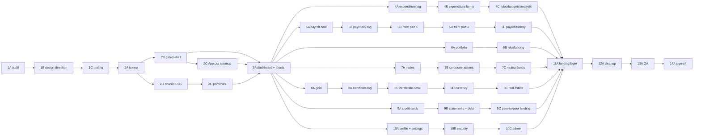

# FinStat — UI/UX Overhaul

**Action Plan & Progress Tracker — v9 (Governance Integration & Sequential Phase Renumbering)**

| Field | Value |
| :--- | :--- |
| Version | 9.0 |
| Revised | 2026-11-09 |
| Supersedes | v8 (2026-11-07), v7, v6, v5, v4, v3, v2, v1 |
| Direction | Flat graphite, one neutral action style, no accent hue, IBM Plex Sans. Chosen by the developer in 1B (D12–D18) |
| Acceptance target | Three reference frames in `docs/UI-UX_Plan/reference/`, two or three variants each, with stress data |
| Scope | Presentation only. No route, API, calculation, permission, or schema changes. |
| Input | `docs/UI-UX_Plan/Comments.md` (review rounds 1–6) + Post-Audit Architecture (Phases 7A–8C) |
| Working model | AI agents implement; the developer reviews, signs off, and performs manual verification. No time estimates are tracked. |

**What changed in v9 (Governance Integration & Sequential Phase Renumbering)**

1. **Sequential phase & sub-phase renumbering (14 phases, 37 sub-phases):** Renumbered the roadmap into 14 sequential phases (`Phase 1` through `Phase 14`) and 37 sub-phases (`1A`–`14A`), removing legacy Phase 0 identifiers, flattening legacy numeric sub-sub-phase suffixes, and formalizing `2C` (`App.css` `!important` removal) as a side branch off `2B` merging before `3A`.
2. **Local verification environment governance (§15 integrated):** Codified developer workstation memory constraints (OOM on full `npm run build` or full 504-test suite). Formally designated CI as the authoritative production build, and established local verification rules: `npm start` as CRA compile/ESLint check proxy, single-worker `npx jest --runInBand <suite>` on touched suites only, and changed-file linting.
3. **Cross-reference & governance reconciliation:** Realigned all exit gates across Phases 1–14, synchronized the 75-route matrix (65 rendering + 10 redirects) and allowlist expansion schedule (§5.10), resolved invariant numbering (I8–I16), updated chart surfaces, CSS inventory burn-down schedule (§8.1), and added top-level traceability disclaimers to Appendices A–F.

**What changed in v8 (Post-Audit Reconciliation)**

1. **Post-audit Dashboard architecture integrated (Phase 3A):** Reconciles Phase 3A with the decomposed frontend architecture established in Phase 8B (`AUD-ARCH-001`). `DashboardSummary.js` is no longer a 1,116-line monolith — it is a lean 110-line coordinator strictly capped at $\le 120$ lines (Invariant I8). The 7 decoupled widget components under `frontend/src/pages/dashboard/` (`AssetAllocationDonut`, `BudgetPulseCard`, `DashboardKpiStrip`, `HoldingsGrid`, `NetWorthHero`, `ReportsGrid`, `SavingsForexCard`) and `useDashboardData.js` are explicit targets. Chart theme is consumed directly inside `AssetAllocationDonut.js`, and all 10 RTL dashboard tests must remain green.
2. **Enterprise Account Switcher integrated into Shell (Phase 2B):** `Sidebar.js` now mounts `<AccountSwitcher />` (`AccountSwitcher.css`, 371 lines), managing delegated user profiles, role clamping (`view_only`), active account popover, amber delegation banner, and family office rollup modal. Shell tokenization in Phase 2B covers these components.
3. **Module 23 Peer-to-Peer Lending Tracker added as Sub-phase 9C:** Dedicated sub-phase covering personal promissory loans, repayments, and counterparty relationships across 3 routes (`/lending`, `/lending/persons/:id`, `/lending/loans/:id`) and 2 modals.
4. **Route matrix expanded to 65 rendering routes:** Added 8 net-new rendering routes introduced during the audit (`/expenditures/bills`, `/salary/simulator`, `/reports/financial`, `/analytics/purchasing-power`, `/settings/recycle-bin`, and the 3 lending routes). Total route entries increase from 67 to **75** (65 rendering + 10 redirects).
5. **Sub-phase count updated from 36 to 37:** Reflects the addition of Sub-phase 9C (Peer-to-Peer Lending).
6. **Test baseline synchronized:** Retains full 504-test baseline across 44 suites (334 backend + 170 frontend) with zero regressions allowed during visual overhaul.

**What changed in v7**

1. **Generated tokens are separated from hand-written theme CSS.** `tokens.css` is generated and contains only the `:root` block; `theme.css` holds hand-written primitives; `theme-components.css` holds the `.fs-page` overrides. Only `tokens.css` is stylelint-exempt, and both theme files are stylelinted at zero (K1, §9.2, §6.6 2A).
2. **The radius allow-list accepts pills.** The pattern includes `var(--fs-radius-pill)`, so status chips and avatars pass without admitting arbitrary radii (K2, §4.8, §9.2).
3. **Tone entry points are classes and primitives.** `.fs-progress--warning` and `.fs-progress--negative` join `Delta` and `Badge`; page CSS and JSX never name a tone token (K3, §4.3, 4C/6A/6B/7A/8A/8B/8C/8E/9A/9B).
4. **Thresholds and labels are audited before use.** §4.3.1 records the existing source for every conditional tone; a row with no source stays neutral and unlabeled (K4, 1A).
5. **1A checks tables, not CSS.** `tokens.js` writes and checks only the §4.9 tables in 1A; `tokens.css` and the sentinel-delimited `:root` block arrive in 2A (K6).
6. **Lint coverage is complete.** ESLint covers inline background images, filters, shadows, border shorthands and radius, plus named and functional colour literals; stylelint also bans mask and border-image gradients (K7, K8).
7. **The fallback font stack is portable.** `local('Arial'), local('Liberation Sans'), local('Helvetica')` keeps the adjusted fallback active on Linux and many Android setups (K9, §4.5, 2A, §9.5, R22).
8. **AD13 is communicated.** The Phase 3 announcement and the 4A changelog explain that colour now only means something needs attention (K10, §3.2, 3A, 4A, §7.2).
9. **Housekeeping:** footer moved to the end, AD1–AD13 recorded, and the primitive count is seven everywhere (K5, K11).

**Round-6 items → where fixed**

| ID | Item | Fix |
| :--- | :--- | :--- |
| K1 | `theme.css` cannot be both generated and hand-written; its lint exemption contradicts the zero rule | New generated `tokens.css` holds only `:root`; `theme.css` and `theme-components.css` are hand-written and stylelinted at zero (§9.2, 2A, §8.1) |
| K2 | Radius allow-list rejects status chips and avatars | Pattern includes `var(--fs-radius-pill)`; `50%` remains banned (§4.8, D15, I15, 1C, §9.2) |
| K3 | Phase tasks name tone tokens that `lint-tones.js` forbids | `.fs-progress--warning` / `.fs-progress--negative`; tasks name the class, `Delta`, or `Badge` (§4.3, 4C/6A/6B/7A/8A/8B/8C/8E/9A/9B) |
| K4 | Tone rules need thresholds and labels the app may not have | §4.3.1 provenance audit in 1A; no source means neutral and no label; no new calculation (I5, R30) |
| K5 | Primitive count is inconsistent | Seven primitives everywhere, including `Delta` (§8.4, 2E, §13, Appendix A) |
| K6 | 1A cannot pass its own token gate; the generator needs markers and Status notes | 1A checks §4.9 only; sentinel block and per-pair Status text are defined for 2A (§6.5, §4.9) |
| K7 | ESLint misses inline images, filters, shadows, borders, radius, and string colours | Expanded key selector plus named/functional `Literal` and `TemplateElement` selectors (§9.2, 1C) |
| K8 | Remaining gradient routes pass lint | `mask`, `-webkit-mask`, `-webkit-mask-image`, and `border-image-source` added (§9.2, I14, 1C) |
| K9 | `local('Arial')` fails on Android and many Linux installs | Fallback stack is Arial, Liberation Sans, Helvetica (§4.5, 2A, §9.5, R22) |
| K10 | AD13 has no user communication | Phase 3 announcement and 4A changelog line (§3.2, 3A, 4A, §7.2) |
| K11 | Footer is in the wrong place; Appendix C says AD1–AD12 | Footer moved to the end as v7; AD1–AD13 recorded (§6.6, Appendix C, Appendix F) |

**What changed in v6**

1. **Shared component overrides move to a new file.** v5 required every file behind an allowlisted route — including `Table.css`, `Form.css`, `Modal.css` and `index.css` — to be at zero. Those files still hold legacy hex, so the 3A gate was unsatisfiable. Every `.fs-page` override now lives in `frontend/src/styles/theme-components.css`; the shared legacy files are untouched before Phase 12, and the zero rule covers page CSS + `theme.css` + `theme-components.css`, with generated `tokens.css` exempt (E1, K1, §9.2).
2. **The tone table covers the rest of the product, and I14 is enforced.** Card utilization, yield, ROI, FX, unrealised change, rebalancing drift and gold get normative rows; a `Delta` primitive and a token ban make the rule mechanical rather than review-only; AD13 records that ordinary amounts lose red/green (E2, §4.3, §6.6 2E).
3. **The anti-slop lint closes further holes:** prefixed `background-clip`, `filter: blur()` / `drop-shadow()`, named and functional colours, a non-leaky radius pattern, and a gradient selector that matches any receiver (E3, §9.2).
4. **Tokens have one source.** `frontend/src/styles/tokens.json` generates both `tokens.css` (the `:root` block) and the §4.9 tables; `tokens.js --check` fails CI on any difference (E4, K1, K6).
5. **The raised surface is measured.** §4.9 gains a raised column and a 3:1 rule for controls and charts placed on it; widening the ramp in 1B forces `--fs-border-control` to move with it (E5).
6. **The ratchet compares against the merge base**, not a committed JSON file, so parallel phase branches stop colliding (S1, §9.2).
7. **The font fallback is wired up.** `--fs-font-sans` lists the adjusted fallback face, the override targets `local('Arial')`, the JS preload is dropped as marginal, and CLS is measured in Lighthouse because `fonts.ready` hides FOUT (S2, §4.5). v7 widens the stack to Arial, Liberation Sans, and Helvetica (K9).
8. **Overlay and platform tokens exist:** `--fs-scrim`, `::selection`, scrollbar, and tooltip surfaces (S3, §4.1).
9. **Register wording corrected:** "grid and information order identical", because AD8 and AD10 deliberately change chrome and type (S4).
10. **Housekeeping:** footer version, progress-log ordering, and the chrome-border exception to "decorative only" (S5).

**Round-5 items → where fixed**

| ID | Item | Fix |
| :--- | :--- | :--- |
| E1 | "Shared CSS at zero" is unsatisfiable before Phase 12 | New `theme-components.css`; shared legacy files untouched; zero rule redefined (§9.2, §6.6 2D, §8.1) |
| E2 | Stale tone instructions; no rows for utilization, yield, ROI, FX, unrealised change, drift, gold; I14 unenforceable | §4.3 domain table extended; 6A/6E/7A/7B/§4.15/D3 corrected; `Delta` primitive; token ban; AD13 |
| E3 | Lint holes: prefixed `background-clip`, `filter`, named and functional colours, leaky radius regex, member-expression gradients | §9.2 config; 1C negative tests |
| E4 | Tokens have two sources of truth | `tokens.json` generates `tokens.css` (`:root`) and §4.9; `--check` in CI |
| E5 | Widening the ramp breaks 3:1 on raised | §4.9 raised column; rule 7; 1B re-tune |
| S1 | Ratchet baseline conflicts across parallel branches | Compare against the `origin/main` merge base; no committed baseline |
| S2 | Font fallback not wired; preload marginal; CLS unmeasured | `--fs-font-sans` lists the fallback; Arial/Liberation Sans/Helvetica stack; no JS preload; Lighthouse CLS |
| S3 | Missing scrim, selection, scrollbar, tooltip tokens | §4.1 platform-surface table; freeze in 1B |
| S4 | "Layout must be identical" contradicts AD8/AD10 | Reworded to "grid and information order identical" |
| S5 | Footer and progress-log ordering; border called "decorative only" | Footer v6; log re-ordered; chrome-border exception stated |

**Prior rounds.** v5 closed the round-4 fixes (Appendix D); v4 replaced §4 with a measured flat graphite contract (Appendix C); v3 fixed allowlist timing, gating and the deterministic harness (Appendix B); v2 and v1 established the phase plan and the route matrix (Appendix A).

---

## 0. How to use this document

1. This is the single source of truth for the overhaul. Update it at the end of every sub-phase.
2. Every task is a checkbox. Each sub-phase ends with an update to:
   - the **Phase Board** (§6.1)
   - the **Route Coverage Matrix** (§5)
   - the **Progress Log** (§10)
3. A sub-phase is `DONE` only when its **Exit Gate** and its parent phase's **acceptance criterion** pass. Partial work is `IN PROGRESS`, never "mostly done".
4. Work is serial by sub-phase across 14 sequential phases (37 sub-phases 1A–14A). Execution order is strictly linear, with 2C running as an App.css !important removal branch off 2B that merges before 3A.
5. Each sub-phase gets its own branch named `phase-ui-*`, for example `phase-ui-4a-expenditure-log`. See §14.
6. Coverage counts in §5 are generated by `frontend/scripts/ui-coverage.js` (initial audit script; Phase 1C adds `--assert-allowlist`). Do not hand-edit counts; regenerate them.
7. There are **no time estimates**. Progress is tracked by sub-phase status, not by elapsed days.

### Status vocabulary

| Marker | Meaning |
| :--- | :--- |
| `[ ]` | Not started |
| `[~]` | In progress (some tasks complete) |
| `[x]` | Complete and verified |
| `[!]` | Blocked (record reason in §11) |
| `[-]` | Deferred / out of scope (record reason in §13) |

---

## 1. Purpose, problem & success criteria

### 1.1 Problem statement

The product has no consistent visual identity. Across 65 rendering routes the UI mixes teal, purple, pink, red, light, and dark surfaces, with 1,298 raw hex literals in 49 CSS files and 1,087 inline `style={{` props. For a product that displays a user's money, that inconsistency reads as unreliability and makes every new page a fresh design decision.

The overhaul replaces page-local styling with one token system, one shell, one set of shared primitives, and one chart theme, while preserving all behaviour. It also removes the dashboard's own gradient-and-glass styling: that page is the most-copied pattern in the app, and its palette is Tailwind's defaults rather than a design decision.

### 1.2 Measurable outcomes

| # | Outcome | Target | Measured by |
| :--- | :--- | :--- | :--- |
| M1 | Raw hex in app CSS | **0** in page CSS, `theme.css`, and `theme-components.css`; only generated `styles/tokens.css` contains literal colours (and `constants/categories.js`, which is data) | stylelint `color-no-hex` + CI grep |
| M2 | Inline style props | **1,087 → 0 colour-bearing**; dynamic values allowed only via CSS custom properties | `ui-coverage.js` + ESLint `no-restricted-syntax` |
| M3 | Accessibility | WCAG 2.1 AA: text ≥ 4.5:1, large text ≥ 3:1, non-text UI (borders, icons, focus) ≥ 3:1 | 1A contrast table + Playwright axe |
| M4a | Automated a11y — structure | **0 serious/critical** ARIA/role/label violations | jest-axe |
| M4b | Automated a11y — colour & layout | **0 serious/critical** violations on all 65 rendering routes | Playwright axe, real browser |
| M5 | Lighthouse accessibility | **≥ 90** per audited route | Lighthouse CI (manual run recorded per phase) |
| M6 | Visual stability | No unintended diff against the 1C baseline; legacy routes diff-clean until their own phase | Playwright visual regression |
| M7 | Route safety | **75/75** route entries resolve (65 rendering + 10 redirects); **10/10** redirects intact | `App.test.js` + route guard test |
| M8 | Calculation correctness | Every calc-bearing fixture set byte-identical to the 1C characterization snapshot | `tests/calculations.spec.js` |
| M9 | Support load | No increase in tickets or task-failure rate on the top five flows | post-release check (manual) |

**Why M4 is split:** jest-axe runs in jsdom, which has no layout engine. It can verify roles, labels, and ARIA wiring; it cannot compute contrast. Contrast must be measured by axe in a real browser against the rendered composited surface.

### 1.3 Qualitative validation

- Before Phase 1 (establishing unmigrated baseline) and after Phase 14, run **3–5 walkthroughs** of the top five flows: log an expense, create a paycheck, add a trade, add a credit-card transaction, review the dashboard.
- Add one timed task to every walkthrough: *"find every expense in one category for the last three months"*. Category colour is removed by D14, so this is the flow that can get slower; record seconds and errors before and after (G3).
- Record observations in §10 using the sub-phase note template.
- Internal dogfooding on `main` after each sub-phase merge (see §3).

### 1.4 Non-goals

Listed in §13. The plan does **not** introduce light mode, RTL, a design-system package, print layouts, or any backend change.

---

## 2. Scope & invariants

These are **rules verified at every sub-phase**, not pre-completed tasks. The implementing agent states compliance in the PR description; the developer verifies. If a rule is broken, the branch is not merged (see §14).

| # | Rule | Verification |
| :--- | :--- | :--- |
| I1 | Production routes and URLs unchanged — 75 entries (74 protected + `*`), 10 redirects. | `App.test.js` route-resolution test; `ui-coverage.js` diff |
| I2 | No API call, payload shape, or service file changed. | PR diff review; blocked path list in CI |
| I3 | No calculation changed on **any** page: payroll, installment schedules, debt payoff, trade P&L, certificate maturity/interest, FX conversion, budget thresholds, real-estate yield. | Characterization fixtures (§9.6) |
| I4 | Auth, roles, `ProtectedAction`, and `useCanModify` gating unchanged. | Viewer-role checklist per phase |
| I5 | Test IDs, `data-*` attributes, and accessible labels preserved — 37 `data-testid`, 39 `aria-label`. | test-ID guard script (§9.2) |
| I6 | Tables render as compact-expand cards at ≤ 768px (D19). Horizontal scroll preserved only for tables with ≥ 12 columns (audit logs) where the card pattern is impractical. No page-level horizontal scroll at 390px. | 390 px visual check: card layout renders, no page-level horizontal scroll, all fields reachable via expander. |
| I7 | No page loses functionality mid-migration. | Pattern added only in the converting PR (§6.3) |
| I8 | Dashboard coordinator line cap preserved — `DashboardSummary.js` must remain $\le 120$ lines (post-audit architecture decomposition invariant). All 10 RTL dashboard tests must remain green. | Line count assertion + `npm test` in 3A |
| I9 | Production build passes with zero errors and no new warnings. | CI (authoritative); local proxy via `npm start` + ESLint/stylelint (§15) |
| I10 | `npm test -- --watchAll=false` passes for touched modules **and** the app route suite. | CI (frontend test job added in 1C); local proxy: touched suites via `npx jest --runInBand` (§15) |
| I11 | No new `!important`; a file's count in the 1C lint ratchet may only fall. | stylelint + `lint-ratchet.js` (§9.2) |
| I12 | No new dependency except the Phase 1C tooling list (§9.2). | `package.json` review |
| I13 | Every non-allowlisted route is **pixel-identical** to its 1C baseline. | Playwright zero-diff gate (§7.1) |
| I14 | No `backdrop-filter`, gradient, gradient text, glow, `filter: blur()` / `drop-shadow()`, `text-shadow`, `mask`, `-webkit-mask`, `-webkit-mask-image`, `mask-image`, `border-image`, or `border-image-source` anywhere in app CSS or JS; only the reference frames illustrate them. | stylelint (§9.2) |
| I15 | Neutral by default: a tone encodes **deviation from expectation or attention**, never the sign of an ordinary amount. Expense amounts, income, and balances are neutral (§4.3). A page never references a tone token directly; it uses `Delta`, `Badge`, or a `.fs-progress--*` modifier. | stylelint + `lint-tones.js` + §4.3 domain table + §7.2 |
| I16 | No radius above 8 px except `var(--fs-radius-pill)` on status chips and avatars. | stylelint (§9.2) |

**Owner of an invariant breach:** the implementing agent. **Decision to revert:** the developer; recorded in §10 with the SHAs.

---

## 3. Release & communication plan

### 3.1 Release model

- **One branch per sub-phase** (for example `phase-ui-5c-paycheck-form-a`). The branch carries the conversion, its tests, and its screenshots.
- Every step is **documented and staged**: commits are small and labelled, the branch is verified locally, and the developer reviews the diff before merge.
- **The developer merges to `main`** once the sub-phase's exit gate and manual checks pass. Merge is the release event: CI on `main` builds and deploys to production via Vercel (`.github/workflows/ci.yml`).
- **There is no staging environment and no per-PR preview deployment.** The allowlist (§6.3) plus the gated shell and gated body (§4.14) are the safety mechanism: only converted routes change.
- Phase 12 removes the gate. That is the only merge in which every route changes at once.
- **Taste checkpoints are part of the release model.** 3A and the first sub-phase of every cluster (4A, 5A, 6A, 7A, 8A, 9A, 10A, 11A) require the developer to approve a rendered screen against its reference frame before the next sub-phase starts. See §6.1.1.
- Sub-phases must be merged **in dependency order** (§6.2). A sub-phase branch that depends on an unmerged branch is rebased, never merged out of order.

### 3.2 User-facing communication

- Add a "What's new" bullet to `CHANGELOG.md` per sub-phase, written for users, not developers.
- Publish one short in-app announcement at Phase 3, Phase 5, and Phase 11 (dashboard, payroll, and login are the most visible surfaces).
- The Phase 3 announcement must include one line explaining the shell switch: *"Pages you haven't updated yet still use the old navigation; we're converting them one at a time."* Without it, users read the change as a bug.
- The Phase 3 announcement and the 4A changelog entry must state: *"Colour now only means something needs attention: ordinary amounts are neutral, so red or green always signals a change in your money or an action."* Without it, AD13 reads as a regression.
- Provide a feedback channel: GitHub issues labelled `ui-overhaul`, plus a named owner for triage.

### 3.3 Support readiness

- Before each merge, the support owner gets: routes changed, screenshots, and the one-line "what to tell users" note.
- If a phase causes a support spike, revert the merge commit first and investigate second.

### 3.4 Cluster sequencing

Pages that share a sub-navigation, a form component, or a table are converted **consecutively**, not spread across phases. The clusters are:

| Cluster | Members |
| :--- | :--- |
| Expenditure | log, add, edit, rules, budgets, recurring, analysis |
| Payroll | profiles, rules/taxes, paychecks, paycheck form, history, update, analytics |
| Investments | trades, trade summary, corporate actions, mutual funds |
| Assets | gold, certificates, currency, real estate |

A cluster's shared component (sub-nav, tab bar) keeps its legacy classes and only adopts `.fs-*` styling under `.fs-page` until the **last** page in the cluster is converted. See §4.16.

---

## 4. Design & accessibility contract

Tokens freeze at the end of **Phase 1B**. No phase renames a token. New tokens may be added only by amending this section and recording the change in §10.

**Direction (D12–D18):** a flat graphite surface, one neutral action style, no accent hue, no blur, no gradients, and colour reserved for deviation — gain, loss, warning. The visual identity comes from alignment, density, type, and one step of surface elevation — not from decoration.

**Why this replaced the v3 contract.** v3 §4 was a tokenized copy of `pages/Dashboard.css`, and that file is itself assembled from Tailwind's defaults: slate 900/400/300/50/500, the 400-level sky/purple/emerald/rose/amber/cyan tones, and indigo 600. Enforcing it across 56 routes would have propagated exactly the look the review rejected. `tokens.css` defines the values and `theme.css` the primitives; `Dashboard.css` is a consumer of them, not their source. The measured palette formalizes the transition from Tailwind slates to neutral flat graphite, eliminating blue tinting and establishing strict 1.11:1 subtle surface elevations. Specifically, Tailwind slate 900 (`#0f172a`), slate 800 (`#1e293b`), and slate 700 (`#334155`) map to `--fs-bg` (`#101114`), `--fs-surface` (`#1a1c20`), and `--fs-surface-raised` (`#22252a`), while primary action indigo 600 (`#4f46e5`) maps to solid neutral `--fs-action-bg` (`#e8eaed`) with `--fs-action-text` (`#0d0e10`).

### 4.1 Surfaces & background

| Token | Value | Use |
| :--- | :--- | :--- |
| `--fs-bg` | `#101114` | Page background — flat, single value |
| `--fs-surface` | `#1a1c20` | Panels, cards, tables, modals |
| `--fs-surface-raised` | `#22252a` | Nested card, row hover, selected row |
| `--fs-surface-sunken` | `#0c0d0f` | Panel table header, chrome plane — 1.044:1 darker than `--fs-bg`, always bordered |
| `--fs-border` | `#34383f` | Dividers between regions that already differ — 1.45:1. Not a control boundary; the chrome edge is the one exception (below) |
| `--fs-border-strong` | `#4a4f57` | Hover emphasis layered **on top of** a control border — 2.07:1, never used alone |
| `--fs-border-control` | `#6a6f77` | **Control boundaries** — 3.37:1 on surface, 3.73:1 on `--fs-bg` |
| `--fs-shadow` | `0 2px 8px rgba(0, 0, 0, 0.35)` | Modals and menus only |
| `--fs-border-width` | `1px` | Every surface boundary |

**Platform surfaces (S3).** These are tokens, not inline values. The modal overlay is `--fs-scrim`, never an alpha black written at the call site.

| Token | Value | Use |
| :--- | :--- | :--- |
| `--fs-scrim` | `rgba(8, 9, 11, 0.72)` | Modal and confirm-modal backdrop |
| `--fs-selection-bg` | `#3a4048` | `::selection` background |
| `--fs-selection-text` | `#f2f3f5` | `::selection` text — 9.42:1 on the selection background |
| `--fs-scrollbar-thumb` | `var(--fs-border-strong)` | Scrollbar thumb (WebKit and Firefox) |
| `--fs-scrollbar-track` | `var(--fs-surface)` | Scrollbar track |
| `--fs-tooltip-bg` | `var(--fs-surface-raised)` | Tooltip and chart-tooltip surface |
| `--fs-tooltip-border` | `var(--fs-border)` | Tooltip border |

- **Flat, always.** The page background is a single declaration: `background: var(--fs-bg);`. No gradient, no radial glow, no texture. Gradients are banned in all app CSS and JS; only the reference frames illustrate them (§9.2).
- **No blur.** `backdrop-filter` is banned in page CSS and in both hand-written theme files. Surfaces are opaque. The app currently has 42 blur uses; each is removed by its owning sub-phase, and lint blocks new ones from 1C.
- **Elevation is a step, not a shadow.** `--fs-bg → surface` and `surface → raised` both measure 1.11:1 — visible at panel size, invisible as a separator, and invisible on a mediocre laptop at low brightness. The step groups; the 1 px border bounds; nothing else may. Any state that differs from its default by less than 3:1 also carries a non-colour cue: a selected row gets a 2 px left rule (or a leading checkbox), zebra never appears without row dividers, and hover is never the only sign that a row is interactive (G1).
- **Chrome is recessed, not elevated (F5, revised in 1B).** `--fs-surface-sunken` `#0c0d0f` is 1.044:1 darker than `--fs-bg`. The step is a hint of depth; the 1 px border remains load-bearing (border-bottom on the navbar, border-right on the sidebar). This is still the one place `--fs-border` is used as a shell edge rather than a divider — the exception to §4.9.2's "fail" status. Inside a panel, the same token renders panel headers darker than `--fs-surface` — a consistent role.

**Border rule (WCAG 1.4.11).** A border that is the *only* thing separating a control from its background must reach 3:1. `--fs-border` and `--fs-border-strong` do not. Use `--fs-border-control` on every interactive control boundary, and `--fs-border` only where the surface step already provides the boundary. The chrome edge is the single exception: it is not a control boundary, it is a shell edge, and the fill beside it is 1.04:1 (§4.9.2).

**Contrast reference surfaces:** `--fs-bg` `#101114`, `--fs-surface` `#1a1c20`, and `--fs-surface-raised` `#22252a`. Every pair is measured against all three; a value that passes only on the page is not a pass (§4.9 rule 7).

### 4.2 Text

| Token | Value | Use | Contrast on surface |
| :--- | :--- | :--- | ---: |
| `--fs-text` | `#f2f3f5` | Headings, primary values | 15.37 |
| `--fs-text-2` | `#c9cdd3` | Body | 10.69 |
| `--fs-text-3` | `#a2a8b0` | Labels, meta, placeholders | 7.12 |
| `--fs-text-4` | `#6f757d` | **Disabled text only** | 3.67 |
| `--fs-placeholder` | `var(--fs-text-3)` | Input placeholder colour | 7.12 |
| `--fs-ink` | `#0d0e10` | Text on light or solid semantic surfaces | 16.02 on `#e8eaed` |

**Placeholder rule.** Placeholders are content, not decoration: they must reach 4.5:1. They use `--fs-text-3`, never `--fs-text-4`. The native `::placeholder` pseudo-element is styled explicitly in `.fs-input`, `.fs-textarea`, and `.fs-select`, because browsers apply a default grey that fails.

**The eyebrow token is deleted.** `--fs-eyebrow` and `--fs-tracking-eyebrow` are gone. An uppercase tracked eyebrow above every page is decoration, not information. Section eyebrows are optional and, when a page genuinely needs one, use `--fs-text-3` at `--fs-text-xs` with normal tracking (§6.4).

### 4.3 Semantic tones

A tone encodes **deviation from expectation**, not category and not the sign of an ordinary amount. A number is neutral unless it is better or worse than what the user expected, or unless it needs attention.

| Token | Value | Meaning | Contrast on surface |
| :--- | :--- | :--- | ---: |
| `--fs-positive` | `#4fa87c` | Better than expected: realised gain, under budget, debt paid down | 5.87 |
| `--fs-negative` | `#d97076` | Worse than expected, or destructive: realised loss, over budget, overdue, delete | 5.30 |
| `--fs-warning` | `#cfa24f` | Approaching a threshold or awaiting action: 80–100% of budget, pending, due soon | 7.26 |
| `--fs-neutral` | `var(--fs-text-3)` | Everything else, including every plain amount | 7.12 |

That is the complete tone set. There is no six-tone palette, no category colour, and no `-bg` tint token.

**Per-domain rule (normative).** If a page disagrees with this table, the page is wrong.

| Domain | Neutral (default) | Positive | Warning | Negative |
| :--- | :--- | :--- | :--- | :--- |
| Expense amount | **the amount** | — | — | — |
| Budget progress | under 80%, no label | — | 80–100%, `Warning` label | over 100%, `Over budget` label |
| Realised P&L (trades, portfolio, certificates) | zero | gain | — | loss |
| Unrealised P&L (portfolio, gold) | zero | gain | — | loss |
| Income and paychecks | **gross, net, deductions** | — | — | — |
| Debt and card balance | **the balance** | — | payment due within 7 days | overdue |
| Card utilization | **under 30%, no label** | — | 30–70%, `Elevated` label | over 70%, `High` label |
| Credit limit and available credit | **the figure** | — | — | — |
| Yield and ROI | **the figure** | delta above a stated target, when the comparison is the subject | — | delta below that target |
| FX rate | **the rate** | — | — | — |
| FX change (a change column) | zero | + | — | − |
| Rebalancing drift | within the rebalance threshold | — | at or above the threshold, `Rebalance` label | — |
| Gold | **weight, price, value** | — | — | — |
| Account balance / net worth | **the balance** | change is positive *and* change is what the view is about | — | change is negative *and* change is what the view is about |

Consequences: the expense log has **no red rows**; a budget bar is the only place an expense category shows colour; a paycheck is never green; a debt balance is red only when it is overdue, never because it is debt; a gold holding is never a gold colour; a credit-card bar shows severity, not "healthy green".

**Rules:**

1. **Neutral by default.** Tables, KPI cards, badges, charts, and navigation are neutral. A colour appears only when it encodes a deviation or attention state from the table above.
2. **No tinted pills.** A badge is `--fs-surface-raised` + `--fs-border` + `--fs-text`. A semantic badge adds the tone as **text** plus a 2 px left rule — never a 12% fill.
3. **Colour is the third cue, never the first.** Sign, arrow, and label come first (§4.10).
4. **Category identity is text, not hue.** `constants/categories.js` keeps its hex values as data, and no `tint` field is derived from them. In the log the category is a short text prefix (`.fs-cat`) or the row's group-by control; charts use the neutral ramp plus ranked bars (§4.12). No new icon set is introduced — an icon appears only if it already exists (G3).
5. **Solid semantic fills use `--fs-ink`.** `#0d0e10` on `#4fa87c` is 6.64:1, on `#d97076` 6.00:1, on `#cfa24f` 8.22:1. Never white.
6. **Only the semantic primitives apply a tone.** `Delta` owns amount deltas, `Badge` owns status labels, and `.fs-progress--warning` / `.fs-progress--negative` own meter fills. Page CSS and page JSX never reference `var(--fs-positive)`, `var(--fs-negative)`, or `var(--fs-warning)`; they name a primitive or a class (§6.6 2E). `lint-tones.js` fails any direct token reference outside the hand-written theme files (`theme.css`, `theme-components.css`); generated `tokens.css` is exempt (E2, K1).

#### 4.3.1 Threshold and label provenance

Every conditional tone above is audited in 1A before a page implements it. The audit records the existing source for each threshold and each label, and computes nothing.

| Domain | Condition | Label | Existing source in code (filled by 1A) | If no source |
| :--- | :--- | :--- | :--- | :--- |
| Budget progress | 80–100% | `Warning` | `pages/expenditure/BudgetsPage.js` (`pct >= 80`) & `pages/dashboard/BudgetPulseCard.js` | Neutral, no label |
| Budget progress | over 100% | `Over budget` | `pages/expenditure/BudgetsPage.js` (`pct > 100`) & `pages/dashboard/BudgetPulseCard.js` | Neutral, no label |
| Debt and card balance | payment due within 7 days | `Due soon` | `pages/credit-cards/CreditCardPage.js` & `pages/credit-cards/DebtPayoffPage.js` (`dueDiffDays <= 7`) | Neutral, no label |
| Debt and card balance | overdue | `Overdue` | `pages/credit-cards/CreditCardPage.js` & `pages/credit-cards/DebtPayoffPage.js` (`dueDiffDays < 0`) | Neutral, no label |
| Card utilization | 30–70% | `Elevated` | `pages/credit-cards/CreditCardPage.js` (`utilizationRate >= 30`) | Neutral, no label |
| Card utilization | over 70% | `High` | `pages/credit-cards/CreditCardPage.js` (`utilizationRate >= 70`) | Neutral, no label |
| Yield and ROI | delta against a stated target | target label | *(Audit confirmed no comparative target constant in code)* | Neutral, no delta, no label |
| FX change | positive / negative | sign only | `pages/currency/CurrencyLogPage.js` & `pages/currency/CurrencyDetailPage.js` (`change > 0` / `< 0`) | Sign and arrow only |
| Rebalancing drift | at or above the rebalance threshold | `Rebalance` | `pages/portfolio/RebalancingPage.js` (target allocation drift threshold) | Neutral, no label |
| Account balance / net worth change | positive / negative | sign only | `pages/dashboard/NetWorthHero.js` & `pages/dashboard/DashboardKpiStrip.js` (period delta sign) | Sign and arrow only |
| Realised / unrealised P&L | gain or loss | `Gain` / `Loss` | `pages/trades/TradeSummaryPage.js`, `components/portfolio/HoldingsTable.js`, `components/portfolio/SummaryCards.js` | Sign and arrow only |

1A leaves the source empty when the code has none. An empty source means the row is **neutral and unlabeled**: no target, threshold, figure, or label is computed in the component. Reusing an existing label is allowed; adding a new label requires a recorded decision in §10 and updates to the tests and accessible names (I5).

#### 4.3.2 Interactive accent

The interface carries one accent hue, reserved exclusively for affordances that respond to user interaction. It is not a status tone, not a category hue, not a chart series colour.

| Token | Value | Use |
| :--- | :--- | :--- |
| `--fs-accent` | `#14b8a6` | Primary buttons, inline text links, active navigation state, checked toggle/checkbox/radio, active tab indicator, selected-row left rule |
| `--fs-accent-hover` | `#22c4b3` | Hover state on accent surfaces |
| `--fs-accent-active` | `#0fa192` | Pressed state on accent surfaces |
| `--fs-accent-text` | `var(--fs-ink)` `#0d0e10` | Text on an accent surface — 7.62:1, never white |

**Rules:**

1. **Accent is interactivity, not meaning.** A button is teal because it is clickable. A badge is not teal because "teal means good". If a status needs a colour, it uses `--fs-positive` / `--fs-negative` / `--fs-warning` via Badge or Delta (§4.3). Never use `--fs-accent` for status.
2. **The accent is never white-on-teal.** White on `#14b8a6` is 2.51:1 and fails 4.5:1. Text on accent uses `--fs-ink` (§4.3 rule 5 continues to apply).
3. **Focus rings remain neutral.** On a teal button, the ring is 3px solid `#f2f3f5` at `outline-offset: 2px` — 5.13:1 against the accent, highly visible. If the ring were teal itself it would be 1.6:1 against the button. §4.6's contract is that the ring sits on `--fs-bg`, not on the control it belongs to. The amendment does not change focus ring colour.
4. **One primary per section.** §4.4's button hierarchy rule still applies. The accent marks the primary; it does not colour every button. Secondary actions are neutral; ghost actions are unfilled; dangerous actions are `--fs-danger` and only inside a confirmation step.
5. **Focus rings excluded from "all interactive".** The developer's scope decision covers buttons, links, active nav, checked states, and selection affordances — not focus rings, which stay neutral for the visibility reason in rule 3.
6. **Chart series are never accent.** §4.12's neutral grey ramp plus the three semantic tones remains the complete chart palette. Teal does not appear as a data series.

### 4.4 Actions

| Token | Value | Use |
| :--- | :--- | :--- |
| `--fs-action-bg` | `var(--fs-accent)` | Primary button surface (teal accent) |
| `--fs-action-text` | `var(--fs-accent-text)` | Primary button text — 7.62:1 on accent |
| `--fs-action-hover` | `var(--fs-accent-hover)` | Primary hover |
| `--fs-action-active` | `var(--fs-accent-active)` | Primary pressed |
| `--fs-danger` | `#d97076` | Destructive confirm only; text `--fs-ink` (6.00:1) |
| `--fs-disabled-opacity` | `0.45` | Disabled control |
| Secondary button | `--fs-surface` + `--fs-border-control` + `--fs-text` | Neutral actions |
| Ghost button | no fill (`background: none`), `--fs-border` on hover | Tertiary actions |

- **One action colour, and it is the accent.** The primary button is the teal accent block on the dark page — the strongest interactive signal on the screen, reserved for the one action that matters. Text is `--fs-ink`, never white (white on teal is 2.51:1 and fails). Secondary buttons remain neutral; ghost stays unfilled; danger stays `--fs-danger`.
- **No shadow, no gradient, no glow.** A solid rectangle with `--fs-border-width` and `--fs-radius-sm`.
- **Danger appears only inside a confirmation step**, never as a page-level default.
- **Inline text links are underlined, always.** With no accent hue there is no colour difference between a link and body text, so the underline *is* the affordance: `text-decoration: underline; text-underline-offset: 2px`. Hover thickens it; visited differs by weight, never by colour. **Scope (G5):** the rule covers links inside prose, table cells, and help text. Navigation is not a link style — sidebar items, tabs, breadcrumbs, and whole-card links never underline; they use their own affordance (active state, 2 px left rule, weight 500, `--fs-text` vs `--fs-text-2`).

**Button hierarchy rule:** at most **one** primary button per view or section. Supporting actions are secondary; tertiary actions are ghost.

**Accepted diff:** every gradient primary button becomes a solid neutral block, and every tinted button loses its hue (AD1, §6.6).

### 4.5 Typography & figures

| Token | Value |
| :--- | :--- |
| `--fs-font-sans` | `'IBM Plex Sans', 'Plex Sans Fallback', -apple-system, BlinkMacSystemFont, 'Segoe UI', sans-serif` |
| `--fs-font-mono` | `'IBM Plex Mono', ui-monospace, SFMono-Regular, Menlo, monospace` |
| `--fs-text-xs` | `12px / 16px` |
| `--fs-text-sm` | `13px / 20px` |
| `--fs-text-base` | `14px / 22px` |
| `--fs-text-lg` | `16px / 24px` |
| `--fs-text-xl` | `20px / 28px` |
| `--fs-text-2xl` | `24px / 32px` |
| `--fs-text-3xl` | `32px / 40px` |
| `--fs-weight-regular` | `400` |
| `--fs-weight-medium` | `500` |
| `--fs-weight-semibold` | `600` |

**Three weights, no 700.** Page titles and section headings use 600; table headers and labels 500; body 400. Hierarchy comes from size and weight, never from gradient text, and `.fs-page-title` is plain `color: var(--fs-text)`.

**Self-hosting (1B deliverable).** Four subset files: Plex Sans 400/500/600 and Plex Mono 400, woff2, latin subset, committed under `frontend/src/assets/fonts/` with the OFL licence. Budget: **≤ 90 KB total**. No third-party font CDN — it is slower, it leaks requests, and it makes visual baselines depend on someone else's uptime.

**Loading (G6, S2).** `@font-face` uses `font-display: swap`, not `block`: in a finance app, invisible numerals on a slow connection are worse than a provisional face. Layout shift is handled by a size-adjusted fallback — one extra `@font-face` per family, `src: local('Arial'), local('Liberation Sans'), local('Helvetica')`, with `size-adjust`, `ascent-override`, `descent-override`, and `line-gap-override` tuned so the fallback occupies the same width as Plex. **The fallback face must be named in `--fs-font-sans`**, otherwise it never applies; targeting these metric-compatible faces rather than an arbitrary stack is deliberate, because one `size-adjust` cannot match every OS default, while Liberation Sans is metric-compatible with Arial and covers Linux. Arial is absent on Android and many Linux installs; the Liberation Sans and Helvetica entries keep the adjusted face in use.

**No preload, no JS injection.** A `<link rel="preload">` in `index.html` costs every legacy route, and a preload injected by JavaScript fires after the bundle has run — roughly when CSS would have discovered the face anyway. `swap` plus the adjusted fallback is the whole strategy. Because the visual harness awaits `document.fonts.ready`, it cannot see layout shift; CLS is measured in Lighthouse on `/dashboard` after 3A instead (§9.3).

**Figures.** Numeric cells and metric values use `--fs-font-sans` with `font-variant-numeric: tabular-nums` and right alignment (`.fs-num`). **Mono is for identifiers only** — symbols, account numbers, transaction IDs — never for money. A proportional face with tabular figures keeps columns aligned without the terminal look.

**Arabic.** Plex Sans has a companion family, so if §13 ever opens RTL the pairing exists. Nothing is loaded until then.

### 4.6 Focus, motion, z-index

| Token | Value |
| :--- | :--- |
| `--fs-focus-ring` | `3px solid #f2f3f5` |
| `--fs-focus-offset` | `2px` |
| `--fs-duration-fast` | `120ms` |
| `--fs-duration-base` | `200ms` |
| `--fs-duration-slow` | `320ms` |
| `--fs-ease-standard` | `cubic-bezier(0.2, 0.8, 0.2, 1)` |
| `--fs-ease-decelerate` | `cubic-bezier(0.0, 0.0, 0.2, 1)` |
| `--fs-z-base` | `0` |
| `--fs-z-content` | `1` |
| `--fs-z-sidebar` | `900` |
| `--fs-z-nav` | `950` |
| `--fs-z-overlay` | `1000` |
| `--fs-z-modal` | `1100` |
| `--fs-z-dropdown` | `1200` |
| `--fs-z-toast` | `1300` |
| `--fs-z-tooltip` | `1400` |
| `--fs-z-skip` | `1500` |

**Why a neutral ring with an offset.** The ring is the lightest neutral in the ramp: 15.37:1 on surface, 13.85:1 on raised, 17.00:1 on `--fs-bg`. Drawn *on* the light primary button it would be 1.09:1 — invisible. The contract is therefore:

```css
outline: var(--fs-focus-ring);
outline-offset: var(--fs-focus-offset);
```

The 2 px gap shows the dark page, so the ring is always measured against `--fs-bg`, never against the control it belongs to. The indicator must never be re-implemented as an inset `box-shadow`, because that moves it back onto the button. Focus rings do not use the accent. §4.3.2 rule 3 explains why: on a teal button, a teal ring would be 1.6:1 against its own surface, invisible. The neutral #f2f3f5 ring is 13.85:1 against --fs-bg and 5.13:1 against --fs-accent — visible everywhere.

**Clipping (G4).** A 3 px outline plus a 2 px offset reaches 5 px outside the control's border box. Any ancestor with `overflow: auto | hidden | scroll` clips it — and the app has many: table wrappers, card bodies, tab strips. Two rules:

1. A scroll wrapper that contains focusable children carries `padding: 5px`. The table wrapper is `.fs-table-scroll`; the same padding applies inside any card that scrolls.
2. Where padding is impossible (a tab strip flush with a card edge), the control uses the inset variant: `outline-offset: -3px`, so the ring is drawn inside its own box.

Explicit test cases in every phase: a row action in the first and last table row, the first and last tab, and a checkbox at the bottom of a scrolling table.

Apply to `:focus-visible` on every interactive element, including links, table rows with row actions, tab items, and custom checkboxes. Never remove the outline without this replacement.

**Skip link** sits at `--fs-z-skip`, above tooltips, and is the first focusable element in the document.

`@media (prefers-reduced-motion: reduce)` sets all durations to `0ms` and disables transform-based transitions. `.fs-skeleton` becomes a **static** block with no shimmer animation, and its `aria-busy` region keeps the loading text.

**Z-index audit (1A deliverable).** Audited in 1A across 20 CSS files: **29 non-zero declarations** mapped to the authoritative 9-tier scale with semantic rationales (do not blindly replace in production):

| File:line | Selector | Value | Mapped token | Semantic rationale |
| :--- | :--- | ---: | :--- | :--- |
| `components/common/ConfirmModal.css:12` | `.confirm-modal-overlay` | 1100 | `--fs-z-modal` (1100) | Exact 1:1 match with dialog overlay level |
| `components/common/Toast.css:6` | `.toast-container` | 99999 | `--fs-z-toast` (1300) | Legacy ad-hoc maximum mapped to semantic toast tier; sits above modal (1100) and dropdown (1200) but below tooltip (1400) and skip link (1500) per §4.6 |
| `components/common/UndoToast.css:7` | `.undo-toast-wrapper` | 9999 | `--fs-z-toast` (1300) | Toast notification tier above modals |
| `components/common/ViewOnlyBanner.css:15` | `.view-only-banner` | 40 | `--fs-z-nav` (950) | View-only banner anchors at the viewport top alongside headers; elevates above regular content (1) |
| `components/creditCards/UtilizationWidget.css:80` | `.threshold-marker-30` | 2 | `--fs-z-content` (1) | Local layering within chart card stacking context |
| `components/dashboard/AppLauncher.css:6` | `.launcher-backdrop` | 2000 | `--fs-z-modal` (1100) | Fullscreen launcher backdrop belongs to modal overlay tier |
| `components/layout/AccountSwitcher.css:163` | `.account-switcher-dropdown` | 1000 | `--fs-z-dropdown` (1200) | Header dropdown popover must sit above navigation bar (950) |
| `components/layout/AccountSwitcher.css:251` | `.family-rollup-modal-backdrop` | 9999 | `--fs-z-modal` (1100) | Modal overlay semantics |
| `components/Modal.css:12` | `.modal-overlay` | 1000 | `--fs-z-overlay` (1000) | Base overlay dimming layer |
| `components/Navbar.css:16` | `.navbar` | 900 | `--fs-z-sidebar` (900) | Chrome navigation container |
| `components/Sidebar.css:9` | `.sidebar` | 1000 | `--fs-z-sidebar` (900) | Unified persistent shell sidebar tier |
| `components/Sidebar.css:155` | `.sidebar` (mobile) | 1200 | `--fs-z-dropdown` (1200) | Drawer menu popover when open on small screens |
| `components/Sidebar.css:172` | `.sidebar-backdrop` | 1100 | `--fs-z-modal` (1100) | Mobile sidebar backdrop blocking background page clicks |
| `components/Sidebar.css:194` | `.mobile-toggle` | 1300 | `--fs-z-toast` (1300) | Floating hamburger trigger remains accessible above mobile backdrop |
| `components/Table.css:93` | `.tooltip-container:hover::after` | 1 | `--fs-z-content` (1) | Pseudo-element tooltip within local table cell; modernized to `--fs-z-tooltip` (1400) in Phase 2E |
| `pages/admin/AdminDashboard.css:301` | `.modal-overlay` | 1000 | `--fs-z-overlay` (1000) | Modal backdrop layer |
| `pages/admin/BackupPage.css:387` | `.restore-modal-overlay` | 9999 | `--fs-z-modal` (1100) | Modal dialog overlay |
| `pages/admin/TaxConfigPage.css:392` | `.admin-modal-backdrop` | 1000 | `--fs-z-overlay` (1000) | Modal backdrop layer |
| `pages/credit-cards/StatementCyclePage.css:91` | `.cycle-timeline-track::before` | 1 | `--fs-z-content` (1) | Timeline track graphic decoration |
| `pages/credit-cards/StatementCyclePage.css:96` | `.timeline-milestone` | 2 | `--fs-z-content` (1) | Milestone node decoration above timeline track |
| `pages/Dashboard.css:309` | `.dash-hero-card > *` | 1 | `--fs-z-content` (1) | Internal stacking context within hero card |
| `pages/Dashboard.css:1339` | `.dash-fab` | 950 | `--fs-z-nav` (950) | Floating action button anchored with navigation layer |
| `pages/expenditure/RecurringBills.css:226` | `.modal-overlay` | 1000 | `--fs-z-overlay` (1000) | Modal backdrop layer |
| `pages/expenditure/RulesPage.css:250` | `.modal-overlay` | 1000 | `--fs-z-overlay` (1000) | Modal backdrop layer |
| `pages/LandingPage.css:64` | `.content-wrapper` | 10 | `--fs-z-content` (1) | Content container above hero gradient background |
| `pages/lending/Lending.css:331` | `.lending-modal-backdrop` | 1000 | `--fs-z-overlay` (1000) | Modal backdrop layer |
| `pages/salary/SalaryProfilePage.css:238` | `.modal-backdrop` | 1000 | `--fs-z-overlay` (1000) | Modal backdrop layer |
| `pages/security/SecuritySettingsPage.css:191` | `.security-modal-overlay` | 1000 | `--fs-z-overlay` (1000) | Modal backdrop layer |
| `pages/trades/CorporateActionsList.css:267` | `.ca-modal-overlay` | 9999 | `--fs-z-modal` (1100) | Corporate actions wizard modal overlay |

### 4.7 Breakpoints

QA widths were not the CSS breakpoints. The codebase uses 33 distinct `max-width` values; the dominant ones are 768 (×23), 480 (×10), 600 (×9), 1200 (×6), 1024 (×3). 390 is never used.

| Token | Value |
| :--- | :--- |
| `--fs-bp-sm` | `480px` |
| `--fs-bp-md` | `768px` |
| `--fs-bp-lg` | `1024px` |
| `--fs-bp-xl` | `1200px` |

**Mandatory QA widths:** 1440, 1024, 768, 480, 390. 1200 is smoke-checked only.

### 4.8 Geometry

| Token | Value |
| :--- | :--- |
| `--fs-radius-sm` | `4px` |
| `--fs-radius-md` | `6px` |
| `--fs-radius-lg` | `8px` |
| `--fs-radius-pill` | `999px` |
| `--fs-space-1..6` | `4 / 8 / 12 / 16 / 24 / 32px` |
| `--fs-control-height` | `40px` (36px compact) |
| `--fs-touch-target` | `44px` (minimum at ≤ 768px) |
| `--fs-border-width` | `1px` |

**Radius ceiling: 8 px.** Inputs, buttons, and badges are 4 px; cards 6 px; modals and large panels 8 px. The ceiling applies to rectangular surfaces; `var(--fs-radius-pill)` (999 px) is the only exception and exists only for status chips and avatars — a pill is not a button. `50%` is not allowed.

The 14–22 px radii in `Dashboard.css` (16 / 22 / 12 px at lines 85, 108, 133, 243, 287) are outside the ceiling and are removed in 3A.

### 4.9 Contrast table — generated baseline

Emitted by `frontend/scripts/tokens.js` from `frontend/src/styles/tokens.json`, which is the only place a token value is written. **The file is the source of truth**: `--write` regenerates this section, and from 2A the `:root` block in `tokens.css`; CI runs `--check` and fails if either differs. Hand-typed values drift — the v4 table reported `--fs-text` at 17.00 on `--fs-surface` while the focus-ring row reported 15.37 for the same hex (F4). Computed 2026-10-31 against `--fs-surface` `#1a1c20`, `--fs-bg` `#101114`, and `--fs-surface-raised` `#22252a`. No compositing, no glass column.

#### 4.9.1 Text pairs

| Pair | Surface | bg | Raised | Target | Status |
| :--- | ---: | ---: | ---: | ---: | :--- |
| `--fs-text` | 15.37 | 17.00 | 13.85 | 4.5 | Pass |
| `--fs-text-2` | 10.69 | 11.83 | 9.63 | 4.5 | Pass |
| `--fs-text-3` | 7.12 | 7.88 | 6.42 | 4.5 | Pass |
| `--fs-text-4` | **3.67** | 4.06 | 3.31 | 4.5 | **Disabled only** |
| `--fs-placeholder` (= text-3) | 7.12 | 7.88 | 6.42 | 4.5 | Pass |
| `--fs-positive` | 5.87 | 6.50 | 5.29 | 4.5 | Pass |
| `--fs-negative` | 5.30 | 5.87 | 4.78 | 4.5 | Pass |
| `--fs-warning` | 7.26 | 8.03 | 6.54 | 4.5 | Pass |
| `--fs-ink` on `--fs-action-bg` `#e8eaed` | 16.02 | — | — | 4.5 | Pass |
| `--fs-ink` on `--fs-danger` `#d97076` | 6.00 | — | — | 4.5 | Pass |
| `--fs-ink` on `--fs-positive` `#4fa87c` | 6.64 | — | — | 4.5 | Pass |
| `--fs-ink` on `--fs-warning` `#cfa24f` | 8.22 | — | — | 4.5 | Pass |
| White on `--fs-action-bg` | 1.21 | — | — | 4.5 | **Fail — use `--fs-ink`** |
| `--fs-accent` | 6.85 | 7.58 | 6.18 | 4.5 | Pass |
| `--fs-ink` on `--fs-accent` #14b8a6 | 7.76 | — | — | 4.5 | Pass |
| White on `--fs-accent` | 2.49 | — | — | 4.5 | **Fail — use `--fs-ink`** |

#### 4.9.2 Non-text pairs (WCAG 1.4.11, 3:1)

| Pair | Surface | bg | Raised | Status |
| :--- | ---: | ---: | ---: | :--- |
| `--fs-border` `#34383f` | 1.45 | 1.60 | 1.31 | **Fail — dividers only; the chrome edge is the exception** |
| `--fs-border-strong` `#4a4f57` | 2.07 | 2.29 | 1.86 | **Fail — never alone** |
| `--fs-border-control` `#6a6f77` | 3.37 | 3.73 | **3.04** | Pass — no headroom for a wider ramp |
| `--fs-focus-ring` `#f2f3f5` | 15.37 | 17.00 | 13.85 | Pass |
| `--fs-focus-ring` on `--fs-action-bg` | **1.09** | — | — | **Fail on the control — offset required** |
| Step `--fs-bg` → `--fs-surface` | 1.11 | — | — | Grouping only, never a boundary |
| Step `--fs-surface` → `--fs-surface-raised` | 1.11 | — | — | Grouping only, never a boundary |
| Action hover `#f5f6f8` | — | 17.46 | — | Pass |
| Action active `#d5d8dd` | — | 13.21 | — | Pass |
| Chart grey 1 `#8b929b` | 5.43 | — | 4.89 | Pass |
| Chart grey 2 `#b8bec6` | 9.11 | — | 8.21 | Pass |
| Chart grey 3 `#6a7078` | 3.41 | — | **3.08** | Pass — no headroom for a wider ramp |
| Chart grey 4 `#d5d9dd` | 12.02 | — | 10.83 | Pass |
| `--fs-accent` #14b8a6 | 6.85 | 7.58 | 6.18 | Pass — no headroom concerns |
| `--fs-surface-sunken` #0c0d0f vs `--fs-bg` | 1.03 | — | — | **Invisible — the 1 px chrome border is mandatory** |

#### 4.9.3 Platform surfaces

| Pair | Surface | Status |
| :--- | ---: | :--- |
| `--fs-selection-text` on `--fs-selection-bg` | 9.42 | Pass |
| `--fs-tooltip-border` vs `--fs-tooltip-bg` | 1.31 | Structural only — tooltips carry their own surface step |
| `--fs-scrim` composited on `--fs-bg` | 1.04 | n/a — non-content surface (backdrop dimming) |
| `--fs-scrollbar-thumb` vs `--fs-scrollbar-track` | 2.07 | Pass — non-critical affordance |

**Rules derived from the table:**

1. Semantic tones are safe as **text on the dark surface** and as **solid fills with `--fs-ink`**. They are never safe with white text.
2. A control boundary uses `--fs-border-control`. `--fs-border` is for dividers that sit inside an already distinguishable surface.
3. The focus ring is solid `#f2f3f5` and is always drawn at `outline-offset: 2px`, so it sits on `--fs-bg`.
4. `--fs-text-4` is disabled text only. Placeholders use `--fs-text-3`.
5. Every surface step is 1.11:1 or less, so a step is never the only cue for an interactive boundary or a state change; add the border, the left rule, or the checkbox (§4.1, §6.4).
6. `--fs-surface-sunken` is 1.04:1 from the page. Chrome is defined by its border, not its fill.
7. **Anything placed on `--fs-surface-raised` is measured there, not on `--fs-surface`.** A control border or chart colour used on a raised row, card, or selected row must still reach 3:1. `--fs-border-control` is **3.04:1** and chart grey 3 is **3.08:1** — both pass by less than 0.1, so widening the ramp in 1B means re-tuning them in the same pass (E5).
8. **Accent is for interactivity only.** `--fs-accent` reaches 6.48:1 on `--fs-surface` and 7.32:1 on `--fs-bg` — a good non-text contrast for buttons, borders of active states, and checked controls. It fails as text on white and must never be used as a background for white text.

**Drift check.** `tokens.js --write` regenerates the two tables above from `tokens.json`; from 2A it also regenerates the sentinel-delimited `:root` block in `tokens.css`. CI runs `tokens.js --check --tables` in 1A and the full `tokens.js --check` from 2A, which compares both artefacts and fails on any difference. Editing a hex means editing `tokens.json`, never the Markdown or the CSS (E4, F4, K6).

The generated tables above are the authoritative set. 1B adds rows for the platform surfaces (scrim, selection, tooltip) once their values are frozen, and any new pair is added in `tokens.json`, never typed here.

### 4.10 Colour is never the only cue

Every gain/loss, status, or severity value carries at least one secondary cue:

- a sign (`+` / `−`),
- a directional icon (`▲` / `▼`), and
- a text label or `aria-label` (`Gain`, `Loss`, `Overdue`, `Paid`).

This is mandatory, not stylistic: red/green colour deficiency affects roughly 8% of men. With a neutral-default palette it also governs four more cases:

- **Links** carry an underline, because there is no accent hue to distinguish them (§4.4).
- **KPI cards** are neutral; the delta is the only coloured element, and it also carries the sign and the arrow.
- **Chart series** are distinguished by pattern or direct label first; the neutral greys differ in luminance, and the semantic tones differ in both luminance and shape.
- **Ordinary amounts are never coloured** (§4.3). The absence of colour is itself the cue: a red number means something is wrong, not that it is an expense.

### 4.11 Fallbacks

```css
@media (forced-colors: active) {
  .fs-card,
  .fs-btn,
  .fs-input,
  .fs-badge {
    border: 1px solid CanvasText;
    forced-color-adjust: auto;
  }
}

@media (prefers-reduced-motion: reduce) {
  .fs-skeleton {
    animation: none;
    background: var(--fs-surface-raised);
  }
}
```

There is no `@supports` block for `backdrop-filter` any more, because nothing blurs. The app has 42 blur uses and 0 `@supports` blocks today; the blur uses are removed by their owning sub-phases and lint blocks new ones. Opaque surfaces need no transparency fallback.

**Selector names are load-bearing.** There is no `.fs-modal` class in the app. Modals use `.modal-content` (`components/Modal.js`) and `.confirm-modal-content` (`components/common/ConfirmModal.js`). Both are listed in the gating matrix (§4.16).

### 4.12 Chart accessibility

`chartTheme.js` owns both colour and non-colour differentiation:

- a neutral grey series ramp (`#8b929b`, `#b8bec6`, `#6a7078`, `#d5d9dd`) plus the three semantic tones,
- `withAlpha`, `doughnutDefaults`, `barDefaults`, `lineDefaults` — **no `gradientFill`**,
- `ariaLabel(seriesName, points)` for a text summary,
- pattern and direct-label helpers, applied to every multi-series chart, not just as a fallback,
- a data-table alternative for every chart on a critical route.

**Series discipline (G2).** The ramp has seven values — four greys plus three tones — and the greys sit 1.7:1 apart at best. A doughnut with eight slices is unreadable regardless of the pattern applied.

- **Cap at six series.** Anything beyond the top six groups into one neutral "Other" slice. The data table below still lists every category, so nothing is hidden.
- **Ranked horizontal bars, not doughnuts.** Category breakdowns (expenditure analysis, portfolio allocation) render as a ranked horizontal bar chart plus a data table. A doughnut is allowed only for a part-to-whole with **≤ 4** segments.
- **Time series** use lines with a direct label at the last point; never legend-only identification.
- The table alternative is mandatory on a critical route: it is the accessible equivalent and the place where "Other" is expanded.

3A sets this pattern, because every later chart copies it.

Charts must not rely on colour alone, and `canvas` elements need an `aria-label` plus adjacent summary text. Gradient fills and glow effects are banned alongside every other gradient (§9.2).

### 4.13 Decisions (Phase 1B gate)

| # | Decision | Owner | Date | Status |
| :--- | :--- | :--- | :--- | :--- |
| D1 | **Revised:** dark-only **flat graphite** for v1, gated per route via `html[data-fs-theme="dark"]`. `body` is not flipped globally; a gated `html[data-fs-theme="dark"] body` rule is part of the contract (§4.14) | Product owner | 2026-10-31 | `[x]` revised |
| D2 | Revised in 1B: primary actions are solid accent blocks (--fs-accent / --fs-ink). Max one primary per section; secondary/ghost/danger as in §4.4 | Product owner | 2026-10-31 | [x] revised in 1B — 2026-11-09 |
| D3 | Normalize RealEstate pink and Admin red to the semantic set. **Ordinary cost and ordinary balances are neutral**; red is for a realised loss, an over-budget state, or a destructive action (§4.3) | Product owner | 2026-10-31 | `[x]` revised |
| D4 | LandingPage is **retheme-only**, scheduled **last** (Phase 11); login and 2FA preserved | Product owner | 2026-10-31 | `[x]` approved |
| D5 | **The plan and its reference frames are versioned.** `.gitignore` exempts `docs/UI-UX_Plan/`; screenshots stay local. The tracked visual record is the Playwright baseline in `frontend/tests/visual/baseline/` | Product owner | 2026-10-31 | `[x]` revised |
| D6 | WCAG 2.1 AA: 4.5:1 text, 3:1 large and non-text | Product owner | 2026-10-31 | `[x]` approved |
| D7 | Exact route patterns via `matchPath`; no prefix matching before Phase 12 | Engineering | 2026-10-31 | `[x]` approved |
| D8 | Shell (Navbar/Sidebar/Toast) themed only on allowlisted routes via `html[data-fs-theme="dark"]` | Engineering | 2026-10-31 | `[x]` approved |
| D9 | **One branch per sub-phase.** The developer merges to `main` and deploys only after the exit gate and manual review pass. No per-PR preview deployments, no staging environment | Product owner | 2026-10-31 | `[x]` approved |
| D10 | Visual regression uses **route-level fixtures and a frozen clock**; no seeded backend for visuals | Engineering | 2026-10-31 | `[x]` approved |
| D11 | AI agents implement; the developer reviews, signs off, and verifies manually. **No time estimates are tracked** | Product owner | 2026-10-31 | `[x]` approved |
| D12 | **Design direction is human-owned.** Accent, neutral ramp, typeface, and radii are chosen by the developer in 1B. An agent may not choose or substitute them | Product owner | 2026-10-31 | `[x]` approved |
| D13 | **Flat surfaces.** No blur, no gradient, no glow, no gradient text anywhere in app CSS or JS; only the reference frames illustrate them. Enforced by lint (§9.2) | Product owner | 2026-10-31 | `[x]` approved |
| D14 | Revised in 1B: one accent hue — teal #14b8a6 — for interactive affordances only. Semantic tones (positive / negative / warning) unchanged. Category colour remains removed. Accent is never status, never category, never chart series | Product owner | 2026-10-31 | [x] revised in 1B — 2026-11-09 |
| D15 | **Radius ceiling 8 px.** Inputs/buttons/badges 4, cards 6, panels/modals 8; `var(--fs-radius-pill)` only for status chips and avatars. `50%` is not allowed | Product owner | 2026-10-31 | `[x]` approved |
| D16 | **Proportional figures with `tabular-nums`.** Mono is reserved for identifiers | Product owner | 2026-10-31 | `[x]` approved |
| D17 | **Reference screens are the acceptance target.** Three frames (dense table, form, dashboard) live under `docs/UI-UX_Plan/reference/` and are versioned | Product owner | 2026-10-31 | `[x]` approved |
| D18 | **IBM Plex Sans + Plex Mono**, self-hosted, subset, ≤ 90 KB, OFL licence committed | Product owner | 2026-10-31 | `[x]` approved |
| D19 | Mobile table pattern: dense data tables render as compact-expand vertical cards at ≤ 768px with break-word overflow. Horizontal scroll preserved only for tables ≥ 12 columns where the card pattern does not fit | Product owner | 2026-11-09 | [x] approved in 1B |
| D20 | Chrome plane darker than page: --fs-surface-sunken becomes #0c0d0f (1.044:1 darker than --fs-bg). The shell reads as a recessed frame; the 1 px border remains load-bearing | Product owner | 2026-11-09 | [x] approved in 1B |

#### 4.13.1 Options considered and rejected

Recorded at the 1B walkthrough on 2026-11-09:

| Area | Rejected | Chosen | Developer's rationale |
| :--- | :--- | :--- | :--- |
| Palette | Tailwind slate (#0f172a, #1e293b, #334155) | Flat graphite (#101114, #1a1c20, #22252a) | Neutral canvas; blue-tinted slate competed with the accent for visual weight |
| Accent | Full neutral (v8 §4) | Teal #14b8a6 | Keeps the app's spirit; interactive elements need one hue to read as clickable |
| Action affordance | Neutral inverted block | Solid teal accent block | A neutral block disappears against neutral content; the accent is the strongest interactive signal on the page |
| Typeface | Inter / system stack | IBM Plex Sans + Plex Mono | Tabular figures by design; a matching mono for identifiers |
| Radii | 12–16 px consumer-rounded | 4 / 6 / 8 px ceiling | Preserves data density; large radii read as editorial or consumer-grade |
| Mobile table | Horizontal scroll (v8 §6.4) | Compact-expand cards | 85% of usage is mobile; horizontal scroll is hostile on 390 px |
| Chrome plane | #15161a (slightly lighter than page) | #0c0d0f (slightly darker than page) | Recessed frame reads as persistent shell; elevated plane read as a floating band |

### 4.14 Scoping, cascade, and shell decision

- **Scoping:** `.fs-page` on the content wrapper. Shared component overrides are written as `.fs-page .styled-table` etc. **in `theme-components.css`, never in the shared legacy file** (§6.6 2D). `.fs-page .styled-table` (0,2,0) beats `.styled-table` (0,1,0) regardless of import order, so the cascade holds without touching `Table.css`. The one thing that can beat it is a legacy `!important`, so 2D verifies computed styles and the owning page's sub-phase removes that `!important` (R27).
- **`@layer` is rejected for v1.** Unlayered legacy CSS outranks layered CSS, so putting `tokens.css`, `theme.css`, or `theme-components.css` in a layer would make them *lose* to the 57 existing unlayered files. Retrofitting layers means editing every file. Decision: scoping + specificity, with a 1A audit reconciling the baseline: **47 core application declarations** across 10 files (`App.css` 11, `CorporateActionsList.css` 9, `Trades.css` 8, `CorporateActionWizard.css` 7, `ProtectedAction.css` 5, `ReconciliationPage.css` 2, `Expenditure.css` 2, `Sidebar.css` 1, `DebtPayoffPage.css` 1, `Lending.css` 1 added in Module 23). The 56 print declarations in `ComprehensiveReport.css` are `@media print` print styles and are covered by §13 Non-Goals ("print layouts / print stylesheet are out of scope"), which explains why they are not on the core app remediation list. Revisit `@layer` after Phase 12 consolidation.
- **No portals exist.** `src` contains **0** `createPortal` calls, and `package.json` contains no date-picker, select, modal, or headless-UI library that could portal internally (audited in round 2, re-confirmed in round 3). `Modal` and `ConfirmModal` render in-tree with fixed overlays, so `.fs-page .modal-content` applies normally. The one exception is `ToastContainer`, rendered by `ToastProvider` above `<Router>`; toasts are themed via the `html[data-fs-theme]` attribute selector, not `.fs-page`. Adding Radix or any headless library would break this and is forbidden by I12.
- **`index.css` stays light by default.** It currently defines `background-color: #f8f9fa; color: #2c3e50`. A global flip would make unmigrated pages unreadable. Two gated rules are added instead (§6.6 1A):

```css
html[data-fs-theme="dark"] {
  color-scheme: dark;
}

html[data-fs-theme="dark"] body {
  background: var(--fs-bg);
  color: var(--fs-text);
}
```

**Why the body rule is required.** `.fs-page` cannot cover: iOS/Android overscroll and rubber-band areas, the gutters beside a `max-width` container, or the area below a short page. Without the gated body rule those regions show `#f8f9fa` on a themed route.

- **Native controls.** `color-scheme: dark` alone does not reliably style `<option>` backgrounds. The contract includes explicit coverage:

```css
.fs-page select,
.fs-page input[type="date"],
.fs-page input[type="time"],
.fs-page input[type="datetime-local"] {
  color-scheme: dark;
  background-color: var(--fs-surface);
  color: var(--fs-text);
  border: var(--fs-border-width) solid var(--fs-border-control);
  border-radius: var(--fs-radius-sm);
}

.fs-page select option {
  background-color: var(--fs-surface);
  color: var(--fs-text);
}
```

The codebase has **19** `type="date"` inputs and **49** `<select>` elements, so these rules are exercised widely. Verify `option` rendering in Chrome, Firefox, and Safari; Safari historically ignores `option` background in some macOS versions — record the result and fall back to a custom listbox only if a page becomes unreadable.

- **Shell gating:** Navbar/Sidebar rules live under `html[data-fs-theme="dark"]`, so unmigrated routes keep the legacy shell. The remaining mismatch is narrower than in v3: both shells are dark, and the themed one is flat graphite while the legacy one is `#1e1e2e` with a sky active state. Accepted and tracked as R3; mitigated by cluster sequencing (§3.4) and the announcement line (§3.2).
- **Lazy CSS order:** `tokens.css`, `theme.css`, and `theme-components.css` are imported once at the entry point, in that order, after `index.css`. Page CSS is lazily injected later but is either migrated (removed) or loses to `.fs-page` scoping. No rule may depend on import order.

### 4.15 Legacy → token mapping

| Legacy | Replace with |
| :--- | :--- |
| `#009879`, `#007a63` (legacy teal primary) | `--fs-accent` `#14b8a6` — the app's teal heritage returns as the interactive accent, on the darker canvas. Not the primary button's neutral block; not a status tone. Only interactive affordances use it. |
| `#0284c7`, `#4f46e5`, any `linear-gradient` primary | `--fs-action-bg` solid |
| Any `radial-gradient` or `linear-gradient` page backdrop | `background: var(--fs-bg)` |
| `backdrop-filter: blur(...)` | **Removed**, not mapped. Surface becomes opaque |
| `background-clip: text` + gradient headline | `color: var(--fs-text)` |
| `#f8f9fa`, `#ffffff`, `#fdfdff` (light surface) | `--fs-surface` |
| `#2c3e50`, `#333`, `#111827` (dark text) | `--fs-text` |
| `#6c757d`, `#7f8c8d`, `#64748b` (muted text) | `--fs-text-3` (`--fs-text-4` only for disabled) |
| `#ddd`, `#ccc`, `#e9ecef`, `#e2e8f0` (border) | `--fs-border-control` on controls, `--fs-border` on dividers |
| `#28a745`, `#10B981` | `--fs-positive` |
| `#dc3545`, `#e74c3c`, `#e11d48` | `--fs-negative` |
| `#f59e0b`, `#fef3c7` | `--fs-warning` |
| `#3498db`, `#007bff`, `#3b82f6`, `#8B5CF6`, `#6366f1` | `--fs-neutral` (they carried no meaning) |
| RealEstate pink `#f43f5e`, `#ec4899` | Neutral. Pink is not a cost signal; the negative tone appears only through `Badge` or `Delta` for a realised loss, an overdue state, or an over-budget state (§4.3) |
| Admin red `#f87171` heading gradient | `--fs-text` |
| Shadow `0 4px 10px rgba(0,0,0,.1)` | `--fs-shadow` (modals and menus only) |
| `white`, `#fff`, `black`, `rgb()`, `rgba()`, `hsl()` used as a colour | The matching token. Named and functional colours are banned by lint from 1C (E3); only generated `tokens.css` may contain a literal colour |
| `border-radius: 10px` … `22px` | `--fs-radius-sm` / `-md` / `-lg` (4 / 6 / 8) |

The three tone rows name the value behind `Delta`, `Badge`, and `.fs-progress--*`. A page applies one of those entry points and never the token itself (K3).

`constants/categories.js` keeps its hex values as **data** and gains an ESLint exemption. It gains no `tint` field: category identity is the label, not a colour (§4.3).

### 4.16 Gating matrix and dual-mode components

Every file edited before Phase 12 must be gated. This is the authoritative list.

| File | Gate | Notes |
| :--- | :--- | :--- |
| `tokens.css`, `theme.css` | **none** | `:root` and `.fs-*` primitives only; no legacy selector is changed |
| `components/Navbar.css` | `html[data-fs-theme="dark"]` | Rendered above `.fs-page`; uses `--fs-surface-sunken` |
| `components/Sidebar.css` | `html[data-fs-theme="dark"]` | Rendered above `.fs-page`; uses `--fs-surface-sunken` |
| `components/common/Toast.css` | `html[data-fs-theme="dark"]` | `ToastProvider` sits above `<Router>` |
| `components/common/ErrorBoundary.css` | `html[data-fs-theme="dark"]` | Can render with no page wrapper |
| `theme-components.css` — table and form | `.fs-page` | Shadows `Table.css` and `Form.css`; those files are not edited before Phase 12 (E1) |
| `theme-components.css` — modal and confirm modal | `.fs-page` | Shadows `Modal.css` and `ConfirmModal.css`; the overlay uses `--fs-scrim` |
| `theme-components.css` — banners, pagination, summary, cards | `.fs-page` | Shadows `ViewOnlyBanner.css`, `ProtectedAction.css`, `PaginationControls.css`, `SummaryRow.css`, `AnalysisCard.css` |
| `components/DataLoader.js` | `currentColor` | Inherits page colour; no gate needed |
| `App.css` — `!important` removal | **separate PR** | Legacy-visible; diffed on its own |
| `App.css` — `.dashboard-button`, `.loading-spinner` | `.fs-page` | Only used inside pages |

The legacy shared files are absent from this table on purpose: they are **not edited** before Phase 12, so they need no gate. Their `!important` declarations can still beat a `.fs-page` override, which 2D checks in the browser and the owning page's sub-phase resolves (R27).

**Dual-mode shared components.** `ExpenditureSubNav`, `CreditCardSubNav`, and the `PayrollRulesHub` tab bar are used by converted and unconverted pages at the same time. They must:

1. keep their existing class names,
2. receive new styling only through `.fs-page <existing-class>` selectors,
3. be screenshotted in **both** modes until the last page in their cluster is converted.

A component that only looks right inside `.fs-page` will render light-on-light or dark-on-dark on a neighbour page.

---

## 5. Route coverage matrix

Generated from `frontend/src/App.js` by `frontend/scripts/ui-coverage.js`.

**Totals:** 75 route entries · 10 redirects · 65 rendering routes · 64 unique page components (PaycheckFormPage renders on two paths) · 0 unassigned.

The **Phase** column names the sub-phase that converts the route and adds its allowlist pattern. A route is themed only after that sub-phase merges.

### 5.1 Public

| Route | Component | Phase | Theme applied | Visual QA | Notes |
| :--- | :--- | :---: | :---: | :---: | :--- |
| `*` (catch-all → Landing/login) | `pages/LandingPage` | 11A | ☐ | ☐ | Login + 2FA + password reveal. Unknown URLs render here, not a 404. Retheme only. Outside `ProtectedRoute`; sets its own gated attribute. |

### 5.2 Dashboard

| Route | Component | Phase | Theme applied | Visual QA | Notes |
| :--- | :--- | :---: | :---: | :---: | :--- |
| `/dashboard` | `pages/Dashboard` | 3A | ☐ | ☐ | Canonical reference. Coordinator (`DashboardSummary.js`, 110 lines <= 120 cap) + 7 widgets in `pages/dashboard/` + `pages/Dashboard` wrapper. First route on allowlist. |
| `/summary` → `/dashboard` | redirect | 3A | n/a | n/a | Verify redirect intact |

### 5.3 Expenditure

| Route | Component | Phase | Theme applied | Visual QA | Notes |
| :--- | :--- | :---: | :---: | :---: | :--- |
| `/expenditures` | `pages/expenditure/ExpenditureLogPage` | 4A | ☐ | ☐ | 47 inline styles; first pattern added |
| `/expenditures/new` | `pages/expenditure/AddExpenditurePage` | 4B | ☐ | ☐ | + `ExpenditureForm` (22) |
| `/expenditures/edit/:id` | `pages/expenditure/EditExpenditurePage` | 4B | ☐ | ☐ | |
| `/expenditures/rules` | `pages/expenditure/RulesPage` | 4C | ☐ | ☐ | 10 inline styles |
| `/expenditures/budgets` | `pages/expenditure/BudgetsPage` | 4C | ☐ | ☐ | 53 inline styles |
| `/expenditures/recurring` | `pages/expenditure/RecurringSuggestionsPage` | 4C | ☐ | ☐ | 21 inline styles |
| `/expenditures/bills` | `pages/expenditure/RecurringBills` | 4C | ☐ | ☐ | 18 inline styles; upcoming bills calendar |
| `/expenditure-analysis` | `pages/expenditure/ExpenditureAnalysisPage` | 4C | ☐ | ☐ | 32 inline styles; chart |

**Phase 4 count: 8.**

### 5.4 Payroll & salary

| Route | Component | Phase | Theme applied | Visual QA | Notes |
| :--- | :--- | :---: | :---: | :---: | :--- |
| `/salary/profiles` | `pages/salary/SalaryProfilePage` | 5A | ☐ | ☐ | 25 inline styles; + `SalaryForm`, `ComponentTable` (13) |
| `/salary-profile` → above | redirect | 5A | n/a | n/a | Verify redirect intact |
| `/salary/rules` | `pages/salary/PayrollRulesHub` | 5A | ☐ | ☐ | 16 inline styles; tabs |
| `/social-insurance` → above | redirect | 5A | n/a | n/a | `?tab=insurance` |
| `/taxes` → above | redirect | 5A | n/a | n/a | `?tab=taxes` |
| `/salary/paychecks` | `pages/paycheck/PaycheckLog` | 5B | ☐ | ☐ | 34 inline styles |
| `/paycheck-log` → above | redirect | 5B | n/a | n/a | Verify redirect intact |
| `/salary/paychecks/new` | `pages/salary/PaycheckFormPage` | 5D | ☐ | ☐ | **77 inline styles — highest risk**; styled in 5C, allowlisted in 5D |
| `/paycheck-log/new` → above | redirect | 5D | n/a | n/a | Verify redirect intact |
| `/salary/paychecks/edit/:id` | `pages/salary/PaycheckFormPage` | 5D | ☐ | ☐ | Same component |
| `/paycheck-log/edit/:id` → list | redirect | 5B | n/a | n/a | Verify redirect intact |
| `/salary-profile/history` | `pages/salary/SalaryHistory` | 5E | ☐ | ☐ | |
| `/salary-profile/edit` | `pages/salary/EditProfilePage` | 5E | ☐ | ☐ | |
| `/salary-profile/history/edit/:historyId` | `pages/salary/EditHistoryRecord` | 5E | ☐ | ☐ | |
| `/salary-profile/update` | `pages/salary/UpdateSalary` | 5E | ☐ | ☐ | 38 inline styles |
| `/analysis/payroll` | `pages/analysis/PayrollAnalyticsPage` | 5E | ☐ | ☐ | Metric cards; no chart today |
| `/analysis/calendar` → above | redirect | 5E | n/a | n/a | `?cycle=calendar` |
| `/analysis/fiscal` → above | redirect | 5E | n/a | n/a | `?cycle=fiscal` |
| `/salary/simulator` | `pages/salary/TaxSimulator` | 5E | ☐ | ☐ | Egyptian statutory tax simulation |

**Phase 5 count: 19 (11 rendering + 8 redirects).**

### 5.5 Portfolio

| Route | Component | Phase | Theme applied | Visual QA | Notes |
| :--- | :--- | :---: | :---: | :---: | :--- |
| `/portfolio` | `pages/portfolio/PortfolioDashboard` | 6A | ☐ | ☐ | `AllocationChart` |
| `/portfolio/rebalancing` | `pages/portfolio/RebalancingPage` | 6B | ☐ | ☐ | 24 inline styles |
| `/reports/financial` | `pages/reports/ComprehensiveReportPage` | 6B | ☐ | ☐ | Multi-module PDF/Excel consolidated reporting |

**Phase 6 count: 3.**

### 5.6 Investments

| Route | Component | Phase | Theme applied | Visual QA | Notes |
| :--- | :--- | :---: | :---: | :---: | :--- |
| `/trades` | `pages/trades/TradeLogPage` | 7A | ☐ | ☐ | |
| `/trades/add` | `pages/trades/AddTradePage` | 7A | ☐ | ☐ | + `TradeForm` |
| `/trades/new` → `/trades/add` | redirect | 7A | n/a | n/a | Verify redirect intact |
| `/trades/edit/:id` | `pages/trades/EditTradePage` | 7A | ☐ | ☐ | |
| `/trade-summary` | `pages/trades/TradeSummaryPage` | 7A | ☐ | ☐ | 54 inline styles |
| `/corporate-actions` | `pages/trades/CorporateActionsList` | 7B | ☐ | ☐ | 9 `!important` |
| `/corporate-actions/wizard` | `pages/trades/CorporateActionWizard` | 7B | ☐ | ☐ | 14 inline styles |
| `/mutual-funds` | `pages/mutual-funds/MutualFundLogPage` | 7C | ☐ | ☐ | |
| `/mutual-funds/new` | `pages/mutual-funds/AddMutualFundPage` | 7C | ☐ | ☐ | + `MutualFundForm` (15) |
| `/mutual-funds/edit/:id` | `pages/mutual-funds/EditMutualFundPage` | 7C | ☐ | ☐ | |
| `/mutual-funds/summary` | `pages/mutual-funds/MutualFundSummaryPage` | 7C | ☐ | ☐ | |

**Phase 7 count: 11 (10 rendering + 1 redirect).**

### 5.7 Assets

| Route | Component | Phase | Theme applied | Visual QA | Notes |
| :--- | :--- | :---: | :---: | :---: | :--- |
| `/gold-wallet` | `pages/gold/GoldLogPage` | 8A | ☐ | ☐ | |
| `/gold-wallet/new` | `pages/gold/AddGoldPage` | 8A | ☐ | ☐ | |
| `/gold-wallet/edit/:id` | `pages/gold/EditGoldPage` | 8A | ☐ | ☐ | |
| `/gold-wallet/summary` | `pages/gold/GoldSummaryPage` | 8A | ☐ | ☐ | 11 inline styles |
| `/analytics/purchasing-power` | `pages/analytics/PurchasingPowerChart` | 8A | ☐ | ☐ | Sovereign gold purchasing power vs. inflation |
| `/certificates` | `pages/certificates/CertificateLogPage` | 8B | ☐ | ☐ | 66 inline styles |
| `/certificates/:id` | `pages/certificates/CertificateDetailPage` | 8C | ☐ | ☐ | 58 inline styles; chart |
| `/certificates/new` | `pages/certificates/AddCertificatePage` | 8C | ☐ | ☐ | + `CertificateForm` |
| `/certificates/edit/:id` | `pages/certificates/EditCertificatePage` | 8C | ☐ | ☐ | |
| `/currency` | `pages/currency/CurrencyLogPage` | 8D | ☐ | ☐ | 36 inline styles |
| `/currency/:id` | `pages/currency/CurrencyDetailPage` | 8D | ☐ | ☐ | 36 inline styles; chart |
| `/currency/new` | `pages/currency/AddCurrencyPage` | 8D | ☐ | ☐ | |
| `/currency/edit/:id` | `pages/currency/EditCurrencyPage` | 8D | ☐ | ☐ | |
| `/real-estate` | `pages/real-estate/RealEstateLogPage` | 8E | ☐ | ☐ | 34 inline styles |
| `/real-estate/new` | `pages/real-estate/AddRealEstatePage` | 8E | ☐ | ☐ | + `RealEstateForm` |
| `/real-estate/edit/:id` | `pages/real-estate/EditRealEstatePage` | 8E | ☐ | ☐ | |

**Phase 8 count: 16. All RealEstate routes live in one sub-phase (8E).**

### 5.8 Credit cards & debt

| Route | Component | Phase | Theme applied | Visual QA | Notes |
| :--- | :--- | :---: | :---: | :---: | :--- |
| `/credit-cards` | `pages/credit-cards/CreditCardPage` | 9A | ☐ | ☐ | + 5 modals; `CardInstallmentSchedule` (28) |
| `/credit-cards/statements` | `pages/credit-cards/StatementCyclePage` | 9B | ☐ | ☐ | 15 inline styles |
| `/credit-cards/debt-payoff` | `pages/credit-cards/DebtPayoffPage` | 9B | ☐ | ☐ | 16 inline styles; strategy cards |
| `/credit-cards/reconcile` | `pages/credit-cards/ReconciliationPage` | 9B | ☐ | ☐ | 20 inline styles |

#### 5.8.1 Peer-to-Peer Lending (Module 23)

| Route | Component | Phase | Theme applied | Visual QA | Notes |
| :--- | :--- | :---: | :---: | :---: | :--- |
| `/lending` | `pages/lending/LendingDashboardPage` | 9C | ☐ | ☐ | Loan cards, counterparty tabs, + 2 modals |
| `/lending/persons/:id` | `pages/lending/PersonDetailPage` | 9C | ☐ | ☐ | Counterparty ledger and history |
| `/lending/loans/:id` | `pages/lending/LoanDetailPage` | 9C | ☐ | ☐ | Repayment ledger, amortization schedule |

**Phase 9 count: 7 (4 credit card + 3 lending).**

### 5.9 Account, security, admin

| Route | Component | Phase | Theme applied | Visual QA | Notes |
| :--- | :--- | :---: | :---: | :---: | :--- |
| `/profile` | `pages/profile/ProfilePage` | 10A | ☐ | ☐ | |
| `/settings` | `pages/profile/SettingsPage` | 10A | ☐ | ☐ | |
| `/settings/recycle-bin` | `pages/profile/RecycleBin` | 10A | ☐ | ☐ | Soft-deleted item restoration |
| `/security` | `pages/security/SecuritySettingsPage` | 10B | ☐ | ☐ | 42 inline styles |
| `/admin` | `pages/admin/AdminDashboard` | 10C | ☐ | ☐ | 41 inline styles |
| `/admin/tax-brackets` | `pages/admin/TaxConfigPage` | 10C | ☐ | ☐ | Already dark |
| `/admin/social-insurance` | `pages/admin/InsuranceConfigPage` | 10C | ☐ | ☐ | Already dark |
| `/admin/backup` | `pages/admin/BackupPage` | 10C | ☐ | ☐ | Already dark |

**Phase 10 count: 8.**

### 5.10 Allowlist growth

The allowlist reaches its final size in 10C, not in 4A. This table is the authoritative order of additions; §6.3 shows the resulting array.

| Sub-phase | Patterns added | Cumulative rendering routes |
| :--- | :---: | ---: |
| 3A | 1 | 1 |
| 4A | 1 | 2 |
| 4B | 2 | 4 |
| 4C | 5 | 9 |
| 5A | 2 | 11 |
| 5B | 1 | 12 |
| 5C | 0 (styles only) | 12 |
| 5D | 2 | 14 |
| 5E | 6 | 20 |
| 6A | 1 | 21 |
| 6B | 2 | 23 |
| 7A | 4 | 27 |
| 7B | 2 | 29 |
| 7C | 4 | 33 |
| 8A | 5 | 38 |
| 8B | 1 | 39 |
| 8C | 3 | 42 |
| 8D | 4 | 46 |
| 8E | 3 | 49 |
| 9A | 1 | 50 |
| 9B | 3 | 53 |
| 9C | 3 | 56 |
| 10A | 3 | 59 |
| 10B | 1 | 60 |
| 10C | 4 | 64 |
| 11A | 1 (catch-all, outside `ProtectedRoute`) | 65 |

**Total: 65 rendering routes.** The ten redirects never need a pattern: they resolve to a rendering path, and `matchPath` evaluates the resolved `location.pathname`.

---
## 6. Phase plan

### 6.1 Phase board

#### v8 to v9 Phase Mapping

| Legacy v8 Phase | v9 Phase (sub-phases) | Phase Scope | Execution Order |
| :--- | :--- | :--- | :--- |
| **Phase 0** | **Phase 1** (1A, 1B, 1C) | Audit, direction and tooling | 1, 2, 3 |
| **Phase 1 (Theme)** | **Phase 2** (2A, 2B, 2C, 2D, 2E) | Core theme & shared UI | 4, 5, 6 (branch off 2B), 7, 8 |
| **Phase 1 (Dash)** | **Phase 3** (3A) | Dashboard | 9 |
| **Phase 2** | **Phase 4** (4A, 4B, 4C) | Expenditure | 10, 11, 12 |
| **Phase 3** | **Phase 5** (5A, 5B, 5C, 5D, 5E) | Payroll & salary | 13, 14, 15, 16, 17 |
| **Phase 4** | **Phase 6** (6A, 6B) | Portfolio | 18, 19 |
| **Phase 5** | **Phase 7** (7A, 7B, 7C) | Investments | 20, 21, 22 |
| **Phase 6** | **Phase 8** (8A, 8B, 8C, 8D, 8E) | Assets | 23, 24, 25, 26, 27 |
| **Phase 7** | **Phase 9** (9A, 9B, 9C) | Credit cards, debt & lending | 28, 29, 30 |
| **Phase 8** | **Phase 10** (10A, 10B, 10C) | Account, security, admin | 31, 32, 33 |
| **Phase 9** | **Phase 11** (11A) | Landing / login | 34 |
| **Phase 10** | **Phase 12** (12A) | Cleanup and consolidation | 35 |
| **Phase 11** | **Phase 13** (13A) | QA matrix | 36 |
| **Phase 12** | **Phase 14** (14A) | Sign-off | 37 |

> *(Note: Appendices A–F retain historical v8 sub-phase identifiers for comment-disposition traceability; see mapping table above for corresponding v9 sub-phases.)*

Legend: `☐` todo · `◐` in progress · `☑` done · `⊘` blocked

There are **no day estimates**. A sub-phase is finished when its exit gate is met and the developer has merged it.

| Sub-phase | Scope | Branch | Status | Exit gate |
| :--- | :--- | :--- | :---: | :---: |
| **1A** | Repo hygiene, audit, inventory, token and contrast tool | `phase-ui-1a-audit` | ☑ | ☑ |
| **1B** | Design direction: ramp, typeface, three frames, token freeze | `phase-ui-1b-design` | ☐ | ☐ |
| **1C** | Tooling, deterministic harness, calc fixtures, gitignore | `phase-ui-1c-tooling` | ☐ | ☐ |
| **2A** | `tokens.css` (generated) + `theme.css` + `theme-components.css` + `.fs-page` base + gated body | `phase-ui-2a-tokens` | ☐ | ☐ |
| **2B** | Gated shell and global overlays | `phase-ui-2b-shell` | ☐ | ☐ |
| **2C** | `App.css` `!important` removal (side branch off 2B, merges before 3A) | `phase-ui-2c-app-css-fix` | ☐ | ☐ |
| **2D** | Shared component overrides (new file, `.fs-page` scoped) | `phase-ui-2d-shared-css` | ☐ | ☐ |
| **2E** | Seven primitives, category labels, specificity | `phase-ui-2e-primitives` | ☐ | ☐ |
| **3A** | `chartTheme.js` + Dashboard conversion | `phase-ui-3a-dashboard` | ☐ | ☐ |
| **4A** | Expenditure log + filters | `phase-ui-4a-expenditure-log` | ☐ | ☐ |
| **4B** | Expenditure forms + sub-nav | `phase-ui-4b-expenditure-forms` | ☐ | ☐ |
| **4C** | Rules, budgets, recurring, analysis | `phase-ui-4c-expenditure-more` | ☐ | ☐ |
| **5A** | Payroll profiles, rules, taxes | `phase-ui-5a-payroll-core` | ☐ | ☐ |
| **5B** | Paycheck log | `phase-ui-5b-paycheck-log` | ☐ | ☐ |
| **5C** | Paycheck form, part 1 (styles only) | `phase-ui-5c-paycheck-form-a` | ☐ | ☐ |
| **5D** | Paycheck form, part 2 + allowlist | `phase-ui-5d-paycheck-form-b` | ☐ | ☐ |
| **5E** | History, update, analytics | `phase-ui-5e-payroll-history` | ☐ | ☐ |
| **6A** | Portfolio dashboard | `phase-ui-6a-portfolio` | ☐ | ☐ |
| **6B** | Rebalancing | `phase-ui-6b-rebalancing` | ☐ | ☐ |
| **7A** | Trades + trade summary | `phase-ui-7a-trades` | ☐ | ☐ |
| **7B** | Corporate actions | `phase-ui-7b-corporate-actions` | ☐ | ☐ |
| **7C** | Mutual funds | `phase-ui-7c-mutual-funds` | ☐ | ☐ |
| **8A** | Gold wallet | `phase-ui-8a-gold` | ☐ | ☐ |
| **8B** | Certificates: log | `phase-ui-8b-certificates-log` | ☐ | ☐ |
| **8C** | Certificates: detail + forms | `phase-ui-8c-certificates-detail` | ☐ | ☐ |
| **8D** | Currency | `phase-ui-8d-currency` | ☐ | ☐ |
| **8E** | Real estate (all three routes) | `phase-ui-8e-real-estate` | ☐ | ☐ |
| **9A** | Credit cards, modals, installments | `phase-ui-9a-credit-cards` | ☐ | ☐ |
| **9B** | Statements, debt payoff, reconciliation | `phase-ui-9b-statements-debt` | ☐ | ☐ |
| **9C** | Peer-to-peer lending (Module 23) | `phase-ui-9c-lending` | ☐ | ☐ |
| **10A** | Profile + Settings | `phase-ui-10a-profile-settings` | ☐ | ☐ |
| **10B** | Security | `phase-ui-10b-security` | ☐ | ☐ |
| **10C** | Admin family | `phase-ui-10c-admin` | ☐ | ☐ |
| **11A** | Landing / login + 2FA | `phase-ui-11a-landing` | ☐ | ☐ |
| **12A** | Cleanup and consolidation | `phase-ui-12a-cleanup` | ☐ | ☐ |
| **13A** | QA matrix and accessibility audit | `phase-ui-13a-qa` | ☐ | ☐ |
| **14A** | Sign-off, changelog, docs | `phase-ui-14a-signoff` | ☐ | ☐ |

**Sub-phase count: 37.** Phase 1 and 2 account for 8 of them because they carry the audit, the design direction, the tooling, the gated shell, the shared CSS, the primitives, the `App.css` cleanup, and Phase 3 delivers the canonical converted dashboard.

Rows are in **execution order**; the labels are stable identifiers. 1B (design) runs before 1C (tooling) because the radius ceiling and the palette must exist before the lint rules that enforce them are written.

> **Local environment constraint:** For all sub-phases above, local compile and test verification are governed by §15. The PR's CI build is the authoritative production build.

### 6.1.1 Taste checkpoints

A checkpoint is a rendered screen the developer opens and approves, not a token review. No later sub-phase starts until the checkpoint passes.

| Checkpoint | Sub-phase | Artefact | Compared with |
| :--- | :--- | :--- | :--- |
| 1 | 3A | `/dashboard` at 1440 and 390 | reference frame 3 (Variant B — dashboard) |
| 2 | 4A | `/expenditures` | reference frame 1 (Variant B — dense table) |
| 3 | 5A | `/salary/profiles` | reference frame 2 (Variant B — form) |
| 4 | 6A | `/portfolio` | frame 3 (Variant B — dashboard) |
| 5 | 7A | `/trades` | frame 1 (Variant B) |
| 6 | 8A | `/gold-wallet` | frame 1 (Variant B) |
| 7 | 9A | `/credit-cards` | frame 2 (Variant B) |
| 8 | 10A | `/profile` | frame 2 (Variant B) |
| 9 | 11A | Landing / login | frame 2 (Variant B) |

All variants are finalized as Variant B at the 1B walkthrough. Variant A artifacts remain in the reference frames for historical comparison (via an in-browser toggle) but the acceptance target for every cluster start is Variant B. A sub-phase whose rendered screen matches Variant A's pattern instead of Variant B's will fail its taste checkpoint.

If a screen does not match its frame, the fix belongs in `theme.css`, `tokens.css`, or the shared primitives, not in a page-local override.

### 6.2 Dependency graph



**1B is a hard gate.** No token may be implemented before the developer approves the three reference frames and signs D12–D18. Execution order is strictly serial across all 14 phases and 37 sub-phases (one sub-phase at a time, governed by §15 single-worker execution). Landing is deliberately last so it inherits settled patterns.

`2C` (`App.css` `!important` removal) is a side branch off `2B`. It may run in parallel with `2D` but must merge **before** `3A`, because the dashboard depends on `.btn-*` no longer being forced by `!important`.

### 6.3 Route allowlist design

`frontend/src/components/ProtectedRoute.js` uses exact patterns with `matchPath`. Prefix matching is forbidden until Phase 12.

**The rule that overrides everything else in this section:** *a pattern is added to the array in the same PR that converts that route.* Never in an earlier PR. A pattern added early themes a half-converted page — dark shell, dark `.fs-page`, light inline styles — and ships it to production on merge.

```js
import { matchPath } from 'react-router-dom';

const THEMED_PATTERNS = [
  // 3A — dashboard
  '/dashboard',

  // 4A — expenditure log
  '/expenditures',

  // 4B — expenditure forms
  '/expenditures/new', '/expenditures/edit/:id',

  // 4C — expenditure rules, budgets, recurring, analysis, bills
  '/expenditures/rules', '/expenditures/budgets', '/expenditures/recurring',
  '/expenditures/bills', '/expenditure-analysis',

  // 5A — payroll profiles and rules
  '/salary/profiles', '/salary/rules',

  // 5B — paycheck log
  '/salary/paychecks',

  // 5D — paycheck form (styled in 5C, allowlisted here)
  '/salary/paychecks/new', '/salary/paychecks/edit/:id',

  // 5E — payroll history, update, analytics, tax simulator
  '/salary-profile/history', '/salary-profile/edit',
  '/salary-profile/history/edit/:historyId', '/salary-profile/update',
  '/analysis/payroll', '/salary/simulator',

  // 6A — portfolio
  '/portfolio',

  // 6B — rebalancing and financial reports
  '/portfolio/rebalancing', '/reports/financial',

  // 7A — trades
  '/trades', '/trades/add', '/trades/edit/:id', '/trade-summary',

  // 7B — corporate actions
  '/corporate-actions', '/corporate-actions/wizard',

  // 7C — mutual funds
  '/mutual-funds', '/mutual-funds/new', '/mutual-funds/edit/:id', '/mutual-funds/summary',

  // 8A — gold and purchasing power
  '/gold-wallet', '/gold-wallet/new', '/gold-wallet/edit/:id', '/gold-wallet/summary',
  '/analytics/purchasing-power',

  // 8B — certificate log
  '/certificates',

  // 8C — certificate detail and forms
  '/certificates/:id', '/certificates/new', '/certificates/edit/:id',

  // 8D — currency
  '/currency', '/currency/:id', '/currency/new', '/currency/edit/:id',

  // 8E — real estate
  '/real-estate', '/real-estate/new', '/real-estate/edit/:id',

  // 9A — credit cards
  '/credit-cards',

  // 9B — statements, debt payoff, reconciliation
  '/credit-cards/statements', '/credit-cards/debt-payoff', '/credit-cards/reconcile',

  // 9C — peer-to-peer lending (Module 23)
  '/lending', '/lending/persons/:id', '/lending/loans/:id',

  // 10A — profile, settings, recycle bin
  '/profile', '/settings', '/settings/recycle-bin',

  // 10B — security
  '/security',

  // 10C — admin
  '/admin', '/admin/tax-brackets', '/admin/social-insurance', '/admin/backup',
];

const isThemedRoute = (pathname) =>
  THEMED_PATTERNS.some((pattern) => matchPath({ path: pattern, end: true }, pathname));
```

**The array above is the final Phase 10C state.** Each sub-phase adds only its own block; the comment above each block names the sub-phase that owns it.

**Automated enforcement.** `ui-coverage.js --assert-allowlist` resolves every pattern to a component and fails if:

1. a pattern matches no route in `App.js`,
2. a pattern's component file still contains colour-bearing inline styles,
3. a pattern's page CSS, `theme.css`, or `theme-components.css` still contains raw hex, a named or functional colour, or `!important`. (`tokens.css` is generated and exempt.)

That makes "added in the converting PR" mechanically checkable instead of a review promise.

Why exact patterns: the v1 prefix list added `/salary` early, which also themed `/salary/paychecks` before the paycheck work was done. `/analysis` would have themed future analysis routes. `/real-estate` spanned two phases.

```js
// In ProtectedRoute, apply the class and the gated theme attribute.
// useLayoutEffect prevents a flash of the legacy shell on first paint.
const themed = isThemedRoute(location.pathname);

useLayoutEffect(() => {
  const root = document.documentElement;
  if (themed) root.dataset.fsTheme = 'dark';
  else delete root.dataset.fsTheme;
  return () => { delete root.dataset.fsTheme; };
}, [themed]);

<main className={`main-content ${themed ? 'fs-page' : ''} ...`}>
```

- LandingPage is outside `ProtectedRoute`; it applies `.fs-page` on its own root and sets the same attribute in Phase 11, clearing it on unmount.
- Phase 12 deletes the allowlist, applies `.fs-page` unconditionally, and sets `data-fs-theme="dark"` permanently.

### 6.4 Cross-cutting UX patterns

Decided once, applied in every phase.

| Area | Rule |
| :--- | :--- |
| Page header | Title → optional one-line subtitle → actions (right). One `<PageHeader>` primitive replaces the 5 existing `.page-header` definitions. **The eyebrow is optional and off by default; there is no gradient title.** |
| Buttons | Primary = accent. Only one accent button per section. Secondary = neutral. Ghost = unfilled. Danger = --fs-danger inside a confirmation only. Discard / cancel / back = neutral secondary (never accent — cancel is not a forward action) |
| Links | Inline text links only: underlined, hover thickens. Navigation, tabs, breadcrumbs, and card links never underline; they use active state plus the 2 px left rule (G5). |
| Colour | Neutral by default. A tone appears only for a deviation from expectation or an attention state — gain, loss, over budget, overdue, pending — never for an ordinary amount, and always with a sign, icon, or label (§4.3, §4.10). |
| Decoration | None. No gradient, blur, glow, or gradient text. Surface steps and 1 px borders carry hierarchy (§4.1, D13). |
| Radii | 4 / 6 / 8 px only; 8 px is the ceiling (D15). `var(--fs-radius-pill)` is for status chips and avatars, never buttons; `50%` is not allowed. |
| Forms | Label above control; required marked `*` + `aria-required`; help text below; inline error directly under the field with `aria-describedby` + `aria-invalid`; summary error on submit; validate on blur and submit, not on every keystroke. Control borders use `--fs-border-control`. |
| Placeholders | `--fs-text-3` via `::placeholder`. Never `--fs-text-4`. |
| Loading | Skeletons for tables, cards, and lists; spinner only for route-level Suspense. `.fs-skeleton` is shape-stable and static under reduced motion. |
| Empty states | Icon + one-line explanation + one primary action. `.fs-empty` |
| Table on mobile | Compact-expand cards at ≤ 768px. Each row renders as one card with 3 visible fields (primary identifier, amount, category/chip) and a "show all fields" expander that reveals the rest. Long values (break-word) wrap fully — no ellipsis truncation. Horizontal scroll preserved only for tables ≥ 12 columns (audit logs) where the card pattern is impractical |
| Accent in tables | Active sort header uses --fs-accent on the sort arrow / heading weight. Checkbox checked state uses --fs-accent fill with --fs-ink tick. Selected row retains --fs-surface-raised plus 2 px --fs-accent left rule (was --fs-text) |
| Selected row | `--fs-surface-raised` **plus** a 2 px left rule in `--fs-text` or a leading checkbox. Hover is the surface step alone. Zebra is optional and never appears without row dividers (G1). |
| Category | Short text prefix (`.fs-cat`) or a group-by control. No colour, no icon unless it already exists (G3, §4.3). |
| Touch targets | ≥ 44×44 px interactive area at ≤ 768 px. |
| Numeric data | Proportional font with `tabular-nums`, right-aligned (`.fs-num`). Mono is for identifiers only (D16). |
| Dynamic styling | Static values in CSS; dynamic values through CSS custom properties, e.g. `style={{ '--fs-progress': pct }}`. Direct `color`/`background`/`borderColor`/`boxShadow`/`fill`/`stroke` inline props are banned and linted (§9.2). |
| Focus | `:focus-visible` with `outline: var(--fs-focus-ring)` and `outline-offset: var(--fs-focus-offset)` on every interactive element. Scroll wrappers carry 5 px padding; flush controls use `outline-offset: -3px`. Never remove the outline without this replacement, and never re-implement it as an inset shadow (§4.6, G4). |
| Toasts/errors | `role="status"` / `role="alert"` live regions. |
| Shared cluster components | Dual-mode: legacy classes retained, new styling only via `.fs-page <class>`; both modes screenshotted until the cluster's last page converts (§4.16). |
| Mixed-file diffs | In a file that also holds logic (`PaycheckFormPage.js`, `CreditCardPage.js`, `Budget*`), the diff may change only `className`, `style`, and JSX structure. Never hooks, handlers, calculations, selectors, or API calls. |

---
### 6.5 Phase 1 — Audit, direction and tooling

**Goal:** measure the baseline, let the developer set the direction, and make the result enforceable. **No production UI changes in this phase.**

#### 1A — Audit, tokens and measurement

- [x] **Fix `.gitignore` first (F1).** Replace the bare `docs` entry with `docs/*` plus `!docs/UI-UX_Plan/`; the order matters, because a negation cannot re-include a file inside an excluded directory. Verify with `git check-ignore -v docs/UI-UX_Plan/UI-UX-PLAN.md` (prints nothing) and `git check-ignore -v docs/ui-snapshots/example.png` (prints the rule). 1B's exit gate commits the reference frames, so this cannot wait for 1C.
- [x] Record D1–D11 approval with owner and date (§4.13).
- [x] Create `frontend/src/styles/tokens.json` as the draft single source, and the tool `frontend/scripts/tokens.js` that 1B, 2A, and Phase 13 run. In 1A it reads `tokens.json` and emits only the §4.9 tables verbatim, with `--write` and `--check` modes; the `tokens.css` comparison begins in 2A, when the CSS file exists (E4, F4, K6). Hand-typed ratios and hand-copied hex are not accepted.
- [x] Define the generated block markers `/* fs-tokens:start */` and `/* fs-tokens:end */` for `tokens.css`, and store the exact Status text for every §4.9 row ("Disabled only", "Fail — use `--fs-ink`", "—") in `tokens.json`, so the generator can reproduce the Markdown.
- [x] Fill the §4.3.1 threshold and label provenance table: for each conditional tone row, record the existing source for its threshold and label. If no source exists, mark the row neutral with no label; compute no new figure.
- [x] Record the palette provenance: v3 §4 matched Tailwind's defaults (slate 900/400/300/50/500, 400-level tones, indigo 600). The new ramp must be measured, not selected by an agent.
- [x] Run the **z-index audit**: map all 24 non-zero declarations to the §4.6 scale.
- [x] Run the **selector audit**: list every `!important` (46) and every high-specificity override of a shared class.
- [x] Re-run the inline-style census with `ui-coverage.js` (census script pre-exists 1A; 1C adds `--assert-allowlist` validation mode); publish per-file counts (§8.2 is the current baseline).
- [x] Verify the two orphan CSS files (`pages/salary/SalaryProfilePage.css`, `pages/salary/PaycheckListPage.css`) have no imports; confirm deletion in 5A.
- [x] Confirm the 10 redirects in `App.js` and the catch-all `*` behaviour.
- [x] Do **not** freeze tokens here. Token values are chosen and frozen in 1B by the developer (D12).
- [x] Write the allowlist skeleton (§6.3) **with the ownership comments**, for review only — do not add it to `ProtectedRoute` yet.
- [x] Record the CSS bundle baseline size for the performance budget.
- [x] Record the browser matrix for native controls: Chrome, Firefox, Safari, and one mobile browser.

**Exit gate 1A:**
- [x] `.gitignore` fixed and verified with `git check-ignore` (F1).
- [x] D1–D11 recorded.
- [x] Every one of the 75 route entries has a sub-phase.
- [x] `tokens.js --check --tables` reproduces the §4.9 tables exactly. The `tokens.css` comparison is deferred to 2A, because no CSS file exists yet (K6).
- [x] §4.3.1 is complete: every conditional tone row has a recorded source, or is marked neutral with no label.
- [x] Palette provenance recorded, with the specific Tailwind matches named.

#### 1B — Design direction (human-owned)

**Owner:** the developer. The agent prepares options, measurements, and frames; it does **not** choose the palette, the typeface, or the radii (D12). Agents regress to the mean when asked to pick a look, which is how v3 ended up with Tailwind's defaults.

**Settled inputs** (D13–D18): flat graphite, no accent hue, IBM Plex Sans + Plex Mono, radii 4/6/8, colour only for gain/loss/warning. 1B confirms or amends these; it does not silently reopen them.

- [ ] Freeze `tokens.json`: the graphite ramp (`--fs-bg`, three surface steps, three border values, four text steps), the three tones, and the platform surfaces — scrim, selection, scrollbar, tooltip (§4.1). No alpha in the main surface ramp (surfaces are fully opaque; `--fs-scrim` is the only authorized alpha surface token for modal backdrops), no gradients.
- [ ] Approve the IBM Plex subset: Sans 400/500/600, Mono 400, latin, woff2, **≤ 90 KB total**, OFL licence committed under `frontend/src/assets/fonts/`.
- [ ] Author three **reference frames** as static HTML + CSS under `docs/UI-UX_Plan/reference/`:
  - `01-dense-table.html` — a log with 20 rows, filters, pagination, row actions, and a numeric column set.
  - `02-form.html` — a two-column form with required fields, an inline error, a disabled control, and primary/secondary actions.
  - `03-dashboard.html` — summary figures, one table, one chart.
- [ ] Each frame uses tokens only, shows default/hover/focus/error states, and contains no gradient, blur, glow, or radius above 8 px.
- [ ] Produce **two or three variants per frame** inside D13–D18, review them side by side, and mark up the chosen one (G7). A single frame is an approval artefact; several are a decision.
- [ ] Every variant carries **stress data**: a 40-character name, a 9-digit negative (`-123,456,789.00`), a 12-column table at 390 px, an empty state, and an error state (G7).
- [ ] Review all three at 1440, 1024, and 390 **on a mediocre screen at low brightness**. If the surface steps read flat, widen them here, before the freeze — and re-tune `--fs-border-control` and chart grey 3 in the same pass so both keep 3:1 on the raised surface (G1, E5).
- [ ] Settle the chrome plane: keep `--fs-surface-sunken` with borders, or choose a darker chrome value, and record the choice in §4.1 (F5).
- [ ] Choose the category replacement cue for the log — text prefix, group-by control, or both (G3).
- [ ] Run `tokens.js --check --tables` against the frozen file. Every failure is fixed in `tokens.json`, never in the table. The `tokens.css` comparison starts in 2A.
- [ ] Sign D12–D18 in §4.13.
- [ ] Record the options considered and rejected, and why (palette, accent, typeface, radius set).
- [ ] Confirm the frames are trackable (`git check-ignore` prints nothing; 1A fixed the exception).
- [ ] Accent scope confirmed — `--fs-accent` `#14b8a6` approved as interactive-only. Focus rings remain neutral (§4.3.2 rule 3).
- [ ] Discard button semantics confirmed — neutral secondary; "Cancel, safe exit" (no confirmation dialog).
- [ ] Mobile table pattern confirmed — compact-expand cards at ≤ 768px; break-word overflow; horizontal scroll preserved only for ≥ 12-column tables.
- [ ] Reference frames finalized — all three rendered with the amended tokens. Variant B is the acceptance target.
- [ ] `tokens.js --check --tables` exits 0 after adding the four new accent rows and updating `--fs-surface-sunken`.

**Exit gate 1B:**
- [ ] Three frames exist, **two or three variants each**, and the chosen variants are committed.
- [ ] Every frame includes the five stress cases and was reviewed at 1440, 1024 and 390 on a low-brightness screen.
- [ ] Chrome value recorded; category replacement cue chosen.
- [ ] Token names and values frozen in `tokens.json`; §4.9 matches it exactly (`tokens.js --check --tables`). The generated `:root` block is compared in 2A.
- [ ] D12–D18 signed.
- [ ] No production UI change.

**User-facing acceptance criterion:** none (design artefact only).

#### 1C — Tooling, harness, fixtures, repository hygiene

- [ ] Add the **frontend test job** to `.github/workflows/ci.yml` (`npm test -- --watchAll=false`). Today CI only builds.
- [ ] Add PR validation: run the frontend jobs on pull requests to `main`, keep the deploy job on `main` only.
- [ ] Add **stylelint** with `color-no-hex`, `color-named: never`, `function-disallowed-list` (`rgb`, `rgba`, `hsl`, `hsla`), and `declaration-no-important`. Exempt only `src/styles/tokens.css`; `theme.css` and `theme-components.css` are linted in full. `src/constants/categories.js` keeps its ESLint exemption, not a stylelint one.
- [ ] Extend stylelint with the **anti-slop rules** (§9.2): `backdrop-filter` and `-webkit-backdrop-filter`; `background-clip` and `-webkit-background-clip` set to `text`; `/gradient\(/` on `background`, `background-image`, `mask`, `mask-image`, `-webkit-mask`, `-webkit-mask-image`, `border-image`, and `border-image-source`; `filter` and `-webkit-filter` matching `/blur\(|drop-shadow\(/`; a `border-radius` allowed-list using the per-corner pattern `^(0|var\(--fs-radius-(sm|md|lg|pill)\))( (0|var\(--fs-radius-(sm|md|lg|pill)\))){0,3}$`; `none` / `var(--fs-shadow)` for `box-shadow`; `none` for `text-shadow`; and a ban on every `border-*-radius` longhand (G8, E3, K2).
- [ ] Add the **lint ratchet** (F2, S1): `frontend/scripts/lint-ratchet.js` runs stylelint over the working tree and again over the merge base (`git merge-base HEAD origin/main`, exported to a temp worktree), reduces both to per-file violation counts, and compares them. It fails when a file's count rises above its merge-base count, when a file that did not exist at the merge base reports any violation, and when a route's page CSS, `theme.css`, or `theme-components.css` is not zero (`tokens.css` is exempt). It never fails a file merely for pre-existing violations.
- [ ] Commit **no baseline file**. The merge base is the baseline, so parallel phase branches cannot collide on a shared JSON. CI needs `fetch-depth: 0`.
- [ ] Add **`lint-tones.js`** (E2): fails any `var(--fs-positive)`, `var(--fs-negative)`, or `var(--fs-warning)` in CSS outside the hand-written theme files (`theme.css`, `theme-components.css`); generated `tokens.css` is exempt. That makes I15 mechanical instead of review-only.
- [ ] Write **`AGENTS.md`** at the repo root: the direction (D13–D18), the three reference-frame paths, the banned patterns, and the rule that a page is matched to a frame rather than invented from the token list.
- [ ] Do **not** install third-party design skills. If one is ever trialled, pin its commit and record the decision in §13.
- [ ] Add the **ESLint JavaScript rules** (§9.2): `no-restricted-syntax` for inline colour, image, filter, shadow, border, radius, and accent props; hex, named, and functional colour literals (including template literals); and a `CallExpression[callee.property.name=/^create(Linear|Radial|Conic)Gradient$/]` selector that matches any receiver (`ctx`, `context`, `chart.ctx`), plus the four missing jsx-a11y rules. The `chartTheme.js` override **re-declares** that selector instead of switching the rule off, so gradients stay banned there (G8, E3, K7).
- [ ] Add **jest-axe** and a shared `expectNoA11yViolations` helper for component tests.
- [ ] Build the **deterministic Playwright harness** (§9.5): route fixtures, frozen clock, masked volatile regions, `storageState` auth, CI-image baselines.
- [ ] Generate the **initial 325 baselines** (65 routes × 5 widths) inside the CI image, and commit them under `frontend/tests/visual/baseline/`.
- [ ] Add the **test-ID guard**: diffs `data-testid` and `aria-label` occurrences before and after.
- [ ] Add `ui-coverage.js --assert-allowlist` mode (§6.3).
- [ ] Create **calculation characterization fixtures** for every calc-bearing page (§9.6).
- [ ] Add the **zero-diff gate** for non-allowlisted routes (§7.1).
- [ ] Record the performance budget hook in CI.

**Exit gate 1C:**
- [ ] `git check-ignore` still confirms the 1A fix: the plan is trackable and snapshots are ignored.
- [ ] CI runs frontend tests, the lint ratchet, ESLint, and the PR subset of visual tests.
- [ ] 325 baselines exist and reproduce with zero diff on an unchanged `main`.
- [ ] Calculation fixtures pass on unchanged code (they describe today's behaviour, not the desired one).
- [ ] `--assert-allowlist` fails on a deliberately mis-scoped test pattern (negative test).
- [ ] Lint fails a deliberately added `backdrop-filter: blur(4px)`, `linear-gradient(...)`, `box-shadow: 0 0 20px #fff`, `border-top-left-radius: 12px`, `mask: linear-gradient(...)`, `mask-image: linear-gradient(...)`, `-webkit-mask-image: linear-gradient(...)`, `border-image: linear-gradient(...)`, `border-image-source: linear-gradient(...)`, `-webkit-background-clip: text`, `filter: drop-shadow(0 0 12px #fff)`, `color: white`, `background: rgba(0, 0, 0, 0.4)`, `border-radius: 0 0 6px 6px`, and `border-radius: var(--fs-radius-md) 40px`; and passes `border-radius: 0 0 var(--fs-radius-md) var(--fs-radius-md)` and `border-radius: var(--fs-radius-pill)` (negative and positive tests).
- [ ] ESLint fails `ctx.createLinearGradient(`, `chart.ctx.createLinearGradient(`, `canvas.getContext('2d').createRadialGradient(`, `style={{ backgroundImage: 'linear-gradient(...)' }}`, `style={{ filter: 'blur(4px)' }}`, `style={{ textShadow: '0 0 8px #fff' }}`, `style={{ borderRadius: 12 }}`, `style={{ accentColor: '#009879' }}`, `const c = 'white'`, `const c = 'rgba(0, 0, 0, 0.4)'`, and `const c = 'hsl(0 0% 0%)'` (negative tests).
- [ ] `lint-tones.js` fails `color: var(--fs-negative)` in a page CSS file and passes the same declaration in `theme.css`; `tokens.css` is exempt because it defines the tone values (negative test).
- [ ] The ratchet fails when a file's count rises by one above the merge base, fails a genuinely new file with any violation, and passes when a hotfix leaves pre-existing violations untouched (negative test).
- [ ] `AGENTS.md` references the three committed frames and the banned patterns.

**User-facing acceptance criterion:** none (no production change).

---

### 6.6 Phase 2 — Core theme & shared UI

**Goal:** build the theme engine and convert everything shared. After Phase 2, core primitives and the gated shell are established; every other page is unchanged, including its shell.

#### 2A — Token layer

New files: `frontend/src/styles/tokens.css`, `frontend/src/styles/theme.css`, and `frontend/src/styles/theme-components.css`.

- [ ] Create `tokens.css` from `tokens.json` with `tokens.js --write`. It contains only the sentinel-delimited `:root` block and no other declarations; the block is generated output, never hand-typed (E4, K1, K6).
- [ ] Create `theme.css` by hand for the primitives below. Every colour, radius, and shadow comes from a `var()` token; spacing and 1 px borders may be literal. It contains no literal hex, `rgb()`, `hsl()`, or named colour.
- [ ] Create `theme-components.css` with a header comment and import it directly after `theme.css`. Every shared override lands there from 2D (E1).
- [ ] Add `@font-face` for the four Plex files with `font-display: swap`, plus the size-adjusted fallback face per family sourced from `local('Arial'), local('Liberation Sans'), local('Helvetica')` and named in `--fs-font-sans` (G6, S2, K9). **No preload at all** — the fallback carries the first paint, and 3A measures CLS.
- [ ] Add `.fs-page` base scope: `background: var(--fs-bg)`, `color: var(--fs-text)`, `font-family: var(--fs-font-sans)`, font smoothing, scrollbar styling, and `min-height: calc(100vh - 64px)`. `.main-content.full-bleed` keeps zero padding.
- [ ] Add `.fs-page` typography: `h1`–`h4` at weights 500/600, `.fs-page-title` as **plain** `color: var(--fs-text)` with no `background-clip`, optional `.fs-eyebrow` at `--fs-text-3` with normal tracking, `.fs-page-subtitle`, `.fs-muted`.
- [ ] Add `.fs-surface`, `.fs-surface-raised`, `.fs-surface-sunken`, `.fs-card`, `.fs-panel`, `.fs-panel-head` — opaque, 1 px `--fs-border`, radii 4/6/8. No blur, no alpha surfaces.
- [ ] Add `.fs-btn`, `.fs-btn-primary` (solid action block), `.fs-btn-secondary`, `.fs-btn-ghost`, `.fs-btn-danger`, `.fs-btn-sm`, plus hover/active/disabled/focus states. No gradient, no shadow.
- [ ] Add `.fs-input`, `.fs-select`, `.fs-textarea`, `.fs-label`, `.fs-help`, `.fs-error`, with `--fs-border-control` on the boundary, `--fs-radius-sm`, and `::placeholder` set to `--fs-text-3`.
- [ ] Add `.fs-badge` as a neutral chip plus three semantic modifiers that use **tone text + a 2 px left rule**. No tinted fills.
- [ ] Add `.fs-table` (header on `--fs-surface-sunken`, 1 px dividers, hover on `--fs-surface-raised`, sticky head option), `.fs-num` (proportional + tabular).
- [ ] Add `.fs-empty`, `.fs-skeleton`, `.fs-loading`, `.fs-error` state blocks.
- [ ] Add `.fs-tabs`, `.fs-pill`, `.fs-progress` (monochrome) plus `.fs-progress--warning` and `.fs-progress--negative`; those modifiers are the only meter tone entry point.
- [ ] Add `.fs-page-head` (optional eyebrow slot, title, subtitle, actions), `.fs-grid`, `.fs-stack`.
- [ ] Add `@media (prefers-reduced-motion: reduce)` and the `forced-colors` block from §4.11. There is no `@supports` block.
- [ ] Add the native-control rules from §4.14 (`select`, `option`, date and time inputs).
- [ ] Add `.fs-table-scroll { padding: 5px; }` and the inset-ring variant from §4.6 (G4).
- [ ] Point the three reference frames at the real token files: replace their inline token block with `<link rel="stylesheet" href="../../../frontend/src/styles/tokens.css">`, `<link rel="stylesheet" href="../../../frontend/src/styles/theme.css">`, and `<link rel="stylesheet" href="../../../frontend/src/styles/theme-components.css">`, and add one Playwright fixture that screenshots each frame, so a token edit produces a diff (G7).
- [ ] Import `tokens.css`, `theme.css`, and `theme-components.css` once in `frontend/src/index.js`, in that order, after `index.css`.
- [ ] In `index.css`, add **only** the two gated rules from §4.14: `color-scheme` and the `body` background/colour under `html[data-fs-theme="dark"]`. Do **not** change the default `body` values.
- [ ] Verify `/dashboard` renders unchanged and every unmigrated route still looks light.

**Exit gate 2A:** `tokens.css`, `theme.css`, and `theme-components.css` compile and are imported; `tokens.js --check` passes for `tokens.css` and §4.9; `theme.css` and `theme-components.css` contain no literal colour; no route changes appearance; toggling `document.documentElement.dataset.fsTheme` on any page changes `body` background and text colour only; the three frames load all three files and are covered by the visual fixture.

#### 2B — Gated shell and global surfaces

Every rule here is gated per §4.16. Nothing in this sub-phase may change a legacy page.

- [ ] `components/Navbar.css` — scope under `html[data-fs-theme="dark"]`; flat `--fs-surface-sunken`, 1 px bottom border, active item on `--fs-surface-raised` with weight 500. No glass, no blur, no sky. Keep 64 px height and sticky behaviour.
- [ ] `components/Sidebar.css` — scope under `html[data-fs-theme="dark"]`; remove the indigo gradient; flat `--fs-surface-sunken` with a 1 px right border; active item uses `--fs-surface-raised` plus a 2 px left rule in `--fs-text` (not a hue); hover uses `--fs-surface-raised`. Keep 70/280 px widths and mobile overlay behaviour.
- [ ] `components/layout/AccountSwitcher.css` (371 lines) & `AccountSwitcher.js` — scope under `html[data-fs-theme="dark"]`; account dropdown popover, delegation list items, active role badges (`view_only`, `manager`, `admin`), delegation return banner, and family rollup modal conform to `--fs-surface`, `--fs-border`, `--fs-text`, and neutral typography.
- [ ] `components/common/Toast.css` — flat `--fs-surface`, 1 px `--fs-border`, radius 6, themed via `html[data-fs-theme]` (rendered outside `.fs-page`).
- [ ] `components/common/ErrorBoundary.css` — token alignment under `html[data-fs-theme="dark"]`.
- [ ] Add a skip-to-content link at `--fs-z-skip`, first in the tab order.
- [ ] Verify unmigrated routes keep the **legacy** shell and the legacy body colour (gating works).
- [ ] Verify no light flash at the page edges on a migrated route: overscroll at 390 px, a short page, and a wide viewport.
- [ ] Open a toast on a legacy route and on `/dashboard`; both must be readable.

**Not in 2B:** `App.css` `!important` removal. It is legacy-visible, so it gets its own branch (§6.6 2C) after the shell lands.

**Exit gate 2B:** navigating between `/dashboard` and a legacy page switches shell cleanly; no legacy route changes appearance; the toast, account switcher, and error boundary are legible in both modes.

#### 2C — `App.css` `!important` removal (separate branch)

- [ ] Branch `phase-ui-2c-app-css-fix`.
- [ ] Remove the 11 `!important` declarations from `App.css` one group at a time (link text-decoration, disabled transform/shadow, `.btn-*` colours, `overflow-x`).
- [ ] After each group, run the full legacy visual suite. Any diff outside the accepted list stops the removal.
- [ ] Move `.dashboard-button` and `.loading-spinner` styling under `.fs-page`.
- [ ] No `.main-content` background rule is added — that element has no background today and does not need one; `.fs-page` supplies the surface.

**Exit gate 2C:** `App.css` contains no `!important`; legacy routes show zero visual diff.

#### 2D — Shared component overrides (new file)

New file: `frontend/src/styles/theme-components.css`. Every rule is scoped under `.fs-page`.

**The shared legacy files are not edited here (E1).** `Table.css`, `Form.css`, `Modal.css`, `index.css` and the rest keep their rules and their ratchet counts until Phase 12. v5 required them to reach zero as soon as a route was allowlisted, which the 3A gate could not satisfy; this sub-phase shadows them instead.

- [ ] `.fs-page .styled-table` — header on `--fs-surface-sunken`, 1 px `--fs-border` dividers, hover on `--fs-surface-raised`, sorted-header state, empty row, `.fs-num`. Zebra uses the surface step, never a tint.
- [ ] `.fs-page` form rules — labels, inputs, textarea, select, focus, error, disabled, control borders, placeholder.
- [ ] `.fs-page .modal-content`, `.fs-page .confirm-modal-content`, `.fs-page .confirm-modal-overlay` (on `--fs-scrim`). The legacy content is `background: #ffffff`; the override is opaque `--fs-surface` with a 1 px border and an 8 px radius.
- [ ] `.fs-page` banner, pagination, summary, analysis-card, component-table, and app-launcher rules.
- [ ] `components/DataLoader.js` — spinner uses `currentColor` so it inherits the page without a gate.
- [ ] **Verify each override wins in the browser**, not just in source order: inspect the computed style on a converted route. A legacy `!important` that beats the override is removed by the owning page's sub-phase, never by editing the shared file (R27).

**Exit gate 2D:** `Table`, `Modal`, `ConfirmModal`, and `Form` inside `.fs-page` look correct; the same components outside `.fs-page` look exactly as they did; zero diff on all legacy routes; `theme-components.css` reports zero violations; the computed-style check above is recorded.

#### 2E — Primitives, category labels, specificity

- [ ] Extract 7 primitives in `frontend/src/components/ui/`: `Button`, `Card`, `Badge`, `PageHeader`, `EmptyState`, `Tabs`, `Delta`. Each wraps `.fs-*`, forwards `className`, `data-testid`, and aria props. `Badge` requires a label and accepts only the three semantic tones; `PageHeader` makes the eyebrow optional.
- [ ] `Delta` takes `value`, `tone` (`neutral`, `positive`, `negative`, `warning`), `sign` (`auto`, `none`, `positive`, `negative`) and a **required** `label`. It renders `.fs-delta .fs-delta--<tone>` plus the sign and the label. It is the required component for an amount delta; `Badge` and the `.fs-progress--*` modifiers cover status and meter tones (E2, §4.3 rule 6).
- [ ] Add `.fs-delta` and the three `.fs-delta--*` modifiers to `theme.css`. Page CSS never references a tone token directly.
- [ ] Adopt primitives **only** in pages already being migrated; no global refactor.
- [ ] `constants/categories.js` — keep the hex values as **data**, add the ESLint exemption, and derive **no** `tint` field. Category identity is the label (§4.3).
- [ ] Resolve every specificity conflict found in the 1A audit for shared classes, or document why it is deferred to Phase 12.
- [ ] Document the dual-mode rule for `ExpenditureSubNav`, `CreditCardSubNav`, and `PayrollRulesHub` tabs (§4.16).

**Exit gate 2E:** all seven primitives — `Button`, `Card`, `Badge`, `PageHeader`, `EmptyState`, `Tabs`, `Delta` — render without changing page markup; `categories.js` still passes its tests; the dual-mode components are documented and demonstrated.

### 6.7 Phase 3 — Dashboard

**Goal:** tokenize the canonical dashboard route, integrate `chartTheme.js`, and convert the coordinator and 7 decoupled widgets under `pages/dashboard/`.

#### 3A — Chart theme and Dashboard conversion

New file: `frontend/src/styles/chartTheme.js`

- [ ] Export `chartPalette`: four neutral greys (`#8b929b`, `#b8bec6`, `#6a7078`, `#d5d9dd`) plus `--fs-positive`, `--fs-negative`, `--fs-warning`.
- [ ] Export `baseChartOptions` (grid `#34383f`, ticks `--fs-text-3`, legend `--fs-text-2`, tooltip on `--fs-surface` with a 1 px border, `animation: false` when `process.env.NODE_ENV === 'test'` or a `__VISUAL_TEST__` flag is set).
- [ ] Export `withAlpha`, `doughnutDefaults`, `barDefaults`, `lineDefaults`, `ariaLabel`. There is **no `gradientFill`**.
- [ ] Add pattern and direct-label helpers and apply them to every multi-series chart.
- [ ] Add `/dashboard` to the allowlist **in this branch** and verify `fs-page` + `data-fs-theme` apply.
- [ ] `pages/Dashboard.css` (1,615 lines) — re-cut, not recolour: remove the three-glow backdrop, the 10–18 px blurs, the gradient headline, the 16/22 px radii and the gradient primary; replace 92 hex literals with tokens. **The layout grid, information order, and 10 canonical BEM container classes (`.dash-content`, `.dash-hero`, `.dash-hero-card`, `.dash-kpis`, `.dash-launch-grid`, `.dash-allocation`, `.dash-holdings-grid`, `.dash-two-col`, `.dash-reports-grid`, `.dash-footnote`) stay unchanged.**
- [ ] `pages/DashboardSummary.js` (Coordinator, 110 lines) — **Preserve Invariant I8 line cap ($\le 120$ lines)**. Coordinator composition remains clean with zero inline styles or business logic additions.
- [ ] `pages/Dashboard.js` — outer shell with alerts (recurring patterns, upcoming bills), Ctrl+K palette shortcut, and AppLauncher modal.
- [ ] 7 decoupled widget components under `pages/dashboard/`:
  - `AssetAllocationDonut.js` — consume `chartTheme.js` directly, theme donut chart mode toggle.
  - `BudgetPulseCard.js` — consume `.fs-progress--warning` / `.fs-progress--negative` modifiers.
  - `DashboardKpiStrip.js` — consume `.fs-delta` and neutral card surfaces.
  - `HoldingsGrid.js` — consume `.fs-table` and `.fs-num`.
  - `NetWorthHero.js` — hero typography, currency toggle, and period delta.
  - `ReportsGrid.js` — card primitives and report links.
  - `SavingsForexCard.js` — card primitives for liquid cash and forex reserves.
- [ ] No preload and no JS injection (S2): `swap` plus the size-adjusted fallback is the whole strategy (§4.5). Verify a legacy route issues **zero** font requests, and measure CLS in Lighthouse on `/dashboard` — record the number in §10 and keep it ≤ 0.1.
- [ ] Apply the series cap: any category chart above six series becomes ranked horizontal bars plus a data table, with the remainder grouped as "Other" (G2, §4.12).
- [ ] Create `docs/ui-snapshots/accepted-diffs.md` (local, not versioned) listing the accepted colour changes.
- [ ] Draft the §3.2 AD13 line for the Phase 2/3 announcement.
- [ ] Capture after-screenshots and run the Playwright diff against the baseline.
- [ ] **Run all 4 dashboard RTL test suites (10 tests total):**
  - `DashboardSummary.test.js` (3 tests — coordinator rendering, error fallback, launcher propagation, and $\le 120$ line cap assertion)
  - `DashboardPanels.test.js` (4 tests — `BudgetPulseCard` category progress & alert styling, `SavingsForexCard` liquidity & exchange reserve formatting)
  - `DashboardKpiStrip.test.js` (1 test — `DashboardKpiStrip` metrics and delta formatting)
  - `useDashboardData.test.js` (2 tests — `useDashboardData` aggregation, memoization, and calculations)
  *(All 10 tests must remain 100% green).*

**Accepted-diff register (3A).** Grid and information order must be identical; chrome, type, and colour may differ only for the reasons below.

| # | Change | Scope | Reason |
| :--- | :--- | :--- | :--- |
| AD1 | Gradient primary → solid accent block (--fs-accent) | every primary button | one action style (D2 revised in 1B) |
| AD2 | Focus ring `rgba(56,189,248,0.55)` → `3px solid #f2f3f5` + 2 px offset | every focused control | old ring 2.77:1 on primary; the new ring sits on `--fs-bg` |
| AD3 | Control borders → `--fs-border-control`, 3.37:1 | inputs, selects, checkboxes | WCAG 1.4.11 |
| AD4 | Placeholders → `--fs-text-3` | all inputs | 4.5:1 |
| AD5 | `--fs-text-4` restricted to disabled text | any page that used it for meta copy | 3.67:1 |
| AD6 | Page backdrop: three radial glows + 4-stop gradient → flat `--fs-bg` | every themed page | AS2 |
| AD7 | Glass panels and 10–18 px blurs → opaque surface + 1 px border | cards, panels, modals, shell | AS3 |
| AD8 | Gradient headline → plain `--fs-text`; eyebrows removed | page headers | AS5, AS6 |
| AD9 | Radii 10–22 px → 4/6/8 | every component | AS8, D15 |
| AD10 | Figures: mono → proportional + `tabular-nums` | tables and metrics | AS9, D16 |
| AD11 | Six tones, 12% tints and coloured KPI cards → three tones, neutral cards | badges, KPIs, charts | AS7 |
| AD12 | Chart gradients and glows → solid fills + patterns | every chart | AS3, §4.12 |
| AD13 | Red and green removed from ordinary amounts: expenses, income, and balances → neutral `--fs-text` | every log, summary, and KPI card | I15, §4.3; announced in §3.2 and the 4A changelog |

Anything not on this list is a regression, not an accepted diff.

**Exit gate 3A (Phase 3 complete):**
- [ ] `/dashboard` matches reference frame 03 at 1440 and 390; the layout grid and information order are unchanged.
- [ ] No gradient, blur, glow, gradient text, or radius above 8 px remains in `Dashboard.css`.
- [ ] Every chart on the page has ≤ 6 series or a grouped "Other", and a table alternative.
- [ ] Shell, global overlays, and shared components themed, but only on allowlisted routes.
- [ ] Only `/dashboard` is allowlisted.
- [ ] Dashboard coordinator line cap preserved (`DashboardSummary.js` $\le 120$ lines); all 4 dashboard RTL suites (10 tests) pass.
- [ ] Build, tests, lint, axe pass.
- [ ] CLS ≤ 0.1 on `/dashboard` in Lighthouse, and no font request on a legacy route.
- [ ] Zero Playwright diff on all 64 non-allowlisted routes at 1440.
- [ ] Developer signs the 3A taste checkpoint (§6.1.1).

**User-facing acceptance criterion:** "The dashboard loads in the new graphite language and matches its reference frame; every other page looks exactly as it did before."

---
### 6.8 Phase 4 — Expenditure

Daily-use flow; 185 inline styles across six files.

#### 4A — Log + filters

- [ ] `pages/expenditure/Expenditure.css` — full light → graphite conversion.
- [ ] `ExpenditureLogPage.js` — 47 inline styles → classes; filters, bulk-action bar, category chips, summary row.
- [ ] `ExpenditureSubNav` — keep legacy classes, add `.fs-page .expenditure-subnav` rules only (§4.16).
- [ ] Category chips are neutral and show the category label; no `tint` field exists (2E). Add the replacement cue chosen in 1B — a short text prefix or a group-by control — so a user can still scan by category without colour (G3).
- [ ] At ≤ 768px, `/expenditures` renders as compact-expand cards, per §6.4 and D19. Category chips visible on each card. No page-level horizontal scroll.
- [ ] Category chip styling: use `--fs-accent` left border? No — category is not accent. Chips are `--fs-surface-raised` + `--fs-border` + `--fs-text` per §4.3 rule 2. Only the sort header arrow, selected-row left rule, and checkbox fills use accent.
- [ ] Add the AD13 line to `CHANGELOG.md`: ordinary expense amounts are neutral; colour now only means something needs attention (§3.2).
- [ ] Verify split transactions and bulk actions still work on the card layout at 390px.
- [ ] Table renders as compact-expand cards at ≤ 768px per §6.4 and D19; no page-level horizontal scroll.
- [ ] **Add `/expenditures` to the allowlist** (one pattern).
- [ ] Confirm zero diff on every non-allowlisted route.

#### 4B — Forms + sub-nav

- [ ] `ExpenditureForm.js` — 22 inline styles → token form controls.
- [ ] `AddExpenditurePage.js` / `EditExpenditurePage.js` — header + container alignment.
- [ ] Apply the form pattern from §6.4 (labels, errors, validation timing, placeholder colour).
- [ ] Verify create, edit, validation errors, and navigation.
- [ ] **Add `/expenditures/new` and `/expenditures/edit/:id`** to the allowlist.

#### 4C — Rules, budgets, recurring, bills, analysis

- [ ] `RulesPage.css` — `.btn-primary`/`.btn-secondary` → `.fs-btn-*`; rule cards, condition rows, modal.
- [ ] `RulesPage.js` — 10 inline styles → classes.
- [ ] `BudgetsPage.css` + `BudgetsPage.js` (53) — flat cards; monochrome progress bars whose threshold state is a `.fs-progress--warning` or `.fs-progress--negative` modifier plus text and icon. Use only the thresholds recorded in §4.3.1; if absent, the bar stays neutral with no label.
- [ ] `RecurringSuggestionsPage.css` + `.js` (21) — suggestion cards.
- [ ] `RecurringBills.js` (18) + `RecurringBills.css` — bills calendar, payment status chips, grace period warnings.
- [ ] `ExpenditureAnalysisPage.js` (32) — chart via `chartTheme`; the category breakdown is ranked horizontal bars plus a data table, capped at six series with the remainder as "Other" (G2, §4.12).
- [ ] Verify budget thresholds, recurring accept/dismiss, bill payment toggles, rule evaluation.
- [ ] **Add the five remaining patterns**: rules, budgets, recurring, bills, analysis.

**Exit gate Phase 4:**
- [ ] All 7 rendering routes converted, then allowlisted — in that order, per branch.
- [ ] Every branch satisfies `ui-coverage.js --assert-allowlist`.
- [ ] Category labels legible on dark surfaces, and the prefix/group-by cue works at 390 px (§4.3, G3).
- [ ] Chart themed and colour-independent.
- [ ] Budget threshold fixtures (§9.6) unchanged.
- [ ] Build, tests, lint, axe, screenshots.
- [ ] Zero diff on non-allowlisted routes.

**User-facing acceptance criterion:** "A user can log an expense, filter the list, and edit it on a 390 px phone without page-level horizontal scroll."

---

### 6.9 Phase 5 — Payroll & salary

Highest concentration and highest risk: 190 inline styles in five files, plus calculation-sensitive logic rows.

#### 5A — Profiles, rules, taxes

- [ ] `pages/salary/SalaryProfile.css` — light → graphite.
- [ ] `SalaryProfilePage.js` (25), `SalaryForm.js`, `ComponentTable.js` (13) → classes.
- [ ] Delete the orphan files `pages/salary/SalaryProfilePage.css` and `pages/salary/PaycheckListPage.css` (imports already verified in 1A).
- [ ] `PayrollRulesHub.js` (16) → classes; tab bar stays dual-mode until 5E.
- [ ] `TaxesPage.css` / `YearlyTaxTable` — dark table, bracket rows.
- [ ] `pages/taxes/TaxesPage.css` `.nav-button` teal → token primary.
- [ ] Verify bracket display, insurance rates, and tab deep-links (`?tab=taxes`, `?tab=insurance`).
- [ ] **Add `/salary/profiles` and `/salary/rules`.**

#### 5B — Paycheck log

- [ ] `pages/paycheck/PaycheckLog.js` (34) → classes; summary strip → neutral cards, with no tone on gross or net (income is neutral, §4.3); only a missing-figure or threshold state takes a tone, plus sign and label.
- [ ] `PaycheckTable.js` (9) → dark table with `.fs-num`.
- [ ] Compact-expand cards at ≤ 768px per §6.4; touch targets ≥ 44px; no horizontal scroll.
- [ ] Table renders as compact-expand cards at ≤ 768px per §6.4 and D19; no page-level horizontal scroll.
- [ ] **Add `/salary/paychecks`.**

#### 5C — Paycheck form, part 1 (styles only, no allowlist change)

- [ ] `pages/salary/PaycheckFormPage.css` — full light → graphite conversion (step cards, smart preview, component rows).
- [ ] `PaycheckFormPage.js` (77) — convert identity/step components.
- [ ] **Do not touch** `normalizePayDateInput`, calculation hooks, handlers, or validation logic. This is the strictest mixed-file rule in the plan (§6.4).
- [ ] Do **not** add `/salary/paychecks/new` yet. The page is styled but not walked.

**Exit gate 5C:** the file's colour-bearing inline styles are gone; the calculation fixtures still pass; the route remains unthemed.

#### 5D — Paycheck form, part 2 + validation + allowlist

- [ ] Finish remaining inline styles in `PaycheckFormPage.js`.
- [ ] Component-table inline editing states themed.
- [ ] Verify create, preview, save, edit, validation errors, date normalization, and legacy dual-field fallback paths.
- [ ] Confirm unit/regression tests for `normalizePayDateInput` pass unchanged.
- [ ] **Add `/salary/paychecks/new` and `/salary/paychecks/edit/:id`.**

#### 5E — History, update, analytics, tax simulator

- [ ] `SalaryHistory.js`, `EditProfilePage.js`, `EditHistoryRecord.js` → dark tables/forms.
- [ ] `UpdateSalary.js` (38) → classes.
- [ ] `PayrollAnalyticsPage.js` (5 inline styles) + `CalendarAnalysis.js` / `FiscalAnalysis.js` — token colours, calendar/fiscal cycle chips; no chart exists today.
- [ ] `TaxSimulator.js` + `TaxSimulator.css` — statutory Egyptian tax bracket simulation cards, progressive slabs visualizer.
- [ ] Verify cycle query params (`?cycle=calendar|fiscal`) and redirects.
- [ ] **Add the six remaining patterns** (history, edit, history-edit, update, analytics, simulator).

**Exit gate Phase 5:**
- [ ] 19 route entries themed or redirect-verified (11 rendering + 8 redirects).
- [ ] Zero teal in the payroll domain.
- [ ] Orphan CSS deleted.
- [ ] **Payroll calculation fixtures byte-identical** to the 1C snapshot.
- [ ] `PaycheckFormPage.js` diff contains no hook, handler, or calculation change.
- [ ] Build, tests, lint, axe, screenshots.
- [ ] Zero diff on non-allowlisted routes.

**User-facing acceptance criterion:** "A user can create and edit a paycheck on a 390 px phone, and the computed net/tax/insurance values are identical to before the migration."

---

### 6.10 Phase 6 — Portfolio

#### 6A — Portfolio dashboard

- [ ] `pages/portfolio/Portfolio.css` — shared backdrop; remove the `#090d16 → #0f172a → #0b1120` local gradient.
- [ ] `PortfolioDashboard.js` — chart colours via `chartTheme`.
- [ ] `components/portfolio/*` (`AllocationChart`, `HoldingsTable`, `SummaryCards`, `UtilizationWidget`) — token colours, no layout change.
- [ ] Unrealised P&L is neutral unless it is the subject of the view, and then uses `Delta` with sign, arrow, and label.
- [ ] Verify summary cards, holdings table, allocation doughnut at all widths.
- [ ] **Add `/portfolio`.**

#### 6B — Rebalancing & comprehensive reporting

- [ ] `RebalancingPage.css` — light → graphite.
- [ ] `RebalancingPage.js` (24) → classes.
- [ ] `ComprehensiveReportPage.js` + `ComprehensiveReport.css` — multi-module consolidated PDF/Excel report generator, date range selectors, module toggle checkboxes.
- [ ] Rebalancing drift uses only the threshold recorded in §4.3.1; if none exists, the drift figure is neutral and carries no `Rebalance` label.
- [ ] Verify empty and error states with the new tokens.
- [ ] **Add `/portfolio/rebalancing` and `/reports/financial`.**

**Exit gate Phase 6:** 3 routes themed; charts themed; build/tests/lint/axe/screenshots; zero diff on non-allowlisted routes.

**User-facing acceptance criterion:** "A user can read allocation, holdings, and multi-module reports on a phone without losing any figure or legend."

---

### 6.11 Phase 7 — Investments

#### 7A — Trades + summary

- [ ] `Trades.css` — filter pills (currently `#007bff`), table header, `.page-header`; remove the 8 `!important`.
- [ ] `TradeForm.js` — token controls.
- [ ] `TradeLogPage.js` — filters, sortable headers, row actions. Sortable headers use `--fs-accent` on the active sort indicator.
- [ ] Table renders as compact-expand cards at ≤ 768px per §6.4 and D19; no page-level horizontal scroll.
- [ ] `TradeSummaryPage.js` (54) → gains, losses, and zero rendered through `Delta` with sign + arrow + label; zero neutral. Page CSS never names a tone token.
- [ ] `AddTradePage.js` / `EditTradePage.js` headers.
- [ ] Verify broker presets, custom broker entry, symbol search, validation.
- [ ] Trade P&L fixtures unchanged.
- [ ] **Add `/trades`, `/trades/add`, `/trades/edit/:id`, `/trade-summary`.**

#### 7B — Corporate actions

- [ ] `CorporateActionsList.css` + `.js` — dark list/table; remove the 9 `!important`.
- [ ] `CorporateActionWizard.css` (14 inline) + `.js` — stepper tokens, step panels, review summary.
- [ ] Remove the 7 `!important` in the wizard.
- [ ] Verify wizard navigation, validation, and submit.
- [ ] **Add `/corporate-actions` and `/corporate-actions/wizard`.**

#### 7C — Mutual funds

- [ ] `MutualFundForm.js` (15) → token form.
- [ ] `MutualFundLogPage.js`, `MutualFundSummaryPage.js` → dark tables/cards.
- [ ] Verify create/edit/summary consistency.
- [ ] **Add the four mutual-fund patterns.**

**Exit gate Phase 7:** 11 entries; wizard stepper matches the dashboard pattern; build/tests/lint/axe/screenshots; zero diff on non-allowlisted routes.

**User-facing acceptance criterion:** "A user can add a trade and confirm gains/losses without relying on colour alone."

---
### 6.12 Phase 8 — Assets

#### 8A — Gold & purchasing power

- [ ] `GoldLogPage.js` (9), `GoldSummaryPage.js` (11) → dark tables/cards. Gold is a **label, not a hue**: weight, price, and value are neutral; the warning tone is reserved for a threshold recorded in §4.3.1 and never stands in for identity (§4.3).
- [ ] `PurchasingPowerChart.js` + `PurchasingPowerChart.css` — sovereign gold purchasing power vs. CPI inflation chart via `chartTheme`.
- [ ] Verify weights, prices, and summary totals.
- [ ] **Add the five gold patterns** (including `/analytics/purchasing-power`).

#### 8B — Certificates: log

- [ ] `CertificateLogPage.js` (66) → classes.
- [ ] Status (active/matured/redeemed) → text label + icon; tone only through `.fs-badge` where §4.3.1 records a warning condition (pending/overdue).
- [ ] Cards at ≤ 768px; status badge stays neutral chip unless §4.3.1 records a warning condition.
- [ ] Table renders as compact-expand cards at ≤ 768px per §6.4 and D19; no page-level horizontal scroll.
- [ ] Verify sorting, filters, and row actions.
- [ ] **Add `/certificates` only.** The detail and form routes stay legacy until 8C.

#### 8C — Certificates: detail + forms

- [ ] `pages/certificates/CertificateDetail.css` — light → graphite.
- [ ] `CertificateDetailPage.js` (58) → classes; chart via `chartTheme`; certificate status uses `.fs-badge` labels, and tone appears only where §4.3.1 records a warning condition.
- [ ] `CertificateForm.js` → token form.
- [ ] `AddCertificatePage.js` / `EditCertificatePage.js` headers.
- [ ] Card list at ≤ 768px for certificate and currency logs; real-estate property cards already follow this shape.
- [ ] Table renders as compact-expand cards at ≤ 768px per §6.4 and D19; no page-level horizontal scroll.
- [ ] Verify maturity display, interest schedule table, status transitions.
- [ ] Certificate maturity and interest fixtures unchanged.
- [ ] **Add `/certificates/:id`, `/certificates/new`, `/certificates/edit/:id`.**

#### 8D — Currency

- [ ] `CurrencyLogPage.js` (36) → dark table.
- [ ] `CurrencyDetailPage.js` (36) → classes; chart via `chartTheme`.
- [ ] `AddCurrencyPage.js` / `EditCurrencyPage.js` headers.
- [ ] Rate/valuation figures use proportional `tabular-nums`, right-aligned.
- [ ] Verify FX fetch display, conversions, validation.
- [ ] FX conversion fixtures unchanged.
- [ ] **Add the four currency patterns.**

#### 8E — Real estate, all routes

- [ ] `pages/real-estate/RealEstate.css` — replace the pink radial glows with flat `--fs-bg`; cost figures are neutral, because pink is not a cost signal; the negative tone is applied only through `Badge` or `Delta` for a realised loss or an overdue state; remove the local `full-bleed` duplication risk.
- [ ] `RealEstateLogPage.js` (34) → classes.
- [ ] `RealEstateForm.js` → token form.
- [ ] `AddRealEstatePage.js` / `EditRealEstatePage.js` header + container alignment.
- [ ] Verify property cards, yield, and ROI figures are neutral; a yield or ROI takes a tone only on a delta against the target recorded in §4.3.1, and stays neutral when no target exists.
- [ ] Real-estate yield/ROI fixtures unchanged.
- [ ] **Add all three real-estate patterns in this branch.** Never theme `/real-estate` before its forms are converted.

**Exit gate Phase 8:**
- [ ] 16 routes themed.
- [ ] No pink or violet page identity remains.
- [ ] Charts themed and accessible.
- [ ] Build/tests/lint/axe/screenshots.
- [ ] Zero diff on non-allowlisted routes.

**User-facing acceptance criterion:** "A user can open a certificate or property on a phone and read maturity, yield, and cost figures without clipping."

---

### 6.13 Phase 9 — Credit cards, debt & lending

#### 9A — Cards, modals, installments

- [ ] `CreditCardPage.css` — light → graphite; card selector, card visuals, utilization bars.
- [ ] `CreditCardPage.js` (7) → classes.
- [ ] `AddCardModal`, `EditCardModal`, `AddTransactionModal` (13), `EditTransactionModal`, `PartialPaymentModal` (14) → dark modal + form tokens.
- [ ] `CardInstallmentSchedule.js` (28) → dark schedule table.
- [ ] `UtilizationWidget.css` → the bar is neutral under 30%, uses `.fs-progress--warning` at 30–70% and `.fs-progress--negative` above 70%, each with a text label. Use only the thresholds recorded in §4.3.1; if absent, the bar stays neutral. No emerald, gold, or rose.
- [ ] `CreditCardSubNav.css` — dual-mode until 9B lands (§4.16).
- [ ] Verify installment math display, partial payments, card CRUD.
- [ ] Credit-card, statement, and lending ledger tables render as compact-expand cards at ≤ 768px. Utilization bars keep .fs-progress--* semantics; the accent does not replace severity.
- [ ] Table renders as compact-expand cards at ≤ 768px per §6.4 and D19; no page-level horizontal scroll.
- [ ] Installment schedule fixtures unchanged.
- [ ] **Add `/credit-cards`.**

#### 9B — Statements, debt payoff, reconciliation

- [ ] `StatementCyclePage.css` + `.js` (15) → metric cards, timeline.
- [ ] `DebtPayoffPage.css` + `.js` (16) → strategy cards, amortization table. Payoff dates are neutral; `.fs-badge--warning` with `Due soon` only when a payment is due within 7 days, `.fs-badge--negative` with `Overdue` only when overdue. Use only the thresholds and labels recorded in §4.3.1; if absent, the date stays neutral.
- [ ] `ReconciliationPage.css` + `.js` (20) → match/unmatch states, diff highlighting with text labels.
- [ ] `CreditCardSubNav.css` — remove the legacy branch now that the cluster is fully converted.
- [ ] Verify statement generation, payoff projections, reconciliation commit.
- [ ] Debt payoff projection fixtures unchanged.
- [ ] **Add the three remaining patterns.**

#### 9C — Peer-to-Peer Lending (Module 23)

- [ ] `LendingDashboardPage.js` (and lending styles) — loan cards, counterparty chips, metric cards, amortization summary.
- [ ] `LoanDetailPage.js`, `PersonDetailPage.js` → dark detail views, transaction ledger table, soft deletion controls.
- [ ] `AddLoanPage.js`, `AddRepaymentModal.js` → dark modal + form tokens.
- [ ] Utilization / remaining balance progress bars use `.fs-progress`.
- [ ] Verify loan creation, repayments, soft deletion, and counterparty management.
- [ ] **Add `/lending`, `/lending/persons/:id`, `/lending/loans/:id` to allowlist.**

**Exit gate Phase 9:** 7 routes (4 credit cards + 3 lending); thresholds labelled; build/tests/lint/axe/screenshots; zero diff on non-allowlisted routes.

**User-facing acceptance criterion:** "A user can record a card transaction or peer loan and see utilization/debt severity as text, not just colour."

---

### 6.14 Phase 10 — Account, security, admin

#### 10A — Profile, Settings & Recycle Bin

- [ ] `ProfilePage.css` — white cards → graphite; role pill → `.fs-badge`.
- [ ] `SettingsPage.css` — cards, method options, radio cards, section icons → tokens.
- [ ] `ProfilePage.js` (8), `SettingsPage.js` (6) → classes.
- [ ] `RecycleBin.js` + `RecycleBin.css` — soft-deleted item restoration table, permanent purge modal.
- [ ] Recycle-bin and audit tables render as compact-expand cards at ≤ 768px; audit logs exceed 12 columns and retain horizontal scroll.
- [ ] Table renders as compact-expand cards at ≤ 768px per §6.4 and D19; no page-level horizontal scroll.
- [ ] Verify avatar, form grid, save/cancel, success banner, recycle bin restoration.
- [ ] **Add `/profile`, `/settings`, and `/settings/recycle-bin`.**

#### 10B — Security

- [ ] `SecuritySettingsPage.css` — purple heading gradient → plain `--fs-text`; no violet accent.
- [ ] `SecuritySettingsPage.js` (42) → classes.
- [ ] Verify 2FA setup/disable, session list, and permission gating.
- [ ] **Add `/security`.**

#### 10C — Admin family

- [ ] `AdminDashboard.css` — red heading gradient → plain `--fs-text`; red only for destructive.
- [ ] `AdminDashboard.js` (41) → classes; quick cards, search, audit table, role badges.
- [ ] `TaxConfigPage.css`, `InsuranceConfigPage.css` — token pass.
- [ ] `BackupPage.css` — token pass; restore modal → `.fs-surface-solid`.
- [ ] Admin modals → shared modal tokens.
- [ ] Verify role editing, search, backup/restore, tax bracket editing, insurance toggles.
- [ ] **Add the four admin patterns.**

**Exit gate Phase 10:**
- [ ] 8 routes themed.
- [ ] No page-wide red or purple identity.
- [ ] Viewer-role UI unchanged in behaviour.
- [ ] 64 of 65 rendering routes allowlisted (Landing excepted).
- [ ] Build/tests/lint/axe/screenshots.
- [ ] Zero diff on non-allowlisted routes.

**User-facing acceptance criterion:** "An admin can edit a role and restore a backup; a viewer sees the same read-only affordances as before."

---

### 6.15 Phase 11 — Landing / login

#### 11A — Landing / login + 2FA

`LandingPage` is the login + 2FA surface and the catch-all route, not a marketing page. It sits outside `ProtectedRoute`, so it sets the gated attribute itself.

- [ ] Apply `.fs-page` on the Landing root and set `data-fs-theme="dark"`; clear it on unmount.
- [ ] `LandingPage.css` — replace the `#1e293b → #581c87` gradient with flat `--fs-bg`; hero, cards, CTA buttons → `.fs-*`.
- [ ] `LandingPage.js` — remove inline colours; keep marketing copy, login, 2FA, and password reveal behaviour unchanged.
- [ ] Verify: initial login, wrong credentials, 2FA required, 2FA invalid, 2FA success, loading and error states.
- [ ] Decide the unknown-URL experience: keep the catch-all login render, or add a themed 404 later (§13).
- [ ] Verify keyboard order and focus visibility on the login form.
- [ ] Verify the gated body rule covers the full-height login background with no light band at the bottom.

**Exit gate Phase 11:** 1 route themed; auth/2FA flows pass; build/tests/lint/axe/screenshots.

**User-facing acceptance criterion:** "A user can sign in with and without 2FA on a phone, with readable errors and visible focus."

---

### 6.16 Phase 12 — Cleanup and consolidation

#### 12A — Cleanup and consolidation

- [ ] Delete the allowlist and gating: every route gets `.fs-page` and `data-fs-theme="dark"` unconditionally.
- [ ] Merge `theme-components.css` into `theme.css` and delete the legacy shared rules it shadowed. One hand-written theme file remains, alongside generated `tokens.css` (E1, K1).
- [ ] Convert or delete the 11 shared legacy CSS files (see §4.16 and §8.1: `components/Table.css`, `components/Form.css`, `components/Modal.css`, `components/common/ConfirmModal.css`, `components/common/ViewOnlyBanner.css`, `components/common/ProtectedAction.css`, `components/PaginationControls.css`, `components/SummaryRow.css`, `components/AnalysisCard.css`, `components/salary/ComponentTable.css`, `components/common/UndoToast.css`) by migrating any remaining selectors into `theme.css` with tokenized values and zeroing out raw hex and `!important`.
- [ ] Remove the now-dead toggle code from `ProtectedRoute` and the per-page attribute handling from `LandingPage`.
- [ ] Eliminate remaining raw hex in page CSS: `#009879`, `#007a63`, `#2c3e50`, `#f8f9fa`, `#ddd`, `#ccc`, `#e9ecef`, `#ffffff`/`#fff` as surfaces, `background: white`.
- [ ] Remove all remaining `!important`; if one is unavoidable, document why in the file.
- [ ] Consolidate duplicated selectors into `theme.css`: `.page-header` (5 definitions), `.btn-primary` (6), `.btn-secondary`, `.form-group` (7), `.modal-content` (3), `.summary-item`, `.nav-button`.
- [ ] Remove per-page overrides that duplicate tokens.
- [ ] Remove the dual-mode branches now that every cluster is fully converted.
- [ ] Ensure no CSS file relies on import order for correctness.
- [ ] Run stylelint and the hex grep repo-wide — this is the first branch where a full-repo run is expected to pass.
- [ ] Delete dead CSS (including any orphans missed in 5A).
- [ ] Confirm the 33 breakpoint values have been reduced to the token set or documented exceptions.
- [ ] Search the repo for `backdrop-filter`, `gradient(`, and `background-clip: text` — all must be 0 outside the reference frames.
- [ ] Search for `#14b8a6` — it must appear only in `tokens.json` and `theme.css`, never in a page CSS file. Page CSS names `--fs-accent`, never the hex.
- [ ] Search for `overflow-x: scroll` in page CSS — any remaining instance must be documented as a ≥ 12-column audit-log exception per I6.
- [ ] Audit every `border-radius`: nothing above 8 px except `var(--fs-radius-pill)` on status chips and avatars; literal `999px` and `50%` are banned.

**Exit gate Phase 12:** every route themed; hex = 0; `!important` = 0; blur = 0; gradients = 0; radius ceiling holds; full-repo lint passes; build/tests/lint/axe/screenshots.

**User-facing acceptance criterion:** "No page looks half-migrated; the shell no longer switches when navigating."

---

### 6.17 Phase 13 — QA matrix

#### 13A — QA matrix and accessibility audit

Per rendering route at **1440 / 1024 / 768 / 480 / 390**:

- [ ] Layout: no horizontal page overflow, no clipped cards, no overlapping text.
- [ ] Tables: scroll container present, sticky header where designed, readable at 390/480.
- [ ] Forms: labels visible, focus ring, error contrast, disabled styling, validation timing, placeholder contrast.
- [ ] Native controls: date pickers and select dropdowns render dark, options readable, in Chrome, Firefox, and Safari.
- [ ] Modals: fit viewport, scroll body, ESC/backdrop close, focus trap intact.
- [ ] Charts: legend/tooltip legible, colour-independent, aria-label + summary, no white flash.
- [ ] States: loading (skeleton, static under reduced motion), empty, error, permission-denied (viewer role).
- [ ] Keyboard: tab order, visible focus, Enter/Space activation, skip link above all overlays.
- [ ] Contrast: Playwright axe on every route plus a spot-check of the 1A table.
- [ ] Reduced motion honoured.
- [ ] Forced colours / high contrast smoke check.
- [ ] Dark scrollbars where supported.
- [ ] Anti-slop: no gradient text, no blur, no glow, one action style, links underlined, radii ≤ 8 px.
- [ ] Compare the first route of each cluster with its reference frame (§6.1.1).
- [ ] No print styles exist; confirm no layout breaks when printed (record as non-goal, §13).

**Automated:** Playwright visual diff at 5 widths; Playwright axe on every route; jest-axe on component tests.
**Manual:** top 12 routes for keyboard and screen-reader sanity.

**Exit gate Phase 13:** 0 serious/critical axe findings (structure and contrast); 0 unintended visual diffs; all manual checks signed off.

---

### 6.18 Phase 14 — Sign-off

#### 14A — Sign-off, changelog, docs

- [ ] CI build green on main (authoritative). Local: `npm start` compiles cleanly; `npx eslint` on changed files clean (§15).
- [ ] CI full suite green on main. Local: `npx jest --runInBand` on touched suites green (§15).
- [ ] stylelint clean repo-wide; ESLint clean; hex grep 0; `!important` 0.
- [ ] Final screenshots archived per sub-phase; Playwright baselines updated intentionally.
- [ ] `CHANGELOG.md` updated with a user-facing UI overhaul entry.
- [ ] `docs/architecture/05-frontend-documentation.md` updated with the token system, `.fs-page` contract, the gating matrix, and the primitive inventory.
- [ ] Reference frames updated only if the direction changed, with a D12 sign-off recorded.
- [ ] Route Coverage Matrix fully `[x]`.
- [ ] All sub-phase branches merged in dependency order.
- [ ] Retrospective added to §12.
- [ ] Post-release walkthroughs scheduled (§1.3).

**Exit gate Phase 14 (Overhaul Complete):** all 11 items checked; §10 final retrospective filled; developer signs off overhaul completion.

**User-facing acceptance criterion:** "All top five flows are visually consistent and pass the before/after walkthrough."

---
## 7. Definition of Done

### 7.1 Per-PR (automated where possible)

- [ ] CI build clean on main (authoritative). Local proxy: `npm start` compiles with 0 errors and no new warnings; `npx eslint` on changed files clean (§15).
- [ ] `npx jest --runInBand <touched suites>` green locally (§15); CI runs full suite.
- [ ] Lint ratchet passes against the merge base: no file's count rose, no new file has a violation, and each allowlisted route's page CSS, `theme.css`, and `theme-components.css` report zero (`tokens.css` is exempt) (§9.2).
- [ ] Anti-slop lint passes: no `backdrop-filter`, gradient, `background-clip` (prefixed or not) set to `text`, glow, `filter: blur()/drop-shadow()`, `text-shadow`, `mask`, `-webkit-mask`, `-webkit-mask-image`, `mask-image`, `border-image`, `border-image-source`, named or functional colour, or radius longhand; radii within the ceiling, with only `var(--fs-radius-pill)` above 8 px.
- [ ] `lint-tones.js` passes: no page CSS references a tone token, and no page JSX names one directly (§4.3).
- [ ] ESLint clean **on changed files**; no new colour-bearing inline style; no new hex literal.
- [ ] jest-axe: 0 serious/critical on touched components.
- [ ] Playwright axe: 0 serious/critical on touched routes.
- [ ] test-ID guard: no removed `data-testid`/aria labels.
- [ ] `ui-coverage.js --assert-allowlist` passes (§6.3).
- [ ] No API/service/calculation files touched. Calculation fixtures unchanged.
- [ ] Route coverage script reports no drift.
- [ ] **Zero Playwright diff on all non-allowlisted routes** — every legacy route at 1440, plus the five legacy smoke routes at 390.
- [ ] Touched routes carry after-screenshots at 1440 and 390.
- [ ] If the PR adds an allowlist pattern: the route it names is converted **in this PR**.
- [ ] If the PR converts a cluster's first route: the screen matches its reference frame.
- [ ] `grep -rn '#14b8a6' frontend/src --include='*.css'` returns only theme.css.
- [ ] `grep -rn 'overflow-x' frontend/src --include='*.css'` returns only documented ≥ 12-column exceptions.

The legacy zero-diff gate is the proof that the allowlist works. A PR that changes a legacy page fails here, regardless of whether the change looks harmless.

### 7.2 Per-phase (manual)

- [ ] `.fs-page` scope applied, and the phase's patterns added **only for converted routes**.
- [ ] Every newly allowlisted route renders fully dark: shell, page surface, controls, and edge bleed.
- [ ] Zero colour-bearing inline styles in touched components (dynamic values via CSS custom properties).
- [ ] Correct at 1440/1024/768/480/390; screenshots at 1440 and 390 minimum.
- [ ] Loading, empty, error, disabled states use tokens.
- [ ] Focus-visible ring on all interactive elements, visible on the action block and on the page background (offset ring).
- [ ] Control borders use `--fs-border-control`; placeholders use `--fs-text-3`.
- [ ] Tables render as compact-expand cards at 390 with no page-level horizontal scroll; every field reachable via expander; sort headers carry accent; checked states use accent.
- [ ] Charts use `chartTheme` and are colour-independent.
- [ ] Shared cluster components render correctly in both modes.
- [ ] Phase acceptance criterion demonstrated and recorded.
- [ ] `CHANGELOG.md` entry.
- [ ] §5 matrix and §6.1 board updated.
- [ ] Branch SHA and merge SHA recorded in §10.
- [ ] Playwright visual diff reviewed and accepted; every accepted change is in the accepted-diff register.
- [ ] No gradient text, no blur, no glow; one action style; links underlined; radii ≤ 8 px.
- [ ] KPI cards are neutral; colour appears only for a deviation or attention state from the §4.3 domain table, with a sign and a label.
- [ ] Figures are proportional with `tabular-nums`; mono appears only in identifier columns.
- [ ] Ordinary amounts are neutral: no red rows in the expense log, no green paychecks, no red debt balances unless overdue (§4.3).
- [ ] Every tone threshold and label has a source recorded in §4.3.1, or its row is neutral and unlabeled.
- [ ] AD13 is announced and recorded in the changelog (§3.2).
- [ ] Only `Delta`, `Badge`, and the `.fs-progress--*` modifiers render a tone; no page CSS or JSX references a tone token (§4.3).
- [ ] Any control or chart placed on `--fs-surface-raised` reaches 3:1 there (§4.9).
- [ ] The focus ring is unclipped in the first and last table row, on the first and last tab, and inside any scrolling card (§4.6).
- [ ] Every chart has ≤ 6 series or a grouped "Other", plus a table alternative (§4.12).
- [ ] Taste checkpoint signed if this is 3A or a cluster's first sub-phase (§6.1.1).

### 7.3 Final (Phase 13–14)

- [ ] Full 65-route × 5-width matrix (CI execution authoritative; local visual subset via §15).
- [ ] axe (structure and contrast) + manual a11y sign-off.
- [ ] Contrast table re-verified against the shipped tokens.
- [ ] Performance budget met.
- [ ] Docs and changelog updated.
- [ ] Invariants I1–I16 verified once more.

### 7.4 Screenshot checklist per sub-phase

- [ ] 1440 px desktop — primary route
- [ ] 1024 px tablet — primary route
- [ ] 768 px small tablet — tables + forms
- [ ] 480 px large phone — tables + filters
- [ ] 390 px phone — tables + modals
- [ ] One loading state, one empty state, one error state
- [ ] Both modes of any shared cluster component
- [ ] Reference frame placed side by side with the converted screen
- [ ] Stored at `docs/ui-snapshots/phase-<sub-phase>/` — **local only, not versioned**
- [ ] Playwright baselines updated only when the diff is accepted, under `frontend/tests/visual/baseline/`

---

## 8. Work inventory

### 8.1 CSS files by sub-phase

57 CSS files exist on disk (baseline 49 + 8 net-new files created in audit Phases 7A–8C). Two are orphans and are deleted in 5A; `tokens.css`, `theme.css`, and `theme-components.css` are new.

| Sub-phase | CSS files |
| :--- | :--- |
| 1A | *(none — repo hygiene and audits only)* |
| 1B | *(none — the three reference frames are static HTML under `docs/UI-UX_Plan/reference/`, not app CSS)* |
| 1C | *(none — configuration only)* |
| 2A | `tokens.css` (new, generated from `tokens.json`), `theme.css` (new, hand-written primitives), `theme-components.css` (new), `index.css` |
| 2B | `Navbar.css`, `Sidebar.css`, `common/Toast.css`, `common/ErrorBoundary.css`, `layout/AccountSwitcher.css` |
| 2C | `App.css` |
| 2D | `theme-components.css` — every shared override. The legacy shared files are **not** edited (E1) |
| 3A | `Dashboard.css`, `dashboard/AppLauncher.css` |
| 4A–4C | `expenditure/Expenditure.css`, `expenditure/ExpenditureSubNav.css`, `expenditure/RulesPage.css`, `expenditure/BudgetsPage.css`, `expenditure/RecurringSuggestionsPage.css`, `expenditure/RecurringBills.css` |
| 5A–5E | `salary/SalaryProfile.css`, `salary/PaycheckFormPage.css`, `taxes/TaxesPage.css`, `salary/TaxSimulator.css`, `analytics/PurchasingPowerChart.css` + **delete** `salary/SalaryProfilePage.css`, `salary/PaycheckListPage.css` |
| 6A–6B | `portfolio/Portfolio.css`, `portfolio/RebalancingPage.css`, `reports/ComprehensiveReport.css` (Phase 6B / print styles) |
| 7A–7C | `trades/Trades.css`, `trades/CorporateActionsList.css`, `trades/CorporateActionWizard.css` |
| 8A–8E | `certificates/CertificateDetail.css`, `real-estate/RealEstate.css` |
| 9A–9C | `credit-cards/CreditCardPage.css`, `credit-cards/StatementCyclePage.css`, `credit-cards/DebtPayoffPage.css`, `credit-cards/ReconciliationPage.css`, `credit-cards/UtilizationWidget.css`, `credit-cards/CreditCardSubNav.css`, `lending/Lending.css` |
| 10A–10C | `profile/ProfilePage.css`, `profile/SettingsPage.css`, `profile/RecycleBin.css`, `security/SecuritySettingsPage.css`, `admin/AdminDashboard.css`, `admin/TaxConfigPage.css`, `admin/InsuranceConfigPage.css`, `admin/BackupPage.css` |
| 11A | `LandingPage.css` |
| 12A | Shared legacy files converted to tokens / deleted: `components/Table.css`, `components/Form.css`, `components/Modal.css`, `components/common/ConfirmModal.css`, `components/common/ViewOnlyBanner.css`, `components/common/ProtectedAction.css`, `components/PaginationControls.css`, `components/SummaryRow.css`, `components/AnalysisCard.css`, `components/salary/ComponentTable.css`, `components/common/UndoToast.css`. Merge `theme-components.css` into `theme.css`. |

**Check:** 46 existing files are edited before Phase 12; 11 shared legacy files are edited/converted/deleted in Phase 12 (see §4.16); 2 orphans deleted in 5A; + 3 net-new theme files (`tokens.css`, `theme.css`, `theme-components.css` which merges into `theme.css`). Total 57 existing files fully accounted for, none twice. Baseline CSS bundle size is **310.10 KB across 57 files**. Native controls are validated against Chrome, Firefox, Safari (desktop), and Safari iOS / Chrome Android (mobile).

### 8.2 Inline-style hotspots (measured 2026-11-09 by ui-coverage.js)

Metric: number of `style={{` props per file. Counts include layout-only styles; the colour-bearing subset is lower and is tracked per PR.

| Component | `style={{` | Sub-phase |
| :--- | ---: | :---: |
| `pages/salary/PaycheckFormPage.js` | 77 | 5C → 5D |
| `pages/certificates/CertificateLogPage.js` | 66 | 8B |
| `pages/certificates/CertificateDetailPage.js` | 61 | 8C |
| `pages/trades/TradeSummaryPage.js` | 54 | 7A |
| `pages/expenditure/BudgetsPage.js` | 53 | 4C |
| `pages/expenditure/ExpenditureLogPage.js` | 47 | 4A |
| `pages/security/SecuritySettingsPage.js` | 42 | 10B |
| `pages/admin/AdminDashboard.js` | 41 | 10C |
| `pages/salary/UpdateSalary.js` | 38 | 5E |
| `pages/currency/CurrencyDetailPage.js` | 36 | 8D |
| `pages/currency/CurrencyLogPage.js` | 36 | 8D |
| `pages/paycheck/PaycheckLog.js` | 34 | 5B |
| `pages/real-estate/RealEstateLogPage.js` | 34 | 8E |
| `pages/expenditure/ExpenditureAnalysisPage.js` | 32 | 4C |
| `pages/credit-cards/CardInstallmentSchedule.js` | 28 | 9A |
| `pages/salary/SalaryProfilePage.js` | 26 | 5A |
| `pages/portfolio/RebalancingPage.js` | 24 | 6B |
| `pages/expenditure/ExpenditureForm.js` | 22 | 4B |
| `pages/expenditure/RecurringSuggestionsPage.js` | 21 | 4C |
| `pages/credit-cards/ReconciliationPage.js` | 20 | 9B |
| `pages/lending/LendingDashboardPage.js` | 20 | 9C |
| `pages/lending/LoanDetailPage.js` | 20 | 9C |
| `pages/lending/PersonDetailPage.js` | 18 | 9C |
| `pages/mutual-funds/MutualFundForm.js` | 18 | 7C |
| `pages/salary/PayrollRulesHub.js` | 17 | 5A |
| `pages/credit-cards/DebtPayoffPage.js` | 16 | 9B |
| `pages/credit-cards/PartialPaymentModal.js` | 15 | 9A |
| `pages/credit-cards/StatementCyclePage.js` | 15 | 9B |
| `pages/trades/CorporateActionWizard.js` | 14 | 7B |
| `components/salary/ComponentTable.js` | 13 | 5A |

**Coverage:** these 30 files account for **989** of **1,179** props. The remaining **190** are spread across smaller forms, pages, and modals and are retired within the sub-phase that owns the page. The +92 delta from the initial 1,087 audit baseline is confirmed as net additions from features created in audit Phases 7A–8C (`pages/lending/`, `pages/profile/RecycleBin.js`, `pages/salary/TaxSimulator.js`, `components/layout/AccountSwitcher.js`, `pages/reports/ComprehensiveReport.js`, `pages/expenditure/RecurringBills.js`, `components/dashboard/AppLauncher.js`, `pages/analytics/PurchasingPowerChart.js`).

The 1A script output replaces this table as the source of truth.

### 8.3 Chart surfaces

Six files import Chart.js directly; every chart consumer must use `chartTheme.js`.

| Area | Files | Sub-phase |
| :--- | :--- | :---: |
| Dashboard allocation + trends | `DashboardSummary.js`, `config/dashboardActions.js` | 3A |
| Shared analysis card | `components/AnalysisCard.js` | 2D |
| Portfolio allocation | `components/portfolio/AllocationChart.js` | 6A |
| Expenditure analysis | `ExpenditureAnalysisPage.js` | 4C |
| Certificate value schedule | `CertificateDetailPage.js` | 8C |
| Currency conversion history | `CurrencyDetailPage.js` | 8D |

Every chart uses the neutral grey ramp plus the three semantic tones. Patterns and direct labels are mandatory, not a fallback (§4.12).

Payroll analytics and debt payoff use metric cards and tables today — **no charts**. If a chart is added later, it must consume `chartTheme.js`.

### 8.4 React primitives (extracted in 2E)

| Primitive | Replaces | Notes |
| :--- | :--- | :--- |
| `Button` | `.btn-*`, `.fs-btn-*` string assembly | Variants: primary, secondary, ghost, danger; sizes sm/md; `isLoading`, `disabled` |
| `Card` | Ad-hoc panel markup | Opaque surface + 1 px border; `raised` variant; header/body slots |
| `Badge` | Tone pills and status text | Neutral chip + three semantic tones; requires a label; no tinted fill, no colour-only badge |
| `Delta` | Amount colour, sign, and label assembly | Tone: neutral/positive/negative/warning; sign: auto/none/positive/negative; required `label`; renders `.fs-delta .fs-delta--<tone>`; the required component for amount deltas |
| `PageHeader` | 5 `.page-header` definitions | Title/subtitle/actions anatomy; eyebrow optional and off by default; no gradient title |
| `EmptyState` | Ad-hoc empty blocks | Icon + one line + one action |
| `Tabs` | `ExpenditureSubNav`, `PayrollRulesHub` tabs, `CreditCardSubNav` | Keyboard arrow navigation, `aria-selected` |

Adoption is incremental: only pages being migrated in the current sub-phase use them. No global refactor.

---

## 9. Tooling & CI

### 9.1 CI gaps found

`.github/workflows/ci.yml` currently:

- runs backend tests and `npm run build` for the frontend,
- **does not run frontend tests at all**,
- triggers only on `main` and `phase-*`,
- has no visual, lint, or accessibility job.

### 9.2 Required additions (Phase 1C)

| Item | Purpose | Where |
| :--- | :--- | :--- |
| Full test suite + production build | CI only (developer workstation OOMs) | ci.yml |
| Frontend test job | `npm test -- --watchAll=false` | `ci.yml` |
| PR validation trigger | Run frontend jobs on PRs to `main`; deploy only from `main` | `ci.yml` |
| stylelint | `color-no-hex`, `color-named`, `function-disallowed-list`, `declaration-no-important`, and the anti-slop rules below, including mask and border-image gradients | `frontend/.stylelintrc.json` |
| Lint ratchet | Per-file counts compared with the merge base; allowlisted files at zero, with generated `tokens.css` exempt (F2, S1) | `frontend/scripts/lint-ratchet.js` |
| Tone lint | No direct tone-token reference outside the hand-written theme files; generated `tokens.css` is exempt (E2, K1) | `frontend/scripts/lint-tones.js` |
| Token tool | `tokens.json` is the source; emits `tokens.css` (`:root`) and §4.9 (E4, K1) | `frontend/scripts/tokens.js` + `frontend/src/styles/tokens.json` |
| Font budget check | Asserts 4 woff2 files present, ≤ 90 KB, OFL present (D18) | `node frontend/scripts/tokens.js --check --fonts` |
| `AGENTS.md` | The direction, the three reference frames, and the banned patterns that every agent reads | repo root |
| ESLint JS rules | Inline colour, image, filter, shadow, border, radius, and accent props; hex, named, and functional colour literals (below) | `.eslintrc` / CRA `extends` override |
| jsx-a11y additions | Four rules CRA omits (below) | `.eslintrc` |
| jest-axe | Structural a11y in component tests | `frontend/package.json` |
| Playwright | Deterministic visual + axe harness (§9.5) | `frontend/tests/visual` |
| Test-ID guard | Diff `data-testid`/`aria-label` before and after | `frontend/scripts/testid-guard.js` |
| Coverage script | Census script (pre-1A) + `--assert-allowlist` validation mode (added in 1C) | `frontend/scripts/ui-coverage.js` |
| Calculation fixtures | Characterization snapshots for every calc page (§9.6) | `frontend/tests/fixtures/calculations` |
| Performance budget | CSS bundle delta and font weight | `ci.yml` + review checklist |

**The lint is a ratchet, not a wall (F2).** Linting whole changed files fails every hotfix to an unmigrated page: a one-line fix in `Trades.css` would be blocked by pre-existing hex literals it did not introduce, which contradicts the hotfix policy (§14.4). Instead:

1. **The merge base is the baseline.** `lint-ratchet.js` runs stylelint over the working tree and over `git merge-base HEAD origin/main`, then compares per-file counts. No baseline file is committed, so parallel phase branches cannot collide on one (S1).
2. **A count may only fall.** A PR fails if any file's count is higher than at the merge base. Lowering a count needs no separate bookkeeping.
3. **Allowlisted files are at zero.** A route's page CSS, `theme.css`, and `theme-components.css` must report zero for every stylelint rule; generated `tokens.css` is exempt. Shared legacy files are shadowed, not converted, until Phase 12 (E1, K1).
4. **New files start at zero.** A file absent from the merge base is linted in full.

This is stricter than changed-files linting where it matters (converted pages) and looser exactly where changed-files linting was wrong (hotfixes). Phase 12 removes the ratchet and runs stylelint repo-wide at zero.

**ESLint configuration:**

```json
{
  "rules": {
    "no-restricted-syntax": [
      "error",
      {
        "selector": "JSXAttribute[name.name='style'] ObjectExpression > Property[key.name=/^(color|background|backgroundImage|backgroundColor|border|borderTop|borderRight|borderBottom|borderLeft|borderBlock|borderInline|borderColor|borderTopColor|borderRightColor|borderBottomColor|borderLeftColor|borderBlockColor|borderInlineColor|borderRadius|borderTopLeftRadius|borderTopRightRadius|borderBottomLeftRadius|borderBottomRightRadius|borderImage|borderImageSource|boxShadow|textShadow|filter|WebkitFilter|backdropFilter|WebkitBackdropFilter|accentColor|fill|stroke|outline|outlineColor|caretColor|textDecorationColor)$/]",
        "message": "Colour-bearing inline styles are banned. Use a token class, or pass a CSS custom property such as style={{ '--fs-progress': pct }}."
      },
      {
        "selector": "Literal[value=/^#(?:[0-9a-fA-F]{3,4}){1,2}$/]",
        "message": "Hex colours are banned outside chartTheme.js and categories.js. Use a token."
      },
      {
        "selector": "TemplateElement[value.raw=/#[0-9a-fA-F]{3,8}/]",
        "message": "Hex colours are banned in template literals."
      },
      {
        "selector": "Literal[value=/^(?:rgb|rgba|hsl|hsla)\\(/i]",
        "message": "Functional colour values are banned. Use a token."
      },
      {
        "selector": "TemplateElement[value.raw=/(?:rgb|rgba|hsl|hsla)\\(/i]",
        "message": "Functional colour values are banned in template literals. Use a token."
      },
      {
        "selector": "Literal[value=/^(?:aliceblue|antiquewhite|aqua|aquamarine|azure|beige|bisque|black|blanchedalmond|blue|blueviolet|brown|burlywood|cadetblue|chartreuse|chocolate|coral|cornflowerblue|cornsilk|crimson|cyan|darkblue|darkcyan|darkgoldenrod|darkgray|darkgreen|darkgrey|darkkhaki|darkmagenta|darkolivegreen|darkorange|darkorchid|darkred|darksalmon|darkseagreen|darkslateblue|darkslategray|darkslategrey|darkturquoise|darkviolet|deeppink|deepskyblue|dimgray|dimgrey|dodgerblue|firebrick|floralwhite|forestgreen|fuchsia|gainsboro|ghostwhite|gold|goldenrod|gray|green|greenyellow|grey|honeydew|hotpink|indianred|indigo|ivory|khaki|lavender|lavenderblush|lawngreen|lemonchiffon|lightblue|lightcoral|lightcyan|lightgoldenrodyellow|lightgray|lightgreen|lightgrey|lightpink|lightsalmon|lightseagreen|lightskyblue|lightslategray|lightslategrey|lightsteelblue|lightyellow|lime|limegreen|linen|magenta|maroon|mediumaquamarine|mediumblue|mediumorchid|mediumpurple|mediumseagreen|mediumslateblue|mediumspringgreen|mediumturquoise|mediumvioletred|midnightblue|mintcream|mistyrose|moccasin|navajowhite|navy|oldlace|olive|olivedrab|orange|orangered|orchid|palegoldenrod|palegreen|paleturquoise|palevioletred|papayawhip|peachpuff|peru|pink|plum|powderblue|purple|rebeccapurple|red|rosybrown|royalblue|saddlebrown|salmon|sandybrown|seagreen|seashell|sienna|silver|skyblue|slateblue|slategray|slategrey|snow|springgreen|steelblue|tan|teal|thistle|tomato|turquoise|violet|wheat|white|whitesmoke|yellow|yellowgreen)$/i]",
        "message": "Named colours are banned. Use a token."
      },
      {
        "selector": "CallExpression[callee.property.name=/^create(Linear|Radial|Conic)Gradient$/]",
        "message": "Gradients are banned (I14). Use a solid fill from chartTheme."
      }
    ],
    "jsx-a11y/click-events-have-key-events": "warn",
    "jsx-a11y/no-static-element-interactions": "warn",
    "jsx-a11y/interactive-supports-focus": "warn",
    "jsx-a11y/label-has-associated-control": "warn"
  },
  "overrides": [
    {
      "files": ["src/styles/chartTheme.js", "src/constants/categories.js"],
      "rules": {
        "no-restricted-syntax": [
          "error",
          {
            "selector": "CallExpression[callee.property.name=/^create(Linear|Radial|Conic)Gradient$/]",
            "message": "Gradients are banned (I14)."
          }
        ]
      }
    }
  ]
}
```

**Stylelint anti-slop configuration:**

```json
{
  "ignoreFiles": ["src/styles/tokens.css"],
  "rules": {
    "color-no-hex": true,
    "color-named": "never",
    "function-disallowed-list": ["rgb", "rgba", "hsl", "hsla"],
    "declaration-no-important": true,
    "declaration-property-value-disallowed-list": {
      "backdrop-filter": ["/./"],
      "-webkit-backdrop-filter": ["/./"],
      "background": ["/gradient\\(/"],
      "background-image": ["/gradient\\(/"],
      "mask": ["/gradient\\(/"],
      "mask-image": ["/gradient\\(/"],
      "-webkit-mask": ["/gradient\\(/"],
      "-webkit-mask-image": ["/gradient\\(/"],
      "border-image": ["/gradient\\(/"],
      "border-image-source": ["/gradient\\(/"],
      "background-clip": ["text"],
      "-webkit-background-clip": ["text"],
      "filter": ["/blur\\(|drop-shadow\\(/"],
      "-webkit-filter": ["/blur\\(|drop-shadow\\(/"],
      "border-top-left-radius": ["/./"],
      "border-top-right-radius": ["/./"],
      "border-bottom-left-radius": ["/./"],
      "border-bottom-right-radius": ["/./"],
      "border-start-start-radius": ["/./"],
      "border-start-end-radius": ["/./"],
      "border-end-start-radius": ["/./"],
      "border-end-end-radius": ["/./"]
    },
    "declaration-property-value-allowed-list": {
      "border-radius": ["/^(0|var\\(--fs-radius-(sm|md|lg|pill)\\))( (0|var\\(--fs-radius-(sm|md|lg|pill)\\))){0,3}$/"],
      "box-shadow": ["none", "/^var\\(--fs-shadow\\)$/"],
      "text-shadow": ["none"]
    }
  }
}
```

The radius rule is an allowed-list rather than a maximum because stylelint cannot compare numbers. The pattern matches a **complete** value: `0`, or one to four radius tokens including `var(--fs-radius-pill)`, so `0 0 var(--fs-radius-md) var(--fs-radius-md)` and `var(--fs-radius-md) 0` are legal, while literal pixel values (e.g. `0 0 6px 6px`) and `var(--fs-radius-md) 40px` are rejected. The pill token is the only permitted radius above 8 px; `50%` and literal `999px` stay banned. The v5 prefix match accepted `var(--fs-radius-md) 40px`, and the shorthand restriction pushed people toward the banned longhands (E3, K2).

**What the gaps were (G8).** The v4 rules missed four routes around I14:

- **Glows.** `box-shadow` and `text-shadow` were unrestricted, so `box-shadow: 0 0 20px #fff` passed. Now `box-shadow` is an allowed-list (`none` or `var(--fs-shadow)`) and `text-shadow` must be `none`.
- **Radius longhands.** `border-top-left-radius: 12px` bypassed the shorthand allow-list entirely. All eight longhands are disallowed; the shorthand with a token is the only way to set a corner.
- **JS gradients.** `chartTheme.js` is exempt from `no-restricted-syntax` so it can hold palette hex, and that exemption also let `createLinearGradient` through. v5 moved the check to `no-restricted-properties`, which only matched a bare `ctx` or `context` identifier. The plan uses a `no-restricted-syntax` selector on the callee property, which matches any receiver — including `chart.ctx` — and the override re-declares that selector instead of switching the rule off.
- **Other gradient properties.** `mask`, `mask-image`, `-webkit-mask`, `-webkit-mask-image`, `border-image`, and `border-image-source` were never checked. All now match `/gradient\(/`.

**v6 closed four more routes (E3).**

- **Prefixed clip.** `-webkit-background-clip: text` is the spelling that works in Safari and older Chrome; only the unprefixed property was listed.
- **Filters.** `filter: blur()` and `filter: drop-shadow()` produce the same glow the bans exist to prevent, and neither property was checked. Both are now disallowed, prefixed form included.
- **Non-hex colour.** `color-no-hex` ignores `white`, `rgb()`, `rgba()` and `hsl()`, so M1 and the Phase 12 `background: white` task had no tool behind them. `color-named: never` plus `function-disallowed-list` close that; only generated `tokens.css` is exempt, because `--fs-shadow` and `--fs-scrim` are legitimate rgba values.
- **Radius.** The old prefix `/^var\(--fs-radius-/` also matched `var(--fs-radius-md) 40px`, and it rejected legitimate per-corner shorthand, which pushed people toward the banned longhands. The pattern now matches the complete value.

**v7 closes the remaining inline-style and gradient routes (K7, K8).** Inline `backgroundImage`, `backdropFilter`, `filter`, `textShadow`, `borderRadius`, the border shorthands, and `accentColor` are now keyed; named and functional colour literals are banned outside the chart and category overrides; and `mask`, `-webkit-mask-image`, and `border-image-source` gradients join the disallowed list. Only `tokens.css` remains stylelint-exempt; `chartTheme.js` and `categories.js` keep their narrow ESLint palette exemption.

**One source for token values (E4).** `tokens.json` is the only place a hex or geometry value is written. `tokens.js --write` produces the sentinel-delimited `:root` block in `tokens.css` and the §4.9 tables; `--check` compares both and fails CI on any difference. 1A checks the tables only; the CSS comparison starts in 2A (K6). Hand-copying forty values from §4 into CSS was the one path neither the script nor the drift check could see.

**Raised surfaces (E5).** §4.9 measures every pair against `--fs-surface-raised` as well. `--fs-border-control` is 3.04:1 there and chart grey 3 is 3.08:1: legal today, but a widened ramp breaks them, so the ramp and those two values move together in 1B.

**jsx-a11y status, corrected.** `eslint-config-react-app` enables 14 jsx-a11y rules, but **not** the four that catch clickable non-interactive elements: `click-events-have-key-events`, `no-static-element-interactions`, `interactive-supports-focus`, and `label-has-associated-control`. The v2 disposition rejected this recommendation too broadly. All four are enabled as warnings in 1C; they become errors in Phase 12 once the backlog is cleared.

### 9.3 Performance budget

The app starts with 42 `backdrop-filter` uses; the target is **0** in page CSS and in both hand-written theme files (§4.1).

- **No blur at all.** That removes the largest compositing cost in the current UI and simplifies the budget: nothing may reintroduce a filter.
- **Fonts:** the four Plex subset files total ≤ 90 KB, loaded with `swap` and a size-adjusted fallback (`local('Arial'), local('Liberation Sans'), local('Helvetica')`) that is named in `--fs-font-sans` (§4.5, K9). No preload: the fallback carries the layout until the webfont resolves. CLS is measured in Lighthouse on `/dashboard` (target ≤ 0.1), because the screenshot harness waits for `fonts.ready` and cannot see shift (S2). Anything above the budget needs a recorded decision in §10.
- Record the CSS bundle size in 1A; allow no more than +15% across the overhaul unless justified in §10.
- Test one mid-tier Android device at 390 px with a long table (~200 rows) and a modal open: scroll must hold up without blur compositing.

### 9.4 Test strategy

- Unit/component tests remain as-is; they do not catch visual regressions.
- jest-axe covers structure, roles, and labels in jsdom.
- Playwright covers route smoke, four critical flows, visual diffs at 5 widths, and axe (including contrast) in a real browser.
- `App.test.js` already covers auth redirects and role gates; extend it with a route-resolution test that asserts all 75 entries render or redirect.
- Calculation fixtures run on every PR that touches a page in their domain (§9.6).

### 9.5 Deterministic visual regression harness

325 baselines are only useful if they are reproducible. The harness is built in 1C and used from 3A onward.

**Directory layout**

```
frontend/tests/visual/
  fixtures/routes.js        # one factory per rendering route
  fixtures/clock.js         # fixed timestamp helper
  fixtures/auth.setup.js    # storageState, no login round-trip
  visual.spec.js            # route × width
  a11y.spec.js              # axe per route
  baseline/                 # generated in the CI image only
```

**Determinism rules**

| Concern | Rule |
| :--- | :--- |
| Data | Every XHR is intercepted with `page.route()` and answered from a fixture. No live backend, no seeded database. |
| Time | `page.clock.setFixedTime(new Date('2026-01-15T09:00:00Z'))` before navigation. Every "today", "N days ago", and maturity countdown is therefore constant. |
| Rates | FX and market rates come from the same fixtures. Any rate fetch that cannot be intercepted is masked. |
| Charts | Chart.js animation disabled during visual runs via `chartTheme` (`animation: false` when the visual flag is set). In local execution (§15), Playwright injects `window.__VISUAL_TEST__ = true` so `chartTheme.js` disables animations deterministically without requiring a production build. A finished animation is never screenshotted mid-frame. |
| Volatile regions | Timestamps, relative dates, generated ids, and the clock carry `data-visual-mask`; the Playwright `mask` option hides them. |
| Fonts | Self-hosted IBM Plex subset, `font-display: swap`, size-adjusted fallback named in `--fs-font-sans` and sourced from `local('Arial'), local('Liberation Sans'), local('Helvetica')`. The harness awaits `document.fonts.ready`, so the captured frame is always the webfont; layout shift is therefore measured separately as CLS in Lighthouse (§9.3). No third-party font origin. |
| Rendering | Baselines are generated **inside the pinned Playwright Docker image** (`mcr.microsoft.com/playwright:vX-jammy`). Local runs compare against CI baselines; they never regenerate them. |
| Auth | `storageState` is built once from a fixture session written to the same storage the app reads on boot. No login flow, no network. |

**PR cost**

| Run | Scope | When |
| :--- | :--- | :--- |
| PR subset | Touched routes × 5 widths, 5 legacy smoke routes × 2 widths, every legacy route at 1440 | every PR |
| Full matrix | 65 routes × 5 widths = 325 | nightly and on merge to `main` |

The "every legacy route at 1440" line is the zero-diff gate (§7.1). It is cheap — one viewport, no interaction — and it is the only automated proof that a global change did not leak.

### 9.6 Calculation characterization fixtures

Created in 1C, before any page is touched. Each fixture records **today's** output; the plan's job is to keep it identical.

| Domain | Fixture | Covers |
| :--- | :--- | :--- |
| Payroll | gross → net, tax brackets, social insurance | `PaycheckFormPage`, `PaycheckTable`, `YearlyTaxTable` |
| Credit cards | installment schedule, statement cycle, partial payment | `CardInstallmentSchedule`, `StatementCyclePage` |
| Debt | payoff projection per strategy | `DebtPayoffPage` |
| Trades | P&L, charges, corporate-action adjustments | `TradeSummaryPage`, `CorporateActionWizard` |
| Certificates | maturity value, interest schedule | `CertificateDetailPage`, `CertificateForm` |
| Currency | conversion, valuation, rate history | `CurrencyDetailPage`, `CurrencyLogPage` |
| Budgets | threshold states at 0/50/80/100/120% | `BudgetsPage` |
| Real estate | yield, ROI, cost totals | `RealEstateLogPage`, `RealEstateForm` |

Runner: `frontend/tests/calculations.spec.js`. A diff is a failing PR, never an accepted change. If a calculation genuinely must change, it is out of scope for this plan (I3) and needs its own decision record.

---
## 10. Progress log

Append one row per sub-phase. Never edit past rows.

| Sub-phase | Date | Completed | Next | Blockers | Branch / merge SHA |
| :--- | :--- | :--- | :--- | :--- | :--- |
| — | 2026-10-31 | Plan revised to v3 after the second review: allowlist timing, gating matrix, gated body, accepted-diff register, contrast extension, deterministic harness, calc fixtures, JS linting, gitignore task, phase board | Superseded by v4 | None | — |
| — | 2026-10-31 | Plan revised to v4 after the third review: §4 replaced with a measured flat graphite contract, glass/blur/gradients removed, accent hue removed, Plex + tabular figures, radii 4/6/8, new 1B design-direction gate, reference frames, taste checkpoints, anti-slop lint, Appendix C | Superseded by v5 | None | — |
| — | 2026-10-31 | Plan revised to v5 after the fourth review: gitignore moved to 1A, lint ratchet replaces changed-files linting, tones redefined as deviation with a per-domain table, §4.9 regenerated by script, chrome bounded by borders, selected-row and chart-series rules, focus-ring clipping, link scope, swap fonts, frame variants and stress data, lint gaps closed (box-shadow, radius longhands, JS gradients, mask/border-image) | Superseded by v6 | None | — |
| — | 2026-10-31 | Plan revised to v6 after the fifth review: shared overrides moved to `theme-components.css`; tone table extended to utilization, yield, ROI, FX, unrealised change, drift and gold; `Delta` primitive and tone ban; lint holes closed (prefixed clip, filters, named colours, radius pattern, member-expression gradients); `tokens.json` is the single source; raised-surface column and 3:1 rule; merge-base ratchet; font fallback wired; scrim, selection, scrollbar and tooltip tokens; register wording | Superseded by v7 | None | — |
| — | 2026-10-31 | Plan revised to v7 after the sixth review: generated `tokens.css` split from hand-written `theme.css` and `theme-components.css`; radius allow-list includes pills; tone tasks use `.fs-progress--*`, `Delta`, and `Badge`; §4.3.1 threshold/label audit; 1A checks tables only with sentinel block and Status notes in `tokens.json`; ESLint covers inline images/filters/shadows/border/radius and named/functional colour literals; mask and border-image gradient routes closed; portable fallback stack; AD13 communication; footer and primitive count fixed | Superseded by v8 | None | — |
| — | 2026-11-07 | Plan revised to v8 after dashboard audit: Invariant I8 preserves coordinator line cap (<= 120 lines) across 7 decoupled widgets under pages/dashboard/; all 4 RTL dashboard suites (10 tests) mapped and green. | Superseded by v9 | None | — |
| — | 2026-11-09 | Plan revised to v9: integrated §15 Local verification environment governance (workstation memory constraint, npm start compile check, single-worker jest on touched suites, CI authoritative build); sequential renumbering into 14 phases and 37 sub-phases (1A–14A). | Begin 1A | None | — |
| 1A | 2026-11-09 | Audit, tokens and measurement completed: .gitignore tracks docs/ui-plans/ alongside docs/UI-UX_Plan/; tokens.json created with verbatim §4.1–§4.8 contract values; tokens.js created with exact WCAG 2.1 math and --check --tables passes with 0 drift; ui-coverage.js confirmed 75 route entries (0 unassigned) and 1,179 inline style props; reconciled audits in §4.14 (!important: 47 core + 56 print), §8.1 (57 CSS files), §8.2 (1,179 props), §4.6 (29 z-index mappings with rationales), §4.3.1 (provenance code sources). | 1B | None | cdfe577 (merged to main) |
| 1B | 2026-11-09 | Design direction approved after prototype review: teal accent #14b8a6 (interactive-only), darker chrome #0c0d0f, mobile compact-expand cards, Variant B for all three frames. Plan amended (§2 I6, §4.1, §4.3.2, §4.4, §4.6, §4.9, §4.13 D2/D14 + D19/D20, §4.13.1, §4.15, §6.1.1, §6.4, §6.5, §6.7–§6.14, §6.16, §7.1, §7.2). | 1C (Tooling) | None | 46f75aa (merged to main) |

```
Sub-phase:   1A
Status:      done
Done:        .gitignore hygiene, tokens.json, tokens.js, ui-coverage.js, audit reconciliations (§4.14, §8.1, §8.2, §4.6, §4.3.1, §14.5)
Next:        1B — Design direction (human-owned reference frames and D12–D18 sign-off)
Blocked by:  None
Allowlist:   none (measurement phase; zero production routing changes)
Visual diff: zero (zero production styling changes)
Fixtures:    unchanged
Screenshots: n/a (measurement phase)
Branch:      phase-ui-1a-audit
Merge SHA:   cdfe577 (merged to main)
```

```
Sub-phase:   1B
Status:      done
Done:        Design direction approved after visual review: teal accent #14b8a6 (interactive-only), darker chrome #0c0d0f, mobile compact-expand cards (D19), Variant B canonical for all 3 reference frames (01-dense-table.html, 02-form.html, 03-dashboard.html), font budget verified (72.64 KB <= 90 KB), tokens.json updated to v1.2.0, UI-UX-PLAN.md amended across 21 authorized sections.
Next:        1C — Tooling, deterministic harness, fixtures
Blocked by:  None
Allowlist:   none (design direction phase; zero production routing or component styling changes)
Visual diff: zero (zero production styling changes)
Fixtures:    unchanged
Screenshots: n/a (reference frames in docs/UI-UX_Plan/reference/)
Branch:      phase-ui-1b-direction
Merge SHA:   46f75aa (merged to main)
```

### Sub-phase note template

```
Sub-phase:   <1A | 1B | 2A | ... >
Status:      <done | in progress | blocked>
Done:        ...
Next:        ...
Blocked by:  ...
Allowlist:   <patterns added this branch | none>
Visual diff: <zero on legacy | N accepted in <list>>
Fixtures:    <unchanged | n/a>
Screenshots: docs/ui-snapshots/phase-<sub-phase>/...
Branch:      phase-ui-...
Merge SHA:   <sha>
```

---

## 11. Risk register

| # | Risk | Likelihood | Impact | Mitigation | Owner sub-phase |
| :--- | :--- | :---: | :---: | :--- | :---: |
| R1 | Specificity collisions — 46 `!important`, high-specificity legacy selectors | High | High | 1A audit; `.fs-page` scoping; remove `!important` per migrated page; no new ones | 1A, 2 |
| R2 | Inline styles resist overrides | High | Medium | Convert inline styles in the owning sub-phase before allowlisting | all |
| R3 | Shell switch between migrated and unmigrated routes | Certain | Medium | Gated shell; cluster sequencing (§3.4); announcement line (§3.2); disappears in Phase 12 | 2, all |
| R4 | Financial table readability regressions | Medium | High | 5-width QA; scroll containers; proportional + `tabular-nums` | all |
| R5 | Chart colour drift across pages | Medium | Medium | Single `chartTheme.js`; colour-independent encoding | 3A |
| R6 | Paycheck form regression | Medium | High | Split 5C/5D; mixed-file diff rule; calculation fixtures; date-normalization tests | 5C, 5D |
| R7 | Admin/security permission UI altered | Low | High | Presentation-only rule; viewer-role verification | 10 |
| R8 | Scope creep into light mode/RTL | Medium | Medium | Explicitly deferred; record requests in §13 | — |
| R9 | Test breakage from class changes | Medium | Medium | Keep existing class names; add `fs-*` alongside; test-ID guard | all |
| R10 | Screenshot archive bloat | Low | Low | Plan-only gitignore; screenshots local; baselines live under `frontend/tests/visual` | 1C |
| R11 | *(retired in v4)* | — | — | Blur is removed entirely; the risk no longer exists (§4.1, §9.3) | — |
| R12 | CI blind spot (no frontend tests) | Certain | High | Frontend test, lint, and visual jobs in 1C | 1C |
| R13 | Coverage/census drift | High | Medium | Generated counts; `--assert-allowlist`; single metric definition | 1C |
| R14 | Hotfix conflicts on active files | Medium | Medium | Hotfix policy (§14.4); rebase the phase branch after a hotfix | all |
| R15 | Manual QA underestimates visual breakage | Medium | High | Playwright zero-diff gate on legacy routes from 1C | 1C |
| R16 | **Allowlist drift** — a route themed before conversion | Medium | High | Pattern added only in the converting PR; `--assert-allowlist`; zero-diff gate | all |
| R17 | **False visual diffs** — font/AA differences between local and CI | High | Medium | Baselines generated in the pinned image; local runs compare, never regenerate | 1C |
| R18 | **Legacy regression from a global edit** | Medium | High | §4.16 gating matrix; `App.css` changes in their own branch; zero-diff gate | 2B, 2D |
| R19 | **Contrast shipped unmeasured** | Medium | High | Playwright axe, not jest-axe, owns contrast; 1A non-text table; native-control testing | 1A, 1C |
| R20 | **De-slopping overshoots** into a second cliché (brutalist, editorial, "Swiss") | Medium | Medium | Boring on purpose: one action style, neutral default, no display face, no oversized type, 4–8 px radii (§4.13, §7.2) | 1B, all |
| R21 | **Agents drift from the direction** because a token list is easier to extrapolate than a design | High | High | Reference frames are the acceptance target; `AGENTS.md`; taste checkpoints at 3A and each cluster start (§6.1.1) | 1B, all |
| R22 | **Font FOUT/flake** breaks the 325 visual baselines, or the fallback never applies | Medium | Medium | Self-hosted subset, `font-display: swap`, fallback named in `--fs-font-sans` and tuned to `local('Arial'), local('Liberation Sans'), local('Helvetica')`; `document.fonts.ready` before screenshot; CLS measured in Lighthouse because the harness hides FOUT (§4.5, §9.3, §9.5, K9) | 2A, 3A |
| R23 | **The ratchet hides new violations** — a count falls in one place while another rises | Medium | High | Per-file counts against the merge base, not a repo total or a committed file; a rise fails; new files start at zero; allowlisted files at zero, with generated `tokens.css` exempt (§9.2) | 1C, all |
| R24 | **Category scanning slows** after colour is removed | Medium | Medium | Text prefix or group-by (G3); timed task in §1.3 before and after; revisited if the delta is material | 1B, 4 |
| R25 | **§4.9 drifts from the tokens** | Medium | Medium | Generated `tokens.css` and §4.9 from `tokens.json`; CI `--check` fails on any difference (E4, K1, K6) | 1A, 1C |
| R26 | **Focus ring clipped** by a scroll container | Medium | Low | 5 px wrapper padding or the inset variant; explicit first/last-row and first/last-tab cases (§4.6, G4) | 2A, all |
| R27 | **Legacy `!important` beats a `.fs-page` override**, since the shared file is no longer edited | Medium | Medium | 2D inspects computed styles on a converted route; the owning page's sub-phase removes the `!important` instead of editing the shared file (§4.14, §4.16, E1) | 2D, all |
| R28 | **A tone is applied to the wrong meaning** — a red expense returns through a hand-written rule | Medium | High | §4.3 domain table; `Delta`, `Badge`, and `.fs-progress--*` are the only tone entry points; `lint-tones.js`; AD13; §7.2 checklist (E2) | 2E, all |
| R29 | **`tokens.json` and `tokens.css` drift apart** | Low | High | 2A generates `tokens.css` from `tokens.json`; `tokens.js --check` fails CI on any difference (E4, K1) | 1A, 2A |
| R30 | **A threshold or label is invented** to satisfy a tone row | Medium | High | §4.3.1 provenance audit; no source means neutral and no label; no new figure; tests and accessible names updated for any approved label (I5, K4) | 1A, all |

---

## 12. Retrospective (fill at Phase 14)

- What went well:
- What took more effort than expected, and which sub-phase absorbed it:
- Token gaps discovered late:
- Where the phase order helped or hurt:
- Allowlist and gating: did the model hold, or did anything leak?
- Process changes for the next UI initiative:

---

## 13. Deferred / out of scope

| Item | Reason | Revisit when |
| :--- | :--- | :--- |
| Light/dark theme toggle | Dark-only flat graphite for v1 (D1). The gating mechanism is theme-agnostic, so this is a palette decision, not a rewrite | After Phase 14 |
| **Category colour in the log** | Removed by D14; replaced by a text prefix or group-by (G3). If the §1.3 timed task regresses materially, revisit the cue, not the palette | After Phase 4 analytics |
| **Accent colour** | D14 rejects an accent hue; reintroducing one is a brand decision, not a page-level change | Post-release brand review |
| **Third-party design skills** (antislop, UIdetox, Taste Skill) | They are instructions agents obey, usually unpinned; the deterministic stylelint rules cover the same patterns and block rather than advise | If a vetted, commit-pinned skill is trialled in 1C |
| Full component-library extraction | Only 7 primitives are extracted now, including `Delta` | After Phase 14 |
| Storybook / permanent styleguide | Not required to ship; patterns are documented in §4 and §6.4 | After Phase 14 |
| Replacing inline styles with CSS-in-JS | Classes + CSS custom properties suffice | Not planned |
| Animation/motion redesign | Tokens cover transitions; no new motion | Optional polish |
| Backend/DTO changes | Presentation-only mandate | Never in this plan |
| New icons or illustrations | Out of scope | Optional polish |
| **Print stylesheet** | The app has **0** print styles today; finance print/export is a product decision, not a theme task | Post-release product review |
| **RTL / Arabic** | Not approved; new CSS uses logical properties where free so the door stays open | If Arabic is planned |
| **Privacy mode (mask balances)** | Product feature; recorded so it is not lost | Post-release |
| **Themed 404 page** | `*` renders login today; changing it changes routing behaviour | Phase 11 decision, else post-release |
| **`@layer` migration** | Unlayered legacy CSS would outrank layered theme rules | After Phase 12 consolidation |
| **Normalised number formatting service** | `tabular-nums` covers readability now | If multi-currency formatting expands |
| **Staging environment / PR previews** | Rejected: per-sub-phase branches plus the allowlist are the safety mechanism (D9) | If deploy cadence changes |

---

## 14. Branches, merge, rollback & hotfix policy

### 14.1 Branching

- **One branch per sub-phase**, named to satisfy the CI trigger: `phase-ui-2a-tokens`, `phase-ui-5c-paycheck-form-a`.
- Every step is committed separately and labelled: `ui(5c): convert step cards to fs-card`, `ui(5c): tokenize preview panel`.
- The branch stays open until its exit gate and the developer's manual review pass. Nothing merges mid-sub-phase.
- The developer merges to `main`; CI on `main` builds and deploys to production. **There is no preview deployment and no staging environment** (D9).
- Tag phase starts for traceability: `git tag ui-phase-5c-start`.

### 14.2 Commit, verify, merge

```bash
# Start a sub-phase (name must match phase-* so CI runs)
git checkout -b phase-ui-5c-paycheck-form-a

# Work in small, labelled commits
git commit -m "ui(5c): convert paycheck step cards to fs-card"

# Verify before proposing the merge (governed by §15)
cd frontend
npm start                               # compile check + manual verification (zero errors, no new warnings)
npx jest --runInBand <touched-suites>   # single-worker touched tests (CI runs full suite)
npx stylelint "src/**/*.css"            # lint changed CSS
npx eslint "src/**/*.js"                # lint changed JS
npx playwright test --project=pr-subset # visual subset locally
cd ..

# Tag for traceability
git tag ui-phase-5c-start
```

Merge is a deliberate act by the developer, not automatic:

```bash
git checkout main
git merge --no-ff phase-ui-5c-paycheck-form-a
git push origin main   # triggers CI build + production deploy
```

Record both the branch SHA and the merge SHA in §10.

### 14.3 Rollback

Revert the **merge commit**, not a path snapshot:

```bash
# Find the merge commit
git log --merges --oneline -n 20

# Revert it (keep the history intact)
git revert -m 1 <merge-sha>
```

Do **not** use `git checkout <sha> -- frontend/src`: it reverts unrelated hotfixes made since that commit. Because each sub-phase is one merge, reverting it returns exactly that sub-phase's routes to their previous look.

### 14.4 Hotfix policy

- Bug fixes to unmigrated pages go to `main` normally.
- Before touching a file that belongs to an open sub-phase branch, note it in the branch and rebase afterwards.
- Bug fixes to migrated pages use tokens, not raw hex.
- A hotfix that changes a shared file (`App.css`, `Table.css`, `Form.css`) must run the zero-diff gate before merge.
- **The lint ratchet never blocks a hotfix for pre-existing violations.** It compares each file with its merge-base count, so it only requires that no count rises and that an allowlisted route's files stay at zero (§9.2). There is no baseline file to update, which is also why parallel phase branches no longer collide (S1).

### 14.5 Document maintenance

- `.gitignore` previously excluded `docs` wholesale, which would leave this plan untracked. **1A fixes it, as its first task (F1)**:

```gitignore
docs/*
!docs/UI-UX_Plan/
!docs/ui-plans/
```

- A negation cannot re-include a file inside an excluded directory, so the pattern must be `docs/*` (contents) rather than `docs` (directory).
- `docs/UI-UX_Plan/reference/` and `docs/ui-plans/` are **inside** the exceptions and are committed: the three frames are the acceptance target (D17), and per-phase implementation plans in `docs/ui-plans/` are tracked alongside the master plan. Only temporary test snapshots and local scratch files stay untracked.
- Screenshot archives under `docs/ui-snapshots/` remain **local and untracked** (D5). The tracked visual record is `frontend/tests/visual/baseline/`.
- Verify with `git check-ignore -v docs/UI-UX_Plan/UI-UX-PLAN.md` (should print nothing, exit code 1), `git check-ignore -v docs/ui-plans/phase_1a_implementation_plan.md` (should print nothing, exit code 1), and `git check-ignore -v docs/ui-snapshots/example.png` (should print a match, exit code 0).

---
## 15. Local verification environment (governance)

The developer's workstation cannot run `npm run build` or the full `npm test` suite without exhausting memory. This is a local-environment constraint, not a plan defect. The rules below apply to every sub-phase and every agent.

### 15.1 Local commands

| Purpose | Local command | Notes |
| :--- | :--- | :--- |
| Compile check + manual verification | `npm start` | CRA dev server; must compile with zero errors and no new warnings. Surfaces syntax, import, and ESLint errors. |
| Unit/component tests (touched suites) | `npx jest --runInBand <path>` | Single-worker execution. Do not run the full 504-test suite locally. |
| Lint (changed files) | `npx eslint <changed .js files>` and `npx stylelint <changed .css files>` | CRA treats ESLint warnings as build errors in CI, so a clean local ESLint run is a build proxy. |
| Visual subset | `npx playwright test --project=pr-subset` | Playwright launches `npm start` as its webServer locally (§9.5). |
| Production build | CI only | The PR's CI build job is the authoritative production build. |

### 15.2 What npm start catches and misses

**Catches:** syntax errors, unresolved imports, Babel transform errors, ESLint warnings and errors, most webpack resolution failures, and the rendered UI for manual verification.

**Misses:** production-only minification (Terser) errors, bundle-size regressions, and any behaviour gated on `process.env.NODE_ENV === 'production'`. The plan currently has no production-only code paths; if one is introduced, it must be verified in CI.

### 15.3 Alternatives to npm run build (in order of preference)

1. `npm start` — compile check + manual verification (default local substitute).
2. `CI=true npm start` — treats ESLint warnings as errors during compilation, matching the production build's strictness.
3. `npx eslint src --ext .js --max-warnings=0` — reproduces the build's lint gate directly.
4. `NODE_OPTIONS=--max-old-space-size=4096 npm run build` — only if physical RAM allows; if it still OOMs, fall back to 1–3 and rely on CI.

### 15.4 Exit gate mapping for local execution

Where an exit gate in §6 specifies:
- `npm run build` clean $\to$ verify via `npm start` (zero compile errors, no new warnings) + clean ESLint on touched files. The PR's CI run is the authoritative build gate.
- `npm test -- --watchAll=false` (or "all 504 tests pass") $\to$ run the touched suite(s) locally with `npx jest --runInBand <path>`. The PR's CI run executes the full suite.

### 15.5 Prohibited local actions

- Do not attempt `npm run build` without explicit authorization or `max-old-space-size` tuning.
- Do not run bare `npm test` or `npx jest` without a path argument or without `--runInBand`.
- Do not run the full visual suite locally; use the PR subset and let CI run the full matrix.

---
## Appendix A — Round 1 comment disposition

> Phase and sub-phase identifiers in this appendix use the v8 numbering; see §6.1 for the v9 mapping.

Every item from the first review is mapped below. IDs: P (product), A (design system), B (accessibility), C (technical), D (delivery), E (UX), F (process).

| ID | Comment | Verdict | Where addressed |
| :--- | :--- | :--- | :--- |
| P1 | No problem statement or success metric | Accepted | §1.1–1.2 (M1–M9) |
| P2 | Priority by code structure, not user value | Accepted | §6 reordered; Expenditure/Payroll first, Admin later |
| P3 | Landing in the wrong place | Accepted with correction | §5.1, §6.14 — it is the login/2FA gate, not an acquisition page; scheduled last |
| P4 | D1–D6 need owners and deadlines | Accepted | §4.13 D1–D18 with owner, date, status (D12–D18 added in v4) |
| P5 | No communication plan | Accepted | §3.2 |
| P6 | Timeline unrealistic | **Superseded** | Day estimates removed entirely (D11). Work is tracked by sub-phase; Phase 0 split into 0A/0C/0B, 1C into 1C-1/1C-2 |
| P7 | DoD too heavy per phase | Accepted | §7 split into per-PR / per-phase / final |
| P8 | Missing user-facing acceptance criteria | Accepted | One criterion per phase in §6.5–6.17 |
| A1 | Typography scale missing | Accepted | §4.5 |
| A2 | Z-index scale missing | Accepted | §4.6 + 0A audit of existing values |
| A3 | Motion tokens missing | Accepted | §4.6 |
| A4 | Focus ring token missing | Accepted | §4.6 `--fs-focus-ring` |
| A5 | Breakpoints undefined; QA widths ≠ breakpoints | Accepted, quantified | §4.7 (33 max-widths found, 390 unused) |
| A6 | Tone background tints missing | Accepted, **superseded in v4** | §4.3: tint tokens removed; v5 narrows this further — a tone encodes deviation only, and ordinary amounts stay neutral |
| A7 | Button state tokens missing | Accepted | §4.4 |
| A8 | Semantic aliases missing | Accepted | §4.3 |
| B1 | Contrast never computed | Accepted, measured | §4.9 — extended in v3 to non-text pairs |
| B2 | Colour alone carries meaning | Accepted | §4.10 sign + icon + label rule |
| B3 | No `backdrop-filter` fallback / forced-colors | **Superseded in v4** | §4.11: blur is removed entirely, so no fallback is needed; the `forced-colors` block is kept |
| B4 | Charts need non-colour differentiation + aria | Accepted | §4.12, §8.3 |
| B5 | No automated a11y checks | Accepted | §9.2 jest-axe + Playwright axe |
| B6 | Add `eslint-plugin-jsx-a11y` | **Partially accepted** | CRA enables 14 jsx-a11y rules but omits four that matter: `click-events-have-key-events`, `no-static-element-interactions`, `interactive-supports-focus`, `label-has-associated-control`. Those four are enabled in 0B (§9.2). The plugin itself is already a transitive dependency. |
| C1 | Specificity wars; consider `@layer` | Accepted, decision made | §4.14: `@layer` rejected because unlayered legacy outranks it; 46 `!important` audited |
| C2 | Portals break `.fs-page` scoping | **Rejected — verified twice** | 0 `createPortal` in `src`; `package.json` has no date-picker, select, modal, radix/headless, MUI, Ant, or Chakra library that could portal internally. In-tree modals work; Toast is the only out-of-tree surface, themed via `html[data-fs-theme]` (§4.14, §4.16) |
| C3 | Global shell next to light content | Accepted | §3, §4.14 gated shell; R3 mitigated by cluster sequencing |
| C4 | Global `index.css` flip contradicts scoping | Accepted, **extended in v3** | Default `body` stays light; a **gated** `html[data-fs-theme="dark"] body` rule is added (§4.14, 1A) to cover overscroll, gutters, and short pages |
| C5 | Lazy CSS order | Accepted | §4.14; theme imported at entry; no order dependence |
| C6 | Allowlist prefixes too broad | Accepted | §6.3 exact `matchPath` patterns |
| C7 | Route counts and phase tallies inconsistent | Accepted, corrected | §5: 67 entries, 10 redirects, 57 rendering, 56 components |
| C8 | Catch-all `*` hides 404 | Accepted as decision | §5.1, §6.14, §13 |
| D1 | Extract React primitives | Accepted | §8.4 (7 primitives including `Delta`, incremental adoption) |
| D2 | Visual regression testing | Accepted | §9.2, §9.5 deterministic harness |
| D3 | Storybook / styleguide | Deferred | §13 |
| D4 | Test-ID guard | Accepted | §9.2 `testid-guard.js` |
| D5 | Performance budget for blur | **Superseded in v4** | §9.3: the blur budget is deleted with the blur; a font-weight budget replaces it |
| D6 | Print styles | Accepted as explicit non-goal | §13 — 0 print styles exist today |
| D7 | RTL / localization | Deferred, logical properties noted | §13 |
| D8 | Number formatting (`tabular-nums`, alignment) | Accepted | §4.5, §6.4 |
| E1 | Button hierarchy | Accepted | §4.4, §6.4 |
| E2 | Form patterns | Accepted | §6.4 |
| E3 | Loading states (skeletons) | Accepted | §6.4 |
| E4 | Empty state content rules | Accepted | §6.4 |
| E5 | Table density / mobile pattern | Partially deferred | Scroll preserved (I6); card-list deferred §13 |
| E6 | Touch targets 44 px | Accepted | §4.8, §6.4 |
| E7 | Page header anatomy | Accepted | §6.4; `PageHeader` primitive; 5 definitions to consolidate |
| E8 | Privacy mode | Deferred | §13 |
| F1 | Invariants pre-checked | Accepted | §2 converted to rules with per-sub-phase verification |
| F2 | "Revert the commit" undefined | Accepted | §2 owner/process; §14.3 merge-commit revert |
| F3 | Hex rule needs tooling | Accepted | §9.2 stylelint + ESLint + grep |
| F4 | Inline-style rule contradictory | Accepted | §6.4 CSS custom property pattern |
| F5 | Inline-style counts inconsistent | Accepted, re-measured | §8.2 (1,087 total; 925 in top 30; stale rows removed) |
| F6 | Branching strategy | **Revised in v3** | §14.1 one branch per sub-phase; developer merges to `main` and deploys after verification (D9) |
| F7 | Rollback command too broad | Accepted | §14.3 `git revert -m 1` |
| F8 | Daily-update burden | Accepted, revised | Updates happen per sub-phase (§10), not per day; counts generated by `ui-coverage.js` |
| F9 | Hotfix policy missing | Accepted | §14.4 |
| F10 | Test strategy thin | Accepted | §9.4–9.6 Playwright, route suite, calculation fixtures |
| F11 | Payroll spot-check insufficient | Accepted, **extended in v3** | §9.6 covers payroll, installments, debt, P&L, certificates, FX, budgets, real estate |

### A.1 Corrections to the review's premises

1. **"44 pages"** — the repository has 57 rendering routes and 56 unique page components. The plan, the review, and the exit-gate tallies are all corrected to measured values.
2. **"Landing = acquisition surface"** — `LandingPage.js` implements login, 2FA, and password reveal, and the `*` route makes it the fallback for unknown URLs. It is an auth gate, not a marketing page.
3. **"Portals break scoping"** — no portal usage exists in `src`, and no installed library portals internally. The only out-of-tree surface is the toast container.
4. **"~700 inline styles"** — measured 1,087 `style={{` props, before filtering layout-only usage.
5. **"Add jsx-a11y"** — the plugin ships with CRA, but four of its most relevant rules are disabled. Partially accepted; see B6.

---

## Appendix B — Round 2 comment disposition

> Phase and sub-phase identifiers in this appendix use the v8 numbering; see §6.1 for the v9 mapping.

### B.1 Blocking items

| ID | Comment | Verdict | Where addressed |
| :--- | :--- | :--- | :--- |
| N1 | The allowlist timing contradicts the exact-pattern rule; six phase steps add whole phases early (2A-1, 3A, 5A, 6A, 7A, 8A) | Accepted | §6.3 rule is now "pattern added in the converting PR"; §6.7–6.13 each state the exact patterns; §5.10 records the growth; §7.1/7.2 add the exit check; §9.2 adds `--assert-allowlist`; R16 added |
| N2 | 1B/1C edit global files that affect legacy pages | Accepted | §4.16 gating matrix covers every file; `App.css` `!important` removal moved to its own branch (1B-fix) with a legacy diff; `.main-content` transparency task deleted (the element has no background); §7.1 adds the zero-diff gate; R18 added |
| N3 | Gated pages still show a light `body` in overscroll, gutters, and short pages | Accepted | §4.14 adds the gated body rule; 1A implements it; 1B and Phase 9 check page edges; D1 notes the gated flip |
| N4 | The canonical reference changes under its own contract ("token-identical", "no visual regression") | Accepted, **extended in v4** | 1D exit is now "layout identical; colour differs only by the accepted list"; §6.6 defines **AD1–AD13**; the v3 `--fs-primary-shadow` is retired with the gradient primary (AD1); §7.2 requires the register |
| N5 | Contrast table misses control borders, placeholders, focus ring over primary, and the jest-axe limitation | Accepted, measured | §4.1 adds `--fs-border-control` (**3.37:1 on surface**); §4.2 adds `--fs-placeholder`; §4.6 uses a solid `#f2f3f5` ring with `outline-offset: 2px`; §4.9.2 is a new non-text table; M4 split into M4a/M4b |
| N6 | Visual regression is not deterministic | Accepted | §9.5: route fixtures, frozen clock, masked volatile regions, `storageState` auth, CI-image baselines, PR subset; D10 records the decision |
| N7 | Calculation safety is only fixtured for payroll | Accepted | §9.6 covers eight domains; I3 rewritten; 0B creates the fixtures before any conversion |
| N8 | Enforcement tooling does not cover JavaScript | Accepted | §9.2 ESLint `no-restricted-syntax` for colour props, hex literals, template-literal hex, and gradient factories on any receiver; merge-base ratchet until Phase 10, then repo-wide |
| N9 | The plan's own home is gitignored and the fix is only a recommendation | Accepted | §6.5 0B is a checked task; §14.5 gives the exact `.gitignore` change and the verification commands; D5 records plan-only versioning |

### B.2 Significant items

| ID | Comment | Verdict | Where addressed |
| :--- | :--- | :--- | :--- |
| S1 | Phase 0 is not one day; 1C is overloaded; "~10% slack" is invisible | Accepted, resolved differently | Day estimates dropped (D11). Phase 0 split into **0A** (audit), **0C** (design direction) and **0B** (tooling/harness/hygiene). 1C split into **1C-1** (shared CSS) and **1C-2** (primitives/category labels/specificity). No slack prose remains |
| S2 | Shared cluster components will look dark next to light neighbours; shell switch reads as a bug; production deploys on every merge | Accepted | §4.16 dual-mode rule; §6.4 row; §3.4 cluster sequencing; §3.2 announcement line; §14.1 branch-per-sub-phase with developer-controlled merge. Preview deploys explicitly rejected (D9) |
| S3 | Appendix A: B6 partly right; C2 needs a `package.json` audit for portal libraries | Accepted | A/B6 revised to partially accepted with the four missing rules; A/C2 keeps the rejection and adds the dependency audit evidence |

### B.3 Accessibility details

| ID | Comment | Verdict | Where addressed |
| :--- | :--- | :--- | :--- |
| X1 | §4.11 `.fs-modal` does not match the real `.modal-content` | Accepted | §4.11 uses `.modal-content` and `.confirm-modal-content` |
| X2 | `color-scheme: dark` coverage for native `<select>`/`<option>` and date popups | Accepted | §4.14 native-control CSS; 19 date inputs and 49 selects measured; tested in Phase 11 across Chrome/Firefox/Safari |
| X3 | Skip link must be the top of the z-index scale | Accepted | `--fs-z-skip: 1500` in §4.6; 1B places it first in tab order |
| X4 | Define `--fs-skeleton` under reduced motion | Accepted | §4.11 static skeleton rule; §6.4 loading row |

### B.4 Phase 0 checklist additions

| ID | Comment | Verdict | Where addressed |
| :--- | :--- | :--- | :--- |
| Z1 | Fix the `.gitignore` exception | Accepted | §6.5 0B, §14.5 |
| Z2 | Add `--fs-border-control`, `--fs-placeholder`, and the gated body rule | Accepted | §4.1, §4.2, §4.14 |
| Z3 | Complete the contrast table for borders, placeholders, focus, tints | Accepted | §4.9.1 and §4.9.2; 0A deliverable |
| Z4 | Create the deterministic Playwright harness | Accepted | §9.5; 0B |
| Z5 | Create calculation fixtures for all calc-bearing pages | Accepted | §9.6; 0B |
| Z6 | Add ESLint rules for JS inline colours, hex literals, and extra jsx-a11y | Accepted | §9.2 |
| Z7 | Add the zero-diff gate and per-PR route subset | Accepted | §7.1, §9.5 |
| Z8 | Change the allowlist rule to "pattern added in the converting PR" | Accepted | §6.3, §5.10 |
| Z9 | Re-estimate Phase 0 and 1C; re-baseline the board | Resolved by dropping estimates | D11; §6.1 |

### B.5 Notes on rejected or partially accepted items

- **Preview deployments (S2).** Rejected by product decision: every sub-phase gets a branch, every step is documented, and the developer merges and deploys after verification. The allowlist and the gated shell are the safety net (§3.1, D9).
- **Committing all 325 baselines to `docs/` (round-1 D2 variant).** Rejected: the plan directory is the only versioned artefact (D5). Baselines stay under `frontend/tests/visual/baseline/`, which is tracked and already scoped to test assets.
- **A seeded backend for visual tests (N6 alternative).** Rejected in favour of route-level fixtures: a seeded database introduces state drift, requires a running API in CI, and cannot freeze time (D10).

---

## Appendix C — Round 3 comment disposition

> Phase and sub-phase identifiers in this appendix use the v8 numbering; see §6.1 for the v9 mapping.

### C.1 Design contract

| ID | Comment | Verdict | Where addressed |
| :--- | :--- | :--- | :--- |
| AS1 | §4 palette is Tailwind's defaults, verbatim | Accepted, measured | §4 preamble records provenance; §4.1–4.3 replace slate/400-tones/indigo with a measured graphite ramp |
| AS2 | Navy page with three radial glows | Accepted | §4.1 flat `--fs-bg`; I14; stylelint gradient ban |
| AS3 | Glass panels and `blur(14px)` | Accepted | §4.1 opaque surfaces; `--fs-blur` deleted; `@supports` block removed; §9.3 blur budget deleted; R11 retired |
| AS4 | Sky→indigo gradient primary | Accepted | §4.4 solid `--fs-action-bg`; AD1 |
| AS5 | Gradient headline text | Accepted | §4.5 plain `color: var(--fs-text)`; no `background-clip` |
| AS6 | Uppercase tracked eyebrow on every page | Accepted | §4.2 deletes `--fs-eyebrow` and `--fs-tracking-eyebrow`; §6.4 makes the eyebrow optional and off by default |
| AS7 | Six neon tones, 12% tinted pills, coloured KPI cards | Accepted | §4.3 three semantic tones; neutral badges and cards; 3B-1 and 7A wording changed |
| AS8 | 14–18 px radii | Accepted | §4.8 4/6/8 with an 8 px ceiling; stylelint allowed-list |
| AS9 | Monospace for all figures | Accepted, reversed | §4.5 proportional + `tabular-nums`; mono for identifiers; §6.4 and R4 updated |
| AS10 | The canonical reference is the problem | Accepted | §4 preamble; document title; D17; `/dashboard` becomes the first consumer and is re-cut in 1D |
| AS11 | Add Phase 0C, design direction (human-owned) | Accepted, placed before 0B | §6.5 0C; D12; 36-row board; §6.2 graph |
| AS12 | Make anti-slop enforceable | Accepted | §9.2 stylelint rules; `AGENTS.md`; §7.1/§7.2 checklist |
| AS13 | De-slopping can overshoot into another cliché | Accepted as a risk | R20; "boring on purpose" in §7.2; D13/D14 constrain the alternative |
| AS14 | Self-host the typeface (CSP/offline) | Accepted, premise corrected | §4.5 self-hosted Plex ≤ 90 KB. There is no CSP and no service worker today; the real reasons are determinism and third-party requests |
| AS15 | Design three reference screens first | Accepted | §6.5 0C; D17; §6.1.1 taste checkpoints; D5 amended |
| AS16 | Revisit D1 dark-only | Revisited, retained | D1 revised to flat graphite; §13 keeps light mode deferred |
| AS17 | Re-freeze tokens and re-run the contrast table | Accepted | 0C exit gate; §4.9 flat table |
| AS18 | Make 1D a taste checkpoint; add one per cluster | Accepted | §6.1.1; §3.1; exit gates |
| AS19 | Consider antislop / avoid-ai-design / UIdetox / Taste Skill | **Partially rejected** | §6.5 0B: no third-party skill is installed; `AGENTS.md` carries the direction; deterministic stylelint replaces the advisory scanners |
| AS20 | Don't add Radix or headless libraries | Accepted | §4.14 restates it; I12 unchanged |
| AS21 | Borrow patterns from Carbon / GOV.UK / Primer | Accepted as reference only | §4.5 typeface rationale; §6.4 form and table rules; no dependency added |
| AS22 | Agent brief in the skill or `CLAUDE.md` | Accepted, adapted | `AGENTS.md` at repo root (the file this harness reads); no `CLAUDE.md` exists today |
| AS23 | Record every new colour or shape change in the AD register | Accepted | AD1–AD13 in §6.6; §7.2 requires the register per phase |

### C.2 Notes on rejected or partially accepted items

- **Third-party skills.** Declined for the reason the comment itself gives: a skill is instructions the agents obey, and an unpinned one is a supply-chain risk with no measurement behind it. The patterns those tools detect — blur, gradient text, purple defaults, repetitive metric blocks — are what `no-restricted-syntax` and the stylelint rules now block. Blocking beats advising.
- **UIdetox as an advisory CI check.** Declined. An advisory job that fails nothing trains the team to ignore it; the stylelint rules fail the PR instead.
- **Refined teal accent.** Declined by the developer. D14 keeps the interface hue-free so that colour stays meaningful; the legacy teal is retired in §4.15.
- **Light theme.** Deferred, not rejected (§13). Flat graphite was chosen; the gating attribute would work unchanged if the palette is revisited.
- **Reference screens as PNG.** Declined in favour of static HTML + CSS: diffable, reviewable in a PR, and unable to drift from the tokens they claim to use.

### C.3 Numbers used in this revision

| Claim | Value | Source |
| :--- | :--- | :--- |
| Palette provenance | slate 900/400/300/50/500, 400-level tones, indigo 600 | matched against `Dashboard.css` and v3 §4 |
| Blur uses today | 42 | repo grep |
| Gradient headline today | present at `Dashboard.css:216` | repo read |
| Radii in `Dashboard.css` | 10 / 12 / 16 / 22 px | repo read |
| Graphite pairs measured | 16 text and non-text pairs | 0A script, 2026-10-31 |
| Reference frames | 3 | 0C deliverable |

---

## Appendix D — Round 4 comment disposition

> Phase and sub-phase identifiers in this appendix use the v8 numbering; see §6.1 for the v9 mapping.

### D.1 Fix before starting

| ID | Comment | Verdict | Where addressed |
| :--- | :--- | :--- | :--- |
| F1 | The `.gitignore` fix sits in 0B while 0C's exit gate needs committed frames | Accepted | §6.5 0A, first task; 0A exit gate; §14.5 |
| F2 | Whole-file linting blocks hotfixes, contradicting §14.4 | Accepted | §9.2 ratchet (baseline, only-down, allowlisted files at zero); 0B tasks and baseline file; §7.1; §14.4; R23 |
| F3 | Tone semantics contradict I15 (every expense turns red) | Accepted | §4.3 redefined as deviation from expectation, with a normative per-domain table; I15 rewritten; §4.10 bullet; §7.2 check |
| F4 | The `--fs-text` contrast row is wrong; hand-typed ratios drift | Accepted, measured | §4.9 generated from `tokens.json` (15.37 / 17.00); `tokens.js --write/--check`; 0A exit gate; CI drift check; R25, R29 |
| F5 | Chrome is not "below the canvas"; `--fs-surface-sunken` is lighter than the page | Accepted | §4.1 chrome bullet, measured at 1.04:1; navbar `border-bottom`, sidebar `border-right`; §4.9.2 row; 0C decision |

### D.2 Design risks

| ID | Comment | Verdict | Where addressed |
| :--- | :--- | :--- | :--- |
| G1 | Elevation is ~1.11:1; zebra, hover and selection are indistinguishable | Accepted | §4.1 elevation rule; §6.4 selected-row row; §6.5 0C low-brightness test and permission to widen the steps |
| G2 | Eight to twelve chart series cannot be told apart by grey | Accepted | §4.12 series discipline (cap 6, "Other", ranked bars, data table); 1D task; §6.7 2B |
| G3 | Removing category colour is a product change | Accepted | §4.3 replacement cue; 0C decision; §6.7 2A-1; §1.3 timed task; §13 entry |
| G4 | Focus rings are clipped by `overflow` | Accepted | §4.6 clipping rules (5 px wrapper padding, inset variant); §6.4 focus row; §7.2 check; R26 |
| G5 | "Links always underlined" is over-scoped | Accepted | §4.4 inline-only scope; §6.4 links row |
| G6 | `font-display: block` plus a global preload is the wrong trade | Accepted | §4.5 loading rule (`swap` + size-adjusted fallback); no preload at all; 1D CLS check; §9.3; §9.5; R22 |
| G7 | The frames can become approval theatre | Accepted | §6.5 0C (two or three variants per frame, stress data, low-brightness review); 1A `<link>` + Playwright fixture |
| G8 | Lint gaps: glows, radius longhands, JS gradients, mask/border-image | Accepted | §9.2 config and rationale; 0B negative tests; I14 extended |

### D.3 Numbers added or corrected

| Claim | Value | Source |
| :--- | :--- | :--- |
| `--fs-text` on `--fs-surface` | 15.37 | recomputed, was 17.00 |
| `--fs-text` on `--fs-bg` | 17.00 | recomputed, was 18.86 |
| `--fs-text-2` / `-3` / `-4` on `--fs-bg` | 11.83 / 7.88 / 4.06 | recomputed |
| Semantic tones on `--fs-bg` | 6.50 / 5.87 / 8.03 | recomputed |
| White on `--fs-action-bg` | 1.21 | recomputed, was 1.16 |
| `--fs-surface-sunken` vs `--fs-bg` | 1.04 | recomputed |
| `--fs-bg` → `--fs-surface` step | 1.11 | recomputed (same as surface → raised) |
| Native-control audit | 19 date inputs, 49 selects | repo grep (unchanged) |
| Chart series with current data | 8–12 in category breakdowns | review, confirmed in `ExpenditureAnalysisPage`, `PortfolioDashboard` |

---

## Appendix E — Round 5 comment disposition

> Phase and sub-phase identifiers in this appendix use the v8 numbering; see §6.1 for the v9 mapping.

### E.1 Blocking

| ID | Comment | Verdict | Where addressed |
| :--- | :--- | :--- | :--- |
| E1 | "Shared CSS at zero" cannot be satisfied before Phase 10 | Accepted | New `theme-components.css`; shared legacy files untouched; zero rule redefined (§9.2, §6.6 1C-1, §4.14, §4.16, §8.1); R27 |
| E2 | Stale tone instructions; no rows for utilization, yield, ROI, FX, unrealised change, drift or gold; I14 unenforceable | Accepted | §4.3 table extended; 6A/6E/7A/7B/§4.15/D3 corrected; `Delta` primitive (1C-2); `lint-tones.js`; AD13; R28 |
| E3 | Anti-slop lint holes | Accepted | §9.2 stylelint and ESLint blocks; 0B negative tests |
| E4 | Tokens have two sources of truth | Accepted | `tokens.json`; `tokens.js` generates `tokens.css` (`:root`) and §4.9; `--check` in CI; 1A generates the CSS; R29 |
| E5 | Widening the surface steps conflicts with 3:1 | Accepted | §4.9 raised column and rule 7; 0C re-tune; re-measured 3.04 / 3.08 |

### E.2 Smaller

| ID | Comment | Verdict | Where addressed |
| :--- | :--- | :--- | :--- |
| S1 | Ratchet baseline conflicts across parallel branches | Accepted | Merge-base comparison; no committed baseline (§9.2, 0B, §14.4) |
| S2 | Font fallback not wired; preload marginal; CLS unmeasured | Accepted | §4.5 loading rule; `--fs-font-sans`; no preload; §9.3/§9.5; 1D Lighthouse task; R22 |
| S3 | Missing scrim, selection, scrollbar and tooltip tokens | Accepted | §4.1 platform-surface table; 0C freeze |
| S4 | "Layout must be identical" contradicts AD8/AD10 | Accepted | 1D register preamble |
| S5 | Footer, log ordering, border called "decorative only" | Accepted | §4.1 border row and rule; §10 re-ordered; footer; §4.9.2 row |

### E.3 Numbers checked or added

| Claim | Value | Source |
| :--- | :--- | :--- |
| `--fs-border-control` on `--fs-surface-raised` | 3.04 | recomputed, confirms the review |
| Chart grey 3 on `--fs-surface-raised` | 3.08 | recomputed, confirms the review |
| Text steps on `--fs-surface-raised` | 13.85 / 9.63 / 6.42 / 3.31 | recomputed |
| Tones on `--fs-surface-raised` | 5.29 / 4.78 / 6.54 | recomputed |
| `::selection` text on `--fs-selection-bg` | 9.42 | recomputed |
| `--fs-border` on `--fs-surface-raised` | 1.31 | recomputed |

---

## Appendix F — Round 6 comment disposition

> Phase and sub-phase identifiers in this appendix use the v8 numbering; see §6.1 for the v9 mapping.

### F.1 Blocking

| ID | Comment | Verdict | Where addressed |
| :--- | :--- | :--- | :--- |
| K1 | `theme.css` cannot be both generated and hand-written; its exemption contradicts the zero rule | Accepted | Generated `tokens.css` contains only `:root`; `theme.css` and `theme-components.css` are hand-written and stylelinted at zero; only `tokens.css` is exempt (§9.2, §6.6 1A, §8.1) |
| K2 | The radius allow-list rejects chips and avatars | Accepted | Pattern includes `var(--fs-radius-pill)`; `50%` and literal `999px` stay banned (§4.8, D15, I16, 0B, §9.2) |
| K3 | Phase tasks name tone tokens that `lint-tones.js` forbids | Accepted | `.fs-progress--warning` / `.fs-progress--negative` in `theme.css`; tasks name the class, `Delta`, or `Badge` (§4.3, 2B/4A/4B/5A/6A/6B/6C/6E/7A/7B) |
| K4 | Tone rules may need thresholds and labels the app does not have | Accepted | §4.3.1 provenance audit in 0A; no source means neutral and no label; no new figure; I5 and R30 |

### F.2 Smaller

| ID | Comment | Verdict | Where addressed |
| :--- | :--- | :--- | :--- |
| K5 | Primitive count disagrees | Accepted | Seven primitives everywhere, including `Delta` (§8.4, 1C-2, §13, Appendix A) |
| K6 | 0A cannot pass its own gate; the generator needs markers and Status notes | Accepted | 0A checks §4.9 only; sentinel block and per-pair Status text defined for 1A (§6.5, §4.9, §9.2) |
| K7 | ESLint misses inline images, filters, shadows, borders, radius, and string colours | Accepted | Expanded key selector and named/functional `Literal` and `TemplateElement` selectors (§9.2, 0B) |
| K8 | Remaining gradient routes pass lint | Accepted | `mask`, `-webkit-mask`, `-webkit-mask-image`, and `border-image-source` added (§9.2, I14, 0B) |
| K9 | The font fallback depends on a font that may not exist | Accepted | `local('Arial'), local('Liberation Sans'), local('Helvetica')` (§4.5, 1A, §9.3, §9.5, R22) |
| K10 | AD13 has no user communication | Accepted | Phase 1 announcement and 2A-1 changelog line (§3.2, 1D, 2A-1, §7.2) |
| K11 | Footer is between Appendix B and C; Appendix C says AD1–AD12 | Accepted | Footer moved to the end as v7; AD1–AD13 recorded (§6.6, Appendix C, this appendix) |

### F.3 Notes

- The generated file is `frontend/src/styles/tokens.css`; the hand-written files are `theme.css` and `theme-components.css`.
- `tokens.js --check` has two scopes: `--tables` in 0A/0C, and tables plus `tokens.css` from 1A onward.
- No threshold, target, label, or calculation is added to the app by this revision. §4.3.1 records only what already exists; a row without a source stays neutral and unlabeled.

*End of plan v9 (governance integration & sequential phase renumbering). Update §5, §6.1, and §10 at the end of every sub-phase.*
