# FinStat High-Rigor Phased Implementation Action Plan (`ACTION_PLAN.md`)

*Status: Verified Revision 3 — Includes Phase 0 CI/Harness Bootstrap, Step-Level Gates (`Requires User Input: Yes/No`), Mermaid Architecture Graph, Server Boot Replica Set Check, Feature Flags (Default: True), and TDD Specifications.*

This action plan is the **definitive, production-grade engineering blueprint** for the FinStat MERN application. It enforces strict separation of concerns, formal verification gates, migration specifications, explicit test vectors, phase-level kill switches, and per-step rollback commands.

Total audit items covered: **80 verified findings across 23 granular sub-phases (Phases 0 through 8C)**.

---

## 1. Global Architecture, Process Controls & Governance

### 1.1 Strict Execution Protocol
1. **Branching Model**: Every sub-phase executes in a dedicated git branch:
   ```bash
   git checkout -b phase-<PhaseID>-<topic>
   ```
2. **Atomic Commits & Per-Step Rollback**: Every numbered step must produce an atomic commit referencing its finding ID. If a step fails verification, execute its specified **Rollback Command** immediately.
3. **Hard Negative Scope ("Do NOT touch")**: Every step defines explicit file boundaries and a **File-Count Cap**. Any diff touching files outside these bounds will be rejected during code review.
4. **Mandatory changelog Entry**: Every step must append an entry to [CHANGELOG.md](file:///d:/Projects/FinStat/CHANGELOG.md) following the Keep a Changelog standard before the step is deemed complete.
5. **Phase-Level Kill Switch & Incident Postmortem**: If a phase verification gate fails or causes unexpected regression, the phase-level kill switch triggers: stop all work, immediately write an incident postmortem artifact to `docs/incidents/<phase>-<YYYYMMDD_HHMMSS>.md` capturing branch name, commit SHA, failed test stderr, `git diff --stat`, and mitigation steps, then revert to the phase start commit and escalate to human review.

### 1.2 Step-Level Implementation Gate & User Review Protocol
Every step in this Action Plan acts as an independent execution gate with an explicit attribute:
`* **Requires User Input**: Yes (<specific intervention/approval required>)` or `* **Requires User Input**: No`.

1. **Autonomous Steps (`Requires User Input: No`)**:
   - The engineer/agent may implement, test, and verify these steps autonomously against the step's Definition of Done (DoD), negative scope ("Do NOT touch"), and test vectors without pausing for user intervention, provided all pre-requisites pass.
2. **Gated Steps (`Requires User Input: Yes`)**:
   - Execution is **strictly blocked** until the user is consulted, gives explicit approval, provides secrets/configuration values, validates external schemas (e.g. bank CSVs), or confirms legal/statutory parameters.
   - The engineer must present the proposed implementation, highlight the exact decision or secret required, and await user sign-off before modifying code or schema.
3. **Pre-Phase Alignment**:
   - Before commencing any sub-phase, an overview of the planned steps and all flagged user inputs must be reviewed with the user.

### 1.3 Mandatory Pre-Migration Database Backup Protocol (`backend/_seeders/backup_db.js`)
For any step involving database migrations, schema mutations, compound index realignments, or data backfills/manipulations:
* **MANDATORY PRE-REQUISITE**: The database MUST be fully backed up before touching a single document:
  ```bash
  node backend/_seeders/backup_db.js
  ```
* **Verification**: Verify that a fresh Excel snapshot file `backend/_seeders/db_backup_<timestamp>.xlsx` is generated and contains non-zero byte size.
* **Audit Trail**: Record the backup snapshot filename and timestamp in the migration changelog entry before executing the migration or script.

### 1.4 Migrations Specification (`backend/migrations/`)
For all schema mutations, compound index realignments, and data backfills:
* **Location**: `backend/migrations/`
* **Naming**: `YYYYMMDD_HHMMSS_<finding_id>_<description>.js` (e.g. `20261015_210000_aud_perf_002_realign_expenditure_index.js`).
* **Format**:
  ```javascript
  module.exports = {
    async up(db) { /* idempotent forward migration */ },
    async down(db) { /* idempotent reverse migration */ }
  };
  ```
* **Execution & Rollback Commands**:
  * Forward Migration: `npm run migrate:up` or `node backend/migrations/runner.js up`
  * Rollback Migration: `npm run migrate:down` or `node backend/migrations/runner.js down <migration_name>`
  * The rollback runner executes `down(db)` for the target migration and unregisters it from the `_migrations` collection.
* **Mandatory Idempotency Procedure**:
  Every migration must be strictly idempotent — safe to run multiple times without throwing duplicate key errors or corrupting state:
  1. **Index Migrations**: Prior to creating an index via `db.collection.createIndex()`, query `db.collection.getIndexes()`. If the index or a conflicting index exists, log and safely drop or alter.
  2. **Field Migrations / Backfills**: Query documents using filter conditions targeting only unmigrated records (e.g. `{ field: { $exists: false } }`). Never overwrite already populated values.
  3. **Collection Creation**: Check `db.listCollections({ name: 'collectionName' })` before `createCollection`.
  4. **Reverse Migrations (`down`)**: Verify index/field presence before attempting removal to prevent uncaught runtime errors during rollbacks.

### 1.5 Known Unknowns
The following empirical factors are cataloged as external dependencies requiring runtime confirmation:
1. **Egyptian Bank CSV Schemas**: Column headers, date formats (`DD/MM/YYYY` vs `YYYY-MM-DD`), and debit/credit sign polarities across CIB, QNB, Banque Misr, and NBE require real export samples.
2. **Sagha Live Gold Feed**: Upstream DOM stability and rate limiting on gold price scrapers require caching resilience.
3. **CBE Exchange Rate Ingress**: Live Central Bank of Egypt currency feeds require fallback to Open Exchange Rates if upstream endpoints throttle.
4. **Bank SMS Text Dialects**: Debit SMS formats vary between POS swipe, online 3DS purchases, and Instapay transfers.
5. **MongoDB Replica Set Prerequisite**: Multi-document transactions (`session.withTransaction()`) require MongoDB replica set topology (standard on Atlas, requires `--replSet rs0` locally).

---

## 2. Step-Level Dependency Architecture & Execution Graph

```mermaid
graph LR
    subgraph Foundation
        P0[Phase 0: CI & Test Harness] --> P1[Phase 1: Operational Stability]
        P1 --> P2A[Phase 2A: Auth Hardening]
        P1 --> P2B[Phase 2B: Input Defense]
        P1 --> P2C[Phase 2C: File & Export]
        P2A & P2B --> P2D[Phase 2D: RBAC & Ingress]
    end

    subgraph Core Data & Calculations
        P2D --> S30[Step 3.0: Replica Set Check]
        S30 --> P3[Phase 3: Transactions & Atomicity]
        P3 --> P4A[Phase 4A: Calculation & UI]
        P3 --> P4B[Phase 4B: Date & Time]
        P4A & P4B --> P4C[Phase 4C: Egyptian Statutory Payroll]
        P4C --> P4D[Phase 4D: Form Validation]
    end

    subgraph Reliability & Performance
        P4D --> P5A[Phase 5A: Operational Readiness]
        P4D --> P5B[Phase 5B: Test Coverage]
        P5B --> P5C[Phase 5C: Performance & Scalability]
    end

    subgraph Modernization & Features
        P5C --> P6A[Phase 6A: Nav Consolidation]
        P5C --> P6B[Phase 6B: Schema Hygiene]
        P6A & P6B --> P7A[Phase 7A: Ingestion]
        P3 -->|Requires 3.1 Transactions| P7B[Phase 7B: Financial Bridges]
        P7A & P7B --> P7C[Phase 7C: Automation & Safety]
        P4C -->|Requires 4C.2 Tax Order| P7D[Phase 7D: Analytics & Modeler]
    end

    subgraph Architecture
        P5B -->|Requires 5B.1 Integration Tests| P8A[Phase 8A: Service Decoupling]
        P6A --> P8B[Phase 8B: Frontend Decomposition]
        P7C & P7D --> P8C[Phase 8C: Enterprise Features]
    end
```



## 3. Master Phase Execution Matrix (23 Granular Sub-Phases)


| Sub-Phase | Focus Domain | Items Covered | Effort | Parallelizable? | Status |
| :---: | :--- | :--- | :---: | :---: | :---: |
| **Phase 0** | Test Harness & CI Bootstrap | `AUD-OPS-005` (Bootstrap), `AUD-TEST-001` (Bootstrap) | 1 day | No (Baseline) | `[x] COMPLETE` |
| **Phase 1** | Operational Stability, Startup Integrity & Immediate Quick Wins | `AUD-OPS-001`, `002`, `004`, `AUD-PERF-002`, `AUD-SEC-002`, `007`, `009`, `SIMP-001`, `005` | 1.5 days | No (Baseline) | `[x] COMPLETE` |
| **Phase 2A** | Auth & Session Hardening | `AUD-SEC-001`, `AUD-SEC-003`, `AUD-SEC-004`, `AUD-SEC-008`, `AUD-PERF-001` | 1 day | Yes (with 2B, 2C) | `[x] COMPLETE` |
| **Phase 2B** | Input & Query Defense | `AUD-SEC-005`, `AUD-SEC-006`, `MF-SEC-002` | 1 day | Yes (with 2A, 2C) | `[x] COMPLETE` |
| **Phase 2C** | File, Export & Backup Surface Defense | `MF-SEC-002` (Deferred), `MF-SEC-006` (Rev), `MF-SEC-008` | 1 day | Yes (with 2A, 2B) | `[x] COMPLETE` |
| **Phase 2D** | RBAC & Ingress Defense | `GAP-002` (with `AUD-SEC-002`, `009` completed in Phase 1) | 0.5 days | No | `[x] COMPLETE` |
| **Phase 3** | Data Integrity, Concurrency & Transaction Atomicity | `AUD-DATA-001`, `AUD-DATA-002`, `AUD-DATA-003`, `SIMP-006` | 2 days | No | `[x] COMPLETE` |
| **Phase 4A** | Calculation & UI Correctness | `AUD-CORR-001`, `002`, `005`, `008`, `AUD-UI-001`, `GAP-011`, `GAP-015` | 1.5 days | Yes (with 4B) | `[x] COMPLETE` |
| **Phase 4B** | Date & Time Semantics | `AUD-CORR-003`, `MF-DEF-004`, `MF-DEF-005` | 1 day | Yes (with 4A) | `[x] COMPLETE` |
| **Phase 4C** | Egyptian Statutory Payroll Compliance | `MF-DEF-006`, `MF-DEF-007` | 1 day | No (Legally Sensitive) | `[x] COMPLETE` |
| **Phase 4D** | Form & Validation Persistence | `AUD-CORR-004`, `MF-DEF-008`, `MF-DEF-009` | 0.5 days | Yes | `[x] COMPLETE` |
| **Phase 5A** | Operational Readiness | `AUD-OPS-003`, `AUD-OPS-005` (Full) | 1 day | Yes (with 5B) | `[x] COMPLETE` |
| **Phase 5B** | Testing Quality & Safety Net | `AUD-TEST-001` (Full), `AUD-TEST-002`, `AUD-SEC-010` | 1.5 days | Yes (with 5A) | `[x] COMPLETE` |
| **Phase 5C** | Performance & Scalability | `AUD-PERF-003`, `AUD-PERF-004`, `AUD-PERF-005`, `GAP-013` | 1.5 days | No | `[x] COMPLETE` |
| **Phase 6A** | Navigation & Page Consolidation | `SIMP-002`, `SIMP-003`, `SIMP-004`, `SIMP-007`, `AUD-ARCH-001` | 1.5 days | Yes (with 6B) | `[x] COMPLETE` |
| **Phase 6B** | Schema & UI Hygiene | `SIMP-008`, `SIMP-009`, `GAP-007`, `GAP-008`, `GAP-010`, `AUD-ARCH-003` | 1.5 days | Yes (with 6A) | `[ ] NOT STARTED` |
| **Phase 7A** | Ingestion & Export | `FEAT-001`, `FEAT-003`, `GAP-005`, `GAP-006` | 2 days | Yes (with 7B) | `[ ] NOT STARTED` |
| **Phase 7B** | Financial Bridges | `FEAT-002`, `FEAT-004`, `GAP-001`, `GAP-003` | 2 days | Yes (with 7A) | `[ ] NOT STARTED` |
| **Phase 7C** | Automation & Safety | `FEAT-005`, `FEAT-006`, `GAP-004`, `GAP-009` | 2 days | Yes (with 7D) | `[ ] NOT STARTED` |
| **Phase 7D** | Analytics & Simulation | `FEAT-007`, `FEAT-008`, `GAP-014` | 2 days | Yes (with 7C) | `[ ] NOT STARTED` |
| **Phase 8A** | Backend Service Decoupling | `AUD-ARCH-002` | 2.5 days | No | `[ ] NOT STARTED` |
| **Phase 8B** | Frontend Architecture Decomposition | `AUD-ARCH-001` | 1.5 days | Yes (with 8C) | `[ ] NOT STARTED` |
| **Phase 8C** | Enterprise Features | `FEAT-009`, `FEAT-010` | 2 days | Yes (with 8B) | `[ ] NOT STARTED` |

---

# Phase 0: Test Harness & CI Bootstrap

> **Phase 0 Kill Switch**: If GitHub Actions CI configuration fails schema validation or if the local Jest runner fails to spin up in-memory MongoDB, halt immediately before executing Phase 1.

---

### Step 0.1: [AUD-OPS-005 (Bootstrap)] Minimal GitHub Actions CI Pipeline Skeleton
* **Requires User Input**: Yes (Confirm GitHub repository secrets, Node.js target matrix [18.x, 20.x], and branch protection rules).
* **Prerequisites**: None.
* **Target File**: [.github/workflows/ci.yml](file:///d:/Projects/FinStat/.github/workflows/ci.yml)
* **File-Count Cap**: 1 file.
* **Do NOT touch**: Application backend or frontend code.
* **Parallelizable**: Yes.
* **Rollback Command**: `rm .github/workflows/ci.yml`
* **Actions**: Author minimal GitHub Actions workflow skeleton triggering on push and pull request. Validates environment setup with checkout, setup-node, and echo sanity checks prior to Phase 1.
* **Definition of Done (DoD)**:
  - [x] GitHub Actions workflow passes YAML schema validation.
  - [x] Workflow executes green on pull request.
  - [x] Appended entry to `CHANGELOG.md`.

---

### Step 0.2: [AUD-TEST-001 (Bootstrap)] In-Memory Test Database Harness & Fixture Setup
* **Requires User Input**: No.
* **Est. Effort**: 1.5h
* **Prerequisites**: Step 0.1.
* **Target Files**:
  * Create `backend/tests/helpers/testDb.js`
  * Create `backend/tests/helpers/authFixtures.js`
  * [backend/package.json](file:///d:/Projects/FinStat/backend/package.json)
* **File-Count Cap**: 3 files.
* **Do NOT touch**: Production database connection in `backend/config/db.js` or application routers.
* **Parallelizable**: No.
* **Rollback Command**: `git checkout HEAD -- backend/package.json && rm -rf backend/tests/helpers/`
* **Actions**:
  1. Add `mongodb-memory-server` and `supertest` to `backend/package.json` devDependencies.
  2. Implement `testDb.js` providing `connect()`, `clearDatabase()`, and `closeDatabase()` managing an isolated in-memory Mongo instance.
  3. Implement `authFixtures.js` providing reusable helper to generate seeded users (`admin`, `manager`, `viewer`) and signed JWT tokens for integration tests.
  4. Add `"test": "jest --runInBand --detectOpenHandles"` script to `backend/package.json`.
* **Definition of Done (DoD)**:
  - [x] Running `npm test` in `backend/` starts in-memory MongoDB, verifies test assertion, and cleanly shuts down.
  - [x] Appended entry to `CHANGELOG.md`.

---

### Phase 0 Verification Gate & Kill Switch
*(Expected execution timeout: < 60s)*
```bash
cd d:/Projects/FinStat/backend && npm test
```
- [x] In-memory MongoDB starts and terminates without hanging open handles.
- [x] CI workflow YAML syntax validated.
- [x] **Phase 0 Signed Off**: `[x] YES` | Date: `2026-10-15`

---

# Phase 1: Operational Stability, Startup Integrity & Immediate Security Quick Wins

> **Phase 1 Kill Switch**: If the backend fails to connect to MongoDB, or if `npm run build` fails after dead-code purge, halt immediately and run `git checkout main`.

---

### Step 1.1: [AUD-OPS-001] MongoDB Connection Pool Configurable Sizing
* **Requires User Input**: No.
* **Est. Effort**: 30m
* **Prerequisites**: None.
* **Target File**: [backend/config/db.js](file:///d:/Projects/FinStat/backend/config/db.js)
* **File-Count Cap**: 1 file.
* **Do NOT touch**: Mongoose model schemas, query logic, or routes.
* **Parallelizable**: Yes.
* **Rollback Command**: `git checkout HEAD -- backend/config/db.js`
* **Actions**: Replace hardcoded `maxPoolSize: process.env.NODE_ENV === 'production' ? 1 : 10` with:
  ```javascript
  maxPoolSize: parseInt(process.env.MONGO_MAX_POOL_SIZE, 10) || 20,
  ```
* **Definition of Done (DoD)**:
  - [x] `MONGO_MAX_POOL_SIZE=50` is respected when set.
  - [x] Defaults to 20 when env variable is omitted in production mode.
  - [x] Appended entry to `CHANGELOG.md`.

---

### Step 1.2: [AUD-OPS-002] Fail-Fast Server Startup Bootstrapping
* **Requires User Input**: No.
* **Est. Effort**: 1h
* **Prerequisites**: Step 1.1.
* **Target File**: [backend/server.js](file:///d:/Projects/FinStat/backend/server.js)
* **File-Count Cap**: 1 file.
* **Do NOT touch**: Route mounts, middleware definitions, or socket handlers.
* **Parallelizable**: No.
* **Rollback Command**: `git checkout HEAD -- backend/server.js`
* **Actions**: Wrap server startup in `async function startServer()`. Replace swallowed `.catch(() => {})` with:
  ```javascript
  async function startServer() {
    try {
      await connectDB();
      const PORT = process.env.PORT || 5000;
      app.listen(PORT, () => console.log(`FinStat server running on port ${PORT}`));
    } catch (err) {
      console.error('FATAL: Database connection failed during startup:', err);
      process.exit(1);
    }
  }
  startServer();
  ```
* **Definition of Done (DoD)**:
  - [x] Server process halts with exit code 1 if `MONGO_URI` points to unreachable host.
  - [x] `app.listen()` is never called before DB connection resolves.
  - [x] Appended entry to `CHANGELOG.md`.

---

### Step 1.3: [AUD-OPS-004] Startup Environment Schema Validation
* **Requires User Input**: Yes (Confirm mandatory production environment variable list & minimum secret length policies).
* **Est. Effort**: 1h
* **Prerequisites**: Step 1.2.
* **Target Files**:
  * Create `backend/config/envValidator.js`
  * [backend/server.js](file:///d:/Projects/FinStat/backend/server.js)
* **File-Count Cap**: 2 files.
* **Do NOT touch**: Express route handlers or frontend config.
* **Parallelizable**: Yes.
* **Rollback Command**: `git checkout HEAD -- backend/server.js && rm backend/config/envValidator.js`
* **Actions**: Create Zod/Joi validator for `NODE_ENV`, `MONGO_URI`, `JWT_SECRET` (min 32 chars in production), `PORT`, `CRON_SECRET`. Invoke at top of `server.js` before any other module loads.
* **Definition of Done (DoD)**:
  - [x] Booting with missing `JWT_SECRET` prints structured validation error and exits with code 1.
  - [x] Booting with valid `.env` succeeds silently.
  - [x] Appended entry to `CHANGELOG.md`.

---

### Step 1.4: [AUD-PERF-002] Expenditure Compound Index Sort Direction Alignment
* **Requires User Input**: No.
* **Est. Effort**: 1.5h
* **Prerequisites**: Step 1.1; Database backup executed via `node backend/_seeders/backup_db.js`.
* **Target Files**:
  * Create `backend/migrations/20261015_210000_aud_perf_002_realign_expenditure_index.js`
  * [backend/models/Expenditure.js](file:///d:/Projects/FinStat/backend/models/Expenditure.js)
* **File-Count Cap**: 2 files.
* **Do NOT touch**: Router query logic or expenditure calculation helpers.
* **Parallelizable**: Yes.
* **Rollback Command**: `node backend/migrations/runner.js down 20261015_210000_aud_perf_002_realign_expenditure_index.js && git checkout HEAD -- backend/models/Expenditure.js`
* **Actions**:
  1. Execute database backup: `node backend/_seeders/backup_db.js`.
  2. Change schema index `{ user: 1, date: -1, _id: 1 }` to `{ user: 1, date: -1, _id: -1 }`.
  3. Author migration dropping old index and creating new compound index.
* **Definition of Done (DoD)**:
  - [x] Backup file `backend/_seeders/db_backup_<timestamp>.xlsx` verified before migration.
  - [x] MongoDB `explain("executionStats")` shows `BtreeCursor` scan with zero in-memory sort stage.
  - [x] Migration script runs idempotently.
  - [x] Appended entry to `CHANGELOG.md`.

---

### Step 1.5: [AUD-SEC-002] Cron Ingress Secret Fallback Elimination
* **Requires User Input**: Yes (User must supply or confirm generation of cryptographically secure CRON_SECRET for backend/.env).
* **Est. Effort**: 1h
* **Prerequisites**: Step 1.3.
* **Target Files**:
  * `backend/middleware/cronAuth.js`
  * `backend/routes/jobs.js`
* **File-Count Cap**: 2 files.
* **Do NOT touch**: Scheduled job task logic inside `jobs.js`.
* **Parallelizable**: Yes.
* **Rollback Command**: `git checkout HEAD -- backend/middleware/cronAuth.js backend/routes/jobs.js`
* **Actions**: Remove hardcoded default string fallbacks. Enforce constant-time timing-safe buffer comparison (`crypto.timingSafeEqual`) on `CRON_SECRET`.
* **Definition of Done (DoD)**:
  - [x] Requests to `/api/jobs/*` without header `x-cron-secret` return HTTP 401 Unauthorized.
  - [x] Timing attack vulnerability eliminated via constant-time buffer check.
  - [x] Appended entry to `CHANGELOG.md`.

---

### Step 1.6: [AUD-SEC-007] Security Headers Mounting (Helmet)
* **Requires User Input**: No.
* **Est. Effort**: 30m
* **Prerequisites**: None.
* **Target File**: [backend/server.js](file:///d:/Projects/FinStat/backend/server.js)
* **File-Count Cap**: 1 file.
* **Do NOT touch**: CORS configuration or route definitions.
* **Parallelizable**: Yes.
* **Rollback Command**: `git checkout HEAD -- backend/server.js`
* **Actions**: Install and mount `helmet({ crossOriginResourcePolicy: false })`.
* **Definition of Done (DoD)**:
  - [x] HTTP response headers include `X-Frame-Options: SAMEORIGIN` and `X-Content-Type-Options: nosniff`.
  - [x] Frontend static assets load without CSP/CORP blockage.
  - [x] Appended entry to `CHANGELOG.md`.

---

### Step 1.7: [AUD-SEC-009] Rate Limiting on Refresh & 2FA Management
* **Requires User Input**: No.
* **Est. Effort**: 30m
* **Prerequisites**: None.
* **Target File**: [backend/routes/auth.js](file:///d:/Projects/FinStat/backend/routes/auth.js)
* **File-Count Cap**: 1 file.
* **Do NOT touch**: JWT generation logic or 2FA TOTP verification algorithms.
* **Parallelizable**: Yes.
* **Rollback Command**: `git checkout HEAD -- backend/routes/auth.js`
* **Actions**: Mount `authRateLimiter` middleware on `POST /refresh`, `POST /2fa/verify`, and `POST /2fa/disable`.
* **Definition of Done (DoD)**:
  - [x] 11th consecutive request to `/api/auth/refresh` within 15 minutes returns HTTP 429 Too Many Requests.
  - [x] Appended entry to `CHANGELOG.md`.

---

### Step 1.8: [SIMP-001] Purge Abandoned Legacy Paycheck CRUD Subsystem
* **Requires User Input**: No.
* **Est. Effort**: 30m
* **Prerequisites**: Verified zero incoming imports.
* **Target Files**:
  * Delete `frontend/src/pages/paycheck/AddPaycheck.js`
  * Delete `frontend/src/pages/paycheck/EditPaycheck.js`
  * Delete `frontend/src/pages/paycheck/PaycheckForm.js`
  * Delete `frontend/src/pages/salary/PaycheckListPage.js`
* **File-Count Cap**: 4 files.
* **Do NOT touch**: `PaycheckLog.js`, `PaycheckTable.js`, or `PaycheckFormPage.js`.
* **Parallelizable**: Yes.
* **Rollback Command**: `git checkout HEAD -- frontend/src/pages/paycheck/ frontend/src/pages/salary/PaycheckListPage.js`
* **Actions**: Delete the 4 orphaned legacy files.
* **Definition of Done (DoD)**:
  - [x] `npm run build` in `frontend/` succeeds with exit code 0.
  - [x] Active paycheck forms in `frontend/src/pages/salary/` render without error.
  - [x] Appended entry to `CHANGELOG.md`.

---

### Step 1.9: [SIMP-005] Eliminate Duplicate Route Aliases
* **Requires User Input**: No.
* **Est. Effort**: 1h
* **Prerequisites**: Step 1.8.
* **Target Files**:
  * [backend/server.js](file:///d:/Projects/FinStat/backend/server.js)
  * [frontend/src/App.js](file:///d:/Projects/FinStat/frontend/src/App.js)
* **File-Count Cap**: 2 files.
* **Do NOT touch**: Controller business logic.
* **Parallelizable**: Yes.
* **Rollback Command**: `git checkout HEAD -- backend/server.js frontend/src/App.js`
* **Actions**: Add permanent HTTP 308 redirect from `/api/salary-profile` to `/api/salary-profiles`. Standardize frontend URLs to canonical `/salary/profiles` and `/trades/add`.
* **Definition of Done (DoD)**:
  - [x] `curl -I http://localhost:5000/api/salary-profile` returns `HTTP/1.1 308 Permanent Redirect`.
  - [x] All frontend navigation links resolve without 404s.
  - [x] Appended entry to `CHANGELOG.md`.

---

### Phase 1 Verification Gate & Kill Switch
*(Expected execution timeout: < 60s)*
```bash
cd d:/Projects/FinStat/backend && node -c server.js && node -c config/db.js
cd d:/Projects/FinStat/frontend && npm run build
```
- [x] Server boot halts with code 1 when `MONGO_URI` is invalid.
- [x] Index execution confirmed via explain plan.
- [x] Zero build errors after dead-code purge.
- [x] **Phase 1 Signed Off**: `[x] YES` | Date: `2026-10-17`

---

# Phase 2A: Auth & Session Hardening

> **Phase 2A Kill Switch**: If valid users cannot log in or if token refresh fails across active sessions, halt immediately and run `git revert HEAD`.

---

### Step 2A.1: [AUD-SEC-001] Global Tax Bracket Admin Role Enforcement
* **Requires User Input**: No.
* **Est. Effort**: 30m
* **Prerequisites**: Phase 1 signed off.
* **Target File**: [backend/routes/taxBrackets.js](file:///d:/Projects/FinStat/backend/routes/taxBrackets.js)
* **File-Count Cap**: 1 file.
* **Do NOT touch**: Bracket calculation algorithms in `taxCalculationService.js`.
* **Parallelizable**: Yes (with 2A.2, 2A.3).
* **Rollback Command**: `git checkout HEAD -- backend/routes/taxBrackets.js`
* **Actions**: Mount `authorize('admin')` on `PUT /api/tax-brackets`, `POST /`, and `DELETE /`.
* **Definition of Done (DoD)**:
  - [x] Standard user (`role: 'manager'`) receives HTTP 403 Forbidden.
  - [x] Admin user updates singleton bracket with HTTP 200 OK.
  - [x] Appended entry to `CHANGELOG.md`.

---

### Step 2A.2: [AUD-SEC-003] User Profile Update Mass Assignment Whitelist
* **Requires User Input**: No.
* **Est. Effort**: 30m
* **Prerequisites**: Phase 1 signed off.
* **Target Files**:
  * [backend/validationSchemas/userSchemas.js](file:///d:/Projects/FinStat/backend/validationSchemas/userSchemas.js)
  * [backend/routes/users.js](file:///d:/Projects/FinStat/backend/routes/users.js)
* **File-Count Cap**: 2 files.
* **Do NOT touch**: Password hashing or 2FA generation.
* **Parallelizable**: Yes.
* **Rollback Command**: `git checkout HEAD -- backend/validationSchemas/userSchemas.js backend/routes/users.js`
* **Actions**: Replaced `.passthrough()` with `.strict()` in `updateProfileSchema`, enforced strict field whitelist in `PUT /api/users/profile` and `PUT /api/users/:id/profile`, and added upfront uniqueness checks (409) for username, email, nationalId, and employeeId.
* **Definition of Done (DoD)**:
  - [x] Payload `{"role": "admin", "isVerified": true}` leaves `user.role` unchanged.
  - [x] Appended entry to `CHANGELOG.md`.

---

### Step 2A.3: [AUD-SEC-004] CORS Dynamic Origin Reflection Restriction
* **Requires User Input**: No.
* **Est. Effort**: 1h
* **Prerequisites**: Phase 1 signed off.
* **Target File**: [backend/server.js](file:///d:/Projects/FinStat/backend/server.js)
* **File-Count Cap**: 1 file.
* **Do NOT touch**: Route handlers or middleware ordering.
* **Parallelizable**: Yes.
* **Rollback Command**: `git checkout HEAD -- backend/server.js`
* **Actions**: Require strict match against `process.env.ALLOWED_ORIGINS` array in production mode; prohibit wildcard dynamic reflection with credentials.
* **Definition of Done (DoD)**:
  - [x] Origin `https://malicious-site.com` receives no `Access-Control-Allow-Origin` header.
  - [x] Legitimate `CLIENT_URL` receives full CORS grant.
  - [x] Appended entry to `CHANGELOG.md`.

---

### Step 2A.4: [AUD-SEC-008] JWT Access Token Lifetime Reduction (15 Minutes)
* **Requires User Input**: No.
* **Est. Effort**: 1h
* **Prerequisites**: Step 2A.2.
* **Target Files**:
  * [backend/utils/tokenUtils.js](file:///d:/Projects/FinStat/backend/utils/tokenUtils.js)
* **File-Count Cap**: 1 file.
* **Do NOT touch**: Password reset tokens or verification tokens.
* **Parallelizable**: No (sequenced after AUD-PERF-001).
* **Rollback Command**: `git checkout HEAD -- backend/utils/tokenUtils.js`
* **Actions**: Reduced default access token expiry from 30 days to `15m`.
* **Definition of Done (DoD)**:
  - [x] Generated JWT access tokens decode with `exp - iat === 900`.
  - [x] Appended entry to `CHANGELOG.md`.

---

### Step 2A.5: [AUD-PERF-001] Refresh Token Bcrypt Lookup & Concurrency Window Fix
* **Requires User Input**: No.
* **Est. Effort**: 1.5h
* **Prerequisites**: Step 2A.4.
* **Target Files**:
  * Create `backend/migrations/20261015_211500_aud_perf_001_hash_refresh_tokens.js`
  * [backend/models/RefreshToken.js](file:///d:/Projects/FinStat/backend/models/RefreshToken.js)
  * [backend/controllers/authController.js](file:///d:/Projects/FinStat/backend/controllers/authController.js)
* **File-Count Cap**: 3 files.
* **Do NOT touch**: User model or login routes.
* **Parallelizable**: No.
* **Rollback Command**: `git checkout HEAD -- backend/models/RefreshToken.js backend/controllers/authController.js`
* **Actions**: Replace linear bcrypt scan with SHA-256 indexed token lookup. Add 30-second grace window to previously rotated token to prevent multi-tab logout storms.
* **Definition of Done (DoD)**:
  - [x] Token lookup executes in `O(1)` via index on `tokenHash`.
  - [x] Two parallel refresh requests within 5 seconds both succeed.
  - [x] Appended entry to `CHANGELOG.md`.

---

### Phase 2A Verification Gate
*(Expected verification timeout: < 120s)*
- [x] Admin authorization enforced on tax brackets.
- [x] Profile update mass-assignment payload fails to elevate privileges.
- [x] Multi-tab token refresh succeeds without session logout.
- [x] **Phase 2A Signed Off**: `[x] YES` | Date: `2026-10-18`

---

# Phase 2B: Input & Query Defense

> **Phase 2B Kill Switch**: If any regex pattern that previously worked in production now returns 400, or if any search endpoint returns 500 for valid user input, or if any asset operation returns 404 for a resource the user actually owns — halt and run `git revert HEAD`.

*Recommended Execution Sequence*: **Step 2B.2 &rarr; Step 2B.1 &rarr; Step 2B.3**

---

### Step 2B.2: [AUD-SEC-006] MongoDB `$regex` Search Injection Defense
* **Requires User Input**: No.
* **Est. Effort**: 30m
* **Prerequisites**: Phase 2A signed off.
* **Target Files**:
  * `backend/utils/requestHelpers.js`
  * `backend/routes/trade.js`
  * `backend/routes/realEstates.js`
* **Test File**: `backend/tests/integration/searchEscaping.test.js`
* **File-Count Cap**: 3 files.
* **Do NOT touch**: Route handlers outside search query sanitization or model schemas.
* **Parallelizable**: Yes.
* **Rollback Command**: `git checkout HEAD -- backend/utils/requestHelpers.js backend/routes/trade.js backend/routes/realEstates.js`
* **Actions**: Implement centralized `escapeRegex(str)` in `backend/utils/requestHelpers.js`. Sanitize search inputs in `backend/routes/trade.js` (stockCode) and `backend/routes/realEstates.js` (name and location) before passing to `$regex`. Truncate search input to 100 characters before regex construction as defense against payload size amplification (`escapeRegex(search).slice(0, 100)`).
* **Definition of Done (DoD)**:
  - [x] Querying with unescaped metacharacters `?search=(` returns HTTP 200 without throwing 500 error.
  - [x] Querying `.*` searches for literal `".*"` string and does not match all records.
  - [x] Searches longer than 100 characters are truncated before regex construction.
  - [x] Tests in `backend/tests/integration/searchEscaping.test.js` pass.
  - [x] Appended entry to `CHANGELOG.md`.

---

### Step 2B.1: [AUD-SEC-005] ReDoS Defense in Categorization Rule Engine & Testing Endpoint
* **Requires User Input**: No.
* **Est. Effort**: 1h
* **Prerequisites**: Step 2B.2.
* **Target Files**:
  * `backend/package.json`
  * `backend/validationSchemas/categorizationRuleSchemas.js`
  * `backend/utils/ruleEngine.js`
* **Test File**: `backend/tests/unit/ruleEngineSecurity.test.js`
* **File-Count Cap**: 3 files.
* **Do NOT touch**: Route handlers for expenditures, credit cards, or frontend components.
* **Parallelizable**: Yes.
* **Rollback Command**: `git checkout HEAD -- backend/utils/ruleEngine.js backend/validationSchemas/categorizationRuleSchemas.js && npm uninstall safe-regex`
* **Actions**: Add pinned `"safe-regex": "2.1.1"` to `backend/package.json` dependencies (locked version, no caret). Tier defenses:
  1. *Rule creation/update (`POST /api/categorization-rules`, `PUT /:id`)*: Enforce 150-char pattern length cap and `safeRegex(pattern)` validation wrapped in `try/catch` inside Zod schemas (`createRuleSchema`, `updateRuleSchema`) so parser edge cases cleanly emit Zod 400 issues rather than unhandled 500 crashes.
  2. *Rule testing (`POST /api/categorization-rules/test`)*: Validate pattern via `safeRegex`, cap `sampleText` at 1,000 characters in `testRuleSchema` to prevent payload-size amplification, and wrap `testRule` execution in a `vm` sandbox with a 100ms timeout guard to protect the event loop.
  3. *Rule execution (`matchesRule`, hot path)*: Trust `safe-regex` validation from rule creation; do not wrap `matchesRule` in `vm` to avoid per-rule overhead on the transaction ledger.
  4. *Audit of Existing Rules*: Check seeders in `backend/_seeders/` and query DB for existing rules with `operator: 'regex'`. Log a warning for any rule where `safeRegex(val) === false` without auto-deleting or invalidating existing user rules.
* **Definition of Done (DoD)**:
  - [x] Pinned dependency `"safe-regex": "2.1.1"` added to `backend/package.json`.
  - [x] Regex payload `(a+)+$` is rejected with HTTP 400 Bad Request on rule creation and test endpoint.
  - [x] Malformed regex patterns return clean HTTP 400 Bad Request (no uncaught 500 error from parser).
  - [x] Patterns exceeding 150 characters rejected with HTTP 400 Bad Request.
  - [x] `sampleText` inputs exceeding 1,000 characters on `/test` rejected with HTTP 400 Bad Request.
  - [x] `testRule` endpoint executes with a 100ms timeout guard via `vm`.
  - [x] `matchesRule` runs cleanly without `vm` overhead.
  - [x] Existing database regex rules audited and logged.
  - [x] Tests in `backend/tests/unit/ruleEngineSecurity.test.js` pass.
  - [x] Appended entry to `CHANGELOG.md`.

---

### Step 2B.3: [MF-SEC-002] Asset Liquidation Multi-Tenant Isolation (IDOR Defense)
* **Requires User Input**: No.
* **Est. Effort**: 1h
* **Prerequisites**: Step 2B.1.
* **Target Files**:
  * `backend/routes/certificates.js`
  * `backend/routes/golds.js`
  * `backend/routes/trade.js`
* **Test File**: `backend/tests/integration/assetLiquidationIDOR.test.js`
* **File-Count Cap**: 3 files.
* **Do NOT touch**: Valuation and interest accrual calculation engines.
* **Parallelizable**: Yes.
* **Rollback Command**: `git checkout HEAD -- backend/routes/certificates.js backend/routes/golds.js backend/routes/trade.js`
* **Actions**: Enforce atomic tenant-scoped lookup `Asset.findOne({ _id: req.params.id, user: req.effectiveUserId, deletedAt: null })` across asset routes (`certificates.js` `POST /:id/withdraw`, `golds.js` `PUT /:id`, `trade.js` `PUT /:id`). Return clean HTTP 404 Not Found if the asset is not found or belongs to another user, eliminating the 403 vs 404 ID enumeration oracle.
* **Definition of Done (DoD)**:
  - [x] User A attempting to mutate or liquidate User B's asset ID receives HTTP 404 Not Found.
  - [x] Direct `findByIdAndUpdate` without tenant scoping eliminated on targeted asset routes.
  - [x] Tests in `backend/tests/integration/assetLiquidationIDOR.test.js` pass.
  - [x] Appended entry to `CHANGELOG.md`.

---

### Phase 2B Verification Gate
*(Expected verification timeout: < 120s)*
- [x] ReDoS patterns rejected with HTTP 400.
- [x] Unsanitized regex search strings escaped cleanly (no 500 crashes).
- [x] Asset liquidation returns 404 on cross-tenant ID.
- [x] Zero regressions in existing production regexes or user-owned asset queries.
- [x] **Phase 2B Signed Off**: `[x] YES` | Date: `2026-10-18`

---

# Phase 2C: File, Export & Backup Surface Defense (Rev 2)

### Deferred from Phase 2C — File Handling & Operational Storage
* **Deferred to Future "File Attachments" Phase:**
  - [ ] Receipt upload for expenditures (blocked by Vercel ephemeral filesystem; requires cloud storage integration like S3, Cloudflare R2, or Vercel Blob).
  - [ ] Signed direct-to-cloud upload URLs (bypassing server disk writes).
  - [ ] Tenant-scoped file access and deletion.
* **Deferred to Operations:**
  - [ ] Production database restore via CLI only (`backend/_seeders/restore_db.js`).
  - [ ] Backup download tokens — not needed (export is direct in-memory streaming).

---

### Step 2C.0: Deferred IDOR Remediation on Real Estate & Credit Card Domains
* **Finding Reference**: `MF-SEC-002` (Deferred from Phase 2B)
* **Requires User Input**: No.
* **Est. Effort**: 1.5h
* **Target Files**:
  * `backend/routes/realEstates.js`
  * `backend/routes/creditCards.js`
* **Test File**: `backend/tests/integration/deferredIDORDefense.test.js`
* **File-Count Cap**: 3 files.
* **Do NOT touch**: Valuation and amortization calculation engines.
* **Rollback Command**: `git checkout HEAD -- backend/routes/realEstates.js backend/routes/creditCards.js && rm -f backend/tests/integration/deferredIDORDefense.test.js`
* **Actions**:
  1. Scope all mutations in `realEstates.js` (`PUT /:id`, `DELETE /:id`) to `{ _id: id, user: req.effectiveUserId, deletedAt: null }`. Return clean HTTP 404 Not Found on missing/unauthorized property; replace `findByIdAndUpdate` with `findOneAndUpdate`.
  2. Scope all mutations in `creditCards.js`:
     - `PUT /cards/:id`, `DELETE /cards/:id`: atomic query `{ _id: id, user: req.effectiveUserId, deletedAt: null }`, return 404, replace `findByIdAndUpdate` with `findOneAndUpdate`.
     - `POST /transactions`: scope card check to user returning 404.
     - `GET /transactions/:cardId`, `GET /due/:cardId`, `GET /statement-cycles/:cardId`, `POST /reconcile/:cardId`: scope card lookup to user returning 404.
     - `PUT /transactions/:id`, `DELETE /transactions/:id`: scope transaction query to user returning 404; eliminate `findByIdAndUpdate`.
     - `POST /payments`, `POST /payments/full`, `POST /payments/partial`: scope card and transaction lookups to user returning 404.
     - `GET /payments/:cardId`: scope card lookup to user returning 404.
     - `PUT /payments/:id`, `DELETE /payments/:id`: scope payment query to user returning 404; eliminate `findByIdAndUpdate`.
* **Definition of Done (DoD)**:
  - [x] All cross-tenant mutations return HTTP 404 Not Found (never 403).
  - [x] Zero `findByIdAndUpdate` calls without user in filter in both files.
  - [x] Integration tests in `deferredIDORDefense.test.js` pass (≥6 tests).
  - [x] Appended entry to `CHANGELOG.md`.

---

### Step 2C.1: DB Model Export/Import UI & Endpoints (Dev-Only Import, Dual EJSON & XLSX)
* **Finding Reference**: `MF-SEC-006` (Revised)
* **Requires User Input**: No.
* **Est. Effort**: 2.5h
* **Sub-Steps**:
  * **2C.1a: In-Memory Dual-Format Exporter (Production-Safe)**: `backend/utils/backupExporter.js`, `backend/routes/backup.js`. Builds either JSON (MongoDB EJSON) or XLSX buffer from collections in memory without disk writes. Enforces a 100,000 total document cap. Excludes sensitive collections (`refreshtokens`, `loginaudits`). Includes `users` collection.
  * **2C.1b: Import Endpoint (Dev-Only, 501 in Production, Transaction/Staging Rollback, Pre-Import Whitelist Scan, Option C Users Guard)**: `backend/utils/backupImporter.js`, `backend/routes/backup.js`. Hard-gated to return HTTP 501 Not Implemented if `process.env.NODE_ENV === 'production'` or `process.env.VERCEL`. In dev, uses `multer.memoryStorage()` with 15MB limit, EJSON magic-byte sniffing (rejects XLSX with helpful 400), pre-import collection whitelist and blocklist verification (rejects unknown collections or payloads containing `refreshtokens`/`loginaudits` before touching database), CSRF header checks, dry-run delta mode (`willDelete` / `willInsert`), and Option C users policy (`?allowUsers=true` required to restore `users`). Detects topology dynamically via `detectTransactionSupport()` (`admin().command({ hello: 1 })`); on standalone, applies Approach A index preservation on staging collection swap and drops `_pre_restore_*` older than 24h.
  * **2C.1c: Status Endpoint & Admin UI Page with Replace-All & User Rollback Banners**: `GET /api/admin/backup/status` (returns `{ importAvailable }`), `frontend/src/services/backupService.js`, `frontend/src/pages/admin/BackupPage.js`, `BackupPage.css`, route in `App.js`, link in `Sidebar.js`. Renders download export buttons (EJSON / XLSX), import file picker (`.json` only) with dry-run and allow-users toggles, dev-only banner, Replace-All restore warning banner, Identity Rollback warning banner upon toggling Restore Users, and dynamically disables import in production based on status endpoint.
* **Target Files**:
  * Create `backend/utils/backupExporter.js`
  * Create `backend/utils/backupImporter.js`
  * Create `backend/routes/backup.js`
  * `backend/server.js` (mount `/api/admin/backup`)
  * Create `frontend/src/services/backupService.js`
  * Create `frontend/src/pages/admin/BackupPage.js`
  * Create `frontend/src/pages/admin/BackupPage.css`
  * `frontend/src/App.js`
  * `frontend/src/components/Sidebar.js`
* **Test File**: `backend/tests/integration/backupExportImport.test.js`
* **File-Count Cap**: 10 files.
* **Rollback Command**: `git checkout HEAD -- backend/package.json backend/server.js frontend/src/App.js frontend/src/components/Sidebar.js && rm -f backend/routes/backup.js backend/utils/backupExporter.js backend/utils/backupImporter.js frontend/src/services/backupService.js frontend/src/pages/admin/BackupPage.js frontend/src/pages/admin/BackupPage.css backend/tests/integration/backupExportImport.test.js`
* **Definition of Done (DoD)**:
  - [x] `GET /api/admin/backup/export?format=json` streams valid EJSON backup; `?format=xlsx` streams multi-sheet spreadsheet; caps at 100,000 total documents.
  - [x] Exported backups contain whitelisted collections (including `users`) and exclude `refreshtokens` and `loginaudits`.
  - [x] `POST /api/admin/backup/import` returns HTTP 501 in production mode (`NODE_ENV=production` or `VERCEL`).
  - [x] Non-EJSON uploads (e.g. uploading an XLSX file) return HTTP 400 Bad Request with a clear message.
  - [x] Import rejects unknown collection names in the backup payload with HTTP 400.
  - [x] Import rejects backup files containing `refreshtokens` or `loginaudits` with HTTP 400.
  - [x] Import writes strictly to lowercase-normalized collection names regardless of payload casing.
  - [x] Restoring `users` collection requires `?allowUsers=true`.
  - [x] Frontend import card displays Replace-All warning banner.
  - [x] Frontend displays Identity Rollback warning when Restore Users is toggled.
  - [x] Dry-run mode clearly reports `willDelete` and `willInsert` counts per collection.
  - [x] Staging fallback preserves all collection indexes after restore.
  - [x] Import failure leaves database in pre-import state (transaction) or preserves original collection in `_pre_restore_*`.
  - [x] Round-trip test (`export → wipe → import → deep-equal to original`) passes 100% using EJSON-normalized comparison.
  - [x] `GET /api/admin/backup/status` drives UI disabled state in production.
  - [x] Tests in `backupExportImport.test.js` pass (≥8 tests).
  - [x] Appended entry to `CHANGELOG.md`.

---

### Step 2C.2: Bulk Export Rate Limiting & Row Caps
* **Finding Reference**: `MF-SEC-008`
* **Requires User Input**: No.
* **Est. Effort**: 1h
* **Target Files**:
  * Create `backend/routes/export.js`
  * `backend/server.js` (mount `/api/export`)
* **Test File**: `backend/tests/integration/exportRateLimiting.test.js`
* **File-Count Cap**: 3 files.
* **Rollback Command**: `git checkout HEAD -- backend/server.js && rm -f backend/routes/export.js backend/tests/integration/exportRateLimiting.test.js`
* **Actions**:
  1. Implement `exportRateLimiter` using `express-rate-limit` (5 requests / 15 minutes per user `keyGenerator: (req) => req.effectiveUserId?.toString() || req.ip`).
  2. Implement cursor streaming (`cursor().pipe(...)` or `res.write()`) on `/api/export/expenditures`, `/api/export/trades`, etc.
  3. Cap synchronous exports at 5,000 rows (throwing HTTP 400 Bad Request if count exceeds 5,000).
* **Definition of Done (DoD)**:
  - [x] 6th export request within 15 minutes returns HTTP 429 Too Many Requests.
  - [x] Datasets exceeding 5,000 rows return HTTP 400 Bad Request.
  - [x] Cursor streaming used for exports (no `.toArray()` on unbounded queries).
  - [x] Viewer role permitted to export own data.
  - [x] Tests in `exportRateLimiting.test.js` pass (≥5 tests).
  - [x] Appended entry to `CHANGELOG.md`.

---

### Phase 2C Verification Gate
*(Expected verification timeout: < 120s)*
- [x] All cross-tenant mutations on Real Estate and Credit Cards return HTTP 404.
- [x] Backup export streams in-memory without disk writes; import returns 501 in production.
- [x] Admin UI renders Backup management page with dev-only protection.
- [x] Export endpoint enforces 5 req / 15m rate limit and 5,000-row cap.
- [x] Test suites pass: `deferredIDORDefense.test.js`, `backupExportImport.test.js`, `exportRateLimiting.test.js`.
- [x] **Phase 2C Signed Off**: `[x] YES` | Date: `2026-10-19`

---

# Phase 2D: RBAC & Ingress Defense

> **Phase 2D Kill Switch**: If authenticated users cannot access routes or if token refresh loops cause UI freezes, halt immediately and run `git checkout main`.

---

### Step 2D.1: [GAP-002] Core RBAC Infrastructure, App Shell & Event Bus
* **Requires User Input**: No.
* **Est. Effort**: 1.5h
* **Target Files**:
  * Create `frontend/src/context/AuthContext.js`
  * Create `frontend/src/context/AuthContext.test.js`
  * Create `frontend/src/components/common/ProtectedAction.js`
  * Create `frontend/src/components/common/ProtectedAction.css`
  * Create `frontend/src/components/common/ProtectedAction.test.js`
  * Create `frontend/src/components/common/ViewOnlyBanner.js`
  * Create `frontend/src/components/common/ViewOnlyBanner.css`
  * `frontend/src/services/apiClient.js`
  * `frontend/src/App.js`
  * `frontend/src/components/ProtectedRoute.js`
  * `frontend/src/components/Sidebar.js`
* **File-Count Cap**: 11 files.
* **Do NOT touch**: Underlying business calculation formulas, backend routers, or database models.
* **Parallelizable**: No.
* **Rollback Command**: `git checkout HEAD -- frontend/src/services/apiClient.js frontend/src/App.js frontend/src/components/ProtectedRoute.js frontend/src/components/Sidebar.js && rm -f frontend/src/context/AuthContext.js frontend/src/context/AuthContext.test.js frontend/src/components/common/ProtectedAction.js frontend/src/components/common/ProtectedAction.css frontend/src/components/common/ProtectedAction.test.js frontend/src/components/common/ViewOnlyBanner.js frontend/src/components/common/ViewOnlyBanner.css`
* **Actions**:
  1. Author `AuthContext.js` providing `useAuth()` and `useCanModify()`, reactive state initialized from `localStorage`, and role computed properties (`canModify`, `isViewer`, `isAdmin`, `isManager`). Support in-tab `app:auth-change` and cross-tab `storage` event listeners. Fall back safely to viewer with warning if role is missing.
  2. Update `apiClient.js` to dispatch `app:auth-change` with `{ user: data.user }` only when `data.user` is defined on token refresh (safeguarding grace window rotation), and with `{ user: null }` on session expiry.
  3. Author `ProtectedAction.js` and `.css` cloning buttons and links with disabled attributes, `cursor: not-allowed`, accessible tooltip container, and click/keyboard (`Enter`, `Space`) event interception.
  4. Author `ViewOnlyBanner.js` and `.css` displaying read-only status banner for viewers; mount inside `ProtectedRoute.js` directly above `<Outlet />`.
  5. Refactor `ProtectedRoute.js` and `Sidebar.js` to consume `useAuth()` directly, eliminating stale `localStorage` reads. Mount `<AuthProvider>` in `App.js`.
  6. Author unit test suites `AuthContext.test.js` and `ProtectedAction.test.js`.
* **Definition of Done (DoD)**:
  - [X] `AuthContext.test.js` and `ProtectedAction.test.js` pass 100%.
  - [X] `apiClient.js` only dispatches `app:auth-change` with non-null user on refresh success when user object is present; dispatches null user on session expiry.
  - [X] `ProtectedRoute.js` and `Sidebar.js` consume `useAuth()`.
  - [X] `<ViewOnlyBanner />` renders for viewers on authenticated routes; hidden for admin/manager and unauthenticated routes.
  - [X] Appended entry to `CHANGELOG.md`.

---

### Step 2D.2: [GAP-002] Complete UI Ledger & Navigation Integration (21 Pages)
* **Requires User Input**: No.
* **Est. Effort**: 2.5h
* **Prerequisites**: Step 2D.1.
* **Target Files**:
  * `frontend/src/components/Navbar.js`
  * `frontend/src/pages/expenditure/ExpenditureLogPage.js`
  * `frontend/src/pages/trades/TradeLogPage.js`
  * `frontend/src/pages/paycheck/PaycheckLog.js`
  * `frontend/src/pages/gold/GoldLogPage.js`
  * `frontend/src/pages/credit-cards/CreditCardPage.js`
  * `frontend/src/pages/real-estate/RealEstateLogPage.js`
  * `frontend/src/pages/mutual-funds/MutualFundLogPage.js`
  * `frontend/src/pages/certificates/CertificateLogPage.js`
  * `frontend/src/pages/currency/CurrencyLogPage.js`
  * `frontend/src/pages/expenditure/BudgetsPage.js`
  * `frontend/src/pages/expenditure/RulesPage.js`
  * `frontend/src/pages/expenditure/RecurringSuggestionsPage.js`
  * `frontend/src/pages/salary/SalaryProfilePage.js`
  * `frontend/src/pages/trades/CorporateActionsList.js`
  * `frontend/src/pages/credit-cards/DebtPayoffPage.js`
  * `frontend/src/pages/credit-cards/StatementCyclePage.js`
  * `frontend/src/pages/credit-cards/ReconciliationPage.js`
  * `frontend/src/pages/portfolio/RebalancingPage.js`
  * `frontend/src/pages/admin/BackupPage.js`
  * `frontend/src/pages/admin/AdminDashboard.js`
* **File-Count Cap**: 21 files.
* **Do NOT touch**: Backend routers, Mongoose schemas, or calculation engines.
* **Parallelizable**: No.
* **Rollback Command**: `git checkout HEAD -- frontend/src/components/Navbar.js frontend/src/pages/expenditure/ExpenditureLogPage.js frontend/src/pages/trades/TradeLogPage.js frontend/src/pages/paycheck/PaycheckLog.js frontend/src/pages/gold/GoldLogPage.js frontend/src/pages/credit-cards/CreditCardPage.js frontend/src/pages/real-estate/RealEstateLogPage.js frontend/src/pages/mutual-funds/MutualFundLogPage.js frontend/src/pages/certificates/CertificateLogPage.js frontend/src/pages/currency/CurrencyLogPage.js frontend/src/pages/expenditure/BudgetsPage.js frontend/src/pages/expenditure/RulesPage.js frontend/src/pages/expenditure/RecurringSuggestionsPage.js frontend/src/pages/salary/SalaryProfilePage.js frontend/src/pages/trades/CorporateActionsList.js frontend/src/pages/credit-cards/DebtPayoffPage.js frontend/src/pages/credit-cards/StatementCyclePage.js frontend/src/pages/credit-cards/ReconciliationPage.js frontend/src/pages/portfolio/RebalancingPage.js frontend/src/pages/admin/BackupPage.js frontend/src/pages/admin/AdminDashboard.js`
* **Actions**:
  1. Wrap mutation actions across all 21 pages using `<ProtectedAction tooltip="View-only access">` (Add, Edit, Delete, Split, Settle, Apply Trade, Import, Role Change).
  2. Keep read-only simulations, calculators, and inspection tools enabled for viewers (`Calculate Strategy`, `Test Rule`, `Run Reconciliation`, `Preview Allocation`, `View Statement`).
  3. Add `<span className="role-badge role-badge-viewer">Read-Only</span>` to `Navbar.js`; wrap `"Add New Log"` button with `<ProtectedAction hide={true}>`.
  4. Add submit-level guard `if (!canModify) { e.preventDefault(); return; }` to form submit handlers.
* **Definition of Done (DoD)**:
  - [x] All 21 target pages wrap mutations in `<ProtectedAction>`.
  - [x] Viewers see disabled buttons with tooltip "View-only access" on all mutation triggers.
  - [x] Calculators, test tools, and simulations remain interactive for viewers.
  - [x] Direct backend API POST/DELETE by viewer returns HTTP 403.
  - [x] Appended entry to `CHANGELOG.md`.

---

### Phase 2D Verification Gate
*(Expected verification timeout: < 120s)*
- [x] `npm run build` in `frontend/` succeeds with exit code 0.
- [x] Frontend unit tests in `AuthContext.test.js` and `ProtectedAction.test.js` pass 100%.
- [x] Viewer accounts cannot submit new records or delete existing ones across all 21 pages.
- [x] Backend integration tests confirm HTTP 403 on viewer mutations.
- [x] **Phase 2D Signed Off**: `[x] YES` | Date: `2026-10-21`

---

# Phase 3: Data Integrity, Concurrency & Transaction Atomicity

> **Phase 3 Kill Switch**: If MongoDB transaction aborts leave database locks or if account balance arithmetic desynchronizes, stop immediately and run `git revert HEAD`.

---

### Step 3.0: MongoDB Replica Set Topology Pre-flight Verification
* **Requires User Input**: Yes (Confirm MongoDB deployment topology; if running standalone locally, initialize replica set `rs0` or provide Atlas URI).
* **Prerequisites**: Phase 2D signed off; Database backup verified.
* **Target Files**:
  * Create `backend/config/verifyReplicaSet.js`
  * [backend/server.js](file:///d:/Projects/FinStat/backend/server.js)
* **File-Count Cap**: 2 files.
* **Do NOT touch**: Route handlers or financial calculations.
* **Parallelizable**: No.
* **Rollback Command**: `git checkout HEAD -- backend/server.js && rm backend/config/verifyReplicaSet.js`
* **Failing test first**: Write automated test executing transaction on mock standalone MongoDB instance; assert it fails with `Transaction numbers are only allowed on a replica set member or mongos`, then verify replica set check detects and reports this before transaction initiation.
* **Actions**: Author `verifyReplicaSet()` executing `await mongoose.connection.db.admin().command({ replSetGetStatus: 1 })`. Call `verifyReplicaSet()` once inside `startServer()` in `backend/server.js` immediately after `connectDB()` resolves. If it throws, log: `"FATAL: Multi-document ACID transactions require a replica set topology. Run 'mongod --replSet rs0' and initiate 'rs.initiate()' locally, or connect to MongoDB Atlas."` and call `process.exit(1)`. Do not gate behind an env var — all environments must support multi-document transactions.
* **Definition of Done (DoD)**:
  - [x] Standalone MongoDB instances halt server startup with code 1 and log replica set setup instructions.
  - [x] Replica set topologies (local `rs0` or Atlas cluster) pass check without error.
  - [x] Appended entry to `CHANGELOG.md`.

---

### Step 3.1: [AUD-DATA-001] Atomic Credit Card Statement Settlement
* **Requires User Input**: No.
* **Est. Effort**: 1.5h
* **Target File**: [backend/controllers/creditCardController.js](file:///d:/Projects/FinStat/backend/controllers/creditCardController.js)
* **File-Count Cap**: 1 file.
* **Failing test first**: Write automated integration test executing concurrent card settlements without a transaction, demonstrating inconsistent state on injected crash; verify test passes with `withTransaction()`.
* **Actions**: Wrap bank deduction and statement payment update inside `await session.withTransaction()`.
* **Definition of Done (DoD)**:
  - [x] If statement update throws an error, bank balance deduction rolls back completely.
  - [x] Appended entry to `CHANGELOG.md`.

---

### Step 3.2: [AUD-DATA-002] & [SIMP-006] Corporate Action Multiplier Standardization
* **Requires User Input**: No.
* **Est. Effort**: 1.5h
* **Feature Flag**: `ENABLE_DYNAMIC_SPLITS` (Default: `true`). When `true`, stock splits execute non-destructively using the normalized valuation multiplier engine, keeping historical Trade documents immutable. When `false`, the legacy retroactive recalculation logic is retained as a fallback.
* **Target Files**:
  * [backend/routes/trades.js](file:///d:/Projects/FinStat/backend/routes/trades.js)
  * [backend/models/CorporateAction.js](file:///d:/Projects/FinStat/backend/models/CorporateAction.js)
* **File-Count Cap**: 2 files.
* **Failing test first**: Write test asserting that running a split previously mutated historical Trade documents; verify new test asserts historical trades remain immutable when `ENABLE_DYNAMIC_SPLITS=true`.
* **Actions**: Deprecate destructive `createSplitWizard`; enforce non-destructive dynamic multiplier calculation at valuation time.
* **Definition of Done (DoD)**:
  - [x] Executing a 2:1 stock split creates a `CorporateAction` record without modifying historical trade documents in MongoDB.
  - [x] Appended entry to `CHANGELOG.md`.

---

### Step 3.3: [AUD-DATA-003] Atomic Active Debt Payoff Plan Transition
* **Requires User Input**: No.
* **Est. Effort**: 1h
* **Target File**: [backend/routes/debtPayoff.js](file:///d:/Projects/FinStat/backend/routes/debtPayoff.js)
* **File-Count Cap**: 1 file.
* **Failing test first**: Write test simulating network drop during debt plan switch; assert previously two plans remained active; verify transaction guarantees exactly one active plan.
* **Actions**: Wrap deactivating previous active plan and activating new plan in `session.withTransaction()`.
* **Definition of Done (DoD)**:
  - [x] Exactly one plan has `isActive: true` per user at any time.
  - [x] Appended entry to `CHANGELOG.md`.

---

### Phase 3 Verification Gate
*(Expected verification timeout: < 120s)*
- [x] Replica set topology verified before transactions execute.
- [x] Card settlement transactions rollback cleanly on simulated error.
- [x] Historical trade documents remain immutable during stock splits.
- [x] Exactly one active debt payoff plan exists per user.
- [x] **Phase 3 Signed Off**: `[x] YES` | Date: `2026-10-22`

---

# Phase 4A: Calculation & UI Correctness

---

### Step 4A.1: [AUD-CORR-001] Credit Card Statement Due `NaN` Bug
* **Requires User Input**: No.
* **Est. Effort**: 30m
* **Target File**: [frontend/src/pages/creditCards/StatementView.js](file:///d:/Projects/FinStat/frontend/src/pages/creditCards/StatementView.js)
* **File-Count Cap**: 1 file.
* **Test Vector**:
  * Charges: `12,500.50 EGP` | Payments: `5,000.00 EGP` | Refunds: `-1,200.00 EGP`.
  * **Known-Good Net Due**: `12,500.50 - 5,000.00 - 1,200.00 = 6,300.50 EGP`.
* **Failing test first**: Write component unit test passing statement data with negative refund amounts; assert that unpatched calculation produces `NaN`; verify fix renders exact positive net due.
* **Actions**: Use `Math.max(0, totalCharges - payments - Math.abs(refunds))`.
* **Definition of Done (DoD)**:
  - [x] Statement with negative adjustments renders exact positive net due.
  - [x] Appended entry to `CHANGELOG.md`.

---

### Step 4A.2: [AUD-CORR-002] & [GAP-012] Stock Sell Overselling Validation
* **Requires User Input**: No.
* **Est. Effort**: 1.5h
* **Feature Flag**: `ENABLE_STRICT_OVERSELL` (Default: `true`). When `true`, trades attempting to sell more shares than the user's net accumulated holding are strictly rejected with HTTP 400 Bad Request. When `false`, overselling issues a non-blocking warning log.
* **Target Files**:
  * [backend/routes/trades.js](file:///d:/Projects/FinStat/backend/routes/trades.js)
  * [frontend/src/pages/trades/TradeForm.js](file:///d:/Projects/FinStat/frontend/src/pages/trades/TradeForm.js)
* **File-Count Cap**: 2 files.
* **Failing test first**: Write integration test submitting a sell trade for 50 AAPL when net accumulated position is 30 AAPL; assert unpatched route allows execution; verify rejection with HTTP 400 Bad Request when `ENABLE_STRICT_OVERSELL=true`.
* **Test Vector**: User owns 30 AAPL; sell 50 AAPL &rarr; HTTP 400 Bad Request.
* **Definition of Done (DoD)**:
  - [x] Validation enforced on both trade creation and trade edit modes.
  - [x] Appended entry to `CHANGELOG.md`.

---

### Step 4A.3: [AUD-CORR-005] Unhandled Null `sellingDate` in Gold Aggregation
* **Requires User Input**: No.
* **Est. Effort**: 30m
* **Target File**: `backend/routes/gold.js`
* **File-Count Cap**: 1 file.
* **Failing test first**: Write aggregation query test with unsold gold documents having `sellingDate: null`; assert unpatched pipeline miscomputes or drops unsold holdings; verify fix groups unsold assets correctly.
* **Actions**: Filter pipeline with `{ sellingDate: { $ne: null } }` prior to calculating realized gains.
* **Definition of Done (DoD)**:
  - [x] Portfolio valuation with unsold gold inventory executes without pipeline crash.
  - [x] Appended entry to `CHANGELOG.md`.

---

### Step 4A.4: [AUD-CORR-008] Paycheck YTD Recalculation on Retroactive Entry & Duplicate Guard
* **Requires User Input**: No.
* **Est. Effort**: 1.5h
* **Target Files**:
  * [backend/models/Paycheck.js](file:///d:/Projects/FinStat/backend/models/Paycheck.js)
  * [backend/routes/paychecks.js](file:///d:/Projects/FinStat/backend/routes/paychecks.js)
* **File-Count Cap**: 2 files.
* **Failing test first**: Write integration test submitting duplicate paychecks for period "2026-05" and editing a March paycheck; assert unpatched code permits duplicate and leaves April YTD gross stale; verify fix rejects duplicate and updates chronological YTD.
* **Actions**: Enforce unique compound index `{ user: 1, salaryProfile: 1, period: 1 }`. Recalculate subsequent YTD totals when a past paycheck is edited.
* **Definition of Done (DoD)**:
  - [x] Logging two paychecks for same profile in "2026-05" throws duplicate error.
  - [x] Appended entry to `CHANGELOG.md`.

---

### Step 4A.5: [AUD-UI-001] MutualFundSummaryPage TypeError on Null Price Fix
* **Requires User Input**: No.
* **Est. Effort**: 30m
* **Target File**: `frontend/src/pages/mutualFunds/MutualFundSummaryPage.js`
* **File-Count Cap**: 1 file.
* **Failing test first**: Write React Testing Library test rendering `MutualFundSummaryPage` with fund data containing `latestPrice: null`; assert unpatched page throws `TypeError: Cannot read properties of null`; verify fix renders fallback badge without crashing.
* **Actions**: Use optional chaining `fund.latestPrice?.nav ?? fund.purchaseNav` and fallback price badge.
* **Definition of Done (DoD)**:
  - [x] Page renders without white-screen crash when price scraper is down.
  - [x] Appended entry to `CHANGELOG.md`.

---

### Step 4A.6: [GAP-011] MWRR Double-Counting Fix on Broker Cash Transfers
* **Requires User Input**: No.
* **Est. Effort**: 1h
* **Target File**: `backend/routes/portfolio.js`
* **File-Count Cap**: 1 file.
* **Failing test first**: Write calculation test feeding internal bank-to-broker transfers into MWRR cash flow array; assert unpatched calculation falsely inflates net portfolio returns; verify internal cash transfers are excluded.
* **Actions**: Exclude internal cash transfers between user's own bank and broker accounts from MWRR cash flow arrays.
* **Definition of Done (DoD)**:
  - [x] Internal transfer does not register as external cash injection in MWRR.
  - [x] Appended entry to `CHANGELOG.md`.

---

### Step 4A.7: [GAP-015] Credit Card Installment Schedule Amortization
* **Requires User Input**: No.
* **Est. Effort**: 1h
* **Target Files**:
  * `backend/models/CreditCard.js`
  * `frontend/src/pages/creditCards/CardInstallmentSchedule.js`
* **File-Count Cap**: 2 files.
* **Failing test first**: Write unit test generating 12-month installment schedule from 0%-interest merchant plan; assert residual penny rounding drift in naive division; verify amortization schedule matches total purchase value to the piastre.
* **Definition of Done (DoD)**:
  - [x] Shows remaining months, remaining principal, and projected completion date.
  - [x] Appended entry to `CHANGELOG.md`.

---

### Phase 4A Verification Gate
*(Expected verification timeout: < 120s)*
- [x] Statement due renders `6,300.50 EGP` for test vector.
- [x] Selling 50 shares with 30 owned returns HTTP 400.
- [x] Gold holding aggregation executes with unsold inventory.
- [x] YTD paycheck totals recalculate chronologically.
- [x] **Phase 4A Signed Off**: `[x] YES` | Date: `2026-10-23`

---

# Phase 4B: Date & Time Semantics

---

### Step 4B.1: [AUD-CORR-003] Certificate Month-Overflow Date Arithmetic Bug
* **Requires User Input**: No.
* **Est. Effort**: 1h
* **Target Files**:
  * `backend/routes/certificates.js`
  * `backend/utils/interestAccrual.js`
* **File-Count Cap**: 2 files.
* **Failing test first**: Write unit test for certificate purchased on `2024-11-30` with 3 months duration; assert unpatched `setMonth(m + 3)` overflows to March 2nd; verify patched arithmetic returns `2025-02-28`.
* **Test Vector**: Issue `2024-11-30`, 3 months duration &rarr; **Known-Good Maturity: `2025-02-28`**.
* **Actions**: Clamp dates to last valid day of month using `d.setDate(0)`.
* **Definition of Done (DoD)**:
  - [x] November 30 + 3 months resolves to February 28 (or 29 in leap year).
  - [x] Appended entry to `CHANGELOG.md`.

---

### Step 4B.2: [MF-DEF-004] Paycheck UTC Midday Timezone Normalization
* **Requires User Input**: No.
* **Est. Effort**: 1h
* **Target Files**:
  * [frontend/src/pages/salary/PaycheckFormPage.js](file:///d:/Projects/FinStat/frontend/src/pages/salary/PaycheckFormPage.js)
  * [backend/routes/paychecks.js](file:///d:/Projects/FinStat/backend/routes/paychecks.js)
* **File-Count Cap**: 2 files.
* **Failing test first**: Write test creating paycheck at 23:30 Egypt local time (`UTC+2` / `UTC+3`); assert unpatched UTC timestamp rolls over into the subsequent calendar day in MongoDB; verify midday normalization preserves intended date string.
* **Test Vector**: User in Cairo logs paycheck on `2026-05-01` &rarr; Persists as `2026-05-01T12:00:00.000Z` (stays in May).
* **Definition of Done (DoD)**:
  - [x] Logging paycheck on 1st of month persists in target calendar month across all timezones.
  - [x] Appended entry to `CHANGELOG.md`.

---

### Step 4B.3: [MF-DEF-005] Multi-Currency Historical Exchange Rate Snapshot
* **Requires User Input**: No.
* **Est. Effort**: 1h
* **Target Files**:
  * [backend/models/Expenditure.js](file:///d:/Projects/FinStat/backend/models/Expenditure.js)
  * [backend/routes/expenditures.js](file:///d:/Projects/FinStat/backend/routes/expenditures.js)
* **File-Count Cap**: 2 files.
* **Failing test first**: Write test querying historical foreign expense without locked exchange rate; assert monthly base currency total fluctuates when current FX rate changes; verify past records lock in transaction-date rate.
* **Test Vector**: Foreign expense `100 USD` on `2024-01-15` (rate 30.90) &rarr; **Known-Good Base: `3,090.00 EGP`**.
* **Definition of Done (DoD)**:
  - [x] Live exchange rate snapshotted into `exchangeRateSnapshot` at creation date.
  - [x] Past monthly spending totals remain immutable under future FX rate shifts.
  - [x] Appended entry to `CHANGELOG.md`.

---

### Phase 4B Verification Gate
*(Expected verification timeout: < 120s)*
- [x] Certificate date clamps to Feb 28 on 3-month Nov 30 test.
- [x] Paycheck date on May 1st stays in May across UTC timezones.
- [x] Past foreign expenses preserve historical base currency value.
- [x] **Phase 4B Signed Off**: `[x] YES` | Date: `2026-10-23`

---

# Phase 4C: Egyptian Statutory Payroll Compliance

> **Phase 4C Legally Sensitive Isolation**: Requires exact verification against Egyptian Ministry of Finance and Social Insurance statutory tables (Law 175/2023 & Law 148/2019).

---

### Step 4C.1: [MF-DEF-006] Egyptian Social Insurance Minimum Insurable Base Floor (Law 148/2019)
* **Requires User Input**: Yes (Confirm current statutory insurable salary base floor: 2,000 vs 2,400 EGP per Egyptian Social Insurance Authority guidelines).
* **Est. Effort**: 1.5h
* **Target File**: [backend/services/taxCalculationService.js](file:///d:/Projects/FinStat/backend/services/taxCalculationService.js)
* **File-Count Cap**: 1 file.
* **Failing test first**: Write unit test calculating deductions for low-wage earner (`1,500.00 EGP/mo`); assert unpatched service deducts `165.00 EGP` (11% of 1,500); verify patched calculation clamps to statutory floor `220.00 EGP` (11% of 2,000).
* **Test Vector (Low Wage Boundary)**:
  * Gross Salary: `1,500.00 EGP/mo` | Minimum Floor: `2,000.00 EGP/mo` | Employee Rate: `11%`.
  * **Known-Good Deduction**: `2,000 * 11% = 220.00 EGP/mo` (Clamped to floor, never `165.00 EGP`).
* **Definition of Done (DoD)**:
  - [x] Insurable salary base clamps to statutory minimum floor per Law 148/2019.
  - [x] Appended entry to `CHANGELOG.md`.

---

### Step 4C.2: [MF-DEF-007] Egyptian Tax Law 175/2023 Personal Exemption Deduction Order
* **Requires User Input**: Yes (Confirm personal exemption deduction order and annual bracket steps per Law 175/2023).
* **Est. Effort**: 1.5h
* **Target File**: [backend/services/taxCalculationService.js](file:///d:/Projects/FinStat/backend/services/taxCalculationService.js)
* **File-Count Cap**: 1 file.
* **Failing test first**: Write unit test computing progressive tax for `15,000.00 EGP/mo` (`180,000.00 EGP/yr`); assert unpatched logic applies personal exemption in incorrect order or distorts bracket tiers; verify exact statutory breakdown matching 143,368.00 EGP net taxable base.
* **Test Vector (Mid Wage Earner)**:
  * Gross: `15,000.00 EGP/mo` (`180,000.00 EGP/yr`).
  * Social Insurance: `12,600 * 11% = 1,386.00 EGP/mo` (`16,632.00 EGP/yr`).
  * Personal Exemption: `20,000.00 EGP/yr`.
  * Net Taxable Base: `180,000 - 16,632 - 20,000 = 143,368.00 EGP/yr`.
  * Progressive Tax: Bracket 2 (`1,500`) + Bracket 3 (`2,250`) + Bracket 4 (`14,673.60`) = `18,423.60 EGP/yr`.
  * **Known-Good Monthly Income Tax**: `1,535.30 EGP/mo`.
  * **Known-Good Monthly Net Pay**: `15,000 - 1,386 - 1,535.30 = 12,078.70 EGP/mo`.
* **Definition of Done (DoD)**:
  - [x] Test vector matches `12,078.70 EGP` monthly net pay within `0.05 EGP`.
  - [x] Personal exemption subtracted prior to progressive bracket stepping.
  - [x] Integration test: `POST /api/paychecks/preview` returns `appliedConfig.minInsurableIncome: 2000` and `personalExemption: 20000` for 2024.
  - [x] Appended entry to `CHANGELOG.md`.

---

### Step 4C.3: [MF-DEF-006 / MF-DEF-007] Frontend Statutory Preview Rendering & HTTP 400 Defense
* **Requires User Input**: No.
* **Est. Effort**: 1h
* **Target Files**:
  * [frontend/src/pages/salary/PaycheckFormPage.js](file:///d:/Projects/FinStat/frontend/src/pages/salary/PaycheckFormPage.js)
  * [frontend/src/pages/salary/__tests__/PaycheckFormPageTax.test.js](file:///d:/Projects/FinStat/frontend/src/pages/salary/__tests__/PaycheckFormPageTax.test.js)
* **File-Count Cap**: 2 files.
* **Definition of Done (DoD)**:
  - [x] Removed diverging local calculation duplication (`2700` floor and single-tier tax) from `computeLiveEstimate`.
  - [x] Frontend `PaycheckFormPage.js` renders statutory values directly from `/api/paychecks/preview` response.
  - [x] HTTP 400 warning banner (`#preview-error-banner` with `role="alert"`) renders when statutory calculation fails.
  - [x] Appended entry to `CHANGELOG.md`.

---

### Phase 4C Verification Gate
*(Expected verification timeout: < 120s)*
- [x] Minimum social insurance floor clamps to 220 EGP on 1,500 EGP salary.
- [x] Net pay on 15,000 EGP salary calculates to exactly `12,078.70 EGP`.
- [x] `POST /api/paychecks/preview` returns `appliedConfig.minInsurableIncome: 2000` for 2024.
- [x] Frontend preview renders statutory values and activates HTTP 400 warning banner on error.
- [x] **Phase 4C Signed Off**: `[x] YES` | Date: `2026-10-25`

---

# Phase 4D: Form & Validation Persistence

---

### Step 4D.1: [AUD-CORR-004] Budget Period Conditional Validation & Duplicate Guard
* **Requires User Input**: No.
* **Est. Effort**: 1h
* **Target Files**:
  * [backend/models/Budget.js](file:///d:/Projects/FinStat/backend/models/Budget.js)
  * [backend/routes/budgets.js](file:///d:/Projects/FinStat/backend/routes/budgets.js)
* **File-Count Cap**: 2 files.
* **Failing test first**: Write integration test submitting monthly budget without required month/year fields and duplicate category budget; assert unpatched route allows submission; verify schema rejects with HTTP 400 Bad Request.
* **Definition of Done (DoD)**:
  - [x] Monthly budget requires year and month fields; annual budget requires year.
  - [x] Duplicate budget for same category/month rejected with HTTP 409 Conflict.
  - [x] Appended entry to `CHANGELOG.md`.

---

### Step 4D.2: [MF-DEF-008] System Default Category Deletion Guard
* **Requires User Input**: No.
* **Est. Effort**: 30m
* **Target Files**:
  * [backend/models/Category.js](file:///d:/Projects/FinStat/backend/models/Category.js)
  * [backend/routes/categories.js](file:///d:/Projects/FinStat/backend/routes/categories.js)
  * [backend/server.js](file:///d:/Projects/FinStat/backend/server.js)
* **File-Count Cap**: 3 files.
* **Failing test first**: Write API test sending `DELETE /api/categories/:id` targeting system-default category ("Groceries"); assert unpatched route deletes category; verify patched route returns HTTP 400 with message "System categories cannot be deleted".
* **Definition of Done (DoD)**:
  - [x] Direct DELETE call returns HTTP 400 with message `"System categories cannot be deleted"`.
  - [x] Category creation rejects duplicates with HTTP 409 Conflict.
  - [x] Appended entry to `CHANGELOG.md`.

---

### Step 4D.3: [MF-DEF-009] Salary Profile Component Toggle State Persistence
* **Requires User Input**: No.
* **Est. Effort**: 30m
* **Target Files**:
  * [frontend/src/components/salary/ComponentTable.js](file:///d:/Projects/FinStat/frontend/src/components/salary/ComponentTable.js)
  * [frontend/src/pages/salary/UpdateSalary.js](file:///d:/Projects/FinStat/frontend/src/pages/salary/UpdateSalary.js)
* **File-Count Cap**: 2 files.
* **Failing test first**: Write React Testing Library test unchecking optional payroll component toggles and simulating component re-render / edit load; assert unpatched form resets toggles to default enabled state; verify persistent toggle state.
* **Definition of Done (DoD)**:
  - [x] Disabling allowance toggle sets value to 0 in submitted payload.
  - [x] Component remains disabled upon page reload.
  - [x] Appended entry to `CHANGELOG.md`.

---

### Phase 4D Verification Gate
*(Expected verification timeout: < 120s)*
- [x] Duplicate budget rejected with HTTP 409.
- [x] System categories cannot be deleted.
- [x] Disabled salary toggles persist across reloads.
- [x] **Phase 4D Signed Off**: `[x] YES` | Date: `2026-10-26`

---

# Phase 5A: Operational Readiness

---

### Step 5A.1: [AUD-OPS-003] Deep Health Check & Graceful Process Shutdown
* **Requires User Input**: No.
* **Est. Effort**: 1h
* **Target File**: [backend/server.js](file:///d:/Projects/FinStat/backend/server.js)
* **File-Count Cap**: 1 file.
* **Actions**: Add `GET /api/health` validating DB connection; add SIGTERM/SIGINT handlers closing server and Mongoose connection cleanly.
* **Definition of Done (DoD)**:
  - [x] `GET /api/health` returns `200 OK` `{"status":"UP","db":"connected"}`.
  - [x] Sending SIGTERM gracefully finishes active requests and exits with code 0 within 5 seconds.
  - [x] Appended entry to `CHANGELOG.md`.

---

### Step 5A.2: [AUD-OPS-005 (Full)] Multi-Stage CI/CD Pipeline & Disaster Recovery Runbook
* **Requires User Input**: Yes (Confirm production deployment targets, host server credentials, and disaster recovery SLA).
* **Target Files**:
  * Create `docs/operations/DISASTER_RECOVERY.md`
  * [.github/workflows/ci.yml](file:///d:/Projects/FinStat/.github/workflows/ci.yml)
* **File-Count Cap**: 2 files.
* **Actions**: Replace Phase 0 placeholder CI skeleton with full multi-stage CI/CD workflow (linting, backend Mongo integration tests, frontend build artifacts, automated deployment triggers, and Slack/email notifications). Author Disaster Recovery Runbook.
* **Definition of Done (DoD)**:
  - [x] Pull requests automatically trigger full test suite and production build gating.
  - [x] Runbook documents point-in-time recovery and database restore procedures.
  - [x] Appended entry to `CHANGELOG.md`.

---

### Phase 5A Verification Gate
*(Expected verification timeout: < 120s)*
- [x] `GET /api/health` returns HTTP 200 with `status: "UP"`.
- [x] SIGTERM graceful shutdown verified.
- [x] CI pipeline triggers on pull request.
- [x] **Phase 5A Signed Off**: `[x] YES` | Date: `2026-10-26`

---

# Phase 5B: Testing Quality & Safety Net

---

### Step 5B.1: [AUD-TEST-001 (Full)] Backend Financial Integration Test Suites
* **Requires User Input**: No.
* **Est. Effort**: 1.5h
* **Target Files**:
  * Create `backend/tests/paychecksApi.test.js`
  * Create `backend/tests/tradesApi.test.js`
  * Create `backend/tests/certificatesApi.test.js`
* **File-Count Cap**: 3 files.
* **Definition of Done (DoD)**:
  - [x] Automated tests cover Egyptian statutory payroll, stock position overselling, and certificate yield accrual.
  - [x] >80% statement coverage on financial routes.
  - [x] Appended entry to `CHANGELOG.md`.

---

### Step 5B.2: [AUD-TEST-002] Frontend Component & User-Journey Test Coverage
* **Requires User Input**: No.
* **Est. Effort**: 1h
* **Target Files**:
  * [frontend/src/App.test.js](file:///d:/Projects/FinStat/frontend/src/App.test.js)
  * Create `frontend/src/pages/salary/PaycheckFormPage.test.js`
* **File-Count Cap**: 2 files.
* **Definition of Done (DoD)**:
  - [x] React Testing Library tests validate login rendering, route guard redirects, and paycheck form calculation preview.
  - [x] Appended entry to `CHANGELOG.md`.

---

### Phase 5B Verification Gate
*(Expected verification timeout: < 120s)*
- [x] Backend financial integration test suite passes 100% green.
- [x] Frontend test suite executes cleanly without warnings.
- [x] **Phase 5B Signed Off**: `[x] YES` | Date: `2026-10-29`

---

# Phase 5C: Performance & Scalability

---

### Step 5C.1: [AUD-PERF-003] Fix N+1 Aggregation in Debt Payoff Route
* **Requires User Input**: No.
* **Est. Effort**: 1h
* **Target File**: [backend/routes/debtPayoff.js](file:///d:/Projects/FinStat/backend/routes/debtPayoff.js)
* **File-Count Cap**: 1 file.
* **Definition of Done (DoD)**:
  - [x] Replaces looped card balance queries with single MongoDB aggregation grouped by card.
  - [x] Appended entry to `CHANGELOG.md`.

---

### Step 5C.2: [AUD-PERF-004] Unbounded `/all` Endpoint Memory Footprint Protection
* **Requires User Input**: No.
* **Est. Effort**: 1h
* **Target Files**:
  * `backend/routes/expenditures.js`
  * `backend/routes/trade.js`
  * `backend/routes/export.js`
* **File-Count Cap**: 3 files.
* **Definition of Done (DoD)**:
  - [x] Clamped `/all` queries to 1,000 lean docs with `limit + 1` accurate truncation detection and `X-Truncated` header.
  - [x] Bulk export streams via Mongoose `.cursor()`, processing 10,000 rows under 100MB RAM.
  - [x] Appended entry to `CHANGELOG.md`.

---

### Step 5C.3: [AUD-PERF-005] Batch Mutual Fund Price Hydration Endpoint
* **Requires User Input**: No.
* **Est. Effort**: 1h
* **Target Files**:
  * `backend/routes/mutualFundTrades.js`
  * `frontend/src/context/MFContext.js`
  * `frontend/src/services/mutualFundService.js`
* **File-Count Cap**: 3 files.
* **Definition of Done (DoD)**:
  - [x] Single `POST /api/mutual-funds/batch-prices` request replaces client-side N+1 fetch waterfall with client-side 5-min TTL cache.
  - [x] Appended entry to `CHANGELOG.md`.

---

### Step 5C.4: [GAP-013] Debounce Search Inputs Across Tables
* **Requires User Input**: No.
* **Est. Effort**: 1h
* **Target Files**:
  * Create `frontend/src/components/common/DebouncedSearchInput.js`
  * `frontend/src/pages/trades/TradeLogPage.js`
* **File-Count Cap**: 2 files.
* **Definition of Done (DoD)**:
  - [x] Fast typing fires single search request 300ms after last keystroke with keyboard accessibility.
  - [x] Appended entry to `CHANGELOG.md`.

---

### Phase 5C Verification Gate
*(Expected verification timeout: < 120s)*
- [x] Debt payoff endpoint executes in a single database aggregation.
- [x] Export streams 10,000 rows with flat heap memory.
- [x] Mutual fund summary loads with 1 batch request.
- [x] Search debounce prevents keystroke request storms.
- [x] **Phase 5C Signed Off**: `[x] YES` | Date: `2026-10-30`

---

# Phase 6A: Navigation & Page Consolidation

---

### Step 6A.1: [SIMP-003] & [AUD-ARCH-001] Mount Summary Directly on `/dashboard`
* **Requires User Input**: No.
* **Est. Effort**: 1h
* **Target Files**:
  * [frontend/src/pages/Dashboard.js](file:///d:/Projects/FinStat/frontend/src/pages/Dashboard.js)
  * [frontend/src/pages/DashboardSummary.js](file:///d:/Projects/FinStat/frontend/src/pages/DashboardSummary.js)
  * [frontend/src/App.js](file:///d:/Projects/FinStat/frontend/src/App.js)
* **File-Count Cap**: 3 files.
* **Actions**: Mount `DashboardSummary` on `/dashboard` with top Quick Actions bar; deprecate empty 15-button launcher.
* **Definition of Done (DoD)**:
  - [x] Login immediately displays financial summary metrics.
  - [x] Appended entry to `CHANGELOG.md`.

---

### Step 6A.2: [SIMP-004] Rationalize 24-Item Sidebar into 5 Structured Hubs
* **Requires User Input**: No.
* **Est. Effort**: 30m
* **Target File**: [frontend/src/components/layout/Sidebar.js](file:///d:/Projects/FinStat/frontend/src/components/layout/Sidebar.js)
* **File-Count Cap**: 1 file.
* **Actions**: Group flat links into 5 collapsible categories: *Overview*, *Income & Payroll*, *Daily Spending*, *Investments & Wealth*, and *System & Settings*.
* **Definition of Done (DoD)**:
  - [x] Sidebar requires zero vertical scrolling on standard desktop resolution.
  - [x] Appended entry to `CHANGELOG.md`.

---

### Step 6A.3: [SIMP-002] Consolidate Twin Calendar & Fiscal Analysis Pages
* **Requires User Input**: No.
* **Target Files**:
  * Create `frontend/src/pages/analysis/PayrollAnalyticsPage.js`
  * Deprecate `frontend/src/pages/analysis/CalendarAnalysis.js`
  * Deprecate `frontend/src/pages/analysis/FiscalAnalysis.js`
* **File-Count Cap**: 3 files.
* **Actions**: Merge twin files into single toggle view `[ Calendar Year | Fiscal Year ]`.
* **Definition of Done (DoD)**:
  - [x] Analytics switch dynamically between Jan–Dec and Jul–Jun without page reload.
  - [x] Appended entry to `CHANGELOG.md`.

---

### Step 6A.4: [SIMP-007] Consolidate Taxes & Social Insurance into Payroll Rules Hub
* **Requires User Input**: No.
* **Target Files**:
  * Create `frontend/src/pages/salary/PayrollRulesHub.js`
  * Deprecate `frontend/src/pages/taxes/TaxesPage.js`
  * Deprecate `frontend/src/pages/insurance/SocialInsurancePage.js`
* **File-Count Cap**: 3 files.
* **Definition of Done (DoD)**:
  - [x] Tabbed view renders tax brackets and social insurance rules in unified hub.
  - [x] Appended entry to `CHANGELOG.md`.

---

### Phase 6A Verification Gate
*(Expected verification timeout: < 120s)*
- [x] User lands directly on summary metrics upon login.
- [x] Sidebar organized into 5 hubs without vertical scrolling.
- [x] Calendar and Fiscal analysis switch dynamically in a single toggle view.
- [x] Single Payroll Rules Hub renders both statutory rules.
- [x] **Phase 6A Signed Off**: `[x] YES` | Date: `2026-10-30`

---

# Phase 6B: Schema & UI Hygiene

---

### Step 6B.1: [SIMP-008] & [AUD-ARCH-003] Deprecate Dual Schema Fields via Virtuals
* **Requires User Input**: No.
* **Est. Effort**: 30m
* **Target File**: [backend/models/Paycheck.js](file:///d:/Projects/FinStat/backend/models/Paycheck.js)
* **File-Count Cap**: 1 file.
* **Actions**: Canonicalize fields (`grossSalary`, `netPay`, `period`, `payDate`); convert legacy aliases (`grossAmount`, `amount`, `month`) to virtual getters; remove pre-save hook.
* **Definition of Done (DoD)**:
  - [ ] Legacy API clients continue receiving `.grossAmount` without duplicate DB storage.
  - [ ] Appended entry to `CHANGELOG.md`.

---

### Step 6B.2: [SIMP-009] & [GAP-010] Standardize `<ConfirmModal />` & Toast Feedback
* **Requires User Input**: No.
* **Est. Effort**: 1h
* **Target Files**:
  * Create `frontend/src/components/common/ConfirmModal.js`
  * `frontend/src/pages/expenditures/ExpenditureTable.js`
  * `frontend/src/pages/trades/TradeTable.js`
  * `frontend/src/pages/certificates/CertificateTable.js`
* **File-Count Cap**: 4 files.
* **Actions**: Replace blocking `window.confirm()` and `alert()` calls with styled accessible modal dialogs.
* **Definition of Done (DoD)**:
  - [ ] Non-blocking modal renders with clear danger styling and keyboard accessibility (ESC closes).
  - [ ] Appended entry to `CHANGELOG.md`.

---

### Step 6B.3: [GAP-007] Expand Broker List Configuration
* **Requires User Input**: Yes (Confirm comprehensive list of Egyptian broker names and commission fee structures).
* **Est. Effort**: 1h
* **Target File**: `frontend/src/pages/trades/TradeForm.js`
* **File-Count Cap**: 1 file.
* **Actions**: Add regional Egyptian/MENA brokers (Hermes, Thndr, Mubasher) and support custom broker text entry.
* **Definition of Done (DoD)**:
  - [ ] User can select Thndr or type custom broker name.
  - [ ] Appended entry to `CHANGELOG.md`.

---

### Step 6B.4: [GAP-008] Bulk Actions on High-Volume Transaction Tables
* **Requires User Input**: No.
* **Est. Effort**: 1h
* **Target File**: `frontend/src/pages/expenditures/ExpenditureTable.js`
* **File-Count Cap**: 1 file.
* **Actions**: Add table multi-select checkboxes with floating bulk action bar: "Delete Selected" and "Change Category".
* **Definition of Done (DoD)**:
  - [ ] Selecting 10 expenses allows single-click category re-assignment.
  - [ ] Appended entry to `CHANGELOG.md`.

---

### Phase 6B Verification Gate
*(Expected verification timeout: < 120s)*
- [ ] Paycheck legacy field aliases accessible via virtuals without DB storage.
- [ ] Deletions trigger non-blocking `<ConfirmModal />`.
- [ ] Custom broker entry supported in trade form.
- [ ] Bulk actions allow multi-row deletion and re-categorization.
- [ ] **Phase 6B Signed Off**: `[ ] YES` | Date: `__________`

---

# Phase 7A: Ingestion & Export

---

### Step 7A.1: [FEAT-001] & [GAP-005] Automated Statement Ingestion Pipeline (CSV & Excel)
* **Requires User Input**: Yes (Supply sample Egyptian bank statement exports [CSV & Excel] for CIB, QNB, NBE).
* **Est. Effort**: 1.5h
* **Target Files**:
  * Create `backend/services/importService.js`
  * `backend/routes/expenditures.js`
  * Create `frontend/src/pages/expenditures/StatementImport.js`
* **File-Count Cap**: 3 files.
* **Actions**: Multi-bank CSV/Excel parser supporting CIB, QNB, Banque Misr; preview table with rule-based auto-categorization.
* **Definition of Done (DoD)**:
  - [ ] User uploads 50-row bank CSV, previews mapping, and commits transactions in <30 seconds with >80% categorization accuracy.
  - [ ] Appended entry to `CHANGELOG.md`.

---

### Step 7A.2: [FEAT-003] & [GAP-006] Financial Data Portability & Official Tax Reports
* **Requires User Input**: Yes (Confirm required official tax report layout and export column specifications).
* **Est. Effort**: 1h
* **Target Files**:
  * Create `backend/services/reportExportService.js`
  * `backend/routes/export.js`
  * Create `frontend/src/pages/reports/TaxReportGenerator.js`
* **File-Count Cap**: 3 files.
* **Actions**: Generate downloadable annual tax summary PDF and full CSV financial ledger exports.
* **Definition of Done (DoD)**:
  - [ ] Annual tax summary PDF exports cleanly with official formatting and breakdown.
  - [ ] Appended entry to `CHANGELOG.md`.

---

### Phase 7A Verification Gate
*(Expected verification timeout: < 120s)*
- [ ] Bank statement CSV imported and committed successfully.
- [ ] Tax report PDF generated with accurate statutory totals.
- [ ] **Phase 7A Signed Off**: `[ ] YES` | Date: `__________`

---

# Phase 7B: Financial Bridges

---

### Step 7B.1: [FEAT-002] & [GAP-003] Unified Cash Flow Settlement Bridge (Income Auto-Deposit)
* **Requires User Input**: Yes (Confirm default bank account mapping for paycheck auto-deposit reconciliation).
* **Est. Effort**: 1.5h
* **Feature Flag**: `ENABLE_UNIFIED_CASH_FLOW` (Default: `true`). When `true`, income logging (paychecks, gold sales, CD payouts) automatically posts a corresponding credit transaction into the user's selected bank account ledger. When `false`, bank ledger creation is bypassed for legacy compatibility.
* **Target Files**:
  * `backend/routes/paychecks.js`
  * `backend/routes/gold.js`
  * `backend/routes/certificates.js`
* **File-Count Cap**: 3 files.
* **Actions**: Add destination cash account selector to paycheck, gold sale, and CD payout forms; atomically credit account balance.
* **Definition of Done (DoD)**:
  - [ ] Logging 10,000 EGP paycheck credits selected Bank Account balance by 10,000 EGP.
  - [ ] Liquidating gold credits chosen cash account.
  - [ ] Appended entry to `CHANGELOG.md`.

---

### Step 7B.2: [FEAT-004] & [GAP-001] Closed-Loop Rebalancing Execution Bridge
* **Requires User Input**: No.
* **Est. Effort**: 1h
* **Target Files**:
  * `frontend/src/pages/portfolio/Rebalancing.js`
  * `frontend/src/pages/trades/TradeForm.js`
* **File-Count Cap**: 2 files.
* **Actions**: Add "Execute Trade" button next to rebalance suggestions pre-filling ticker, action, shares, and price into `TradeForm`.
* **Definition of Done (DoD)**:
  - [ ] Clicking "Execute Trade" navigates to trade ticket pre-filled with recommended order details.
  - [ ] Appended entry to `CHANGELOG.md`.

---

### Phase 7B Verification Gate
*(Expected verification timeout: < 120s)*
- [ ] Income logging atomically credits target bank balance.
- [ ] Rebalance recommendation opens pre-filled trade ticket.
- [ ] **Phase 7B Signed Off**: `[ ] YES` | Date: `__________`

---

# Phase 7C: Automation & Safety

---

### Step 7C.1: [FEAT-005] & [GAP-009] Forward-Looking Bill Scheduler & Alerting
* **Requires User Input**: No.
* **Est. Effort**: 1h
* **Target Files**:
  * Create `backend/models/RecurringBill.js`
  * `backend/routes/expenditures.js`
  * Create `frontend/src/pages/expenditures/RecurringBills.js`
* **File-Count Cap**: 3 files.
* **Actions**: Track recurring bills with due dates; alert users on dashboard 3 days prior; generate expense upon confirmation.
* **Definition of Done (DoD)**:
  - [ ] Upcoming bills due within 3 days render alert banner on home dashboard.
  - [ ] Appended entry to `CHANGELOG.md`.

---

### Step 7C.2: [FEAT-006] & [GAP-004] Soft-Delete Recycle Bin & 10-Second Undo Banner
* **Requires User Input**: No.
* **Est. Effort**: 1h
* **Target Files**:
  * Create `frontend/src/pages/settings/RecycleBin.js`
  * Create `frontend/src/components/common/UndoToast.js`
  * `backend/routes/expenditures.js`
  * `backend/routes/trades.js`
* **File-Count Cap**: 4 files.
* **Actions**: Add `isDeleted: true` soft-delete flag; show 10-second Undo snackbar; provide Recycle Bin view with single-click restore.
* **Definition of Done (DoD)**:
  - [ ] Deleting transaction shows 10-second Undo toast; clicking Undo cancels deletion.
  - [ ] Soft-deleted items restorable from Recycle Bin.
  - [ ] Appended entry to `CHANGELOG.md`.

---

### Phase 7C Verification Gate
*(Expected verification timeout: < 120s)*
- [ ] Bill scheduler alerts on upcoming due dates.
- [ ] Deleting an expense triggers 10s undo banner and routes to Recycle Bin.
- [ ] **Phase 7C Signed Off**: `[ ] YES` | Date: `__________`

---

# Phase 7D: Analytics & Simulation

---

### Step 7D.1: [FEAT-007] & [GAP-014] Multi-Currency Purchasing Power & Gold-Backed Analytics
* **Requires User Input**: Yes (Confirm CBE currency feed endpoints and Sagha gold scrapers endpoint URLs or credentials).
* **Est. Effort**: 1h
* **Target Files**:
  * Create `backend/services/fxService.js`
  * `backend/routes/gold.js`
  * Create `frontend/src/pages/analytics/PurchasingPowerChart.js`
* **File-Count Cap**: 3 files.
* **Actions**: Plot net worth converted to 24K gold grams and USD; chart historical Central Bank of Egypt exchange rate fluctuations.
* **Definition of Done (DoD)**:
  - [ ] Chart displays net worth purchasing power in physical gold grams over time.
  - [ ] Appended entry to `CHANGELOG.md`.

---

### Step 7D.2: [FEAT-008] Interactive Egyptian Statutory Tax & Salary Modeler
* **Requires User Input**: No.
* **Est. Effort**: 1h
* **Target Files**:
  * Create `backend/services/taxSimulationService.js`
  * `backend/routes/taxBrackets.js`
  * Create `frontend/src/pages/salary/TaxSimulator.js`
* **File-Count Cap**: 3 files.
* **Actions**: Sandbox slider evaluating Law 175/2023 gross-to-net salary, insurance caps, and bracket steps in real time without persisting records.
* **Definition of Done (DoD)**:
  - [ ] Real-time gross salary slider models exact monthly net pay and tax deductions instantly.
  - [ ] Appended entry to `CHANGELOG.md`.

---

### Phase 7D Verification Gate
*(Expected verification timeout: < 120s)*
- [ ] Gold purchasing power analytics plot correctly over historical timeline.
- [ ] Tax sandbox slider models Law 175/2023 in real time.
- [ ] **Phase 7D Signed Off**: `[ ] YES` | Date: `__________`

---

# Phase 8A: Backend Service Decoupling

---

### Step 8A.1: [AUD-ARCH-002] Fat Router Refactoring to Pure Domain Services
* **Requires User Input**: No.
* **Est. Effort**: 1.5h
* **Target Files**:
  * Create `backend/services/payrollService.js`
  * Create `backend/services/tradeExecutionService.js`
  * Create `backend/services/ledgerService.js`
  * `backend/routes/paychecks.js`
  * `backend/routes/trades.js`
  * `backend/routes/expenditures.js`
* **File-Count Cap**: 6 files.
* **Actions**: Move business logic, tax formulas, trade position checks, and account balance arithmetic out of router callbacks into isolated domain service classes.
* **Definition of Done (DoD)**:
  - [ ] Express route handlers contain zero database queries or math calculations (controllers validate input and call services).
  - [ ] Services covered by >90% isolated unit test coverage without HTTP mocks.
  - [ ] Appended entry to `CHANGELOG.md`.

---

### Phase 8A Verification Gate
*(Expected verification timeout: < 120s)*
- [ ] Controllers delegate 100% of calculation and storage logic to domain services.
- [ ] Isolated unit tests pass without HTTP request mocking.
- [ ] **Phase 8A Signed Off**: `[ ] YES` | Date: `__________`

---

# Phase 8B: Frontend Architecture Decomposition

---

### Step 8B.1: [AUD-ARCH-001] Decompose Monolithic `DashboardSummary.js`
* **Requires User Input**: No.
* **Est. Effort**: 1.5h
* **Target Files**:
  * [frontend/src/pages/DashboardSummary.js](file:///d:/Projects/FinStat/frontend/src/pages/DashboardSummary.js)
  * Create `frontend/src/pages/dashboard/NetWorthWidget.js`
  * Create `frontend/src/pages/dashboard/AssetAllocationDonut.js`
  * Create `frontend/src/pages/dashboard/CashFlowTrendWidget.js`
* **File-Count Cap**: 4 files.
* **Actions**: Decompose the 750+ line monolith into a clean coordinator importing memoized, independently hydrating widget cards.
* **Definition of Done (DoD)**:
  - [ ] `DashboardSummary.js` reduced to <150 lines of coordinator code.
  - [ ] Individual widget cards memoized; zero unnecessary cross-card re-renders.
  - [ ] Appended entry to `CHANGELOG.md`.

---

### Phase 8B Verification Gate
*(Expected verification timeout: < 120s)*
- [ ] `DashboardSummary.js` coordinator is under 150 lines.
- [ ] Sub-widgets render and re-render independently without performance degradation.
- [ ] **Phase 8B Signed Off**: `[ ] YES` | Date: `__________`

---

# Phase 8C: Enterprise Features

---

### Step 8C.1: [FEAT-009] Multi-Tenant Delegated Account Switcher & Family Office Rollup
* **Requires User Input**: Yes (Confirm family office / multi-tenant delegation invitation model and permission roles).
* **Est. Effort**: 1h
* **Target Files**:
  * `backend/routes/users.js`
  * Create `backend/models/AccountDelegation.js`
  * `frontend/src/components/layout/AccountSwitcher.js`
* **File-Count Cap**: 3 files.
* **Actions**: Allow managers/parents to switch between managed dependent profiles without logging out; provide consolidated family net worth aggregation.
* **Definition of Done (DoD)**:
  - [ ] Account switcher dropdown switches active user context instantly.
  - [ ] Appended entry to `CHANGELOG.md`.

---

### Step 8C.2: [FEAT-010] Zero-Leak Bank SMS & Text Receipt Parser
* **Requires User Input**: Yes (Provide sample bank SMS formats from major Egyptian banks for parser regex calibration).
* **Est. Effort**: 1h
* **Target Files**:
  * Create `backend/utils/smsReceiptParser.js`
  * Create `frontend/src/pages/expenditures/QuickPasteExpense.js`
* **File-Count Cap**: 2 files.
* **Actions**: Client-side regex parser for Egyptian bank debit SMS alerts (CIB, QNB, NBE) extracting merchant, amount, date, and card suffix with zero external data transmission.
* **Definition of Done (DoD)**:
  - [ ] Pasting bank SMS parses merchant, date, and amount accurately.
  - [ ] Zero external API calls made during text parsing.
  - [ ] Appended entry to `CHANGELOG.md`.

---

### Phase 8C Verification Gate
*(Expected verification timeout: < 120s)*
- [ ] Account switcher allows toggling between primary user and managed dependents.
- [ ] Bank SMS text parser extracts debit amount and merchant accurately.
- [ ] **Phase 8C Signed Off**: `[ ] YES` | Date: `__________`

---

## Action Plan Master Traceability Matrix (All 80 Items Mapped to 23 Sub-Phases)

| Finding / Item ID | Description | Assigned Sub-Phase & Step |
| :--- | :--- | :---: |
| **AUD-SEC-001** | Missing Admin Authorization on Global Tax Brackets | **Phase 2A, Step 2A.1** |
| **AUD-SEC-002** | Insecure Default Fallback Secret in Cron Ingress | **Phase 1, Step 1.5** |
| **AUD-SEC-003** | Profile Mass Assignment Privilege Escalation to Admin | **Phase 2A, Step 2A.2** |
| **AUD-SEC-004** | Insecure CORS Wildcard Reflection with Credentials | **Phase 2A, Step 2A.3** |
| **AUD-SEC-005** | ReDoS in Categorization Rule Engine & Testing Endpoint | **Phase 2B, Step 2B.1** |
| **AUD-SEC-006** | Unsanitized MongoDB `$regex` Queries (Regex Injection) | **Phase 2B, Step 2B.2** |
| **AUD-SEC-007** | Missing Security Headers (Helmet) & Clickjacking | **Phase 1, Step 1.6** |
| **AUD-SEC-008** | Excessive 30-Day JWT Access Token Lifetime | **Phase 2A, Step 2A.4** |
| **AUD-SEC-009** | Missing Rate Limiting on 2FA & Refresh Endpoints | **Phase 1, Step 1.7** |
| **AUD-SEC-010** | ID Enumeration Oracle (Paycheck PUT/DELETE returns HTTP 403 instead of 404 on Foreign Documents) | **Cataloged in Phase 5B, Step 5B.1a** |
| **MF-SEC-002** | Asset Sell Multi-Tenant Isolation (IDOR: Phase 2B Assets, Phase 2C Real Estate & Credit Cards) | **Phase 2B, Step 2B.3 & Phase 2C, Step 2C.0** |
| **MF-SEC-005** | Insecure File Upload & Path Traversal | **Deferred to Cloud Storage Phase** |
| **MF-SEC-006** | DB Model Import/Export UI & Streaming Endpoint | **Phase 2C, Step 2C.1** |
| **MF-SEC-008** | Bulk Export Rate Limiting & Row Caps | **Phase 2C, Step 2C.2** |
| **GAP-002** | Inconsistent UI Read-Only Enforcement for Viewer Role | **Phase 2D, Step 2D.1** |
| **AUD-DATA-001** | Non-Atomic Mutations in Credit Card Payments | **Phase 3, Step 3.1** |
| **AUD-DATA-002** | Partial Mutation Risk in Corporate Action Wizard | **Phase 3, Step 3.2** |
| **AUD-DATA-003** | Non-Atomic Active Payoff Plan Transition | **Phase 3, Step 3.3** |
| **SIMP-006** | Unify Fragmented Corporate Action Mechanisms | **Phase 3, Step 3.2** |
| **AUD-CORR-001** | Runtime `NaN` in Credit Card Statement Due Calculation | **Phase 4A, Step 4A.1** |
| **AUD-CORR-002** | Missing Stock Oversell Validation Producing Fabricated Gains | **Phase 4A, Step 4A.2** |
| **AUD-CORR-005** | Unhandled Null `sellingDate` in Gold Aggregation | **Phase 4A, Step 4A.3** |
| **AUD-CORR-008** | Corrupted YTD Paychecks on Retroactive Entry & Missing Duplicate Guard | **Phase 4A, Step 4A.4** |
| **AUD-UI-001** | Uncaught TypeError in React `MutualFundSummaryPage` on Missing Price | **Phase 4A, Step 4A.5** |
| **GAP-011** | MWRR Double-Counts Internal Broker Cash Transfers | **Phase 4A, Step 4A.6** |
| **GAP-012** | Trade Form Edit Mode Allows Fabricated Stock Overselling | **Phase 4A, Step 4A.2** |
| **GAP-015** | Incomplete Credit Card Installment Schedule & Amortization | **Phase 4A, Step 4A.7** |
| **AUD-CORR-003** | Day-Overflow Date Bug in Certificate Maturity Calculations | **Phase 4B, Step 4B.1** |
| **MF-DEF-004** | Paycheck UTC Midday Timezone Normalization | **Phase 4B, Step 4B.2** |
| **MF-DEF-005** | Multi-Currency Historical Exchange Rate Snapshot | **Phase 4B, Step 4B.3** |
| **MF-DEF-006** | Egyptian Social Insurance Minimum Insurable Base Floor (Law 148/2019) | **Phase 4C, Step 4C.1** |
| **MF-DEF-007** | Egyptian Tax Law 175/2023 Personal Exemption Deduction Order | **Phase 4C, Step 4C.2** |
| **AUD-CORR-004** | Missing Conditional Validation on Budget Period Fields | **Phase 4D, Step 4D.1** |
| **MF-DEF-008** | System Default Category Deletion Guard | **Phase 4D, Step 4D.2** |
| **MF-DEF-009** | Salary Profile Component Toggle State Persistence | **Phase 4D, Step 4D.3** |
| **AUD-PERF-001** | Refresh Token Bcrypt Linear Scan & Multi-Tab Race Condition | **Phase 2A, Step 2A.5** |
| **AUD-PERF-002** | Compound Index Sort Direction Mismatch in Expenditure Ledger | **Phase 1, Step 1.4** |
| **AUD-PERF-003** | N+1 Aggregation Pipeline in Debt Payoff Route | **Phase 5C, Step 5C.1** |
| **AUD-PERF-004** | Unbounded `/all` Endpoint Memory Footprint Across Routers | **Phase 5C, Step 5C.2** |
| **AUD-PERF-005** | Client-Side N+1 Waterfall in Mutual Fund Price Hydration | **Phase 5C, Step 5C.3** |
| **GAP-013** | Search Inputs Trigger Instant Un-Debounced API Requests | **Phase 5C, Step 5C.4** |
| **AUD-OPS-001** | Production MongoDB Connection Pool Size of 1 | **Phase 1, Step 1.1** |
| **AUD-OPS-002** | Silent Swallowing of DB Connection Failure at Startup | **Phase 1, Step 1.2** |
| **AUD-OPS-003** | Missing Deep Health Check & Absence of SIGTERM Graceful Shutdown | **Phase 5A, Step 5A.1** |
| **AUD-OPS-004** | Missing Startup Environment Schema Validation | **Phase 1, Step 1.3** |
| **AUD-OPS-005 (Bootstrap)** | Minimal CI Pipeline Skeleton (Checkout, Setup Node, Syntax Verification) | **Phase 0, Step 0.1** |
| **AUD-OPS-005 (Full)** | Complete Automated CI/CD Pipeline & Disaster Recovery Runbook | **Phase 5A, Step 5A.2** |
| **AUD-TEST-001 (Bootstrap)** | In-Memory Mongo Test Database Harness & Fixture Infrastructure | **Phase 0, Step 0.2** |
| **AUD-TEST-001 (Full)** | Comprehensive Backend Financial Integration Test Suites (Paychecks, Trades, CDs) | **Phase 5B, Step 5B.1** |
| **AUD-TEST-002** | Void of Frontend Component & User-Journey Test Coverage | **Phase 5B, Step 5B.2** |
| **SIMP-001** | Purge Abandoned Legacy Paycheck CRUD Subsystem | **Phase 1, Step 1.8** |
| **SIMP-002** | Consolidate Twin Calendar & Fiscal Year Analysis Pages | **Phase 6A, Step 6A.3** |
| **SIMP-003** | Unify Redundant Home Launcher (`/dashboard`) with Profile Summary | **Phase 6A, Step 6A.1** |
| **SIMP-004** | Rationalize 24-Item Flat Sidebar into 5 Structured Hubs | **Phase 6A, Step 6A.2** |
| **SIMP-005** | Eliminate Duplicate Route Aliases Across Frontend & Backend | **Phase 1, Step 1.9** |
| **SIMP-007** | Consolidate Taxes and Social Insurance into Unified Payroll Rules Hub | **Phase 6A, Step 6A.4** |
| **SIMP-008** | Deprecate Paycheck Dual Legacy Field Storage | **Phase 6B, Step 6B.1** |
| **SIMP-009** | Standardize Destructive Confirmations & Eliminate Blocking Alerts | **Phase 6B, Step 6B.2** |
| **GAP-007** | Restrictive Hardcoded Broker List Blocking Regional Equities | **Phase 6B, Step 6B.3** |
| **GAP-008** | Missing Bulk Actions on High-Volume Transaction Tables | **Phase 6B, Step 6B.4** |
| **GAP-010** | Inconsistent Confirmation Dialogs & Destructive Action Recovery | **Phase 6B, Step 6B.2** |
| **AUD-ARCH-001** | Monolithic `DashboardSummary` Component with 7-Context Coupling | **Phase 6A, Step 6A.1 & Phase 8B, Step 8B.1** |
| **AUD-ARCH-003** | Dual Schema Field Duplication & Pre-Save Sync Overhead | **Phase 6B, Step 6B.1** |
| **FEAT-001** | Automated Statement Ingestion Pipeline (CSV & Excel Importer) | **Phase 7A, Step 7A.1** |
| **FEAT-003** | Financial Data Portability & Official Tax Summary Reports | **Phase 7A, Step 7A.2** |
| **GAP-005** | Total Absence of CSV and Excel File Import | **Phase 7A, Step 7A.1** |
| **GAP-006** | Total Absence of Data Export & Tax Summary Reporting | **Phase 7A, Step 7A.2** |
| **FEAT-002** | Unified Cash Flow Settlement Bridge (Income Auto-Deposit) | **Phase 7B, Step 7B.1** |
| **FEAT-004** | Closed-Loop Rebalancing Execution with Trade Order Pre-filling | **Phase 7B, Step 7B.2** |
| **GAP-001** | Rebalancing Action Link is a Non-Prefilled Dead End | **Phase 7B, Step 7B.2** |
| **GAP-003** | Inter-Module Cash Flow Disconnect: Income Does Not Flow to Bank | **Phase 7B, Step 7B.1** |
| **FEAT-005** | Forward-Looking Bill Scheduler & Due Date Alerting | **Phase 7C, Step 7C.1** |
| **FEAT-006** | Soft-Delete Recycle Bin & 10-Second Deletion Undo | **Phase 7C, Step 7C.2** |
| **GAP-004** | Soft-Delete "Black Hole": Zero Frontend Recovery or Trash UI | **Phase 7C, Step 7C.2** |
| **GAP-009** | Incomplete Recurring Expense Workflow: Tagging Without Future Due Alerts | **Phase 7C, Step 7C.1** |
| **FEAT-007** | Multi-Currency Purchasing Power & Gold-Backed Net Worth Analytics | **Phase 7D, Step 7D.1** |
| **FEAT-008** | Interactive Egyptian Statutory Tax & Salary Scenario Modeler | **Phase 7D, Step 7D.2** |
| **GAP-014** | Currency Holdings Lack Historical Mark-to-Market Charting | **Phase 7D, Step 7D.1** |
| **AUD-ARCH-002** | Fat Router Anti-Pattern & Inconsistent Layer Boundaries | **Phase 8A, Step 8A.1** |
| **FEAT-009** | Multi-Tenant Delegated Account Switcher & Family Office Rollup | **Phase 8C, Step 8C.1** |
| **FEAT-010** | Zero-Leak Bank SMS & Text Receipt Parser | **Phase 8C, Step 8C.2** |
