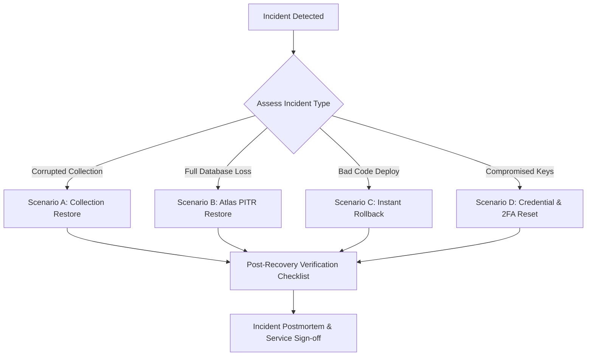

# FinStat Disaster Recovery & Business Continuity Runbook (`DISASTER_RECOVERY.md`)

*Version: 1.0.0 — Production-Ready Operations Blueprint*  
*Classification: Operational / Infrastructure*

---

## 1. System Topology & Architecture Overview

FinStat operates on a modern, decoupled cloud architecture designed for high availability, multi-tenant isolation, and resilient failover:

* **Frontend**: React 19 Single Page Application (SPA) deployed on **Vercel** with global edge CDN distribution and client-side routing.
* **Backend API**: Node.js Express application running in serverless / containerized runtime on **Vercel**, exposing REST endpoints and scheduled cron handlers (`/api/jobs/*`).
* **Database**: **MongoDB Atlas Replica Set** (WiredTiger storage engine) supporting multi-document ACID transactions, automatic election, and continuous point-in-time oplog backups.
* **Backup Stores**:
  1. **MongoDB Atlas Continuous Backups**: Automated oplog streaming with point-in-time recovery (PITR) up to 7–35 days.
  2. **In-Memory Dual-Format Backups**: Administrative on-demand export (`GET /api/admin/backup/export`) streaming compressed MongoDB Extended JSON (EJSON v2 relaxed: false) and multi-sheet XLSX spreadsheets without disk overhead.
  3. **Offline Seeders / Snapshot Archives**: File-based Excel snapshots generated via `node backend/_seeders/backup_db.js`.

---

## 2. Disaster Recovery Service Level Agreements (SLAs)

| Metric | Target SLA | Definition & Operational Boundary |
| :--- | :--- | :--- |
| **RTO (Recovery Time Objective)** | **< 1 hour** | Maximum acceptable duration of application downtime between incident declaration and restored read/write service. |
| **RPO (Recovery Point Objective)** | **< 5 minutes** (Atlas PITR)<br>**< 24 hours** (Daily snapshots) | Maximum acceptable data loss window. Continuous Atlas oplog replay yields near-zero loss; offline snapshot restoration recovers to previous daily checkpoint. |

---

## 3. Automated Backup Procedures & Maintenance

### 3.1 Daily Offline Excel Database Backup
Executed daily or immediately prior to any schema mutation or migration:
```bash
node backend/_seeders/backup_db.js
```
* **Artifact**: `backend/_seeders/db_backup_<YYYY-MM-DDTHH-mm-ss-SSSZ>.xlsx`
* **Retention Policy**: Stored in secure cold storage / S3 bucket with 90-day retention and automated lifecycle pruning.

### 3.2 Dual-Format Administrative Backup Export
Administrators can generate on-demand backups via the Admin Portal (`/admin/backup`) or direct API:
* **EJSON (MongoDB Extended JSON)**:
  ```bash
  curl -H "Authorization: Bearer <ADMIN_JWT>" https://api.finstat.app/api/admin/backup/export?format=json -o backup_ejson.json
  ```
* **XLSX (Multi-Sheet Spreadsheet)**:
  ```bash
  curl -H "Authorization: Bearer <ADMIN_JWT>" https://api.finstat.app/api/admin/backup/export?format=xlsx -o backup_sheets.xlsx
  ```
* **Data Exclusions**: Ephemeral authentication tokens (`refreshtokens`) and transient logs (`loginaudits`) are strictly excluded from export streams to prevent credential leakage.

---

## 4. Emergency Recovery Playbooks



---

### Scenario A: Partial / Collection-Level Data Corruption

**Symptoms**: Inadvertent bulk deletion, unmigrated schema inconsistency, or targeted collection corruption.

1. **Isolate Damage**: Place application in maintenance mode or restrict write operations:
   ```bash
   # Temporarily disable write traffic via Vercel Edge Middleware or maintenance header
   ```
2. **Identify Impacted Collections**: Query document counts and compare against the latest daily snapshot.
3. **Execute Selective Restore**:
   - In development / staging: Use `/api/admin/backup/import` with dry-run verification:
     ```bash
     curl -X POST -F "backupFile=@backup.json" "https://api.finstat.app/api/admin/backup/import?dryRun=true"
     ```
   - In production: Use MongoDB Atlas selective collection restore from the continuous backup timeline, restoring the affected collection to a temporary cluster, exporting the clean records, and re-importing via standard Mongoose scripts.

---

### Scenario B: Full Database Catastrophic Outage (Atlas Disaster)

**Symptoms**: Total database cluster failure, primary and secondary node corruption, or regional cloud provider outage.

1. **Activate Atlas Point-in-Time Recovery (PITR)**:
   - Navigate to **MongoDB Atlas Console** &rarr; **Database Deployments** &rarr; **Backup**.
   - Select **Restore** &rarr; **Point-in-Time**.
   - Select the target timestamp immediately preceding the incident window (down to the exact second).
   - Choose restore target: Restore to a new cluster instance (e.g., `finstat-prod-recovery`).
2. **Update Connection String**:
   - Once the restored cluster completes initialization, copy its connection string.
   - Update `MONGO_URI` in the **Vercel Project Settings** under Environment Variables.
   - Trigger a project redeployment so active serverless containers connect to the recovered cluster:
     ```bash
     npx vercel --prod --token=$VERCEL_TOKEN
     ```
3. **Standalone / Local Disaster Recovery Alternative**:
   If restoring to an on-premise or local MongoDB instance:
   ```bash
   node backend/_seeders/restore_db.js <path-to-snapshot.xlsx>
   ```

---

### Scenario C: Failed Deployment / Bad Code Release

**Symptoms**: Unhandled 500 runtime errors, front-end white screen, or API regression following a production release.

1. **Instant Vercel Rollback**:
   Vercel allows instant zero-downtime rollbacks to the preceding deployment artifact without rebuilding:
   ```bash
   npx vercel rollback <previous-deployment-url-or-id> --token=$VERCEL_TOKEN
   ```
2. **Git Phase-Level Rollback Protocol**:
   If a git branch or commit caused state corruption, execute the phase rollback command:
   ```bash
   git revert HEAD
   git push origin main
   ```
3. **Deploy Timeout & Hanging Transaction Edge Case**:
   - If graceful shutdown hangs on an uncommitted or slow database transaction, deploy retries will trigger after Vercel's 30-second `SIGKILL` window.
   - Per Phase 3 multi-document transaction mechanics (`session.withTransaction()`), any in-flight transaction that is terminated prior to formal commit automatically rolls back in MongoDB WiredTiger storage, leaving account balances, statements, and trade records mathematically consistent.

---

### Scenario D: Compromised Secrets & Emergency Key Rotation

#### 1. Rotating Standard Secrets (`JWT_SECRET`, `CRON_SECRET`)
* **`JWT_SECRET`**:
  - Rotating `JWT_SECRET` immediately invalidates all active stateless access tokens.
  - Active users will experience a single transparent token refresh via their HTTP-only cookie `RefreshToken`.
  - Update `JWT_SECRET` in Vercel project dashboard and redeploy.
* **`CRON_SECRET`**:
  - Update `CRON_SECRET` in Vercel environment variables and in `vercel.json` cron ingress headers.

#### 2. Emergency `ENCRYPTION_KEY` Rotation & 2FA Reset Protocol
> [!CAUTION]
> **Catastrophic Impact of ENCRYPTION_KEY Rotation**:
> `ENCRYPTION_KEY` is utilized for AES-256 encryption of user TOTP secrets in `User.totpSecret`. If this key is rotated without a coordinated response, **all existing user TOTP secrets become permanently unreadable**, locking out all 2FA-enabled accounts.
>
> Executing this procedure has a **~24-hour user impact window** and must ONLY be executed upon confirmed credential compromise, never as routine maintenance.

**Coordinated Response Procedure**:
1. **Archive Old Key**:
   Export and store the current `ENCRYPTION_KEY` in an offline secure vault for 30 days to facilitate forensic decryption if required.
2. **Execute Dry-Run Preview**:
   Inspect how many user accounts will be affected without touching MongoDB:
   ```bash
   node backend/scripts/disable-all-2fa.js --dry-run
   ```
   *Expected output*: `[DRY-RUN] Would reset 2FA for user: ... Summary: Updated: N, Skipped: M, Errors: 0`.
3. **Rotate Key in Vercel**:
   Generate a fresh cryptographically secure 32-byte base64 key:
   ```bash
   node -e "console.log(require('crypto').randomBytes(32).toString('base64'))"
   ```
   Update `ENCRYPTION_KEY` in Vercel project settings.
4. **Execute Live Emergency 2FA Reset**:
   Execute the administrative script with the explicit confirmation flag:
   ```bash
   node backend/scripts/disable-all-2fa.js --confirm-emergency-reset
   ```
   *Actions taken*:
   - Clears `totpSecret` and `backupCodes` for all users.
   - Sets `totpEnabled: false`.
   - Records an administrative audit log entry with `action: 'emergency_2fa_reset'`.
   - Skips users who already had 2FA disabled.
5. **Broadcast User Notification**:
   Send an urgent email notification to all users informing them:
   *"Due to an emergency infrastructure security update, Two-Factor Authentication (2FA) has been safely reset on your account. Please log in and re-enable 2FA in your Security Settings."*
6. **User Re-enrollment**:
   Users log in normally with username/password and generate a fresh TOTP QR code encrypted with the new `ENCRYPTION_KEY`.

---

## 5. Post-Recovery Verification Checklist

Following any disaster recovery procedure, perform the following verification steps before signing off:

- [ ] **Deep Health Check**:
  ```bash
  curl -i https://api.finstat.app/api/health
  ```
  Assert HTTP 200 OK with:
  ```json
  {
    "status": "UP",
    "db": "connected",
    "version": "1.0.0"
  }
  ```
- [ ] **Unauthenticated Access**: Verify `/api/health` does not require Bearer tokens or cookies.
- [ ] **Transaction Ledger Balance Reconciliation**:
  Verify account balances match ledger calculations (`calculatePreviousBalance` and running balances in expenditures).
- [ ] **Authentication & Token Rotation**:
  Log in with test account; verify access token generation (15m) and refresh token rotation with 30s grace window.
- [ ] **Role Hierarchy Isolation (RBAC)**:
  - Viewer role: Ensure read-only inspection tools render; mutations return HTTP 403.
  - Manager role: Verify expenditure and paycheck logging.
  - Admin role: Verify administrative dashboard and backup endpoints.
- [ ] **Audit Trail & Postmortem**:
  Author incident report in `docs/incidents/<phase>-<YYYYMMDD_HHMMSS>.md` detailing root cause, timeline, actions taken, and preventive measures.

---

## 6. Escalation Matrix

| Role | Responsibility | Contact Channel |
| :--- | :--- | :--- |
| **Lead Infrastructure Engineer** | Database restoration, cluster failover, Vercel deployments | Operations Channel / PagerDuty |
| **Security Officer** | Key rotation authorization, incident forensics, user notification | Security Emergency Escalation |
| **Lead Application Developer** | Code rollbacks, migration repair, balance reconciliation | Engineering Escalation |
