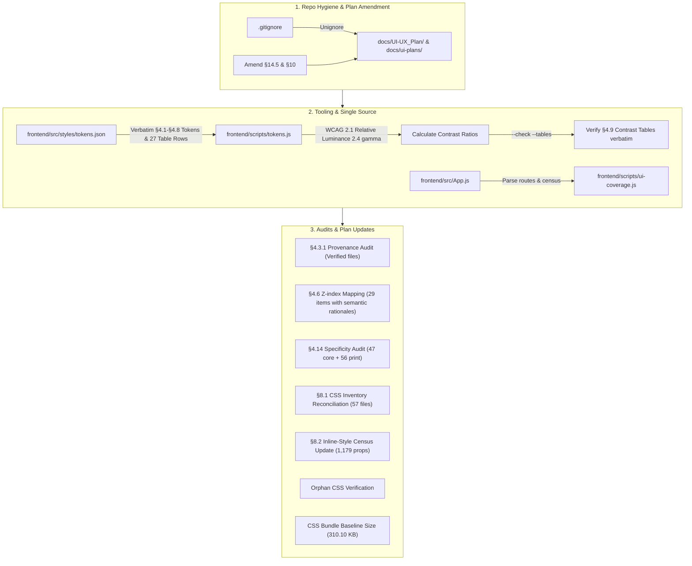

# Phase 1A Implementation Plan — Audit, Tokens and Measurement (v3.1)

## Goal Description
Phase 1A initiates the UI/UX Overhaul as defined in [UI-UX-PLAN.md](file:///d:/Projects/FinStat/docs/UI-UX_Plan/UI-UX-PLAN.md#L1178-L1210). Phase 1A is strictly a **measurement, tooling, hygiene, and audit phase** with **zero production styling or behavioral alterations**.

It accomplishes:
1. **Repository Hygiene**: Fixing `.gitignore` so `docs/UI-UX_Plan/` and `docs/ui-plans/` are tracked while keeping temporary snapshots and local artifacts untracked. Formally amends §14.5 and §10 with the rationale.
2. **Design Tokens Single Source of Truth**: Creating `frontend/src/styles/tokens.json` holding the exact, verbatim tokens from §4.1–§4.8, status notes, sentinel block markers (`/* fs-tokens:start */` and `/* fs-tokens:end */`), an empty `platformSurfaces: {}` schema placeholder for Phase 1B, and complete 27-row schema tables matching §4.9.1 and §4.9.2 verbatim.
3. **Contrast & Token Tooling**: Creating `frontend/scripts/tokens.js` implementing exact WCAG 2.1 relative luminance math (gamma 2.4, threshold 0.04045, no pre-rounding) to dynamically calculate contrast against `--fs-surface` (`#1a1c20`), `--fs-bg` (`#101114`), and `--fs-surface-raised` (`#22252a`), supporting `--write` and `--check --tables` validation modes.
4. **Coverage & Inline-Style Tooling**: Creating `frontend/scripts/ui-coverage.js` to parse `App.js` routes and generate the inline-style census.
5. **Architectural Audits & Plan Reconciliation**:
   - **`!important` Audit & Reconciliation**: Reconciling the 46 baseline to 103 total (47 core app declarations + 56 `@media print` overrides in `ComprehensiveReport.css` covered by §13 non-goals).
   - **CSS Inventory Audit & Reconciliation**: Reconciling the 49 baseline to 57 total CSS files (accounting for 8 net-new files created during audit Phases 7A–8C).
   - **Z-Index Audit & Reconciliation**: Mapping all 29 non-zero declarations (24 baseline + 5 audit additions) to the §4.6 9-tier scale with exact `file:line` references and detailed semantic rationales for non-1:1 mappings.
   - **Inline-Style Census (§8.2) Update**: Updating baseline from 1,087 to the census-confirmed 1,179 props (+92 delta from Phase 8 features: `pages/lending/`, `AccountSwitcher`, `RecycleBin`, `ComprehensiveReport`, `TaxSimulator`, `RecurringBills`, `AppLauncher`, `PurchasingPowerChart`).
   - **Provenance Audit**: Auditing conditional tones, thresholds, and labels (§4.3.1) citing only verified source files (`pages/credit-cards/CreditCardPage.js`, `TradeSummaryPage.js`, `HoldingsTable.js`, etc.).
   - **Orphan CSS Verification**: Confirming zero imports across `src/` for `SalaryProfilePage.css` and `PaycheckListPage.css`.
   - **Route Matrix Verification**: Confirming all 75 route entries (65 rendering + 10 redirects) and catch-all `*` in `App.js`.
   - **Baseline Performance Metrics**: Measuring baseline total CSS bundle size (310.10 KB) and recording the native-control browser matrix.

---

## User Review Required

> [!IMPORTANT]
> **Strict Contract Fidelity for `tokens.json` & §4.9 Contrast Tables**:
> All token values in `tokens.json` are copied **verbatim from §4.1–§4.8** of the approved plan. Contrast ratios are computed dynamically by `tokens.js` using the exact WCAG 2.1 formula ($L = 0.2126 R' + 0.7152 G' + 0.0722 B'$, gamma 2.4, threshold 0.04045, no pre-rounding).
> All status strings match §4.9.1 and §4.9.2 verbatim (including the load-bearing **Fail** statuses that enforce control boundary rules and the chrome edge exception).
> If `node frontend/scripts/tokens.js --check --tables` encounters a mismatch, the fix is to edit `tokens.json` to conform to §4.1–§4.8, **never** to alter the Markdown contrast tables in `UI-UX-PLAN.md`.
>
> | Token | Approved Value (§4.1–§4.8) | Surface Contrast | bg Contrast | Raised Contrast | Status (Verbatim §4.9) |
> | :--- | :--- | ---: | ---: | ---: | :--- |
> | `--fs-text` | `#f2f3f5` | 15.37 | 17.00 | 13.85 | Pass |
> | `--fs-text-2` | `#c9cdd3` | 10.69 | 11.83 | 9.63 | Pass |
> | `--fs-text-3` | `#a2a8b0` | 7.12 | 7.88 | 6.42 | Pass |
> | `--fs-text-4` | `#6f757d` | 3.67 | 4.06 | 3.31 | **Disabled only** |
> | `--fs-border` | `#34383f` | 1.45 | 1.60 | 1.31 | **Fail — dividers only; the chrome edge is the exception** |
> | `--fs-border-strong` | `#4a4f57` | 2.07 | 2.29 | 1.86 | **Fail — never alone** |
> | `--fs-border-control` | `#6a6f77` | 3.37 | 3.73 | 3.04 | Pass — no headroom for a wider ramp |
> | `--fs-surface-sunken` | `#15161a` | — | — | — | Structural surface |
> | `--fs-border-width` | `1px` | — | — | — | Base width |
> | `--fs-radius-pill` | `999px` | — | — | — | Pill ceiling (D15) |

> [!WARNING]
> **Reconciliation of Plan Inventories**:
> 1. **`!important` Declarations**: 56 declarations reside in `ComprehensiveReport.css` inside print rules. Per §13 Non-Goals ("print layouts are out of scope"), these are classified as print media overrides. Core app has 47 declarations (46 baseline + 1 in `pages/lending/Lending.css` from Module 23).
> 2. **CSS File Inventory**: 57 CSS files exist on disk (+8 over the 49 baseline), all created during Phase 7A–8C audit features (`AppLauncher.css`, `AccountSwitcher.css`, `PurchasingPowerChart.css`, `RecurringBills.css`, `Lending.css`, `RecycleBin.css`, `ComprehensiveReport.css`, `TaxSimulator.css`). §8.1 will be updated in `UI-UX-PLAN.md` to formally map these files.
> 3. **Z-index Declarations**: 29 non-zero declarations exist on disk (+5 over the 24 baseline, added in Phase 8). All 29 are fully mapped to the 9-tier scale with explicit semantic rationales.
> 4. **Inline-Style Census Update (§8.2)**: 1,179 total props on disk (+92 over the 1,087 baseline), due to net-new pages added during audit Phases 7A–8C (`pages/lending/`, `AccountSwitcher`, `RecycleBin`, `ComprehensiveReport`, `TaxSimulator`, `RecurringBills`, `AppLauncher`, `PurchasingPowerChart`). §8.2 will be updated to establish 1,179 as the verified baseline.
> 5. **`.gitignore` Plan Amendment**: `!docs/ui-plans/` is formally added to §14.5 and §10 with the rationale: *"Phase plans in `docs/ui-plans/` are tracked alongside the master plan in `docs/UI-UX_Plan/`"*.

---

## Proposed Changes



---

### Component 1: Repository Hygiene & Plan Alignment (`.gitignore`)

#### [MODIFY] [`.gitignore`](file:///d:/Projects/FinStat/.gitignore)
- Replace bare `docs` rule with:
  ```gitignore
  # docs (ignore general docs, but version UI-UX master plan and per-phase implementation plans)
  docs/*
  !docs/UI-UX_Plan/
  !docs/ui-plans/
  ```

#### [MODIFY] [`docs/UI-UX_Plan/UI-UX-PLAN.md`](file:///d:/Projects/FinStat/docs/UI-UX_Plan/UI-UX-PLAN.md)
- Update §14.5 to document tracking both `docs/UI-UX_Plan/` and `docs/ui-plans/`:
  `Replace bare docs with docs/* plus !docs/UI-UX_Plan/ and !docs/ui-plans/ (Phase plans in docs/ui-plans/ are tracked alongside the master plan).`
- Record the rationale in §10 Progress Log under sub-phase 1A.

---

### Component 2: Token Tooling & Single Source of Truth

#### [NEW] [`frontend/src/styles/tokens.json`](file:///d:/Projects/FinStat/frontend/src/styles/tokens.json)
Contains verbatim values from §4.1–§4.8, sentinel block markers, an empty `platformSurfaces: {}` placeholder, and complete 27-row table definitions matching §4.9.1 and §4.9.2 verbatim:
```json
{
  "$schema": "./tokens.schema.json",
  "meta": {
    "version": "1.0.0",
    "phase": "1A",
    "updated": "2026-11-09",
    "sentinels": {
      "start": "/* fs-tokens:start */",
      "end": "/* fs-tokens:end */"
    }
  },
  "surfaces": {
    "--fs-bg": "#101114",
    "--fs-surface": "#1a1c20",
    "--fs-surface-raised": "#22252a",
    "--fs-surface-sunken": "#15161a"
  },
  "borders": {
    "--fs-border": "#34383f",
    "--fs-border-strong": "#4a4f57",
    "--fs-border-control": "#6a6f77",
    "--fs-border-width": "1px"
  },
  "text": {
    "--fs-text": "#f2f3f5",
    "--fs-text-2": "#c9cdd3",
    "--fs-text-3": "#a2a8b0",
    "--fs-text-4": "#6f757d",
    "--fs-ink": "#0d0e10"
  },
  "tones": {
    "--fs-positive": "#4fa87c",
    "--fs-negative": "#d97076",
    "--fs-warning": "#cfa24f",
    "--fs-neutral": "var(--fs-text-3)"
  },
  "actions": {
    "--fs-action-bg": "#e8eaed",
    "--fs-action-text": "#0d0e10",
    "--fs-action-hover": "#f5f6f8",
    "--fs-action-active": "#d5d8dd",
    "--fs-danger": "#d97076",
    "--fs-disabled-opacity": "0.45"
  },
  "radii": {
    "--fs-radius-sm": "4px",
    "--fs-radius-md": "6px",
    "--fs-radius-lg": "8px",
    "--fs-radius-pill": "999px"
  },
  "focus": {
    "--fs-focus-ring": "3px solid #f2f3f5",
    "_comment_focus_color": "Tooling extraction of the color component from compound --fs-focus-ring for contrast calculation; not a separate design token",
    "--fs-focus-ring-color": "#f2f3f5",
    "--fs-focus-offset": "2px"
  },
  "motion": {
    "--fs-duration-fast": "120ms",
    "--fs-duration-base": "200ms",
    "--fs-duration-slow": "320ms",
    "--fs-ease-standard": "cubic-bezier(0.2, 0.8, 0.2, 1)",
    "--fs-ease-decelerate": "cubic-bezier(0.0, 0.0, 0.2, 1)"
  },
  "zIndex": {
    "--fs-z-base": "0",
    "--fs-z-content": "1",
    "--fs-z-sidebar": "900",
    "--fs-z-nav": "950",
    "--fs-z-overlay": "1000",
    "--fs-z-modal": "1100",
    "--fs-z-dropdown": "1200",
    "--fs-z-toast": "1300",
    "--fs-z-tooltip": "1400",
    "--fs-z-skip": "1500"
  },
  "breakpoints": {
    "--fs-bp-sm": "480px",
    "--fs-bp-md": "768px",
    "--fs-bp-lg": "1024px",
    "--fs-bp-xl": "1200px"
  },
  "platformSurfaces": {
    "_comment": "Populated in Phase 1B: scrim, selection, scrollbar, tooltip"
  },
  "tables": {
    "textPairs": [
      { "pair": "--fs-text", "foreground": "--fs-text", "target": "4.5", "status": "Pass" },
      { "pair": "--fs-text-2", "foreground": "--fs-text-2", "target": "4.5", "status": "Pass" },
      { "pair": "--fs-text-3", "foreground": "--fs-text-3", "target": "4.5", "status": "Pass" },
      { "pair": "--fs-text-4", "foreground": "--fs-text-4", "target": "4.5", "status": "**Disabled only**" },
      { "pair": "--fs-placeholder (= text-3)", "foreground": "--fs-text-3", "target": "4.5", "status": "Pass" },
      { "pair": "--fs-positive", "foreground": "--fs-positive", "target": "4.5", "status": "Pass" },
      { "pair": "--fs-negative", "foreground": "--fs-negative", "target": "4.5", "status": "Pass" },
      { "pair": "--fs-warning", "foreground": "--fs-warning", "target": "4.5", "status": "Pass" },
      { "pair": "--fs-ink on --fs-action-bg `#e8eaed`", "foreground": "--fs-ink", "background": "--fs-action-bg", "target": "4.5", "status": "Pass" },
      { "pair": "--fs-ink on --fs-danger `#d97076`", "foreground": "--fs-ink", "background": "--fs-danger", "target": "4.5", "status": "Pass" },
      { "pair": "--fs-ink on --fs-positive `#4fa87c`", "foreground": "--fs-ink", "background": "--fs-positive", "target": "4.5", "status": "Pass" },
      { "pair": "--fs-ink on --fs-warning `#cfa24f`", "foreground": "--fs-ink", "background": "--fs-warning", "target": "4.5", "status": "Pass" },
      { "pair": "White on --fs-action-bg", "foreground": "#ffffff", "background": "--fs-action-bg", "target": "4.5", "status": "**Fail — use `--fs-ink`**" }
    ],
    "nonTextPairs": [
      { "pair": "--fs-border `#34383f`", "token": "--fs-border", "status": "**Fail — dividers only; the chrome edge is the exception**" },
      { "pair": "--fs-border-strong `#4a4f57`", "token": "--fs-border-strong", "status": "**Fail — never alone**" },
      { "pair": "--fs-border-control `#6a6f77`", "token": "--fs-border-control", "status": "Pass — no headroom for a wider ramp" },
      { "pair": "--fs-focus-ring `#f2f3f5`", "token": "--fs-focus-ring-color", "status": "Pass" },
      { "pair": "--fs-focus-ring on --fs-action-bg", "foreground": "--fs-focus-ring-color", "background": "--fs-action-bg", "status": "**Fail on the control — offset required**" },
      { "pair": "Step `--fs-bg` → `--fs-surface`", "foreground": "--fs-bg", "background": "--fs-surface", "status": "Grouping only, never a boundary" },
      { "pair": "Step `--fs-surface` → `--fs-surface-raised`", "foreground": "--fs-surface", "background": "--fs-surface-raised", "status": "Grouping only, never a boundary" },
      { "pair": "`--fs-surface-sunken` vs `--fs-bg`", "foreground": "--fs-surface-sunken", "background": "--fs-bg", "status": "**Invisible — the 1 px chrome border is mandatory**" },
      { "pair": "Action hover `#f5f6f8`", "foreground": "--fs-action-hover", "background": "--fs-bg", "status": "Pass" },
      { "pair": "Action active `#d5d8dd`", "foreground": "--fs-action-active", "background": "--fs-bg", "status": "Pass" },
      { "pair": "Chart grey 1 `#8b929b`", "foreground": "#8b929b", "status": "Pass" },
      { "pair": "Chart grey 2 `#b8bec6`", "foreground": "#b8bec6", "status": "Pass" },
      { "pair": "Chart grey 3 `#6a7078`", "foreground": "#6a7078", "status": "Pass — no headroom for a wider ramp" },
      { "pair": "Chart grey 4 `#d5d9dd`", "foreground": "#d5d9dd", "status": "Pass" }
    ]
  }
}
```

#### [NEW] [`frontend/scripts/tokens.js`](file:///d:/Projects/FinStat/frontend/scripts/tokens.js)
- Implements:
  - Exact WCAG 2.1 relative luminance math with 2.4 gamma and no pre-rounding:
    $$sRGB(c) = \begin{cases} c / 12.92 & \text{if } c \le 0.04045 \\ ((c + 0.055) / 1.055)^{2.4} & \text{otherwise} \end{cases}$$
    $$L = 0.2126 \cdot sRGB(R) + 0.7152 \cdot sRGB(G) + 0.0722 \cdot sRGB(B)$$
    $$\text{Contrast Ratio} = \frac{\max(L_1, L_2) + 0.05}{\min(L_1, L_2) + 0.05}$$
  - `generateTables(tokens)`: Generates Markdown matching §4.9.1 (13 rows) and §4.9.2 (14 rows) verbatim.
  - `--check --tables`: Validates that §4.9 in `docs/UI-UX_Plan/UI-UX-PLAN.md` matches calculated values from `tokens.json`. Exits 0 on match, 1 on drift. Primary evidence of 1A completion.
  - `--write`: Regenerates §4.9 in `UI-UX-PLAN.md` between marked boundaries.

---

### Component 3: Route Coverage & Inline-Style Census Tooling

#### [NEW] [`frontend/scripts/ui-coverage.js`](file:///d:/Projects/FinStat/frontend/scripts/ui-coverage.js)
- Standalone CLI tool:
  - `parseRoutes()`: Extracts all 75 route definitions (65 rendering + 10 redirects) from `frontend/src/App.js`.
  - `runCensus()`: Scans `frontend/src` for `style={{` occurrences, reporting per-file counts and summary metrics (1,179 total across repository).
  - Flags:
    - `--census`: Outputs sorted per-file inline-style ranking.
    - `--routes`: Validates that all 75 routes in `App.js` map to sub-phases in §5.

---

### Component 4: Audits & Plan Reconciliation Updates

#### [MODIFY] [`docs/UI-UX_Plan/UI-UX-PLAN.md`](file:///d:/Projects/FinStat/docs/UI-UX_Plan/UI-UX-PLAN.md)

1. **§4.14 Specificity and `!important` Reconciliation**:
   - Update declaration count from 46 to **47 core application declarations** across 10 files:
     - `App.css`: 11
     - `pages/trades/CorporateActionsList.css`: 9
     - `pages/trades/Trades.css`: 8
     - `pages/trades/CorporateActionWizard.css`: 7
     - `components/common/ProtectedAction.css`: 5
     - `pages/credit-cards/ReconciliationPage.css`: 2
     - `pages/expenditure/Expenditure.css`: 2
     - `components/Sidebar.css`: 1
     - `pages/credit-cards/DebtPayoffPage.css`: 1
     - `pages/lending/Lending.css`: 1 *(Net addition from Module 23 in Phase 8)*
   - Formally document the **56 declarations in `pages/reports/ComprehensiveReport.css`** as `@media print` print styles, confirming they are covered by §13 Non-Goals ("print stylesheet / print layouts are out of scope"), which explains why they are not on the core app remediation list.

2. **§8.1 CSS Inventory Reconciliation**:
   - Update CSS file inventory from 49 to **57 total CSS files**.
   - Add the 8 net-new files created during audit Phases 7A–8C to the appropriate phase rows:
     - `components/dashboard/AppLauncher.css` (Phase 3A)
     - `components/layout/AccountSwitcher.css` (Phase 2B)
     - `pages/analytics/PurchasingPowerChart.css` (Phase 5E)
     - `pages/expenditure/RecurringBills.css` (Phase 4C)
     - `pages/lending/Lending.css` (Phase 9C)
     - `pages/profile/RecycleBin.css` (Phase 10A)
     - `pages/reports/ComprehensiveReport.css` (Phase 6B / print styles)
     - `pages/salary/TaxSimulator.css` (Phase 5E)
   - Update the Section 8.1 check paragraph to reflect 57 total files.

3. **§8.2 Inline-Style Hotspots Reconciliation (Census Update)**:
   - Update baseline total from 1,087 to the census-confirmed **1,179 inline style props** across `src/`.
   - Document the **+92 delta** from features created in audit Phases 7A–8C:
     - `pages/lending/` (`LendingDashboardPage.js` 20, `LoanDetailPage.js` 20, `PersonDetailPage.js` 18, internal components `PersonCard.js` 3, `AddTransactionForm.js` 2; all 3 page routes are already fully covered in §5.8.1)
     - `pages/profile/RecycleBin.js` (+19)
     - `pages/salary/TaxSimulator.js` (+17)
     - `components/layout/AccountSwitcher.js` (+11)
     - `pages/reports/ComprehensiveReport.js` (+8)
     - `pages/expenditure/RecurringBills.js` (+5)
     - `components/dashboard/AppLauncher.js` (+2)
     - `pages/analytics/PurchasingPowerChart.js` (+2)
   - Update §8.2 table and text to establish 1,179 as the new source-of-truth baseline for §7.2 phase verification.

4. **§4.6 Z-Index Audit Reconciliation (with Semantic Rationales)**:
   - Update count from 24 to **29 non-zero declarations** across 20 CSS files.
   - Record exact `file:line`, selector, value, mapped token, and semantic rationale:
     1. `components/common/ConfirmModal.css:12` (`.confirm-modal-overlay` 1100) $\to$ `--fs-z-modal` (1100). *Rationale: Exact 1:1 match with dialog overlay level.*
     2. `components/common/Toast.css:6` (`.toast-container` 99999) $\to$ `--fs-z-toast` (1300). *Rationale: Legacy ad-hoc maximum mapped to semantic toast tier; sits above modal (1100) and dropdown (1200) but below tooltip (1400) and skip link (1500) per §4.6.*
     3. `components/common/UndoToast.css:7` (`.undo-toast-wrapper` 9999) $\to$ `--fs-z-toast` (1300). *Rationale: Toast notification tier above modals.*
     4. `components/common/ViewOnlyBanner.css:15` (`.view-only-banner` 40) $\to$ `--fs-z-nav` (950). *Rationale: View-only banner anchors at the viewport top alongside headers; elevates above regular content (1).*
     5. `components/creditCards/UtilizationWidget.css:80` (`.threshold-marker-30` 2) $\to$ `--fs-z-content` (1). *Rationale: Local layering within chart card stacking context.*
     6. `components/dashboard/AppLauncher.css:6` (`.launcher-backdrop` 2000) $\to$ `--fs-z-modal` (1100). *Rationale: Fullscreen launcher backdrop belongs to modal overlay tier.*
     7. `components/layout/AccountSwitcher.css:163` (`.account-switcher-dropdown` 1000) $\to$ `--fs-z-dropdown` (1200). *Rationale: Header dropdown popover must sit above navigation bar (950).*
     8. `components/layout/AccountSwitcher.css:251` (`.family-rollup-modal-backdrop` 9999) $\to$ `--fs-z-modal` (1100). *Rationale: Modal overlay semantics.*
     9. `components/Modal.css:12` (`.modal-overlay` 1000) $\to$ `--fs-z-overlay` (1000). *Rationale: Base overlay dimming layer.*
     10. `components/Navbar.css:16` (`.navbar` 900) $\to$ `--fs-z-sidebar` (900). *Rationale: Chrome navigation container.*
     11. `components/Sidebar.css:9` (`.sidebar` 1000) $\to$ `--fs-z-sidebar` (900). *Rationale: Unified persistent shell sidebar tier.*
     12. `components/Sidebar.css:155` (`.sidebar` mobile 1200) $\to$ `--fs-z-dropdown` (1200). *Rationale: Drawer menu popover when open on small screens.*
     13. `components/Sidebar.css:172` (`.sidebar-backdrop` 1100) $\to$ `--fs-z-modal` (1100). *Rationale: Mobile sidebar backdrop blocking background page clicks.*
     14. `components/Sidebar.css:194` (`.mobile-toggle` 1300) $\to$ `--fs-z-toast` (1300). *Rationale: Floating hamburger trigger remains accessible above mobile backdrop.*
     15. `components/Table.css:93` (`.tooltip-container:hover::after` 1) $\to$ `--fs-z-content` (1). *Rationale: Pseudo-element tooltip within local table cell; modernized to `--fs-z-tooltip` (1400) in Phase 2E.*
     16. `pages/admin/AdminDashboard.css:301` (`.modal-overlay` 1000) $\to$ `--fs-z-overlay` (1000). *Rationale: Modal backdrop layer.*
     17. `pages/admin/BackupPage.css:387` (`.restore-modal-overlay` 9999) $\to$ `--fs-z-modal` (1100). *Rationale: Modal dialog overlay.*
     18. `pages/admin/TaxConfigPage.css:392` (`.admin-modal-backdrop` 1000) $\to$ `--fs-z-overlay` (1000). *Rationale: Modal backdrop layer.*
     19. `pages/credit-cards/StatementCyclePage.css:91` (`.cycle-timeline-track::before` 1) $\to$ `--fs-z-content` (1). *Rationale: Timeline track graphic decoration.*
     20. `pages/credit-cards/StatementCyclePage.css:96` (`.timeline-milestone` 2) $\to$ `--fs-z-content` (1). *Rationale: Milestone node decoration above timeline track.*
     21. `pages/Dashboard.css:309` (`.dash-hero-card > *` 1) $\to$ `--fs-z-content` (1). *Rationale: Internal stacking context within hero card.*
     22. `pages/Dashboard.css:1339` (`.dash-fab` 950) $\to$ `--fs-z-nav` (950). *Rationale: Floating action button anchored with navigation layer.*
     23. `pages/expenditure/RecurringBills.css:226` (`.modal-overlay` 1000) $\to$ `--fs-z-overlay` (1000). *Rationale: Modal backdrop layer.*
     24. `pages/expenditure/RulesPage.css:250` (`.modal-overlay` 1000) $\to$ `--fs-z-overlay` (1000). *Rationale: Modal backdrop layer.*
     25. `pages/LandingPage.css:64` (`.content-wrapper` 10) $\to$ `--fs-z-content` (1). *Rationale: Content container above hero gradient background.*
     26. `pages/lending/Lending.css:331` (`.lending-modal-backdrop` 1000) $\to$ `--fs-z-overlay` (1000). *Rationale: Modal backdrop layer.*
     27. `pages/salary/SalaryProfilePage.css:238` (`.modal-backdrop` 1000) $\to$ `--fs-z-overlay` (1000). *Rationale: Modal backdrop layer.*
     28. `pages/security/SecuritySettingsPage.css:191` (`.security-modal-overlay` 1000) $\to$ `--fs-z-overlay` (1000). *Rationale: Modal backdrop layer.*
     29. `pages/trades/CorporateActionsList.css:267` (`.ca-modal-overlay` 9999) $\to$ `--fs-z-modal` (1100). *Rationale: Corporate actions wizard modal overlay.*

5. **§4.3.1 Provenance Audit Completion**:
   Fill the provenance table with verified code sources:
   - *Budget progress (80–100%, >100%)*: `pages/expenditure/BudgetsPage.js` (`pct >= 80`, `pct > 100`) & `pages/dashboard/BudgetPulseCard.js`.
   - *Debt & card balance (due within 7 days, overdue)*: `pages/credit-cards/CreditCardPage.js` & `pages/credit-cards/DebtPayoffPage.js` (due date relative to `Date.now()`).
   - *Card utilization (30–70%, >70%)*: `pages/credit-cards/CreditCardPage.js` (`utilizationRate >= 30`, `utilizationRate >= 70`).
   - *Yield & ROI*: Neutral, no delta, no label (audit confirms no hard-coded comparative target constant exists).
   - *FX change*: `pages/currency/CurrencyLogPage.js` & `pages/currency/CurrencyDetailPage.js` (`change > 0` positive, `change < 0` negative).
   - *Rebalancing drift*: `pages/portfolio/RebalancingPage.js` (drift relative to asset class target weight).
   - *Account balance / net worth change*: `pages/dashboard/NetWorthHero.js` & `pages/dashboard/DashboardKpiStrip.js` (period delta sign).
   - *Realised / unrealised P&L*: `pages/trades/TradeSummaryPage.js`, `components/portfolio/HoldingsTable.js`, `components/portfolio/SummaryCards.js` (`realizedProfit > 0` Gain, `< 0` Loss; `unrealizedProfit > 0` Gain, `< 0` Loss).

6. **§4.1 Palette Provenance**:
   - Document measured transition from Tailwind slate to neutral flat graphite (`#101114`, `#1a1c20`, `#22252a`).

7. **Allowlist Skeleton**:
   - Record the 65-route allowlist skeleton in §6.3 as review documentation.

8. **CSS Baseline Metric**:
   - Record current total CSS size: **310.10 KB across 57 files**.

9. **Browser Matrix**:
   - Record Chrome, Firefox, Safari (desktop), and Safari iOS / Chrome Android (mobile) as the official native control test matrix.

---

## Verification Plan

### Automated Verification
```powershell
# 1. Gitignore rule validation (F1)
# Exit code 1 means the file is NOT ignored (tracked) — which is what we want:
git check-ignore -v docs/UI-UX_Plan/UI-UX-PLAN.md
# Expected: exit code 1 (no output)

git check-ignore -v docs/ui-plans/phase_1a_implementation_plan.md
# Expected: exit code 1 (no output)

# Exit code 0 means the file IS ignored:
git check-ignore -v docs/ui-snapshots/test.png
# Expected: exit code 0; prints a line matching "docs/* docs/ui-snapshots/test.png"

# 2. Token contrast calculation and table verification (Exit Gate 1A primary evidence)
node frontend/scripts/tokens.js --check --tables
# Expected: Exits 0 on unmodified UI-UX-PLAN.md with "All §4.9 contrast tables match tokens.json exactly! (0 drift)"

# 3. Route coverage and inline style census verification
node frontend/scripts/ui-coverage.js --routes
# Expected: "75 route entries confirmed. 0 unassigned."

node frontend/scripts/ui-coverage.js --census
# Expected: Reports 1,179 total inline style props and per-file hotspot ranking

# 4. Orphan CSS import verification
# Expected: Zero matches across frontend/src outside the css files themselves:
node -e "
const fs = require('fs');
const path = require('path');
let found = 0;
function walk(dir) {
  for (const f of fs.readdirSync(dir)) {
    const full = path.join(dir, f);
    if (fs.statSync(full).isDirectory()) walk(full);
    else if ((f.endsWith('.js') || f.endsWith('.jsx')) && !full.includes('node_modules')) {
      const c = fs.readFileSync(full, 'utf8');
      if (c.includes('SalaryProfilePage.css') || c.includes('PaycheckListPage.css')) {
        console.error('Import found in:', full);
        found++;
      }
    }
  }
}
walk('frontend/src');
if (found === 0) console.log('Zero imports found for orphan CSS files. Verified.');
else process.exit(1);
"

# 5. Local compilation check and single-worker touched tests (governed by §15)
# Uses deterministic one-shot commands that exit 0/1 (never hangs):
cd frontend
npx eslint src --ext .js --max-warnings=0
npx jest --runInBand src/App.test.js
```

### Manual Verification
1. Review `git status`: Confirm only the intended files are staged/modified (`.gitignore`, `tokens.json`, `tokens.js`, `ui-coverage.js`, `UI-UX-PLAN.md`, `phase_1a_implementation_plan.md`).
2. Verify `tokens.json` values against §4.1–§4.8: Confirm all required tokens (`#c9cdd3`, `#a2a8b0`, `#6f757d`, `#34383f`, `#4a4f57`, `#6a6f77`, `#15161a`, `1px`, `999px`) and `platformSurfaces: {}` match the approved plan verbatim.
3. Confirm that `tokens.js --check --tables` passes against the unmodified Markdown tables with zero changes to Markdown contrast statuses.
4. Confirm that zero production styling, markup, or routing behavior has changed.
