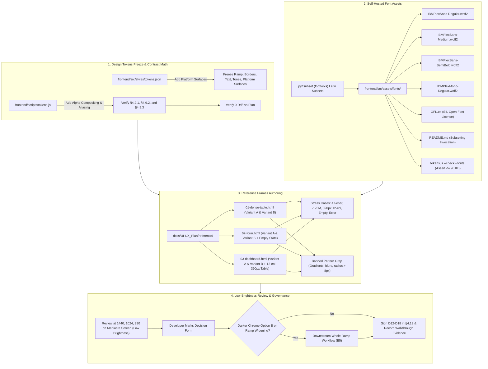

# Phase 1B Implementation Plan — Design Direction (Human-Owned) (v3)

## Goal Description
Phase 1B executes the **Design Direction** sub-phase as specified in [UI-UX-PLAN.md](file:///d:/Projects/FinStat/docs/UI-UX_Plan/UI-UX-PLAN.md#L1244-L1276) (§6.5 lines 1244–1276). 

Phase 1B is **human-owned** (governed by Decision D12):
> "The developer selects and approves the design direction; the agent prepares options, measurements, and frames; it does **not** choose the palette, the typeface, or the radii. Agents regress to the mean when asked to pick a look, which is how v3 ended up with Tailwind's defaults."

Phase 1B delivers:
1. **Design Tokens Freeze**: Freezing `frontend/src/styles/tokens.json`, populating platform surfaces (`--fs-scrim`, `--fs-selection-bg`, `--fs-selection-text`, `--fs-scrollbar-thumb`, `--fs-scrollbar-track`, `--fs-tooltip-bg`, `--fs-tooltip-border`), adding §4.9.3 to `UI-UX-PLAN.md`, updating `tokens.js` with alpha compositing and alias resolution, and confirming zero contrast drift.
2. **IBM Plex Font Assets**: Procuring self-hosted IBM Plex Sans (400, 500, 600) and IBM Plex Mono (400) latin woff2 subsets under `frontend/src/assets/fonts/` with the SIL Open Font License (`OFL.txt`), strictly within the **$\le 90\text{ KB}$ total budget**.
3. **Three Canonical Reference Frames**: Authoring standalone, self-contained HTML + CSS mockups under `docs/UI-UX_Plan/reference/`:
   - `01-dense-table.html` (Expenditure log: 20 rows, filters, pagination, row actions, numeric columns).
   - `02-form.html` (Two-column form: required fields, inline error, disabled control, primary/secondary actions).
   - `03-dashboard.html` (Summary figures, accessible SVG chart with table alternative, 12-column recent activity table).
4. **Variant Exploration & Complete Stress Testing**: Providing 2 distinct variants per frame exploring architectural choices (category replacement cues, mobile table behavior, chrome plane styling, and card density), with comprehensive stress cases embedded across all three frames:
   - Frame 1: $\ge 40$-char name, 9-digit negative, 12-column table at 390px, empty state, error state.
   - Frame 2: $\ge 40$-char name, 9-digit negative, inline error, disabled control, empty state (`.fs-empty`), mobile 390px collapse. *(Note: 12-column table stress is non-applicable to forms and is deferred to Frames 1 and 3).*
   - Frame 3: $\ge 40$-char KPI title, 9-digit negative balance, 12-column recent activity table at 390px with horizontal scroll, chart empty state, chart error state.
5. **Low-Brightness Evaluation & Governance Sign-Off**: Reviewing at 1440px, 1024px, and 390px on a low-brightness screen, settling the chrome plane (§4.1), choosing the category cue (§6.5, G3), signing D12–D18 (§4.13), and recording rejected options.
6. **Strict Boundary**: **Zero production UI changes** (no edits to `src/pages/`, `src/components/`, or app CSS).

---

## User Review Required — Human-Owned Decision Form (D12–D18)

> [!IMPORTANT]
> **Human Ownership Notice (D12)**:
> The agent prepares options, implements tooling, and renders reference frames. The developer reviews the rendered frames in the browser across viewports and low brightness, and marks the chosen options below. No decision is pre-committed.

```
+----------------------------------------------------------------------------------------------------+
|                                    PHASE 1B DECISION FORM                                           |
+------------------------------------+------------------------------------+--------------------------+
| Area                               | Options / Scope                    | Developer Decision       |
+------------------------------------+------------------------------------+--------------------------+
| 1. Platform Surfaces Freeze        | Confirm §4.1 values in tokens.json | [ ] Pending review:      |
|    (Values from §4.1 contract)     | & verify §4.9.3 contrast table:    | ( ) Confirmed §4.1 values|
|                                    | scrim, selection, scrollbar,       | ( ) Amendments requested |
|                                    | tooltip (confirm, not choose)      |                          |
+------------------------------------+------------------------------------+--------------------------+
| 2. IBM Plex Font Budget (D18)      | Procure woff2 latin subset (Sans   | [ ] Pending:             |
|    (Family locked by D18; budget   | 400/500/600 + Mono 400) + OFL.txt; | ( ) Verify <= 90 KB      |
|    locked <= 90 KB by §4.5)        | budget target <= 90 KB total       |     after procurement    |
+------------------------------------+------------------------------------+--------------------------+
| 3. Chrome Plane Architecture (F5)  | Option A: Keep --fs-surface-sunken | [ ] Pending review:      |
|    (Reviewed in 03-dashboard.html) |   (#15161a) with 1px border        | ( ) Option A (Plan base) |
|                                    | Option B: Darker chrome (#0c0d0f)  | ( ) Option B (Darker)    |
|                                    |   (triggers ramp widening workflow)|                          |
+------------------------------------+------------------------------------+--------------------------+
| 4. Category Replacement Cue (G3)   | Option A: Text prefix (.fs-cat)    | [ ] Pending review:      |
|    (Reviewed in 01-dense-table)    | Option B: Group-by control/chips   | ( ) Option A (Prefix)    |
|                                    | Option C: Both prefix & group-by   | ( ) Option B (Group-by)  |
|                                    |                                    | ( ) Option C (Both cues) |
+------------------------------------+------------------------------------+--------------------------+
| 5. Reference Frame Selection       | Review Variant A vs Variant B      | [ ] Pending review:      |
|    (Rendered in browser at 1440,   | across 01, 02, and 03; select     | 01-dense-table: (A / B)  |
|     1024, and 390px)               | canonical pattern for later phases | 02-form:        (A / B)  |
|                                    |                                    | 03-dashboard:   (A / B)  |
+------------------------------------+------------------------------------+--------------------------+
```

---

## Proposed Changes



---

### Component 1: Freeze `tokens.json`, Platform Surfaces, and §4.9.3 Table

#### 1.1 `tokens.json` Platform Surfaces Population
Update [frontend/src/styles/tokens.json](file:///d:/Projects/FinStat/frontend/src/styles/tokens.json):
1. Bump metadata: `"version": "1.1.0"`, `"phase": "1B"`.
2. Populate `platformSurfaces`:
   ```json
   "platformSurfaces": {
     "--fs-scrim": "rgba(8, 9, 11, 0.72)",
     "--fs-selection-bg": "#3a4048",
     "--fs-selection-text": "#f2f3f5",
     "--fs-scrollbar-thumb": "var(--fs-border-strong)",
     "--fs-scrollbar-track": "var(--fs-surface)",
     "--fs-tooltip-bg": "var(--fs-surface-raised)",
     "--fs-tooltip-border": "var(--fs-border)"
   }
   ```
3. Add `tables.platformSurfaces` schema rows in `tokens.json`:
   ```json
   "platformSurfaces": [
     { "pair": "`--fs-selection-text` on `--fs-selection-bg`", "foreground": "--fs-selection-text", "background": "--fs-selection-bg", "target": "4.5", "status": "Pass" },
     { "pair": "`--fs-tooltip-border` vs `--fs-tooltip-bg`", "foreground": "--fs-tooltip-border", "background": "--fs-tooltip-bg", "status": "Structural only — tooltips carry their own surface step" },
     { "pair": "`--fs-scrim` composited on `--fs-bg`", "foreground": "--fs-scrim", "background": "--fs-bg", "status": "n/a — non-content surface (backdrop dimming)" },
     { "pair": "`--fs-scrollbar-thumb` vs `--fs-scrollbar-track`", "foreground": "--fs-scrollbar-thumb", "background": "--fs-scrollbar-track", "status": "Pass — non-critical affordance" }
   ]
   ```

#### 1.2 Contrast Math & Tooling Updates (`tokens.js`)
Update [frontend/scripts/tokens.js](file:///d:/Projects/FinStat/frontend/scripts/tokens.js):
1. **Alias & Section Resolution**: Update `resolveHex(token, tokens)` to resolve across `platformSurfaces` and follow recursive `var(...)` aliases (e.g. `--fs-scrollbar-thumb` $\to$ `--fs-border-strong` $\to$ `#4a4f57`).
2. **Alpha Compositing Contrast (M2)**: Implement `compositeColor(rgbaStr, bgHex)` using standard alpha-blending math:
   $$C_{\text{composited}} = \text{round}(\alpha \cdot C_{\text{fg}} + (1 - \alpha) \cdot C_{\text{bg}})$$
   Compute contrast of the composited color against the backdrop. For `--fs-scrim` (`rgba(8, 9, 11, 0.72)`) composited over `--fs-bg` (`#101114`), the composited tone is approximately `#0a0b0d` with a measured contrast of $\approx 1.04:1$. Record this measured numerical ratio explicitly in the generated table row alongside the status `n/a — non-content surface (backdrop dimming)`.
3. **Table Generation (§4.9.3)**: Implement generator for `#### 4.9.3 Platform surfaces`, rendering:
   - `--fs-selection-text` on `--fs-selection-bg`: 9.42 | Pass
   - `--fs-tooltip-border` vs `--fs-tooltip-bg`: 1.31 | Structural only — tooltips carry their own surface step
   - `--fs-scrim` composited on `--fs-bg`: ~1.04 | n/a — non-content surface (backdrop dimming)
   - `--fs-scrollbar-thumb` vs `--fs-scrollbar-track`: 2.07 | Pass — non-critical affordance
4. **Validation**: Ensure `node frontend/scripts/tokens.js --check --tables` validates §4.9.1, §4.9.2, and §4.9.3, failing if §4.9.3 is missing or drifted.
5. **Font Verification Command (M4)**: Implement `node frontend/scripts/tokens.js --check --fonts` to assert that the 4 woff2 files exist, sum to $\le 90\text{ KB}$, and `OFL.txt` exists.

#### 1.3 Plan Amendment: Add §4.9.3 to `UI-UX-PLAN.md`
Add the generated §4.9.3 table to [docs/UI-UX_Plan/UI-UX-PLAN.md](file:///d:/Projects/FinStat/docs/UI-UX_Plan/UI-UX-PLAN.md) right below §4.9.2.

#### 1.4 Conditional Downstream Workflow: Chrome Option B / Whole-Ramp Widening (E5)
If the developer chooses Option B (darker chrome `#0c0d0f`) or if low-brightness testing reveals that surface steps wash out:
1. Update `tokens.json`: change `--fs-surface-sunken` to `#0c0d0f`.
2. Evaluate surface ramp step: if `--fs-surface-raised` changes, **re-tune `--fs-border-control` and chart grey 3** in the same pass so both maintain $\ge 3:1$ non-text contrast on `--fs-surface-raised` (governed by Invariant E5 and §6.5).
3. Run `node frontend/scripts/tokens.js --write` to regenerate §4.9.1, §4.9.2, and §4.9.3 tables.
4. Perform manual git diff review on `UI-UX-PLAN.md`: every changed numeric value and status must be justified in the walkthrough.
5. Update §4.1 with the new hex and update the chrome plane boundary rationale.

---

### Component 2: Procure & Verify Font Assets (`frontend/src/assets/fonts/`)

Create directory `frontend/src/assets/fonts/` and place:
1. `IBMPlexSans-Regular.woff2` (Weight 400, latin subset)
2. `IBMPlexSans-Medium.woff2` (Weight 500, latin subset)
3. `IBMPlexSans-SemiBold.woff2` (Weight 600, latin subset)
4. `IBMPlexMono-Regular.woff2` (Weight 400, latin subset)
5. `OFL.txt` containing the official SIL Open Font License v1.1.
6. `README.md` documenting the exact subsetting parameters and reproducible invocation (M3).

> [!NOTE]
> **Subsetting Methodology & Legal Terms (M3, N7, N10)**:
> - **Tooling & Glyph Range (M3)**: Subsetting is performed with `pyftsubset` (`fonttools`) targeting the latin glyph range:
>   `unicodes="U+0000-00FF,U+0131,U+0152-0153,U+02BB-02BC,U+02C6,U+02DA,U+02DC,U+0304,U+0308,U+0329,U+2000-206F,U+20AC,U+2122,U+2191,U+2193,U+2212,U+2215,U+FEFF,U+FFFD"` with `--flavor=woff2 --layout-features='*'`. Documented in `frontend/src/assets/fonts/README.md`. No build-time network dependency.
> - **OFL Terms (N10)**: IBM Plex's OFL declares no Reserved Font Names; subsetting is permitted and the derivative retains the name per §1 of the license.
> - **Declaration Deferred to Phase 2A (N7)**: Font files are procured and verified here in 1B, but **not declared**. The `@font-face` rules (`font-display: swap`) and the size-adjusted fallback stack (`local('Arial'), local('Liberation Sans'), local('Helvetica')`) are formally introduced in Phase 2A's `theme.css`. Phase 1B's exit gate is that the files exist, are valid, and strictly satisfy $\sum \text{size}(\text{woff2}) \le 90\text{ KB}$.

---

### Component 3: Author Reference Frames (`docs/UI-UX_Plan/reference/`)

All reference frames are authored as self-contained static HTML documents. Each file:
- Declares tokens in `:root` matching `tokens.json` verbatim.
- Contains **no gradients, no blurs (`backdrop-filter`), no glows, no shadows other than `--fs-shadow`, and no radius above 8px**.
- Enforces Banned-Pattern Grep compliance (N1).
- Provides exactly **two distinct variants (Variant A and Variant B)** with an interactive toggle switch.
- Embeds exhaustive stress cases across all three frames.

#### Frame 1: `01-dense-table.html` (Expenditure / Transaction Log)
- **Features**: 20 rows of financial log data, search input, category filter, date filter, status filter, pagination (`Page 1 of 5`), summary row (`Total Expenses`), row hover states (`--fs-surface-raised`), row action buttons (View, Edit, Delete).
- **Variant A (Text Prefix Cue & Pure Horizontal Scroll)**:
  - Category indicated via structured muted text prefix (e.g. `[Food & Dining] Artisanal Coffee`, `[Utilities] Fiber Internet`) with clean horizontal dividers (`--fs-border`).
  - Mobile 390px viewport preserves pure horizontal scroll per §6.4 without pinned columns.
- **Variant B (Group-by Control & Sticky Column Affordance)**:
  - Top group-by toggle (`Group by: None | Category | Date | Account`), rendering collapsible grouped headers (`Housing (4 items) — $2,450.00`) and neutral bounded chips (`var(--fs-radius-pill)`, `--fs-surface-raised`, `--fs-border`).
  - Mobile 390px viewport demonstrates optional sticky identifier column (`.fs-sticky-col`) for developer review (N8).
- **Stress Cases (5/5 Covered)**:
  1. $\ge 40$-char name: Row 1 Payee = `Alexander Bartholomew Montgomery-Fitzgerald III` (47 chars).
  2. 9-digit negative amount: Row 1 Amount = `-$123,456,789.00`.
  3. 12-column table at 390px viewport: Viewport switcher testing responsive horizontal scroll at 1440px $\to$ 1024px $\to$ 390px.
  4. Empty state: `.fs-empty` container (`No transactions match the selected filters`).
  5. Error state: Inline network error banner (`Failed to synchronize transaction ledger. Retry?`).

#### Frame 2: `02-form.html` (Salary Profile / Credential Editor)
- **Features**: Responsive layout, section grouping card, field labels (`--fs-text-3`), required indicators (`*`), text input, numeric currency input, dropdown select, checkbox, textarea, helper description, disabled field, inline validation error, and action footer (Primary button `--fs-action-bg` + Secondary button `--fs-surface` + `--fs-border-control`).
- **Variant A (Two-Column Balanced Grid)**:
  - Structured 2-column layout (`grid-template-columns: 1fr 1fr`) with balanced 20px vertical rhythm, explicit section dividers, and full-width summary remarks.
- **Variant B (Stacked Sub-Panel Cards)**:
  - Sequential stacked panels (`--fs-surface`) with elevated sub-section cards (`--fs-surface-raised`), testing modular form groupings.
- **Stress Cases (B5 Resolution)**:
  1. $\ge 40$-char name: Name input field pre-filled with 47-char string (`Alexander Bartholomew Montgomery-Fitzgerald III`).
  2. 9-digit negative amount: Currency input pre-filled with `-$123,456,789.00`.
  3. Inline validation error: Invalid input with `--fs-negative` border and 4.5:1 error text message.
  4. Disabled control: Field marked disabled displaying `--fs-text-4` disabled text and `opacity: 0.45`.
  5. **Empty state (B5)**: Dedicated empty-state section/mode showing the form rendered with blank fields, disabled primary submit, and an explanatory `.fs-empty` message (`No profile data loaded. Select a profile or click Add to begin.`), demonstrating the loading $\to$ empty transition.
  6. Mobile 390px collapse: 100% single column collapse with full-width action bar.
  > *(Note: The 12-column table stress is not applicable to forms; Frame 2 covers the complete form stress set {$\ge 40$-char, 9-digit, inline error, disabled, empty, mobile 390}, while the table-specific stress is demonstrated in Frames 1 and 3).*

#### Frame 3: `03-dashboard.html` (Canonical Finance Dashboard)
- **Features (B6 Resolution)**: Top shell navbar and sidebar navigation (testing chrome plane), 4 summary metric KPI cards with `.fs-num` proportional tabular figures, interactive financial trend chart, and **12-column recent activity table** (Date, Payee, Account, Category, Debit, Credit, Balance, FX Rate, FX Amount, Status, Reference, Notes).
- **Chart Accessibility Architecture (N2, §4.12)**:
  - Chart authored as inline SVG with `role="img"`, `<title>` element, and adjacent summary text linked via `aria-describedby`.
  - Collapsible `<details>` element immediately beneath the chart providing a full HTML data-table alternative, establishing the canonical accessible chart pattern for Phase 3A.
- **Variant A (Sunken Chrome + 1px Border Boundary - Plan Baseline)**:
  - Shell navbar/sidebar styled with `--fs-surface-sunken` (`#15161a`) bounded by explicit 1px `--fs-border` (`#34383f`).
- **Variant B (Darker True Sunken Chrome)**:
  - Shell navbar/sidebar styled with darker tone (`#0c0d0f`), creating direct tonal separation without relying solely on the 1px border.
- **Stress Cases (5/5 Covered, B6 Resolution)**:
  1. $\ge 40$-char KPI title: KPI Card 1 metric title = `Corporate Account — Alexander Bartholomew Montgomery-Fitzgerald III`.
  2. 9-digit negative balance: KPI Card 2 balance = `-$123,456,789.00` with negative delta tone (`--fs-negative`).
  3. **12-column table at 390px (B6)**: Mini recent activity table with 12 distinct columns demonstrating the horizontal scroll container, sticky identifier column (in Variant B), and divider visibility at 390px narrow viewport.
  4. Empty state: Chart widget showing graceful empty state ("No activity during this billing cycle").
  5. Error state: Chart widget showing network error state ("Failed to render trend chart: data service unavailable").

---

### Component 4: Low-Brightness & Multi-Viewport Verification Protocol

Verification checklist on mediocre display / low brightness:
1. **Low-Brightness Mediocre Screen Test**:
   - Set screen brightness to 20–30% on an sRGB / budget display.
   - Confirm `--fs-bg` (`#101114`) vs `--fs-surface` (`#1a1c20`) vs `--fs-surface-raised` (`#22252a`) provide sufficient visual grouping.
   - Confirm `--fs-border-control` (`#6a6f77`) remains unmistakably visible around inputs and buttons (satisfying 3:1 non-text contrast against `--fs-surface-raised` at 3.04:1 and `--fs-surface` at 3.37:1).
   - If surface steps wash out completely, trigger the whole-ramp widening workflow before token freeze (Component 1.4).
2. **Multi-Viewport Visual Checks**:
   - 1440px desktop: Clean alignment, no ragged edges, generous whitespace within 8px radius constraint.
   - 1024px tablet: Smooth grid wrap, no awkward line-breaks in table headers.
   - 390px mobile: Table gracefully scrolls horizontally; forms stack vertically without horizontal overflow; KPI cards collapse cleanly.

---

### Component 5: Plan Governance & Master Plan Updates

Update [docs/UI-UX_Plan/UI-UX-PLAN.md](file:///d:/Projects/FinStat/docs/UI-UX_Plan/UI-UX-PLAN.md):
1. **§4.1**: Record the developer's settled chrome plane decision.
2. **§4.9.3**: Add platform surfaces contrast table.
3. **§4.13 (M1 Resolution)**:
   - Update Decisions table D1–D18: preserve original approval date and record 1B sign-off as `"approved 2026-10-31, re-confirmed [walkthrough date]"`.
   - Add subsection §4.13.1 **Options Considered and Rejected** documenting one-sentence rationale for:
     - Neutral graphite palette vs Tailwind slate
     - Neutral primary action vs single accent hue (teal/blue)
     - IBM Plex Sans + Plex Mono vs Inter / system stack
     - 4/6/8px radius ceiling vs large rounded radii
4. **§6.5**: Record chosen category replacement cue for the dense log (G3).
5. **§9.2 Tooling Inventory (M4)**: Record `tokens.js --check --fonts` under tooling additions.
6. **§10**: Add progress log entry for Phase 1B with date, git commit hash, font budget confirmation ($\le 90\text{ KB}$), and reference frame file paths.

---

## Verification Plan & Walkthrough Approval Evidence

### Automated Verification Commands

| Command | Expected Output | Purpose |
| :--- | :--- | :--- |
| `node frontend/scripts/tokens.js --check --tables` | `✓ All §4.9 contrast tables (including §4.9.3) match tokens.json exactly! (0 drift)` | Confirm token freeze & §4.9 contrast integrity |
| `node frontend/scripts/tokens.js --check --fonts` | `✓ All 4 IBM Plex woff2 files present. Total: < 90 KB. OFL verified.` | Enforce font bundle budget ($\le 90\text{ KB}$) |
| `git check-ignore -v docs/UI-UX_Plan/reference/01-dense-table.html` | Exit code 1 (no output) | Negative control: Reference frames trackable |
| `git check-ignore -v docs/ui-snapshots/test.png` | Exit code 0 (prints ignore rule) | Positive control: Gitignore properly excludes snapshots |
| `grep -rnE "linear-gradient\|radial-gradient\|conic-gradient\|backdrop-filter\|filter:\s*(blur\|drop-shadow)\|text-shadow\|border-radius:\s*(1[0-9]\|[2-9][0-9]\|[1-9][0-9]{2,})px" docs/UI-UX_Plan/reference/` | No output (exit code 1) | Enforce no banned styling patterns in reference frames |
| `grep -rn "@font-face" frontend/src --include="*.css"` | No output (exit code 1) | Strict enforcement: Zero `@font-face` declarations in `src/` (deferred to 2A) |
| `cd frontend && npx eslint scripts/tokens.js --max-warnings=0` | Clean exit (code 0) | Script lint compliance |
| `set CI=true && cd frontend && npm test -- --runInBand src/App.test.js` | `Tests: 9 passed, 9 total` | Confirm zero test regression |
| `git status --porcelain frontend/src/pages/ frontend/src/components/` | Empty output (0 touched production UI files) | Strict production UI freeze enforcement |
| `git status --porcelain frontend/src/ \| sort` | Matches exactly:<br>` M frontend/src/styles/tokens.json`<br>`?? frontend/src/assets/fonts/IBMPlexMono-Regular.woff2`<br>`?? frontend/src/assets/fonts/IBMPlexSans-Medium.woff2`<br>`?? frontend/src/assets/fonts/IBMPlexSans-Regular.woff2`<br>`?? frontend/src/assets/fonts/IBMPlexSans-SemiBold.woff2`<br>`?? frontend/src/assets/fonts/OFL.txt`<br>`?? frontend/src/assets/fonts/README.md` | Explicit verification of allowable changes in `src/` |

### Walkthrough Approval Evidence Checklist (Human Owner)
Per §6.5 1B exit gate and governance requirements, the following evidence items will be presented in `docs/ui-plans/phase_1b_walkthrough.md`:
1. [ ] **Three Reference Frames Committed**: `docs/UI-UX_Plan/reference/01-dense-table.html`, `02-form.html`, and `03-dashboard.html` exist, each with 2 distinct variants and full stress-case coverage (B5, B6).
2. [ ] **Contrast Tables Verification**: `node frontend/scripts/tokens.js --check --tables` exits 0, and `git diff` shows §4.9.3 was added with values matching tool computation.
3. [ ] **Font Assets Budget Verification**: `node frontend/scripts/tokens.js --check --fonts` exits 0; total woff2 size $\le 90\text{ KB}$ recorded in walkthrough.
4. [ ] **Screenshot Package**: 9 screenshots (3 frames $\times$ 3 viewports: 1440, 1024, 390) + at least 1 low-brightness capture committed to `docs/ui-plans/phase_1b_walkthrough.md`.
5. [ ] **Decision Form Completed by Human Owner**: Decision Form fully filled with the developer's choices (items 1–5), not the agent's.
6. [ ] **Options Considered and Rejected**: §4.13.1 lists the four rejected directions with one-sentence rationale each.
7. [ ] **Downstream Differential Scope**:
   - If Option A chrome chosen: `git diff docs/UI-UX_Plan/UI-UX-PLAN.md` shows zero value changes in §4.9.1 and §4.9.2 (only §4.9.3 added).
   - If Option B chrome or ramp widening chosen: `git diff docs/UI-UX_Plan/UI-UX-PLAN.md` shows exactly which §4.9 values moved, plus the compensating `--fs-border-control` and chart grey 3 re-tuning.
8. [ ] **Strict Production UI Freeze**: `git status --porcelain frontend/src/pages/ frontend/src/components/` is empty; `git status --porcelain frontend/src/ | sort` matches the expected 1 modified + 6 untracked files.
9. [ ] **Banned-Pattern Grep Clean**: `grep -rnE` on `docs/UI-UX_Plan/reference/` returns empty.
10. [ ] **Zero Font Declarations in CSS**: `grep -rn "@font-face" frontend/src --include="*.css"` returns empty.
11. [ ] **Signed Walkthrough Record**: Formal sign-off header: *"Reviewed at [date] on [display], chose [options]."*
