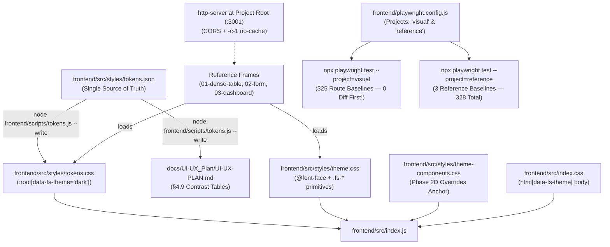

# Phase 2A Implementation Plan — Token Layer & Theme Primitives

## Goal Description
Execute **UI Phase 2A (Token Layer)** as defined in `docs/UI-UX_Plan/UI-UX-PLAN.md` §6.6 and governed by `AGENTS.md` and Plan Amendment v10.2 (D22 multi-theme door preservation).

Phase 2A establishes the foundational design tokens and core UI CSS primitives:
1. Emits `frontend/src/styles/tokens.css` from `tokens.json` via `node frontend/scripts/tokens.js --write`, scoped under `:root[data-fs-theme="dark"]` per D22 constraint 1.
2. Implements `frontend/src/styles/theme.css` with self-hosted IBM Plex font faces (`font-display: swap` + metric-adjusted `Plex Sans Fallback`), `.fs-page` base scope, typography, surfaces, buttons, inputs, badges, tables, numbers, states, tabs/pills, focus-inset, native controls, `forced-colors`, and `prefers-reduced-motion`.
3. Establishes empty `frontend/src/styles/theme-components.css` as the Phase 2D override anchor.
4. Updates `frontend/src/index.css` with two gated rules using attribute-existence `html[data-fs-theme]` body rules per D22 constraint 2a.
5. Imports the three stylesheets in `frontend/src/index.js` after `index.css`.
6. Links the 3 reference frames to the real token files, replacing all hardcoded colours with `var(--fs-*)` references.
7. Serves reference frames via a project-root static server (`npx http-server .. -p 3001 --cors -c-1`) so `@font-face` and token CSS resolve same-origin.
8. Adds `http-server` to `frontend/package.json` devDependencies.
9. Configures two Playwright projects (`visual` for 325 routes, `reference` for 3 frames) with unified `snapshotPathTemplate: '{testDir}/baseline/{arg}{ext}'`.
10. Suppresses toasts only during test runs via `page.addStyleTag` in the two visual spec files (no production code change).
11. Generates 3 new reference baselines into the A5-Local repo, updates `manifest.json` from 325 → 328, updates `verify-baseline-manifest.js`.
12. Executes strict sequential verification: (1) 325 route baselines zero-diff, (2) generate 3 reference baselines, (3) verify 3, (4) manifest 328/328.

---

## User Review Required

> [!IMPORTANT]
> **D22 Multi-Theme Architectural Constraints (Strictly Enforced)**
> 1. `tokens.css` emits scoped `:root[data-fs-theme="dark"] { ... }`, never flat `:root`.
> 2. `index.css` gates via attribute-existence `html[data-fs-theme] body { ... }` (specificity `(0,1,2)`), never attribute-value `html[data-fs-theme="dark"] body`.
> 3. Zero instances of `data-fs-theme="dark"` outside `tokens.css` across all CSS files.
> 4. `theme.css` and `theme-components.css` contain **zero literal hex, rgb, rgba, or named colours** — enforced by `.stylelintrc.json`.

> [!WARNING]
> **Strict Verification Order (No Baseline Drift Allowed)**
> `npx playwright test --update-snapshots` must never be run on the `visual` project.
> - **Step 1** runs `npx playwright test --project=visual` and proves 325 passed, 0 diff against pre-2A baselines (Invariant I13).
> - **Step 2** runs `npx playwright test --project=reference --update-snapshots` to generate the 3 new reference baselines.
> - **Step 3** runs `npx playwright test --project=reference` (no flag) to verify.
> - **Step 4** runs `node frontend/scripts/verify-baseline-manifest.js` to confirm 328/328.

> [!NOTE]
> **Toast Suppression — Test-Only, No Production Code Change**
> Toasts are suppressed only during Playwright screenshot capture, via `page.addStyleTag` in `visual.spec.js` and `reference-frames.spec.js`. No production JavaScript is touched — `ToastContext.js`, `Toast.js`, or any other component is unchanged. Local dev (`npm start` in browser) shows toasts as normal. This scope keeps 2A to CSS + config + content + test specs only.

> [!NOTE]
> **Pre-flight check — N1: toast selectors match the actual app's classes**
> Before adding `page.addStyleTag`, run:
> ```powershell
> grep -rn "toast" frontend/src/context/ frontend/src/components/ | grep -iE "className|role=" | head -20
> ```
> Confirm whether the app uses `.toast-container`, `.Toastify`, or a custom class. The suppression rule uses both class selectors and role selectors (`[role="status"]`, `[role="alert"]`) so it matches regardless of implementation.

> [!NOTE]
> **Pre-flight check — N2: 1C baselines contain no toasts**
> Before adding `addStyleTag` to `visual.spec.js`, open 3 random 1C baseline PNGs (e.g. `frontend/tests/visual/baseline/dashboard-1440.png`, `expenditures-1440.png`, `credit-cards-1440.png`). Confirm none show a visible toast.
> - If none show a toast: Step 1's 325-diff check is unaffected; `addStyleTag` is a visual no-op for those routes.
> - If any show a toast: that route is excluded from Step 1's zero-diff requirement, and its baseline is regenerated with `addStyleTag` applied; document the exclusion in the walkthrough.

---

## Proposed Changes



---

### Component 1: Design Tokens Engine (`tokens.json` & `tokens.js`)

#### [MODIFY] `frontend/src/styles/tokens.json`
Incorporate typography tokens from §4.5:
- `--fs-font-sans`: `'IBM Plex Sans', 'Plex Sans Fallback', -apple-system, BlinkMacSystemFont, 'Segoe UI', sans-serif`
- `--fs-font-mono`: `'IBM Plex Mono', ui-monospace, SFMono-Regular, Menlo, monospace`
- Text sizes & line heights (split into pairs for individual CSS property flexibility; recorded in §4.5 amendment note):
  - `--fs-text-xs`: `12px`, `--fs-line-height-xs`: `16px`
  - `--fs-text-sm`: `13px`, `--fs-line-height-sm`: `20px`
  - `--fs-text-base`: `14px`, `--fs-line-height-base`: `22px`
  - `--fs-text-lg`: `16px`, `--fs-line-height-lg`: `24px`
  - `--fs-text-xl`: `20px`, `--fs-line-height-xl`: `28px`
  - `--fs-text-2xl`: `24px`, `--fs-line-height-2xl`: `32px`
  - `--fs-text-3xl`: `32px`, `--fs-line-height-3xl`: `40px`
- Font weights: `--fs-weight-regular`: `400`, `--fs-weight-medium`: `500`, `--fs-weight-semibold`: `600`
- Incorporate shadows token from §4.1:
  - `--fs-shadow`: `0 2px 8px rgba(0, 0, 0, 0.35)`

#### [MODIFY] `frontend/scripts/tokens.js`
- `--write` mode: emits `frontend/src/styles/tokens.css` from `tokens.json`:
  ```css
  /* fs-tokens:start */
  :root[data-fs-theme="dark"] {
    /* Surfaces */
    --fs-bg: #101114;
    ... (all tokens)
  }
  /* fs-tokens:end */
  ```
  Excludes internal tooling keys (`_comment_*`).
  Regenerates §4.9 Markdown tables in `docs/UI-UX_Plan/UI-UX-PLAN.md`.
- `--check` mode (bare): validates (a) §4.9 Markdown tables, (b) `tokens.css` on disk matches generated content exactly.
- `--check --fonts` mode: validates font bundle (4 IBM Plex woff2 files present, total ≤ 90 KB).
- Comprehensive check command:
  ```text
  node frontend/scripts/tokens.js --check && node frontend/scripts/tokens.js --check --fonts
  ```

#### [NEW] `frontend/src/styles/tokens.css`
Generated file emitted via `node frontend/scripts/tokens.js --write`. Contains only the sentinel-delimited `:root[data-fs-theme="dark"]` block.

---

### Component 2: CSS Architecture & Theme Primitives (`theme.css` & `theme-components.css`)

#### [NEW] `frontend/src/styles/theme.css`
Hand-crafted CSS. Stylelint-enforced: 0 literal hex, rgb, rgba, or named colours; only `var(--fs-*)`.

1. **Self-Hosted `@font-face` Rules**:
   - `IBM Plex Sans` Regular (400), Medium (500), SemiBold (600), `IBM Plex Mono` Regular (400) loading from `../assets/fonts/*.woff2` with `font-display: swap`.
   - Size-adjusted fallback `@font-face`:
     ```css
     @font-face {
       font-family: 'Plex Sans Fallback';
       src: local('Arial'), local('Liberation Sans'), local('Helvetica');
       ascent-override: 102.5%;
       descent-override: 27.5%;
       line-gap-override: 0%;
       size-adjust: 100%;
     }
     ```

2. **Base Scope (`.fs-page`)**:
   - `background: var(--fs-bg); color: var(--fs-text); font-family: var(--fs-font-sans); min-height: calc(100vh - 64px);`
   - Scrollbar tokens (`--fs-scrollbar-thumb`, `--fs-scrollbar-track`).
   - `.main-content.full-bleed { padding: 0; }`.

3. **Typography (`.fs-page`)**:
   - Headings `h1`–`h4` with sizes and weights (500/600).
   - `.fs-page-title` plain `color: var(--fs-text)`, no `background-clip`.
   - `.fs-eyebrow` (normal tracking, `--fs-text-3`, `--fs-text-xs`, uppercase).
   - `.fs-page-subtitle`, `.fs-muted`.

4. **Surfaces & Layouts**:
   - `.fs-surface`, `.fs-surface-raised`, `.fs-surface-sunken`, `.fs-card`, `.fs-panel`, `.fs-panel-head`.
   - `.fs-page-head`, `.fs-grid`, `.fs-stack`.
   - Opaque surfaces, 1px `--fs-border`, radii 4/6/8px (per-corner shorthands only; no longhands).

5. **Interactive Controls & Buttons**:
   - `.fs-btn`, `.fs-btn-primary`, `.fs-btn-secondary`, `.fs-btn-ghost`, `.fs-btn-danger`, `.fs-btn-sm`.
   - Hover, active, disabled, and `:focus-visible` states using `--fs-focus-ring` and `--fs-focus-offset`.
   - `.fs-input`, `.fs-select`, `.fs-textarea`, `.fs-label`, `.fs-help`, `.fs-error`.
   - `::placeholder` using `--fs-text-3`.

6. **Badges, Meters & Tables**:
   - `.fs-badge` neutral chip; `.fs-badge--positive`, `.fs-badge--negative`, `.fs-badge--warning` with tone text + 2px left border (no tinted fills).
   - `.fs-table` (header on `--fs-surface-sunken`, 1px dividers, hover on `--fs-surface-raised`, sticky head).
   - `.fs-num` (proportional + tabular-nums).
   - `.fs-table-scroll { padding: 5px; }` (G4 clipping prevention).
   - `.fs-tabs`, `.fs-pill`, `.fs-progress` (monochrome + warning/negative modifiers).
   - `.fs-empty`, `.fs-skeleton`, `.fs-loading`, `.fs-error` state blocks (matching v9 §6.5 naming exactly).

7. **Focus-Inset Specificity (Order & Composition Priority)**:
   - Place `.fs-focus-inset` rules after `.fs-btn` in `theme.css`. Declare composite selector (specificity `(0,3,0)` beats `.fs-btn:focus-visible` at `(0,2,0)`):
     ```css
     .fs-focus-inset:focus-visible,
     .fs-focus-inset.fs-btn:focus-visible {
       outline: var(--fs-focus-ring);
       outline-offset: -3px;
     }
     ```

8. **Native Controls & Accessibility**:
   - Native controls per §4.14: `select`, `option`, `input[type="date"]`, `input[type="time"]`, `input[type="datetime-local"]` — scoped to `.fs-page`.
   - `@media (forced-colors: active)` per §4.11.
   - `@media (prefers-reduced-motion: reduce)` per §4.11 (`.fs-skeleton { animation: none; }`).

#### [NEW] `frontend/src/styles/theme-components.css`
Header comment establishing file purpose for Phase 2D overrides (E1). Zero declarations initially; clean stylelint pass.

---

### Component 3: Application Integration & Test-Only Toast Suppression

#### [MODIFY] `frontend/src/index.css`
Add two gated rules per §4.14 and D22 constraint 2a:
```css
html[data-fs-theme] {
  color-scheme: dark;
}

html[data-fs-theme] body {
  background: var(--fs-bg);
  color: var(--fs-text);
}
```
Default body declarations (`background-color: #f8f9fa; color: #2c3e50;`) remain untouched — the gated rule adds, does not replace.

#### [MODIFY] `frontend/src/index.js`
Import the three stylesheets in order after `index.css`:
```javascript
import './index.css';
import './styles/tokens.css';
import './styles/theme.css';
import './styles/theme-components.css';
```

#### [MODIFY] Test-Only Toast Suppression (No Production Code Change)
Toasts are suppressed only during Playwright screenshot capture. Add to both `frontend/tests/visual/visual.spec.js` and `frontend/tests/visual/reference-frames.spec.js`, immediately before the screenshot assertion:
```javascript
await page.waitForLoadState('networkidle');
await page.addStyleTag({
  content: `
    .toast-container,
    [class*="toast-container"],
    .Toastify,
    [role="status"],
    [role="alert"] {
      display: none !important;
      visibility: hidden !important;
    }
  `,
});
```
No modification to `frontend/src/context/ToastContext.js`, `frontend/src/components/Toast.js`, or any other production file. Local dev (`npm start` in browser) shows toasts as normal; production shows toasts as normal. Only the Playwright browser context hides them, and only for the duration of the screenshot test.

The role-based selectors (`[role="status"]`, `[role="alert"]`) are mandated by v9 §6.4 for accessibility live regions; they catch any toast implementation regardless of library or class name.

---

### Component 4: Reference Frames, Serving Model & Playwright Configuration

#### [MODIFY] `frontend/package.json`
Add `http-server` to `devDependencies`:
```bash
npm i -D http-server
```
Commit the updated `package.json` and `package-lock.json`.

#### [MODIFY] Reference Frames HTML Files
In `docs/UI-UX_Plan/reference/01-dense-table.html`, `02-form.html`, `03-dashboard.html`:
1. Add `data-fs-theme="dark"` to `<html lang="en">` → `<html lang="en" data-fs-theme="dark">`.
2. Replace inline `<style>:root { ... }</style>` block with:
   ```html
   <link rel="stylesheet" href="../../../frontend/src/styles/tokens.css">
   <link rel="stylesheet" href="../../../frontend/src/styles/theme.css">
   <link rel="stylesheet" href="../../../frontend/src/styles/theme-components.css">
   ```
3. Audit remaining inline styles for hardcoded hex/rgb and replace with `var(--fs-*)` references — satisfying the "tokens only" requirement from v9 §6.5.
4. Verify the file loads correctly through the http-server at `http://localhost:3001/docs/UI-UX_Plan/reference/01-dense-table.html` before proceeding (see Verification Plan step 5).

#### [MODIFY] `frontend/playwright.config.js`
1. Verify `testDir` (N5):
   ```powershell
   grep "testDir" frontend/playwright.config.js
   ```
   Confirm the value produces `frontend/tests/visual/baseline/` in the `snapshotPathTemplate` output. Since `testDir` is `./tests/visual`, the template `'{testDir}/baseline/{arg}{ext}'` is correct.
2. Configure `snapshotPathTemplate`:
   ```javascript
   snapshotPathTemplate: '{testDir}/baseline/{arg}{ext}',
   ```
3. Configure two `webServer` entries:
   ```javascript
   webServer: [
     {
       command: process.env.CI
         ? 'npm run build && npx serve -s build -l 3000'
         : 'npm start',
       port: 3000,
       reuseExistingServer: !process.env.CI,
       timeout: 120000,
     },
     {
       command: 'npx http-server .. -p 3001 --cors -c-1',
       port: 3001,
       reuseExistingServer: !process.env.CI,
       timeout: 30000,
     },
   ],
   ```
   `http-server ..` serves the project root (`D:\Projects\FinStat\`) so the reference frames at `docs/UI-UX_Plan/reference/` can resolve `../../../frontend/src/styles/*` and `theme.css`'s `../assets/fonts/*` as same-origin requests. `-c-1` disables caching. Note (N4): this server is local-and-CI-only; it is never exposed externally.
4. Configure Playwright projects:
   ```javascript
   projects: [
     { name: 'setup', testMatch: /auth\.setup\.js/ },
     { name: 'visual', dependencies: ['setup'], testMatch: /visual\.spec\.js/ },
     { name: 'reference', testMatch: /reference-frames\.spec\.js/ },
     { name: 'a11y', dependencies: ['setup'], testMatch: /a11y\.spec\.js/ },
   ],
   ```
   `a11y` project is defined but not executed in 2A (N3). Since Step 1 requires all 325 route baselines to be pixel-identical to their 1C captures (which implies DOM structure unchanged), running axe on those same routes would produce identical results to 1C. If Step 1 shows any diff on any route, `--project=a11y` runs on that specific route before merge.

#### [NEW] `frontend/tests/visual/reference-frames.spec.js`
- Navigates to `http://localhost:3001/docs/UI-UX_Plan/reference/01-dense-table.html`, `.../02-form.html`, `.../03-dashboard.html` at 1440px viewport.
- Awaits `await page.waitForLoadState('networkidle')`.
- Applies toast suppression `addStyleTag` (see Component 3).
- Awaits `await page.evaluate(() => document.fonts.ready)`.
- Asserts font resolution:
  ```javascript
  const fontLoaded = await page.evaluate(() => document.fonts.check('14px "IBM Plex Sans"'));
  expect(fontLoaded).toBe(true);
  ```
- Captures:
  ```javascript
  await expect(page).toHaveScreenshot('reference-01-dense-table-1440.png');
  // ... repeat for 02-form and 03-dashboard
  ```

#### [MODIFY] `frontend/scripts/verify-baseline-manifest.js`
Parse manifest dynamically and support both object-dictionary and array formats:
```javascript
const manifest = JSON.parse(fs.readFileSync(MANIFEST_PATH, 'utf8'));
const entries = manifest.entries
  ? (Array.isArray(manifest.entries) ? manifest.entries : Object.entries(manifest.entries))
  : Object.entries(manifest);
const expectedCount = manifest.count || entries.length;
if (entries.length !== expectedCount || entries.length < 325) {
  console.error(`Expected ${expectedCount} entries (>= 325), found ${entries.length}`);
  process.exit(1);
}
```
Update `manifest.json` from `count: 325, entries: [...]` to `count: 328, entries: [... 325 route entries + 3 new reference entries]`.
Commit the 3 new baseline PNGs and updated `manifest.json` to `D:\Projects\FinStat-visual-baselines`.

---

## Verification Plan

### Automated Tests (Strict Sequential Execution)

1. **Token Generator & Contrast Check**:
   ```bash
   node frontend/scripts/tokens.js --write
   node frontend/scripts/tokens.js --check
   node frontend/scripts/tokens.js --check --fonts
   ```
   *Expected*: 0 drift on §4.9 tables and `tokens.css`; font budget ≤ 90 KB.

2. **Stylelint & Tone Linting**:
   ```bash
   cd frontend
   npx stylelint "src/styles/*.css"
   node scripts/lint-tones.js
   node scripts/lint-ratchet.js
   ```
   *Expected*: `theme.css` and `theme-components.css` pass with 0 errors; no illegal tone usage; ratchet passes.

3. **D22 Multi-Theme Constraint Verification**:
   ```powershell
   # Constraint 1: scoped :root block in tokens.css
   Select-String -Path frontend/src/styles/tokens.css -Pattern "^:root"

   # Constraint 2a: attribute-existence in index.css
   Select-String -Path frontend/src/index.css -Pattern "data-fs-theme"

   # Constraint 2b: no data-fs-theme="dark" outside tokens.css
   Get-ChildItem -Recurse -Include "tokens.css","theme.css","theme-components.css","index.css" frontend/src |
     Select-String 'data-fs-theme="dark"'
   ```
   *Expected*:
   - Only `frontend/src/styles/tokens.css` matches `:root[data-fs-theme="dark"]`.
   - `frontend/src/index.css` contains `html[data-fs-theme]` (existence).
   - Zero occurrences of `data-fs-theme="dark"` in `theme.css`, `theme-components.css`, or `index.css`.

4. **Production Build & Jest Test Suite**:
   ```bash
   cd frontend
   $env:CI="true"; npm run build
   $env:CI="true"; npm test -- --watchAll=false
   npx jest --runInBand tests/a11y/expectNoA11yViolations.test.js
   npx jest --runInBand tests/calculations.spec.js
   ```
   *Expected*:
   - Zero compilation errors under `CI=true`; `Compiled successfully`.
   - `npm test` reports 44 test suites in `src/` — passing. (Reconciled count; v3's "48" was stale).
   - The two specialized `tests/` suites pass.
   - Total: 44 (`src/`) + 2 (`tests/`) = 46 Jest suites.

5. **STEP 1 — Legacy Route Safety Net (325 Baselines, Zero Diff)**:
   ```bash
   cd frontend
   npx playwright test --project=visual
   ```
   *Expected*: 325 route snapshots pass with 0 diff against pre-2A baselines. Proves zero CSS leakage to legacy routes (Invariant I13).
   **Never pass `--update-snapshots` here.** Full report attached to walkthrough.

6. **STEP 2 — Reference Frame Baselines Generation (3 Frames)**:
   ```bash
   cd frontend
   npx playwright test --project=reference --update-snapshots
   ```
   *Expected*: generates 3 new baseline PNGs in `frontend/tests/visual/baseline/`:
   - `reference-01-dense-table-1440.png`
   - `reference-02-form-1440.png`
   - `reference-03-dashboard-1440.png`

7. **STEP 3 — Reference Frame Verification (3 Passed)**:
   ```bash
   cd frontend
   npx playwright test --project=reference
   ```
   *Expected*: 3 passed, 0 diff. Confirms `page.evaluate(() => document.fonts.check('14px "IBM Plex Sans"'))` returned `true`.

8. **STEP 4 — Commit Baselines & Verify Manifest (328/328)**:
   Commit the 3 new baseline PNGs and updated `manifest.json` to `D:\Projects\FinStat-visual-baselines`:
   ```bash
   cd D:\Projects\FinStat-visual-baselines
   git add reference-01-dense-table-1440.png reference-02-form-1440.png reference-03-dashboard-1440.png manifest.json
   git commit -m "phase(2a): add 3 reference frame baselines (325 -> 328)"
   ```
   Verify:
   ```bash
   node frontend/scripts/verify-baseline-manifest.js
   ```
   *Expected*: 328/328 baselines verified (all ≥ 1000 bytes, dimensions > 1×1, sha256 match).

### Manual Verification
1. Run local dev server (`npm start`).
2. Visit `/dashboard` and unmigrated routes (e.g. `/salary`, `/expenditures`).
3. Verify unmigrated routes still display their original light theme `#f8f9fa` with zero style leakage.
4. In DevTools on any page, run `document.documentElement.dataset.fsTheme = 'dark'`:
   - Verify body background switches to `#101114` and color to `#f2f3f5`.
   - Remove attribute: returns to light background and text.
5. Directly open `http://localhost:3001/docs/UI-UX_Plan/reference/01-dense-table.html` in browser:
   - Verify IBM Plex Sans fonts and token styles load properly.
   - Verify 0 console 404s (fonts, CSS, or any asset).

---

## Walkthrough Evidence Checklist
The walkthrough must capture actual command output for each of the following:

| # | Evidence |
|---|---|
| 1 | `grep "^:root" frontend/src/styles/tokens.css` → `:root[data-fs-theme="dark"]` (single match, no bare `:root`) |
| 2 | `grep "data-fs-theme" frontend/src/index.css` → `html[data-fs-theme] body` on body rule |
| 3 | `grep -rn 'data-fs-theme="dark"' frontend/src/styles/theme.css frontend/src/styles/theme-components.css frontend/src/index.css` → empty |
| 4 | `node frontend/scripts/tokens.js --check && node frontend/scripts/tokens.js --check --fonts` → both exit 0 |
| 5 | `npx stylelint "src/styles/*.css"` → 0 errors |
| 6 | Step 1: `npx playwright test --project=visual` → 325 passed, 0 diff (before any reference baselines exist) |
| 7 | Step 2: `npx playwright test --project=reference --update-snapshots` → 3 baselines generated in `frontend/tests/visual/baseline/reference-*.png` |
| 8 | Step 3: `npx playwright test --project=reference` → 3 passed, 0 diff |
| 9 | Step 4: `node frontend/scripts/verify-baseline-manifest.js` → 328/328 verified |
| 10 | `git log --oneline -n 3` in `D:\Projects\FinStat-visual-baselines` → shows new commit with 3 reference PNGs + updated `manifest.json` |
| 11 | `CI=true npm run build` → exit 0, Compiled successfully |
| 12 | `npm test -- --watchAll=false` → 44 `src/` suites + 2 `tests/` suites = 46 total (not 48/50) |
| 13 | `git diff main -- frontend/src/context/ frontend/src/components/Toast.js` → empty (confirms no production code changes; toast suppression is test-only) |
| 14 | DevTools manual: `data-fs-theme="dark"` on `<html>` → body switches; removed → reverts. Proves D22 mechanism is value-agnostic and ready for T3 |
| 15 | N1: `grep -rn "toast" frontend/src/context/ frontend/src/components/ | grep -iE "className|role=" | head -20` → confirms suppression selectors (`.toast-container`, `[role="status"]`, `[role="alert"]`) match actual app patterns |
| 16 | N2: open 3 random 1C baseline PNGs (`dashboard-1440.png`, `expenditures-1440.png`, `credit-cards-1440.png`) → confirm none show visible toasts. If any do, document exclusion and regenerate those specific baselines |
| 17 | N5: `grep "testDir" frontend/playwright.config.js` → confirm value combined with `snapshotPathTemplate` produces `frontend/tests/visual/baseline/` |
| 18 | Open `http://localhost:3001/docs/UI-UX_Plan/reference/01-dense-table.html` in browser → 0 console 404s, IBM Plex rendered |
| 19 | Zero production JS: `git diff main -- frontend/src/context/ frontend/src/components/` → only `theme.css`, `theme-components.css`, `tokens.css`, `index.css`, `index.js` under `src/` are touched; no `.js` under `context/` or `components/` |

---

## Execution Sequence
1. Pre-flight N1 — verify toast selectors.
2. Pre-flight N2 — verify 1C baselines have no toasts.
3. Pre-flight N5 — verify testDir.
4. Component 1 — extend `tokens.json`, extend `tokens.js`, run `--write`.
5. Component 2 — author `theme.css`, stub `theme-components.css`.
6. Component 3 — update `index.css`, update `index.js`, add `addStyleTag` to both spec files.
7. Component 4 — add `http-server` devDependency, update reference frames, update `playwright.config.js`, author `reference-frames.spec.js`, update `verify-baseline-manifest.js`.
8. Verification 1–4 — token, stylelint, D22, build+tests.
9. Verification 5 — Step 1: 325-diff.
10. Verification 6–7 — Step 2 + 3: generate and verify 3 reference baselines.
11. Verification 8 — Step 4: commit baselines and verify 328/328 manifest.
12. Manual 1–5.
13. Produce walkthrough with 19 evidence items.

---

## Commit Discipline
Suggested commits (each a coherent unit, not a full branch squash):
1. `phase(2a): extend tokens.json with typography and shadows`
2. `phase(2a): tokens.js emits scoped tokens.css and validates font budget`
3. `phase(2a): generate tokens.css from tokens.json`
4. `phase(2a): author theme.css with primitives, fonts, and accessibility blocks`
5. `phase(2a): stub theme-components.css as 2D anchor`
6. `phase(2a): gate body via html[data-fs-theme] attribute-existence`
7. `phase(2a): import tokens, theme, theme-components in entry point`
8. `phase(2a): reference frames load real tokens; hardcoded colours audited`
9. `phase(2a): http-server devDependency and multi-server Playwright config`
10. `phase(2a): split Playwright into visual and reference projects`
11. `phase(2a): test-only toast suppression via addStyleTag with role selectors`
12. `phase(2a): verify-baseline-manifest supports dynamic entry count`
13. `phase(2a): generate 3 reference frame baselines`
14. `phase(2a): reference baselines committed to A5-Local repo`
15. Walkthrough commit on `phase-ui-2a-tokens`.
