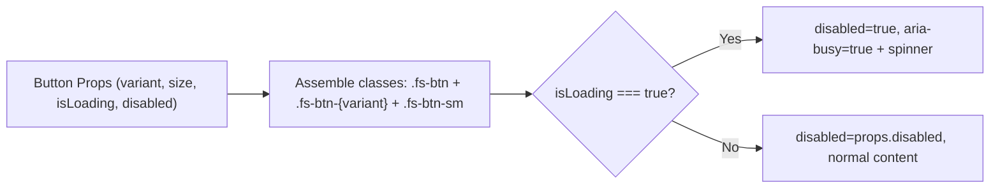

# Implementation Plan — UI Phase 2E: Seven Primitives, Category Labels, and Specificity (v3 — Pre-Flight Revisions)

> **Branch:** `phase-ui-2e-primitives`  
> **Governing Spec:** `docs/UI-UX_Plan/UI-UX-PLAN.md` §6.6 (Phase 2E), §8.4 (Primitives), §4.3 (Semantic tones), §4.16 (Dual-mode components), and §4.14 (Scoping & Specificity)  
> **Status:** Pending User Review & Approval  
> **Prerequisites:** Phase 2D merged to `main` at `1c441ec` / progress log at `33e5cb4` (Complete)

---

## 1. Goal Description

Phase 2E establishes the core design system component building blocks for all subsequent route migrations (Phase 3A through Phase 11A) without altering existing page markup (preserving Invariant I13 and zero diff on unmigrated routes):

1. **Seven React Primitives**: Extract `Button`, `Card`, `Badge`, `PageHeader`, `EmptyState`, `Tabs`, and `Delta` in `frontend/src/components/ui/` with full TypeScript-grade JSDoc prop typing, strict prop validation, forwarding of `data-testid`, `className`, and ARIA attributes, and zero colour-bearing inline styles or raw hex values.
2. **Semantic Delta & Tone Classes**: Author `.fs-delta` and its three modifier classes (`.fs-delta--positive`, `.fs-delta--negative`, `.fs-delta--warning`, plus neutral default) in `frontend/src/styles/theme.css` following §4.3 normative tone rules (deviation from expectation only; no tinted fills; solid fills use `--fs-ink`).
3. **Category Labels as Data**: Ensure `frontend/src/constants/categories.js` keeps hex colors purely as data with zero derived `tint` fields, preserving category identity as text/labels (§4.3 rule 4).
4. **Specificity Conflict Reconciliations**: Document the exact resolution or owning phase for every one of the 47 core application `!important` declarations and high-specificity selectors identified in the 1A selector audit across 10 legacy files.
5. **Dual-Mode Cluster Navigation Rules**: Formalize and demonstrate the dual-mode styling rules for cluster sub-navigators (`ExpenditureSubNav`, `CreditCardSubNav`, `PayrollRulesHub`) that serve converted (`.fs-page`) and unconverted routes concurrently (§4.16).

---

## 2. User Review Required & Guardrails

> [!IMPORTANT]
> **Incremental Primitive Adoption (No Global Refactor):**
> Per §6.6 and §8.4, primitives are extracted and tested in isolation during Phase 2E. Existing pages are **not** refactored in Phase 2E — adoption occurs incrementally as each page's dedicated sub-phase opens (e.g. `DashboardKpiStrip` adopts `Delta` and `Card` in Phase 3A; `ExpenditureLogPage` adopts `Badge` and `Button` in Phase 4A). This guarantees **zero visual diff** across all 326 production route snapshots.

> [!NOTE]
> **Button `isLoading` Spinner Scoping (N1):**
> `Button`'s `isLoading` spinner renders `.loading-spinner`, which 2C scoped to `.fs-page .loading-spinner`. Since `Button` is only used inside `.fs-page` (from 3A onward), this works seamlessly. Sub-phase 2F will replace this inline indicator with `<Loading variant="inline" />` when app-wide loading uniformity is established, eliminating any scoping dependency.

> [!NOTE]
> **Loading Primitive Decoupled to Sub-Phase 2F:**
> As established in Plan Amendment v10.3 (D23), Primitive #8 (`Loading`) has its own dedicated universal migration sub-phase (Phase 2F). Phase 2E strictly extracts the primary 7 primitives.

---

## 3. Architecture & Primitive Specifications

### 3.1 Primitive 1: `Button` (`frontend/src/components/ui/Button.js`)
Wraps `.fs-btn` and primitive utility classes from `theme.css`.

- **Props**:
  - `variant`: `'primary' | 'secondary' | 'ghost' | 'danger'` (default: `'secondary'`)
  - `size`: `'sm' | 'md'` (default: `'md'`)
  - `isLoading`: `boolean` (default: `false`)
  - `disabled`: `boolean` (default: `false`)
  - `type`: `'button' | 'submit' | 'reset'` (default: `'button'`)
  - `icon`: `ReactNode` (optional leading icon)
  - `iconRight`: `ReactNode` (optional trailing icon)
  - `className`: `string`
  - `children`: `ReactNode`
- **Class Mapping**:
  - Base: `.fs-btn`
  - Variant: `.fs-btn-primary`, `.fs-btn-secondary`, `.fs-btn-ghost`, `.fs-btn-danger`
  - Size: `.fs-btn-sm` (when `size === 'sm'`)
- **Accessibility & Loading**:
  - When `isLoading` is true, sets `disabled={true}`, `aria-busy="true"`, and renders inline `<span className="loading-spinner" aria-hidden="true" />` alongside children.
  - Fully forwards `data-testid`, `aria-label`, and standard button event handlers.



### 3.2 Primitive 2: `Card` (`frontend/src/components/ui/Card.js`)
Wraps `.fs-card` with opaque surface, 1px border, and optional slots.

- **Props**:
  - `variant`: `'default' | 'raised'` (default: `'default'`)
  - `header`: `ReactNode` (optional header slot)
  - `footer`: `ReactNode` (optional footer slot)
  - `className`: `string`
  - `children`: `ReactNode`
- **Class Mapping**:
  - Base: `.fs-card`
  - Variant: `.fs-card--raised` (uses `--fs-surface-raised` instead of `--fs-surface`)
- **Structure**:
  ```jsx
  <div className={cardClasses} {...rest}>
    {header && <div className="fs-card-header">{header}</div>}
    <div className="fs-card-body">{children}</div>
    {footer && <div className="fs-card-footer">{footer}</div>}
  </div>
  ```

### 3.3 Primitive 3: `Badge` (`frontend/src/components/ui/Badge.js`)
Neutral chip plus three semantic tones; strictly requires a label; no tinted fills (§4.3 rule 2 & §8.4).

- **Props**:
  - `tone`: `'neutral' | 'positive' | 'negative' | 'warning'` (default: `'neutral'`)
  - `label`: `string` (optional prop)
  - `children`: `ReactNode` (optional)
  - `className`: `string`

#### Precedence & Accessible Label Resolution Rules
1. **Both `label` and `children` provided**:
   - `label` becomes the accessible `aria-label`.
   - `children` renders as the visible content (e.g. `<Badge label="Approved" tone="positive"><Icon name="check" /> Approved</Badge>`).
2. **Only `label` provided**:
   - `label` renders as the visible text content (and also serves as the accessible name).
3. **Only `children` provided**:
   - `children` renders visibly. If `children` is a string, it also serves as the accessible text; if complex node, developer must ensure an accessible name exists.
4. **Neither provided**:
   - Logs a development warning (`console.warn('[Badge] A badge requires a label or children.')`), and renders `null` to avoid empty badges.

- **Class Mapping**:
  - Base: `.fs-badge` (`--fs-surface-raised`, `--fs-border`, `--fs-text-2`, pill radius)
  - Semantic Modifiers:
    - `positive`: `.fs-badge--positive` (text `--fs-positive`, 2px left border `--fs-positive`)
    - `negative`: `.fs-badge--negative` (text `--fs-negative`, 2px left border `--fs-negative`)
    - `warning`: `.fs-badge--warning` (text `--fs-warning`, 2px left border `--fs-warning`)
    - `neutral`: no modifier class

### 3.4 Primitive 4: `Delta` (`frontend/src/components/ui/Delta.js`)
Required component for amount deltas (§8.4, §4.3 rule 6).

- **Props**:
  - `value`: `number | string` (required amount or percentage)
  - `tone`: `'neutral' | 'positive' | 'negative' | 'warning'` (default: `'neutral'`)
  - `sign`: `'auto' | 'none' | 'positive' | 'negative'` (default: `'auto'`)
  - `label`: `string` (**required** descriptive label, e.g. "vs previous period")
  - `className`: `string`

#### Accessibility Announcement Pattern (Option B Selected)
To completely prevent screen reader double-announcements across ATs (e.g. JAWS/TalkBack traversing both parent `aria-label` and unhidden child nodes), **Option B** is chosen:
- Visible content announces naturally through standard DOM text.
- Parent container does **not** duplicate text into `aria-label`.
- Unicode minus (`\u2212`) and plus (`+`) announce naturally in screen readers.

- **Sign Resolution**:
  - `auto`: Computes `+` for numeric > 0, `−` (`\u2212`) for numeric < 0, none for 0.
  - `positive`: Explicit `+`
  - `negative`: Explicit `−` (`\u2212`)
  - `none`: No sign character.
- **Structure**:
  ```jsx
  <span className={`fs-delta fs-delta--${tone} ${className || ''}`} {...rest}>
    <span className="fs-delta-value">{signChar}{value}</span>
    <span className="fs-delta-label">{label}</span>
  </span>
  ```

### 3.5 Primitive 5: `PageHeader` (`frontend/src/components/ui/PageHeader.js`)
Replaces ad-hoc `.page-header` declarations across the application (§8.4).

- **Props**:
  - `title`: `string | ReactNode` (**required**)
  - `subtitle`: `string | ReactNode` (optional)
  - `eyebrow`: `string | ReactNode` (optional, **off by default**)
  - `actions`: `ReactNode` (optional action buttons / controls)
  - `className`: `string`
- **Structure**:
  ```jsx
  <header className={`fs-page-head ${className || ''}`} {...rest}>
    <div className="fs-page-head-content">
      {eyebrow && <div className="fs-eyebrow">{eyebrow}</div>}
      <h1 className="fs-page-title">{title}</h1>
      {subtitle && <p className="fs-page-subtitle">{subtitle}</p>}
    </div>
    {actions && <div className="fs-page-actions">{actions}</div>}
  </header>
  ```

### 3.6 Primitive 6: `EmptyState` (`frontend/src/components/ui/EmptyState.js`)
Standardized state block: icon + one title line + optional description + optional action CTA (§8.4).

- **Props**:
  - `icon`: `ReactNode` (optional icon)
  - `title`: `string | ReactNode` (**required**)
  - `description`: `string | ReactNode` (optional)
  - `action`: `ReactNode` (optional CTA button)
  - `className`: `string`
- **Structure**:
  ```jsx
  <div className={`fs-empty ${className || ''}`} role="status" {...rest}>
    {icon && <div className="fs-empty-icon" aria-hidden="true">{icon}</div>}
    <h3 className="fs-empty-title">{title}</h3>
    {description && <p className="fs-empty-desc">{description}</p>}
    {action && <div className="fs-empty-action">{action}</div>}
  </div>
  ```

### 3.7 Primitive 7: `Tabs` (`frontend/src/components/ui/Tabs.js`)
Accessible tablist with full keyboard navigation and `aria-selected` (§8.4).

- **Props**:
  - `tabs`: `Array<{ id: string, label: string, icon?: ReactNode, disabled?: boolean, badge?: string | number }>` (**required**)
  - `activeTab`: `string` (**required**)
  - `onChange`: `(tabId: string) => void` (**required**)
  - `ariaLabel`: `string` (required accessible name)
  - `orientation`: `'horizontal' | 'vertical'` (default: `'horizontal'`)
  - `className`: `string`
- **ARIA APG Orientation Compliance (C2)**:
  - The `role="tablist"` container sets `aria-orientation={orientation}` explicitly (`"horizontal"` by default, `"vertical"` when `orientation="vertical"`). This satisfies ARIA APG tab pattern requirements for accurate screen reader keyboard hint announcements.
- **Keyboard Navigation Support (C3)**:
  - When `orientation === 'horizontal'` (default):
    - `ArrowRight`: Focuses next enabled tab (wrapping around).
    - `ArrowLeft`: Focuses previous enabled tab (wrapping around).
    - `ArrowDown` / `ArrowUp`: Inert (does not change active tab; standard browser scroll behavior preserved).
  - When `orientation === 'vertical'`:
    - `ArrowDown`: Focuses next enabled tab (wrapping around).
    - `ArrowUp`: Focuses previous enabled tab (wrapping around).
    - `ArrowRight` / `ArrowLeft`: Inert (does not change active tab).
  - Both orientations:
    - `Home`: Focuses first enabled tab.
    - `End`: Focuses last enabled tab.
    - `Enter` / `Space`: Activates the focused tab.
    - Disabled tabs are skipped automatically during cycling.

---

## 4. Proposed Changes

### 4.1 Design System Primitives & Barrel Exports

#### [NEW] `frontend/src/components/ui/Button.js`
Button primitive implementing variants (`primary`, `secondary`, `ghost`, `danger`), sizes (`sm`, `md`), loading state with spinner, and full ARIA support. Default export `Button`.

#### [NEW] `frontend/src/components/ui/Card.js`
Card primitive implementing opaque surfaces, border, `raised` modifier, and header/body/footer slots. Default export `Card`.

#### [NEW] `frontend/src/components/ui/Badge.js`
Badge primitive implementing neutral chip, label precedence rules, and three semantic tone modifiers (`positive`, `negative`, `warning`). Default export `Badge`.

#### [NEW] `frontend/src/components/ui/Delta.js`
Delta primitive implementing value, sign (`auto`, `none`, `positive`, `negative`), required `label`, and Option B natural announcement. Default export `Delta`.

#### [NEW] `frontend/src/components/ui/PageHeader.js`
PageHeader primitive implementing title, subtitle, optional eyebrow, and actions slot. Default export `PageHeader`.

#### [NEW] `frontend/src/components/ui/EmptyState.js`
EmptyState primitive implementing icon, title, description, and action CTA slot with `role="status"`. Default export `EmptyState`.

#### [NEW] `frontend/src/components/ui/Tabs.js`
Tabs primitive implementing accessible `role="tablist"` / `role="tab"` with `aria-orientation`, horizontal/vertical keyboard roving navigation, and active state indicators. Default export `Tabs`.

#### [NEW] `frontend/src/components/ui/index.js`
Unified export barrel for all 7 primitives supporting both named imports from barrel and direct default imports (C1):
```javascript
export { default as Button } from './Button';
export { default as Card } from './Card';
export { default as Badge } from './Badge';
export { default as Delta } from './Delta';
export { default as PageHeader } from './PageHeader';
export { default as EmptyState } from './EmptyState';
export { default as Tabs } from './Tabs';
```
*(Supports: `import { Button } from '../components/ui'` and `import Button from '../components/ui/Button'` cleanly without duplicate-export parse errors).*

---

### 4.2 Styling Additions in `frontend/src/styles/theme.css`

#### [MODIFY] `frontend/src/styles/theme.css`
Add the following token-compliant styles:
- `.fs-delta`, `.fs-delta--positive`, `.fs-delta--negative`, `.fs-delta--warning`, `.fs-delta--neutral`, `.fs-delta-value`, `.fs-delta-label`.
- `.fs-card--raised`, `.fs-card-header`, `.fs-card-body`, `.fs-card-footer`.
- `.fs-page-actions`, `.fs-page-head-content`.
- `.fs-empty-icon`, `.fs-empty-title`, `.fs-empty-desc`, `.fs-empty-action`.
- `.fs-tab`, `.fs-tab--active`, `.fs-tab:hover`, `.fs-tab:focus-visible`, `.fs-tab:disabled`.

---

### 4.3 Dual-Mode Shared Component Overrides in `theme-components.css`

#### [MODIFY] `frontend/src/styles/theme-components.css`
Add `.fs-page`-scoped rules for cluster sub-navigators to support dual-mode rendering:
- `.fs-page .expenditure-subnav-container`, `.fs-page .expenditure-subnav-track`, `.fs-page .expenditure-subnav-link`, `.fs-page .expenditure-subnav-link.active`
- `.fs-page .credit-card-subnav-container`, `.fs-page .credit-card-subnav-track`, `.fs-page .credit-card-subnav-link`
- `.fs-page .payroll-rules-hub-tabs`, `.fs-page .payroll-rules-hub-tab`

---

### 4.4 Category Labels & ESLint Exemption Verification

#### [MODIFY] `frontend/src/constants/categories.js`
Confirm existing hex definitions remain pure data with zero derived `tint` property. Add inline documentation clarifying category identity is label text (§4.3 rule 4).

#### [NEW] `frontend/src/constants/__tests__/categories.test.js`
Unit tests asserting that `EXPENDITURE_CATEGORIES`:
- Contains only name, color, and keywords (no `tint` field derived).
- Colors are valid hex strings and contain NO `#14b8a6` (accent ban).

---

### 4.5 Specificity Conflict Disposition Matrix (1A Audit — Reconciled)

Accurately maps the 47 core application `!important` declarations to their governing phases (per v9 §5 and v10.3):

| File | Count | Domain / Scope | Status in Phase 2E | Owning Sub-phase |
| :--- | :---: | :--- | :--- | :---: |
| `App.css` | 11 | Global utilities & overrides | **RESOLVED** in Phase 2C (0 remaining) | Phase 2C (Complete) |
| `ProtectedAction.css` | 5 | Disabled action overlay | **RESOLVED** in Phase 2D (shadowed via `.fs-page .protected-action-wrapper`); legacy file untouched until Phase 12 | Phase 2D (Complete) / Phase 12 |
| `Sidebar.css` | 1 | Mobile drawer width | **RESOLVED** in Phase 2B (dark shell gating) | Phase 2B (Complete) |
| `Expenditure.css` | 2 | Expenditure mobile padding & button text | Deferred to Phase 4 (Expenditure conversion) | Phase 4A / 4B |
| `DebtPayoffPage.css` | 1 | Green table row highlight | Deferred to Phase 9 (Credit cards conversion) | Phase 9B |
| `ReconciliationPage.css` | 2 | Small table button padding | Deferred to Phase 9 (Credit cards conversion) | Phase 9B |
| `Trades.css` | 8 | Action buttons & links | Deferred to Phase 7 (Investments conversion) | Phase 7A |
| `CorporateActionsList.css` | 9 | Modal & wizard buttons | Deferred to Phase 7 (Investments conversion) | Phase 7B |
| `CorporateActionWizard.css` | 7 | Wizard step buttons | Deferred to Phase 7 (Investments conversion) | Phase 7B |
| `Lending.css` | 1 | Overflow-x auto on mobile | Deferred to Phase 9 (Credit cards / lending conversion) | Phase 9C |

---

### 4.6 Verification & Test Suites

#### [NEW] `frontend/src/components/ui/__tests__/Button.test.js`
Tests variants (`primary`, `secondary`, `ghost`, `danger`), sizes (`sm`, `md`), loading state with spinner, click handling, disabled state, and `expectNoA11yViolations`.

#### [NEW] `frontend/src/components/ui/__tests__/Card.test.js`
Tests default/raised variants, slot rendering (header, body, footer), and `expectNoA11yViolations`.

#### [NEW] `frontend/src/components/ui/__tests__/Badge.test.js`
Tests positive, negative, warning, and neutral tone modifiers, all four precedence cases (both, label-only, children-only, neither warning), and `expectNoA11yViolations`.

#### [NEW] `frontend/src/components/ui/__tests__/Delta.test.js`
Tests tone modifiers, auto/explicit sign calculation (`+`, `−`, none), required label rendering, Option B announcement, and `expectNoA11yViolations`.

#### [NEW] `frontend/src/components/ui/__tests__/PageHeader.test.js`
Tests title, subtitle, optional eyebrow (on/off), actions slot, and `expectNoA11yViolations`.

#### [NEW] `frontend/src/components/ui/__tests__/EmptyState.test.js`
Tests icon, title, description, action CTA slot, `role="status"`, and `expectNoA11yViolations`.

#### [NEW] `frontend/src/components/ui/__tests__/Tabs.test.js`
Comprehensive test suite asserting (C3):
- **Horizontal Mode**:
  - `ArrowRight` -> focuses next tab; `ArrowLeft` -> focuses previous tab.
  - `ArrowDown` / `ArrowUp` -> inert (active tab unchanged).
  - `Home` / `End` -> focuses first / last tab.
- **Vertical Mode**:
  - `aria-orientation="vertical"` confirmed on container (C2).
  - `ArrowDown` -> focuses next tab; `ArrowUp` -> focuses previous tab.
  - `ArrowRight` / `ArrowLeft` -> inert (active tab unchanged).
  - `Home` / `End` -> focuses first / last tab.
- **Common Behaviors**:
  - Skips disabled tabs automatically in both orientations.
  - `Enter` / `Space` triggers `onChange` with tab id.
  - `expectNoA11yViolations` passes on both orientations.

#### [NEW] `frontend/tests/visual/fixtures/shared/primitives.html`
Static dual-mode HTML fixture rendering all 7 primitives in both legacy and `.fs-page` / `html[data-fs-theme]` contexts alongside cluster subnav dual-mode blocks (`ExpenditureSubNav`, `CreditCardSubNav`, `PayrollRulesHub`).

#### [NEW] `frontend/tests/visual/primitives.spec.js`
Playwright browser test suite verifying computed styles and keyboard navigation in Chromium at 1440px.

---

## 5. Verification Plan

### Automated Tests
1. **Jest Unit & Accessibility Suites**:
   ```powershell
   cd frontend; npm test -- --watchAll=false src/components/ui/ src/constants/
   ```
   *Expected: All 8 test suites pass, 0 a11y violations via `jest-axe`.*
2. **Full Unit Suite Regression**:
   ```powershell
   cd frontend; $env:CI="true"; npm test
   ```
   *Expected: 58/58 test suites pass (317 + new tests).*
3. **Stylelint & Theme Verification**:
   ```powershell
   cd frontend; npx stylelint "src/styles/theme.css" "src/styles/theme-components.css"
   ```
   *Expected: Clean exit code 0.*
4. **Stylelint Ratchet**:
   ```powershell
   node frontend/scripts/lint-ratchet.js
   ```
   *Expected: 0 regressions.*
5. **Lint Tones & Tokens Check**:
   ```powershell
   node frontend/scripts/tokens.js --check
   node frontend/scripts/lint-tones.js
   ```
   *Expected: 0 drift, 0 violations, 0 undefined tokens.*
6. **Browser Primitives Suite**:
   ```powershell
   cd frontend; $env:CI="true"; npx playwright test --project=primitives
   ```
   *Expected: All dual-mode primitive computed styles and keyboard interactions pass.*
7. **Visual Route Regression Suite (Invariant I13)**:
   ```powershell
   cd frontend; $env:CI="true"; $env:NODE_OPTIONS="--max-old-space-size=4096"; npx playwright test --project=visual
   ```
   *Expected: 326/326 passed with 0 diff.*

---

## 6. Exit Gate 2E Checklist

- [x] All 7 primitives (`Button`, `Card`, `Badge`, `PageHeader`, `EmptyState`, `Tabs`, `Delta`) authored in `frontend/src/components/ui/` with full prop validation and ARIA support.
- [x] Primitives tested without altering unmigrated page markup (zero production regression).
- [x] `theme.css` updated with `.fs-delta`, `.fs-delta--*`, and primitive layout classes.
- [x] `categories.js` verified: hex values kept purely as data, no `tint` derived, passes ESLint and unit test.
- [x] Specificity audit for shared classes fully documented with 10-file disposition matrix matching v9/v10.3 phase numbering.
- [x] Dual-mode rule for cluster subnavs (`ExpenditureSubNav`, `CreditCardSubNav`, `PayrollRulesHub`) documented and verified in dual-mode browser suite.
- [x] Invariant I13 verified: 326/326 visual route regression tests pass with 0 diff.
- [x] Constraint E1 preserved: zero legacy shared CSS files edited (`git diff --name-only main` clean of legacy files).
- [x] All automated lints, ratchet checks, and unit tests pass clean.

---

## 7. Sign-Off Record

- **Status**: Completed & Verified
- **Branch**: `phase-ui-2e-primitives` merged into `main` (`6691414`)
- **Walkthrough Artifact**: [`docs/ui-plans/phase_2e_walkthrough.md`](docs/ui-plans/phase_2e_walkthrough.md)
- **Sign-Off Date**: 2026-11-14
- **Next Sub-Phase**: Phase 2F — Universal Loading Pattern (D23)

