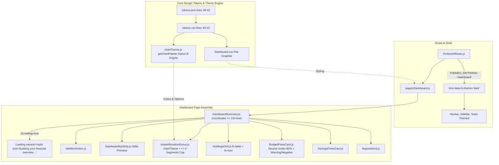

# Implementation Plan — UI Phase 3A: Chart Theme and Dashboard Conversion (v3.1 — Finalized)

## 1. Executive Summary & Problem Statement

Phase 3A represents the first live page-level conversion of the FinStat design overhaul. It transitions the application from foundational tokens and primitives (Phases 1 and 2) to active route theming, targeting the primary application view: **`/dashboard`**.

Today, `/dashboard` is governed by a 1,615-line monolithic stylesheet (`pages/Dashboard.css`) containing:
- 92 raw hex literals (`#0b1220`, `#34d399`, `#f87171`, `#fbbf24`, etc.).
- 28 instances of banned gradients, blurs (10–18px `backdrop-filter`), and radial glow overlays.
- 28 instances of non-compliant border radii (>8px ceiling: 10px, 12px, 14px, 16px, 18px, 20px, 22px, `50%`).
- Gradient-filled primary action buttons and gradient headline text.
- Charts with hardcoded color arrays, unmitigated series overload, and missing accessibility descriptions.
- Ad-hoc custom skeleton DOM that bypasses the universal `<Loading>` primitive.

Phase 3A will:
1. Tokenize `/dashboard` to match **Canonical Reference Frame 03 (`03-dashboard.html`)** (recessed `#0c0d0f` chrome, graphite KPI tiles, single interactive teal CTA).
2. Introduce the theme-aware **`chartTheme.js`** engine using a resilient dynamic computed style reader (Option B) reading confirmed tokens `--fs-chart-grey-1..4` (already defined in `tokens.json` lines 39–42 and `tokens.css` lines 30–33) that strictly protects Multi-theme door D22 Constraint 3 (banning `#14b8a6` as a chart series).
3. Migrate `DashboardSummary.js` (enforcing Invariant I8 $\le 120$ lines) and replace custom skeleton markup with `<Loading variant="route" text="Building your financial overview…" />` per D23. Route Suspense in `ProtectedRoute.js` remains unchanged (`text="Loading session..."`).
4. Convert all 7 decoupled widgets under `pages/dashboard/`:
   - `AssetAllocationDonut.js`: cap doughnut at $\le 4$ segments per §4.12 (top 3 + 4th "Other" grouped slice; detailed asset records remain in `HoldingsGrid`).
   - `BudgetPulseCard.js`: under-80% budget progress rendered in neutral tone per §4.3 (eliminating green per AD13); warning/negative modifiers for $\ge 80\%$.
   - `DashboardKpiStrip.js`: consume `Delta` primitive; render ordinary figures in neutral tabular font.
   - `HoldingsGrid.js`: tabular figures, neutral surfaces, removal of inline color styles.
   - `NetWorthHero.js`, `ReportsGrid.js`, `SavingsForexCard.js`: remove inline styles, colored glows, and arbitrary wrapper tints.
5. Allowlist `/dashboard` in `ProtectedRoute.js` (`THEMED_PATTERNS = ['/dashboard']`), keeping all other 64 routes completely unthemed with **0 visual regression diff (Invariant I13)**.
6. Migrate `Button.js`'s `isLoading` spinner to `<Loading variant="inline" />`.
7. Remove all 13 `src/pages/dashboard/*` entries from `frontend/.eslintignore` and verify `0` warnings.
8. Validate live visual match against Reference Frame 03 at 1440px and 390px via side-by-side screenshots and automated computed style assertions (`dashboard-reference-match.spec.js` registered in Playwright `reference` project).

---

## 2. Pre-Flight Verifications (Completed)

| Check | Target | Verification Command | Outcome |
| :--- | :--- | :--- | :--- |
| **Pre-flight 1** | Verify `DashboardSummary.test.js` path | `Get-ChildItem -Recurse -Filter "DashboardSummary.test.js" frontend/src` | **CONFIRMED**: File resides at `frontend/src/pages/dashboard/__tests__/DashboardSummary.test.js`. Plan paths are accurate. |
| **Pre-flight 2** | Verify the 5 "already absent" files from `.eslintignore` | Exact regex grep in `frontend/.eslintignore` for `Dashboard.js`, `DashboardSummary.js`, `DashboardKpiStrip.js`, `ReportsGrid.js`, `SavingsForexCard.js` | **CONFIRMED**: All 5 files are 100% absent from `.eslintignore`. They will be actively linted by `npx eslint --max-warnings=0`. |
| **Pre-flight 3** | Verify chart grey tokens in `tokens.json` & `tokens.css` | `Select-String -Path frontend\src\styles\tokens.json,frontend\src\styles\tokens.css -Pattern "chart-grey"` | **CONFIRMED**: Tokens `--fs-chart-grey-1..4` exist in `tokens.json` (lines 39–42) and `tokens.css` (lines 30–33) with 0 drift. D22 is concrete. |
| **Pre-flight 4** | Verify `.eslintignore` dashboard entries count | `Select-String -Path frontend\.eslintignore -Pattern "src/pages/dashboard"` | **CONFIRMED**: Exactly 13 entries match `src/pages/dashboard`. The 4 other `dashboard` matches are future phase files (`dashboardActions.js`, `AdminDashboard.js`, `LendingDashboardPage.js`, `PortfolioDashboard.js`). |
| **Pre-flight 5** | Verify visual test grep specificity | `npx playwright test --project=visual --list --grep "dashboard @"` | **CONFIRMED**: Exactly 5 tests listed (`dashboard @ 1440px, 1024px, 768px, 480px, 390px`). |

---

## 3. Governing Specifications, Decisions & Invariants

| Ref | Policy / Invariant | Requirement in Phase 3A |
| :--- | :--- | :--- |
| **D8 / D1** | **Gated Shell & Flat Graphite** | Only `/dashboard` is added to `THEMED_PATTERNS`. The dark shell (`#0c0d0f` recessed chrome) applies exclusively to `/dashboard`. Legacy routes remain completely unthemed. |
| **D2 / AD1** | **Single Interactive Teal Accent** | Accent `#14b8a6` (`--fs-accent`) with text `--fs-ink` (`#0d0e10`) is reserved for the primary CTA button (e.g. "+ Add something new") and active navigation tabs. Text on accent is never white (fails WCAG 2.1). Accent is never a chart series. |
| **D15 / AD9** | **8px Radius Ceiling** | All radii must be $\le 8\text{px}$ (`var(--fs-radius-sm)`: 4px, `var(--fs-radius-md)`: 6px, `var(--fs-radius-lg)`: 8px). `var(--fs-radius-pill)` (999px) is permitted only for live badges, status chips, and avatars. Radii 10–22px and `50%` are eliminated. |
| **D16 / AD10** | **Tabular Figures** | Numbers use proportional `--fs-font-sans` with `font-variant-numeric: tabular-nums` (`.fs-num`). IBM Plex Mono is reserved exclusively for identifiers. |
| **D22 (C3)** | **Multi-Theme Chart Engine** | `chartTheme.js` exports `getChartPalette()` reading existing tokens `--fs-chart-grey-1..4` and `--fs-positive\|negative\|warning` via `getComputedStyle(document.documentElement)` at chart render time. Uses Option B regex validator fallback for robust SSR/jsdom/unthemed execution. Hex `#14b8a6` is strictly banned in `chartTheme.js`. |
| **D23** | **Universal Loading Pattern** | **Route Suspense (`ProtectedRoute.js`)**: `<Loading variant="route" text="Loading session..." />` — unchanged from 2F.<br>**Coordinator data fetch (`DashboardSummary.js`)**: `<Loading variant="route" text="Building your financial overview…" />`. Custom skeleton DOM (`.dashboard-loading`, `.dash-skeleton`) is deleted. `Button.js` migrates internal spinner to `<Loading variant="inline" />`. |
| **§4.12** | **Strict Chart Series Discipline** | Doughnut charts are strictly capped at $\le 4$ segments (§4.12). When holdings $> 4$, keep top 3 slices and group remainder into a 4th slice labeled "Other" (`--fs-chart-grey-4`). Full asset-level details render in `HoldingsGrid` below. Canvas elements require `ariaLabel` and summary/legend tables. |
| **§4.3 / AD13** | **Neutral-by-Default Balances & Budgets** | Red and green removed from ordinary balances/amounts. Semantic tones (`positive`, `negative`, `warning`) appear only for performance deltas, over-budget states, or destructive actions. Under-80% budget utilization is rendered in neutral (AD13 retires green budget bars). |
| **I5** | **Test ID & ARIA Preservation** | All existing `data-testid` and `aria-label` attributes must be preserved (monitored by `testid-guard.js`). |
| **I8** | **Coordinator Line Cap** | `DashboardSummary.js` must strictly remain $\le 120$ lines (enforced by `DashboardSummary.test.js`). Replacing custom skeleton markup with `<Loading>` reduces lines to ~95–98 lines. |
| **I13** | **Zero Regression on Legacy Routes** | All 64 unmigrated routes must produce 0 diff in visual regression. Diff on `/dashboard` is governed by Accepted Diff register AD1–AD13. |
| **Ref Frame 03** | **Canonical Frame Alignment** | `/dashboard` must match `03-dashboard.html` in layout, information hierarchy, recessed chrome (`#0c0d0f`), graphite KPI cards, and single accent CTA at 1440px and 390px. |

---

## 4. Architecture & Component Blueprint



---

## 5. Proposed Changes

### 5.1 Theme & Chart Engine Layer

#### [NEW] `frontend/src/styles/chartTheme.js`
Creates the universal chart theming engine conforming to §4.12, §6.7, and D22 Constraint 3:
- **Resilient Dynamic Token Reader (Option B)**:
  ```javascript
  function getTokenValue(name, fallback) {
    if (typeof window === 'undefined' || typeof document === 'undefined') return fallback;
    const styles = getComputedStyle(document.documentElement);
    const value = styles.getPropertyValue(name).trim();
    if (!value || !/^(#[0-9a-f]{3,8}|rgba?\(|hsla?\()/i.test(value)) {
      return fallback;
    }
    return value;
  }
  ```
- **`getChartPalette()`**:
  - Dynamically reads computed styles for existing tokens in `tokens.css`:
    - `--fs-chart-grey-1` (fallback `#8b929b`)
    - `--fs-chart-grey-2` (fallback `#b8bec6`)
    - `--fs-chart-grey-3` (fallback `#6a7078`)
    - `--fs-chart-grey-4` (fallback `#d5d9dd`)
    - `--fs-positive` (fallback `#4fa87c`)
    - `--fs-negative` (fallback `#d97076`)
    - `--fs-warning` (fallback `#cfa24f`)
  - Accent `#14b8a6` is strictly excluded (enforced by ESLint rule and unit tests).
- **`baseChartOptions(overrides)`**:
  - Grid line color: `#34383f` (`--fs-border`).
  - Tick color: `#a2a8b0` (`--fs-text-3`).
  - Legend label color: `#c9cdd3` (`--fs-text-2`).
  - Tooltip: background `#1a1c20` (`--fs-surface`), border `#34383f`, text `#f2f3f5`, 1px border.
  - Animation: disabled when `process.env.NODE_ENV === 'test'` or `window.__VISUAL_TEST__` is set.
- **Helper Functions**:
  - `withAlpha(hex, alpha)`: converts 6-digit hex to `rgba(...)`.
  - `doughnutDefaults(overrides)`: cutout `72%`, responsive, maintainAspectRatio `false`.
  - `barDefaults(overrides)`: horizontal bar defaults.
  - `lineDefaults(overrides)`: curve tension, point radius, clean borders.
  - `ariaLabel(seriesName, points)`: returns standard accessible summary string for `<canvas>` elements.
  - `createPattern(type, color)`: off-screen canvas pattern generator for pattern fills (dots, lines) to support non-color differentiation.

#### [NEW] `frontend/src/styles/__tests__/chartTheme.test.js`
Unit test suite verifying:
1. `getChartPalette()` returns correct 4 greys and 3 semantic tones in test environment.
2. Returns valid hex/rgba strings consumable by Chart.js.
3. Palette strictly does NOT contain `#14b8a6`.
4. Option B fallback works when `getComputedStyle` returns empty values.
5. `baseChartOptions` disables animation during test execution.
6. `withAlpha` correctly computes rgba strings.
7. `ariaLabel` generates clean descriptive accessibility strings.

---

### 5.2 Route Allowlist Layer

#### [MODIFY] `frontend/src/components/ProtectedRoute.js`
Add `/dashboard` to `THEMED_PATTERNS`:
```javascript
// Themed routes allowlist (Phase 3A: '/dashboard')
export const THEMED_PATTERNS = ['/dashboard'];
```
*(Route Suspense `<Loading variant="route" text="Loading session..." />` remains completely untouched from 2F).*

---

### 5.3 Primitives Alignment Layer

#### [MODIFY] `frontend/src/components/ui/Button.js`
Migrate internal loading spinner from legacy `.loading-spinner` to `<Loading variant="inline" />`:
```jsx
// Before:
{isLoading ? (
  <span className="loading-spinner" aria-hidden="true" />
) : (
  icon && <span className="fs-btn-icon-left" aria-hidden="true">{icon}</span>
)}

// After:
{isLoading ? (
  <Loading variant="inline" />
) : (
  icon && <span className="fs-btn-icon-left" aria-hidden="true">{icon}</span>
)}
```

#### [MODIFY] `frontend/src/components/ui/__tests__/Button.test.js`
Update test assertion from `btn.querySelector('.loading-spinner')` to `btn.querySelector('.fs-loading-spinner')`.

---

### 5.4 Dashboard Page & Coordinator Layer

#### [MODIFY] `frontend/src/pages/Dashboard.css` (1,615 lines)
Complete re-cut conforming to Reference Frame 03 (`03-dashboard.html`) and the Accepted Diff register:
- **Remove All Glow Overlays & Backdrop Gradients**:
  - Delete `.dashboard-shell::before` (radial gradient mesh).
  - Delete `.dash-hero::before`, `.dash-hero-card::before` multi-stop gradient glow effects.
  - Set `.dashboard-shell`, `.dashboard-container`, `.dash-content` background to `var(--fs-bg)`.
- **Remove Blurs**:
  - Replace all `backdrop-filter: blur(...)` with opaque surfaces (`var(--fs-surface)` or `var(--fs-surface-raised)`) and `1px solid var(--fs-border)`.
- **Remove Gradient Headline**:
  - `.dash-hero-copy h1` becomes solid `color: var(--fs-text)` with `font-size: var(--fs-text-3xl)` and `font-weight: var(--fs-weight-semibold)`.
- **Enforce 8px Radius Ceiling**:
  - Radii `10px`, `12px`, `14px`, `16px`, `18px`, `20px`, `22px` -> replaced with `var(--fs-radius-sm)` (4px), `var(--fs-radius-md)` (6px), or `var(--fs-radius-lg)` (8px).
  - Radii `50%` on non-avatars -> replaced with `var(--fs-radius-pill)` or `var(--fs-radius-sm)`.
- **Replace 92 Hex Literals with Tokens**:
  - Replace `#0b1220`, `#0f172a`, `#1e293b`, `#334155` with `--fs-bg`, `--fs-surface`, `--fs-surface-raised`, `--fs-surface-sunken`.
  - Replace `#38bdf8`, `#818cf8`, `#34d399`, `#f87171`, `#fbbf24` with `--fs-border`, `--fs-text-2`, `--fs-text-3`, or semantic `--fs-positive`, `--fs-negative`, `--fs-warning`.
  - Replace primary gradient CTA `.dash-btn-primary` with `.fs-btn-primary` (`background: var(--fs-accent); color: var(--fs-ink); border: 1px solid var(--fs-accent)`).
- **Preserve All 10 BEM Container Classes**:
  - `.dash-content`, `.dash-hero`, `.dash-hero-card`, `.dash-kpis`, `.dash-launch-grid`, `.dash-allocation`, `.dash-holdings-grid`, `.dash-two-col`, `.dash-reports-grid`, `.dash-footnote`.

#### [MODIFY] `frontend/src/pages/DashboardSummary.js` (Coordinator)
- **Strict Invariant I8 Compliance**: File length must remain $\le 120$ lines (currently 110 lines; will drop to ~95 lines after skeleton cleanup).
- **Universal Loading Pattern (D23)**: Replace the entire ad-hoc skeleton block in `isLoading` (lines 30–45) with:
  ```jsx
  if (isLoading) {
    return <Loading variant="route" text="Building your financial overview…" />;
  }
  ```
- **Error State**: Replace `.dash-btn-primary` in retry button with `.fs-btn-primary`.

#### [MODIFY] `frontend/src/pages/dashboard/__tests__/DashboardSummary.test.js`
- Update Test 1 to assert that `<Loading variant="route" text="Building your financial overview…" />` renders when `isLoading` is true (`expect(screen.getByRole('status')).toBeInTheDocument(); expect(screen.getByText(/Building your financial overview/i)).toBeInTheDocument();`).

#### [MODIFY] `frontend/src/pages/Dashboard.js` (Shell & Floating Actions)
- Modernize upcoming bills and recurring suggestions alert banners:
  - Replace arbitrary colors with `--fs-surface`, `--fs-border`, `--fs-warning`, and `--fs-text`.
- Tokenize floating action button (`.dash-fab`) and Quick Launch trigger.

---

### 5.5 The 7 Decoupled Widgets Layer (`frontend/src/pages/dashboard/`)

#### [MODIFY] `frontend/src/pages/dashboard/AssetAllocationDonut.js`
- Import `getChartPalette`, `doughnutDefaults`, and `ariaLabel` from `../../styles/chartTheme`.
- **Enforce $\le 4$ Segments Cap (§4.12)**:
  - When `chartSegments.list.length > 4`:
    - Sort items by value descending.
    - Keep top 3 slices with their names and values.
    - Group all remaining slices ($4\text{th}, 5\text{th}, \dots$) into a 4th slice: `{ name: 'Other', value: otherTotal }`.
  - Slice colors assigned from `getChartPalette().greys` (`greys[0]`, `greys[1]`, `greys[2]`, `greys[3]`).
  - Full granular holdings detail (e.g., 5–10 items) remains rendered in the `HoldingsGrid` table below.
- Remove raw hex borders (`borderColor: '#0b1220'`) -> use `var(--fs-surface)` or chart theme background.
- Update toggle buttons to use token-based `.fs-btn` or `.dash-toggle-btn` classes.

#### [MODIFY] `frontend/src/pages/dashboard/BudgetPulseCard.js`
- **Neutral-by-Default Balances & Budgets (§4.3 & AD13)**:
  - Remove raw hex literals (`#f87171`, `#fbbf24`, `#34d399`).
  - Eliminate `style={{ color: barColor }}` and `style={{ background: barColor }}`.
  - Map utilization to modifier classes:
    - **Under 80%**: Neutral (default track span, no tone modifier, text `--fs-text`). *AD13: Emerald green `#34d399` is retired for healthy budgets.*
    - **80%–100%**: Warning (`.dash-budget-bar--warning`).
    - **Over 100%**: Negative (`.dash-budget-bar--negative`).
    - *No positive modifier is applied.*
  - Retain inline width for percentage only: `style={{ width: `${Math.min(100, budget.percentageUsed)}%` }}`.

#### [MODIFY] `frontend/src/pages/dashboard/__tests__/DashboardPanels.test.js`
- Update Test 2 to assert `.dash-budget-bar--negative` for $>100\%$ utilization.
- Update Test 3 to assert neutral styling (absence of negative/warning classes) for under-80% utilization.

#### [MODIFY] `frontend/src/pages/dashboard/DashboardKpiStrip.js`
- Consume `Delta` primitive (`frontend/src/components/ui/Delta.js`) for the portfolio return delta (`+24.0% vs invested`).
- Replace arbitrary colored KPI tiles (`tone-sky`, `tone-emerald`, `tone-rose`, `tone-cyan`, `tone-violet`) with uniform neutral card surfaces (`--fs-surface` with `--fs-border`).
- Ordinary figures (invested capital, liquid cash, budget used) rendered in neutral `--fs-text` with `tabular-nums` per Invariant I14 / AD13.

#### [MODIFY] `frontend/src/pages/dashboard/HoldingsGrid.js`
- Remove inline `background: asset.color` from `.dash-holding-track span`.
- Apply `.fs-num` and `tabular-nums` to financial amounts.
- Replace tone tint classes (`tone-${asset.tone}`) with uniform neutral card surfaces (`--fs-surface`).
- Replace ad-hoc deltas with tokenized `.fs-delta` or neutral indicators.

#### [MODIFY] `frontend/src/pages/dashboard/NetWorthHero.js`
- Clean up inline styles: remove `style={{ textDecoration: 'none' }}`.
- Remove raw color fills from `.dash-mix-bar span` (`style={{ background: asset.color }}` -> use palette greys or tokenized mix-bar styles).
- Ensure hero typography uses `--fs-text-3xl`, `--fs-weight-semibold`, and `--fs-text`.

#### [MODIFY] `frontend/src/pages/dashboard/ReportsGrid.js`
- Tokenize Quick Launch tiles and Report links:
  - Neutral card surfaces with `1px solid var(--fs-border)`.
  - Eliminate colored tone wrappers (`tone-${action.tone}`).
  - Add hover transitions using standard motion tokens (`--fs-duration-fast`, `--fs-surface-raised`).

#### [MODIFY] `frontend/src/pages/dashboard/SavingsForexCard.js`
- Eliminate colored card wrapper tints.
- Map unrealized FX gain/loss values to `--fs-positive` / `--fs-negative` classes while keeping ordinary certificate deposits and forex values neutral (`--fs-text`).

---

### 5.6 ESLint Ignore Cleanup Layer

#### [MODIFY] `frontend/.eslintignore`
Remove all 13 converted Dashboard files and test suites from `frontend/.eslintignore`:
```text
src/pages/dashboard/AssetAllocationDonut.js
src/pages/dashboard/BudgetPulseCard.js
src/pages/dashboard/HoldingsGrid.js
src/pages/dashboard/NetWorthHero.js
src/pages/dashboard/__tests__/AssetAllocationDonut.test.js
src/pages/dashboard/__tests__/DashboardKpiStrip.test.js
src/pages/dashboard/__tests__/DashboardPanels.test.js
src/pages/dashboard/__tests__/DashboardSummary.test.js
src/pages/dashboard/__tests__/HoldingsGrid.test.js
src/pages/dashboard/__tests__/NetWorthHero.test.js
src/pages/dashboard/__tests__/ReportsGrid.test.js
src/pages/dashboard/__tests__/useDashboardData.test.js
src/pages/dashboard/useDashboardData.js
```
*(Confirmed by Pre-flight 2 & 4: Exactly 13 `src/pages/dashboard/` entries are removed. The remaining 4 `dashboard` entries belong to unmigrated routes/configs scheduled for subsequent phases: `src/config/dashboardActions.js`, `src/pages/admin/AdminDashboard.js`, `src/pages/lending/LendingDashboardPage.js`, `src/pages/portfolio/PortfolioDashboard.js`).*

Verification command:
```powershell
cd frontend; npx eslint src/styles/chartTheme.js src/pages/Dashboard.js src/pages/DashboardSummary.js src/pages/dashboard/*.js src/pages/dashboard/__tests__/*.js --max-warnings=0
```

---

### 5.7 Testing, Playwright Registration & Visual Regression Layer

#### [MODIFY] `frontend/playwright.config.js`
Register `dashboard-reference-match.spec.js` in the `reference` project to guarantee automatic execution in CI and local test runs:
```javascript
{
  name: 'reference',
  dependencies: ['setup'],
  testMatch: /(reference-frames|dashboard-reference-match)\.spec\.js/,
}
```

#### [NEW] `frontend/tests/visual/dashboard-reference-match.spec.js` (Intent A)
Creates automated DOM token assertions on the live `/dashboard` route (6 granular tests):
- Navbar background: `rgb(12, 13, 15)` (`#0c0d0f`).
- Primary button background: `rgb(20, 184, 166)` (`#14b8a6`).
- Primary button text color: `rgb(13, 14, 16)` (`#0d0e10`, `--fs-ink` for WCAG 2.1 compliance).
- KPI cards border radius: `6px` or `8px` ($\le 8\text{px}$).
- KPI cards background: `rgb(22, 24, 29)` (`#16181d`).
- Page background: `rgb(16, 17, 20)` (`#101114`).

#### Accepted Diff Register (AD1–AD13)
The visual changes on `/dashboard` are governed by accepted diff entries:
- **AD1**: Single interactive accent (teal button replaces legacy gradient button).
- **AD2**: Dark page background (`#101114`) and recessed chrome (`#0c0d0f`).
- **AD3**: Surface hierarchy (`#16181d` card surfaces, `1px solid #23272f` borders).
- **AD4**: Elimination of radial gradient glow overlays and backdrop blurs.
- **AD5**: Typography standardization (IBM Plex Sans, solid `--fs-text` headline).
- **AD9**: 8px radius ceiling enforced on all cards and controls.
- **AD10**: Tabular numeric figures on financial values.
- **AD12**: Neutral chart palette (4 neutral greys replace rainbow hex colors).
- **AD13**: Neutral-by-default balances & budgets (under-80% budget progress bar is neutral; green is retired).

#### Baseline Updates (A5-Local, D21)
Because `/dashboard` is converted to dark theme, its 5 viewport screenshots (1440, 1024, 768, 480, 390px) will be captured and updated in the workstation-local baseline repository (`FinStat-visual-baselines`), and `manifest.json` will be updated via `verify-baseline-manifest.js`.
The other 64 routes will be verified at **0 diff**.

---

## 6. Verification Plan

### 6.1 Automated Tooling Gates
```powershell
# 1. Token drift check
node frontend/scripts/tokens.js --check
# Expected: 0 drift

# 2. Tone and token usage linter
node frontend/scripts/lint-tones.js
# Expected: 0 violations, 0 undefined tokens

# 3. Ratchet check
node frontend/scripts/lint-ratchet.js
# Expected: 0 regressions against merge-base

# 4. Stylelint AST checks on theme and Dashboard.css
cd frontend; npx stylelint "src/styles/*.css" "src/pages/Dashboard.css"
# Expected: 0 errors, 0 warnings

# 5. Test ID guard
node frontend/scripts/testid-guard.js
# Expected: 0 removed data-testid or aria-label attributes

# 6. ESLint check on all converted dashboard files and tests
cd frontend; npx eslint src/styles/chartTheme.js src/pages/Dashboard.js src/pages/DashboardSummary.js src/pages/dashboard/*.js src/pages/dashboard/__tests__/*.js --max-warnings=0
# Expected: 0 warnings, code 0

# 7. Dashboard unit test suites (All 10 suites covering Phase 3A)
cd frontend; $env:CI="true"; npm test -- --watchAll=false src/styles/__tests__/chartTheme.test.js src/pages/dashboard/__tests__/DashboardSummary.test.js src/pages/dashboard/__tests__/AssetAllocationDonut.test.js src/pages/dashboard/__tests__/DashboardKpiStrip.test.js src/pages/dashboard/__tests__/DashboardPanels.test.js src/pages/dashboard/__tests__/HoldingsGrid.test.js src/pages/dashboard/__tests__/NetWorthHero.test.js src/pages/dashboard/__tests__/ReportsGrid.test.js src/pages/dashboard/__tests__/useDashboardData.test.js src/components/ui/__tests__/Button.test.js
# Expected: All 10 suites pass, coordinator lines <= 120

# 8. Full unit test run
cd frontend; $env:CI="true"; npm test -- --watchAll=false
# Expected: 60+ suites passing

# 9. Production build verification
cd frontend; $env:CI="true"; npm run build
# Expected: Compiled successfully
```

### 6.2 Browser & Visual Regression Testing
```powershell
# 1. Playwright Reference Frames verification (Includes 3 static frames passed with 0 diff + 6 dashboard computed-style assertions passed, 0 failures; total 9 passed)
cd frontend; $env:CI="true"; npx playwright test --project=reference

# 2. Playwright Primitives & Shell verification
cd frontend; $env:CI="true"; npx playwright test --project=primitives
cd frontend; $env:CI="true"; npx playwright test --project=shell

# 3. Full visual route regression test
cd frontend; $env:CI="true"; npx playwright test --project=visual
# Expected: 64 non-allowlisted routes pass at 0 diff; /dashboard matches accepted diffs
```

### 6.3 Font & CLS Verification (S2)
- Inspect network panel on an unthemed route (`/trades`) to confirm **0** font requests.
- Run Lighthouse on `http://localhost:3000/dashboard` to verify Cumulative Layout Shift (CLS) $\le 0.1$.

---

## 7. Walkthrough Requirements (12 Evidence Items)

The Phase 3A Walkthrough artifact must document and provide raw verifiable evidence for each of the following 12 items:

1. **Core Verification Suite**:
   - `node frontend/scripts/tokens.js --check` -> `0 drift`.
   - `node frontend/scripts/lint-tones.js` -> `0 violations, 0 undefined tokens`.
   - `node frontend/scripts/lint-ratchet.js` -> `0 regressions`.
   - `npx stylelint "src/styles/*.css" "src/pages/Dashboard.css"` -> `0 errors, 0 warnings`.
   - `node frontend/scripts/testid-guard.js` -> `0 removals`.
   - `npx eslint <all modified dashboard files> --max-warnings=0` -> exit code `0`.
   - All 10 dashboard test suites passing with raw test output showing each named suite.
   - `npm test -- --watchAll=false` -> `60+ suites pass` (raw summary output).
   - `CI=true npm run build` -> `Compiled successfully`.
2. **Invariant I8 Evidence**:
   - `(Get-Content frontend/src/pages/DashboardSummary.js).Count` -> record exact line count $\le 120$ (expected ~95–98 lines).
3. **Visual Regression Suite**:
   - `--project=visual` raw output head + tail proving all 326 tests executed individually.
   - Classification per route: 64 non-allowlisted routes pass at 0 diff; `/dashboard` at 5 viewports classified per AD1–AD13 with screenshot references. Any other diff is investigated and rejected.
4. **Supporting Visual & Manifest Suites**:
   - `--project=reference` -> 3 static frames passed with 0 diff + 6 dashboard computed-style assertions passed, 0 failures (total: 9 passed, 0 failures).
   - `--project=shell` -> 7 passed, 0 diff.
   - `--project=shared` -> 10 passed, 0 diff.
   - `--project=primitives` -> 4 passed, 0 diff.
   - `node frontend/scripts/verify-baseline-manifest.js` -> `334/334 manifest entries valid`.
5. **Chart Theme Discipline & D22 Protection**:
   - `grep "14b8a6" frontend/src/styles/chartTheme.js` -> returns empty (proving `#14b8a6` is 100% absent).
   - `grep -r "fs-chart-grey" frontend/src/styles/tokens.json frontend/src/styles/tokens.css` -> shows all 4 grey tokens confirmed (`--fs-chart-grey-1..4`).
   - `chartTheme.test.js` output showing all 7 test cases pass.
6. **Reference Frame 03 Taste Checkpoint (§6.1.1)**:
   - Side-by-side screenshots at 1440px: live `/dashboard` next to `03-dashboard.html`.
   - Side-by-side screenshots at 390px: live `/dashboard` next to `03-dashboard.html`.
   - Statement of intentional deviations (if any) with explicit justification.
   - Developer sign-off on visual hierarchy, layout grid, and graphite polish.
7. **Baseline Update Evidence (A5-Local, D21)**:
   - `--project=visual --grep "dashboard @" --update-snapshots` -> exactly 5 `/dashboard` files updated.
   - `git -C D:\Projects\FinStat-visual-baselines log -1 --stat` showing 5 `/dashboard` PNGs updated and `manifest.json` updated.
   - `manifest.json` maintains 334 total entries (5 updated, 329 untouched).
8. **Scope Verification**:
   - `git diff --name-only main` raw output confirming changes strictly bounded to dashboard files, `.eslintignore`, `playwright.config.js`, `ProtectedRoute.js`, `Button.js`, `chartTheme.js`, tests, and documentation.
   - Zero modifications to legacy shared CSS files (`Table.css`, `Form.css`, `Modal.css`, etc.).
9. **`.eslintignore` Final State**:
   - `grep -c "src/pages/dashboard" frontend/.eslintignore` -> returns `0`.
   - `grep "dashboard" frontend/.eslintignore` -> confirms only the 4 unmigrated routes/configs remain.
10. **Font & CLS Verification (S2)**:
    - Browser DevTools network panel on unthemed route (`/trades`) showing **0** font requests.
    - Lighthouse audit on `http://localhost:3000/dashboard` showing CLS $\le 0.1$.
11. **Automated Reference Match Evidence**:
    - Raw output of `npx playwright test --project=reference` passing all static frames and live `dashboard-reference-match.spec.js` checks.
12. **Universal Loading State Evidence (D23)**:
    - Unit test and visual verification showing `<Loading variant="route" text="Building your financial overview…" />` active during dashboard data loading.
