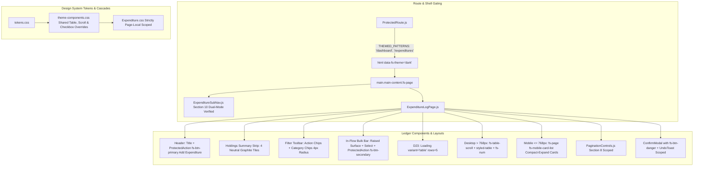

# Implementation Plan — UI Phase 4A: Expenditure Log & Filters (v5.1 — Approved for Execution)

## 1. Executive Summary & Problem Statement

Phase 4A converts FinStat's primary daily-use ledger: **`/expenditures`** (Expenditure Log and Filters).

Today, `/expenditures` is styled by legacy `frontend/src/pages/expenditure/Expenditure.css` (625 lines) and structured by `frontend/src/pages/expenditure/ExpenditureLogPage.js` (736 lines) and `frontend/src/pages/expenditure/ExpenditureSubNav.js`. It exhibits the following architectural and design shortcomings:
1. **47 colour-bearing and layout inline styles** across `ExpenditureLogPage.js`, bypassing design system tokens and linters.
2. **Raw hardcoded rainbow category colours** (`catConfig.color`, e.g. `#FF6384`, `#10B981`, `#3B82F6`) rendered as inline background fills on table badges and filter buttons, violating §4.3 Rule 2 and Invariant I15.
3. **Ordinary transaction amounts rendered in red and green** (`log.transactionType === 'W' ? 'red' : ...`), violating Accepted Diff AD13 and Invariant I15 (colour is reserved strictly for alerts, deltas, and attention states).
4. **Hardcoded balance cards** with rainbow left-borders (`#3b82f6`, `#10b981`, `#f59e0b`, `#6b7280`) and custom backgrounds.
5. **Ad-hoc table loading DOM**: uses unstyled `<td colSpan="10" style={{ color: '#6b7280' }}>Loading expenditures...</td>`, violating the Universal Loading Pattern (Decision D23 / Phase 2F).
6. **Horizontal page scroll on mobile ($\le 768\text{px}$)**: the 10-column table forces page-level horizontal overflow on mobile viewports, violating Decision D19.
7. **ESLint exclusion**: `ExpenditureLogPage.js` and `ExpenditureBulkActions.test.js` remain ignored in `frontend/.eslintignore`.

Phase 4A converts `/expenditures` to match **Canonical Reference Frame 01: Dense Table (`01-dense-table.html` Variant B)**:
- Canonical dark graphite frozen token palette (`--fs-bg: #101114`, `--fs-surface: #1a1c20`, `--fs-surface-raised: #22252a`, `--fs-surface-sunken: #0c0d0f`, `--fs-border: #34383f`, `--fs-border-control: #6a6f77`, `--fs-text: #f2f3f5`).
- Single view primary CTA button ("+ Add Expenditure") using `.fs-btn-primary` (`--fs-accent: #14b8a6` with `--fs-ink: #0d0e10` text, strictly zero white text on accent).
- `ExpenditureSubNav.js` dual-mode verification: `.fs-page .expenditure-subnav-*` rules (authored in Phase 2E) active on `/expenditures`, while unthemed routes (`/expenditures/new`, `/expenditure-analysis`) preserve unstyled legacy navigation with zero regression diff. Verified clean under ESLint (0 warnings).
- Shared table styles, single scroll wrapper, sort arrow, and custom table checkboxes defined strictly in `frontend/src/styles/theme-components.css` per §4.14 and §6.1.1; `Expenditure.css` contains only page-specific styles.
- Cross-browser custom checkbox implemented via accessible label/span wrapper (`.fs-checkbox-label`, `.fs-checkbox-input`, `.fs-checkbox-custom`), eliminating fragile `::after` on replaced `<input>` elements.
- Single `.fs-table-scroll` container with 5px padding and 5px negative margin to prevent focus-ring clipping (§4.6 / G4), eliminating nested duplicate scroll wrappers.
- Neutral category chips (`.fs-cat-badge`) using `--fs-surface-raised` + `--fs-border` + `--fs-text` with `var(--fs-radius-sm)` (4px) per §4.3 Rule 2 and I16/D15, with group-by and category filter buttons as the non-color scanning cue (G3).
- Neutral ordinary amounts (`--fs-text`, `.fs-num`) with proportional IBM Plex Sans and tabular numerals (`font-variant-numeric: tabular-nums`).
- Responsive compact-expand cards on viewports $\le 768\text{px}$ (D19), strictly eliminating horizontal scroll using React conditional rendering (zero CSS `!important`) with all mobile classes scoped under `.fs-page`.
- Strict preservation of Invariant I4: viewer-role permissions and `ProtectedAction` gating remain 100% enforced on all creation, editing, and deletion controls.
- Universal loading integration (`<Loading variant="table" rows={5} text="Loading expenditures..." />`) per D23.
- Row actions (Edit, Delete) use neutral icons (`var(--fs-text-3)`, hover `var(--fs-text)`); destructive red is restricted strictly to `ConfirmModal` `variant="danger"`.
- Expanding the allowlist in `ProtectedRoute.js` from `['/dashboard']` to `['/dashboard', '/expenditures']`, preserving exact path matching (`end: true`) and 0 visual regression on all other 63 unallowlisted routes (Invariant I13).
- Updating the local visual baseline in `D:\Projects\FinStat-visual-baselines` for `/expenditures` after taste checkpoint 2 approval, verifying 0 visual diff on all 63 unallowlisted routes, and attaching the Playwright diff report to the walkthrough.
- Removing `ExpenditureLogPage.js` and `ExpenditureBulkActions.test.js` from `.eslintignore` with 0 warnings.
- Branch: `phase-ui-4a-expenditure-log`. Exit gate includes developer approval of taste checkpoint 2 against Reference Frame 01 (Variant B) at 1440 and 390.

---

## 2. Phase Preconditions & Dependency Verification

Before opening branch `phase-ui-4a-expenditure-log`, the following preconditions are verified and documented:

1. **Preceding Phase Sign-Off**:
   - UI Phases 2E (Subnav & Primitives), 2F (Universal Loading), and 3A (Chart Theme & Dashboard) are verified merged into `main` (verified at merge SHAs `8baf3e5` and `0e2e9b9`).
2. **Loading Primitive Availability (D23)**:
   - `frontend/src/components/ui/index.js` exports `Loading`.
   - `frontend/src/components/ui/Loading.js` is verified to support `variant="table"`, `rows` (number), and `text` (string).
3. **ProtectedAction Wrapper Availability (I4)**:
   - `frontend/src/components/common/ProtectedAction.js` is verified to wrap `<Link>` and `<button>` elements, cloning children with `disabled`, `aria-disabled="true"`, `tabIndex: -1`, and click/keydown interception when `canModify === false`.
4. **Visual Baseline Linkage (D21)**:
   - Directory junction `frontend/tests/visual/baseline` is linked to `D:\Projects\FinStat-visual-baselines`.
   - Manifest integrity verified at 334/334 images via `node frontend/scripts/verify-baseline-manifest.js`.
5. **Blocking Precondition Rule**:
   - If any of these preconditions fail or regress, Phase 4A is strictly blocked from opening.

---

## 3. Review Findings Resolution (A1–A3 & Matrix)

| ID | Issue | Root Cause & Rule | v5.1 Resolution |
| :--- | :--- | :--- | :--- |
| **A1** | Split-transaction classes undefined | JSX introduced `.category-badges-list`, `.split-items-list`, `.split-detail-row`, `.split-details-drawer` without CSS inventory rules. | Defined all four classes in `Expenditure.css` (§5.3 inventory): flex layouts, gap `4px` / `0.25rem`, aligned text. Added Playwright 390px split-transaction alignment check in §5.6 item 9. |
| **A2** | `.eslintignore` line numbers unverified | Hardcoded line numbers risk drift; `ExpenditureSubNav.js` removal unproven. | Added verification command `git grep -n "Expenditure" frontend/.eslintignore`. Proved lines 54 and 57 match `ExpenditureLogPage.js` and `ExpenditureBulkActions.test.js`, and `ExpenditureSubNav.js` is already absent. Remove both matched lines dynamically. |
| **A3** | Reference test item 2 selector ambiguous | Inspected "table container" after `.table-container` was removed in favor of single `.fs-table-scroll`. | Explicitly assert on selector `.fs-table-scroll`: `expect(await page.locator('.fs-table-scroll').evaluate(el => getComputedStyle(el).backgroundColor)).toBe('rgb(26, 28, 32)')`. |
| **N1** | `ExpenditureSubNav.js` dual-mode | Need explicit verification of subnav. | Added dual-mode verification: themed on `/expenditures` via Section 10 under `.fs-page`, unthemed on unallowlisted routes with 0 diff. Confirmed clean under ESLint (0 warnings). |
| **N2** | Clean `.eslintignore` removal | Converted files must be unignored. | Removed `ExpenditureLogPage.js` and `ExpenditureBulkActions.test.js`. Verified `ExpenditureSubNav.js` is clean. |
| **N3** | `Badge` API usage | Plan used `tone="neutral"` prop. | Aligned to §8.4: used `<Badge label={label}>{label}</Badge>`. Default tone is neutral; explicit `label` prop satisfies accessibility contract. |
| **N4** | Sort header arrow | Sort arrow uses accent. | Added `.fs-page .styled-table .fs-sort-arrow { color: var(--fs-accent); }` in `theme-components.css`. Added Playwright test asserting sort arrow computes to `rgb(20, 184, 166)`. |
| **N5** | Action icons defined | Icons lacked CSS definitions. | Defined `.action-icon`, `.edit-icon`, `.delete-icon` in `theme-components.css` Section 3 using neutral tokens (`color: var(--fs-text-3)`, hover `color: var(--fs-text)`). |
| **N6** | Dead `.bulk-btn-*` CSS rules | Empty rule bodies. | Deleted empty `.bulk-btn-*` rules. JSX uses standard `.fs-btn-secondary` directly. |
| **N7** | Double scroll nesting | Nested `.table-container` and `.fs-table-scroll`. | Eliminated `.table-container`. A single `.fs-table-scroll` container wraps the table with `overflow-x: auto; padding: 5px; margin: -5px;`. |
| **C2** | Jest `--runInBand` | Prevent test contention. | Standardized all unit test commands to `npx --prefix frontend jest --runInBand <path>`. |
| **C3** | Progress Log template | Missing §10 template fields. | Provided exact §10 template with all 11 required fields. |
| **C4** | Visual diff report format | Missing four-part breakdown. | Defined explicit four-part diff breakdown: total (64), zero-diff (63), accepted diffs (1, AD13), unexplained (0). |
| **C5/C6** | Mobile splits & category chips | 390px verification missing. | Added Playwright assertions at 390px verifying category chips per card and split transaction breakdown. |

---

## 4. Architecture & Component Hierarchy



---

## 5. Detailed Implementation Steps

### 5.1 Component 1: Route Gating & Allowlist Expansion

#### [MODIFY] `frontend/src/components/ProtectedRoute.js`
- Expand `THEMED_PATTERNS` to include `'/expenditures'`:
```javascript
// Themed routes allowlist (Phase 3A: '/dashboard', Phase 4A: '/expenditures')
export const THEMED_PATTERNS = ['/dashboard', '/expenditures'];
```
- Ensure `isThemedRoute` continues using exact path matching `{ path: pattern, end: true }`.

#### [MODIFY] `frontend/src/components/__tests__/ProtectedRoute.test.js`
- Add allowlist exactness test cases:
```javascript
describe('isThemedRoute allowlist exactness', () => {
  it('identifies allowlisted routes', () => {
    expect(isThemedRoute('/dashboard')).toBe(true);
    expect(isThemedRoute('/expenditures')).toBe(true);
  });

  it('rejects unallowlisted child and sibling routes (Invariant I13)', () => {
    expect(isThemedRoute('/expenditures/new')).toBe(false);
    expect(isThemedRoute('/expenditures/edit/123')).toBe(false);
    expect(isThemedRoute('/expenditures/rules')).toBe(false);
    expect(isThemedRoute('/expenditure-analysis')).toBe(false);
    expect(isThemedRoute('/portfolio')).toBe(false);
  });
});
```

---

### 5.2 Component 2: Shared Component Stylesheet (`theme-components.css`)

#### [MODIFY] `frontend/src/styles/theme-components.css`
- Under **Section 3: Table Overrides (`.fs-page .styled-table`)**:
  1. **Single Table Scroll Container (N7 & V3-B1)**:
     ```css
     .fs-page .fs-table-scroll {
       width: 100%;
       max-width: 100%;
       margin: 1.25rem auto; /* 20px section separator */
       overflow-x: auto;
       -webkit-overflow-scrolling: touch;
       background: var(--fs-surface);
       border: var(--fs-border-width) solid var(--fs-border);
       border-radius: var(--fs-radius-md);
       padding: 5px;
     }
     ```
  2. **Cross-Browser Selected Row Left Rule (Minor 2)**:
     ```css
     .fs-page .styled-table tbody tr.fs-row-selected {
       background: var(--fs-surface-raised);
     }

     .fs-page .styled-table tbody tr.fs-row-selected td:first-child {
       border-left: 2px solid var(--fs-accent);
     }
     ```
  3. **Sort Header Arrow Styling (N4)**:
     ```css
     .fs-page .styled-table .fs-sort-arrow,
     .fs-page .styled-table .sort-arrow {
       color: var(--fs-accent);
       margin-left: 4px;
     }
     ```
  4. **Cross-Browser Accessible Custom Checkboxes (V3-B2)**:
     ```css
     .fs-page .fs-checkbox-label {
       display: inline-flex;
       align-items: center;
       position: relative;
       cursor: pointer;
       user-select: none;
       vertical-align: middle;
     }

     .fs-page .fs-checkbox-input {
       position: absolute;
       opacity: 0;
       width: 16px;
       height: 16px;
       margin: 0;
       cursor: pointer;
     }

     .fs-page .fs-checkbox-custom {
       width: 16px;
       height: 16px;
       background: var(--fs-surface);
       border: var(--fs-border-width) solid var(--fs-border-control);
       border-radius: var(--fs-radius-sm);
       display: inline-grid;
       place-content: center;
       box-sizing: border-box;
       transition: border-color var(--fs-duration-fast) var(--fs-ease-standard),
                   background var(--fs-duration-fast) var(--fs-ease-standard);
     }

     .fs-page .fs-checkbox-input:checked + .fs-checkbox-custom {
       background: var(--fs-accent);
       border-color: var(--fs-accent);
     }

     .fs-page .fs-checkbox-input:checked + .fs-checkbox-custom::after {
       content: '';
       width: 4px;
       height: 8px;
       border: solid var(--fs-ink);
       border-width: 0 2px 2px 0;
       transform: rotate(45deg);
       margin-top: -2px;
     }

     .fs-page .fs-checkbox-input:focus-visible + .fs-checkbox-custom {
       outline: var(--fs-focus-ring);
       outline-offset: var(--fs-focus-offset);
     }
     ```
  5. **Shared Neutral Action Icons (N5 & R7)**:
     ```css
     .fs-page .action-icon {
       margin: 0 4px;
       cursor: pointer;
       color: var(--fs-text-3);
       background: transparent;
       border: none;
       padding: 0.25rem;
       display: inline-flex;
       align-items: center;
       justify-content: center;
       font-size: var(--fs-text-sm);
       transition: color var(--fs-duration-fast) var(--fs-ease-standard);
     }

     .fs-page .action-icon:hover {
       color: var(--fs-text);
     }

     .fs-page .edit-icon {
       color: var(--fs-text-3);
     }

     .fs-page .edit-icon:hover {
       color: var(--fs-text);
     }

     .fs-page .delete-icon {
       color: var(--fs-text-3);
     }

     .fs-page .delete-icon:hover {
       color: var(--fs-text);
     }
     ```

---

### 5.3 Component 3: Page Stylesheet Tokenization (`Expenditure.css`)

#### [MODIFY] `frontend/src/pages/expenditure/Expenditure.css`
- Keep existing unscoped legacy classes intact for unthemed routes (`/expenditures/new`, `/expenditure-analysis`).
- Introduce strictly **page-specific** `.fs-page` rules implementing Canonical Reference Frame 01 (Variant B), with **zero new `!important`**, **zero tone tokens named in page CSS**, and **all classes scoped under `.fs-page`**:

#### Spacing & Geometry Documentation:
Proportional rem values align with Reference Frame 01 (`01-dense-table.html`) and §4.8 geometry:
- Standard steps: `0.25rem` (4px), `0.5rem` (8px), `0.75rem` (12px), `1rem` (16px), `1.5rem` (24px).
- Specialized layout steps: `0.375rem` (6px chip padding), `0.875rem` (14px card padding), `1.25rem` (20px section spacing), `0.35rem` (5.6px drawer gap), `36px` compact toolbar control height exception.

#### Complete CSS Class Inventory for `Expenditure.css`:
```css
/* 1. Header & Actions */
.fs-page .page-header {
  display: flex;
  justify-content: space-between;
  align-items: center;
  gap: 1rem;
  margin-bottom: 1rem;
}

.fs-page .page-header-actions {
  display: flex;
  align-items: center;
  gap: 0.5rem;
}

/* 2. Holdings Summary Strip */
.fs-page .holdings-summary-card {
  background: var(--fs-surface-raised);
  border: var(--fs-border-width) solid var(--fs-border);
  border-radius: var(--fs-radius-lg);
  padding: 1rem;
  margin-bottom: 1rem;
}

.fs-page .holdings-grid {
  display: grid;
  grid-template-columns: repeat(auto-fit, minmax(200px, 1fr));
  gap: 1rem;
}

.fs-page .holdings-tile {
  background: var(--fs-surface);
  border: var(--fs-border-width) solid var(--fs-border);
  border-radius: var(--fs-radius-md);
  padding: 1rem;
}

.fs-page .holdings-tile-icon {
  color: var(--fs-text-3);
  font-size: var(--fs-text-lg);
  margin-bottom: 0.25rem;
}

.fs-page .holdings-tile-label {
  color: var(--fs-text-3);
  font-size: var(--fs-text-xs);
  font-weight: var(--fs-weight-medium);
}

.fs-page .holdings-tile-value {
  color: var(--fs-text);
  font-size: var(--fs-text-lg);
  font-weight: var(--fs-weight-semibold);
  font-variant-numeric: tabular-nums;
}

/* 3. Filter Section */
.fs-page .filter-section {
  background: var(--fs-surface-raised);
  border: var(--fs-border-width) solid var(--fs-border);
  border-radius: var(--fs-radius-lg);
  padding: 1rem;
  margin-bottom: 1rem;
}

.fs-page .filter-group {
  display: flex;
  flex-direction: column;
  gap: 0.5rem;
  margin-bottom: 0.75rem;
}

.fs-page .filter-group:last-child {
  margin-bottom: 0;
}

.fs-page .filter-chips {
  display: flex;
  flex-wrap: wrap;
  gap: 0.5rem;
}

.fs-page .filter-chip {
  background: var(--fs-surface);
  border: var(--fs-border-width) solid var(--fs-border-control);
  border-radius: var(--fs-radius-sm);
  color: var(--fs-text-2);
  padding: 0.375rem 0.75rem;
  font-size: var(--fs-text-xs);
  font-weight: var(--fs-weight-medium);
  cursor: pointer;
  transition: background var(--fs-duration-fast) var(--fs-ease-standard),
              color var(--fs-duration-fast) var(--fs-ease-standard);
}

.fs-page .filter-chip:hover {
  background: var(--fs-surface-raised);
  color: var(--fs-text);
}

.fs-page .filter-chip.active {
  background: var(--fs-accent);
  color: var(--fs-ink);
  border-color: var(--fs-accent);
  font-weight: var(--fs-weight-semibold);
}

.fs-page .filter-notice {
  background: var(--fs-surface-sunken);
  border: var(--fs-border-width) solid var(--fs-border);
  border-radius: var(--fs-radius-sm);
  color: var(--fs-text-3);
  padding: 0.75rem;
  font-size: var(--fs-text-xs);
}

/* 4. Bulk Actions Bar (In-Flow Page Region) */
.fs-page .bulk-actions-bar {
  background: var(--fs-surface-raised);
  border: var(--fs-border-width) solid var(--fs-border);
  border-radius: var(--fs-radius-md);
  padding: 0.75rem 1rem;
  display: flex;
  align-items: center;
  justify-content: space-between;
  gap: 0.75rem;
  margin-bottom: 1rem;
}

.fs-page .bulk-actions-info {
  display: flex;
  align-items: center;
  gap: 0.5rem;
}

.fs-page .bulk-count-badge {
  background: var(--fs-surface-sunken);
  border: var(--fs-border-width) solid var(--fs-border);
  color: var(--fs-text);
  border-radius: var(--fs-radius-sm);
  padding: 0.25rem 0.5rem;
  font-size: var(--fs-text-xs);
  font-weight: var(--fs-weight-medium);
}

.fs-page .bulk-actions-controls {
  display: flex;
  align-items: center;
  gap: 0.5rem;
  flex-wrap: wrap;
}

.fs-page .bulk-category-label {
  color: var(--fs-text-3);
  font-size: var(--fs-text-xs);
  font-weight: var(--fs-weight-medium);
}

.fs-page .bulk-category-select {
  background: var(--fs-surface);
  border: var(--fs-border-width) solid var(--fs-border-control);
  border-radius: var(--fs-radius-sm);
  color: var(--fs-text);
  font-size: var(--fs-text-sm);
  padding: 0.375rem 0.75rem;
  height: 36px; /* Footnote: §4.8 compact control height exception for toolbars */
}

/* 5. Category Badges & Splits (A1) */
.fs-page .fs-cat-badge {
  display: inline-block;
  background: var(--fs-surface-raised);
  border: var(--fs-border-width) solid var(--fs-border);
  border-radius: var(--fs-radius-sm);
  padding: 2px 8px;
  font-size: var(--fs-text-xs);
  color: var(--fs-text);
  margin-right: 4px;
}

.fs-page .category-badges-list {
  display: flex;
  flex-wrap: wrap;
  gap: 4px;
}

.fs-page .split-container {
  display: flex;
  flex-direction: column;
  gap: 4px;
}

.fs-page .split-badge-title {
  font-size: var(--fs-text-xs);
  color: var(--fs-text-3);
}

.fs-page .split-details-drawer {
  display: flex;
  flex-direction: column;
  align-items: stretch; /* S1: overrides .fs-card-field align-items: center for column layout */
  gap: 4px;
}

.fs-page .split-items-list {
  display: flex;
  flex-direction: column;
  gap: 0.25rem;
  width: 100%;
}

.fs-page .split-detail-row {
  display: flex;
  justify-content: space-between;
  align-items: center;
  gap: 0.5rem;
  padding: 2px 0;
  font-size: var(--fs-text-xs);
}

/* 6. Scoped Mobile Compact-Expand Cards (<= 768px) */
.fs-page .fs-mobile-card-list {
  display: flex;
  flex-direction: column;
  gap: 0.75rem;
  width: 100%;
  box-sizing: border-box;
  padding: 5px;
}

.fs-page .fs-card-item {
  background: var(--fs-surface-raised);
  border: var(--fs-border-width) solid var(--fs-border);
  border-radius: var(--fs-radius-md);
  padding: 0.875rem;
  display: flex;
  flex-direction: column;
  gap: 0.5rem;
  width: 100%;
  box-sizing: border-box;
}

.fs-page .fs-card-item.fs-row-selected {
  border-left: 2px solid var(--fs-accent);
}

.fs-page .fs-card-header {
  display: flex;
  justify-content: space-between;
  align-items: center;
  gap: 0.5rem;
}

.fs-page .fs-card-date {
  color: var(--fs-text-3);
  font-size: var(--fs-text-xs);
  font-variant-numeric: tabular-nums;
}

.fs-page .fs-card-amount {
  font-size: var(--fs-text-lg);
  font-weight: var(--fs-weight-semibold);
  font-variant-numeric: tabular-nums;
  text-align: right;
  color: var(--fs-text);
}

.fs-page .fs-card-primary-info {
  display: flex;
  align-items: center;
  gap: 0.5rem;
  flex-wrap: wrap;
}

.fs-page .fs-card-desc {
  color: var(--fs-text-2);
  font-size: var(--fs-text-sm);
  word-break: break-word;
}

.fs-page .fs-card-expander-btn {
  background: var(--fs-surface);
  border: var(--fs-border-width) solid var(--fs-border-control);
  border-radius: var(--fs-radius-sm);
  color: var(--fs-text-2);
  font-size: var(--fs-text-xs);
  padding: 0.5rem;
  text-align: center;
  cursor: pointer;
  min-height: 44px;
  display: flex;
  align-items: center;
  justify-content: center;
  transition: background var(--fs-duration-fast) var(--fs-ease-standard),
              color var(--fs-duration-fast) var(--fs-ease-standard);
}

.fs-page .fs-card-expander-btn:hover {
  background: var(--fs-surface-raised);
  color: var(--fs-text);
}

.fs-page .fs-card-expander-btn:focus-visible {
  outline: var(--fs-focus-ring);
  outline-offset: var(--fs-focus-offset);
}

.fs-page .fs-card-details-drawer {
  background: var(--fs-surface);
  border: var(--fs-border-width) solid var(--fs-border);
  border-radius: var(--fs-radius-sm);
  padding: 0.5rem 0.75rem;
  display: flex;
  flex-direction: column;
  gap: 0.35rem;
  margin-top: 0.25rem;
}

.fs-page .fs-card-field {
  display: flex;
  justify-content: space-between;
  align-items: center;
  padding: 4px 0;
  border-bottom: var(--fs-border-width) solid var(--fs-border);
  font-size: var(--fs-text-xs);
}

.fs-page .fs-card-field:last-of-type {
  border-bottom: none;
}

.fs-page .fs-card-label {
  color: var(--fs-text-3);
  font-weight: var(--fs-weight-medium);
}

.fs-page .fs-card-value {
  color: var(--fs-text);
  font-variant-numeric: tabular-nums;
}

.fs-page .fs-card-actions {
  display: flex;
  justify-content: flex-end;
  gap: 0.75rem;
  padding-top: 0.5rem;
  border-top: var(--fs-border-width) solid var(--fs-border);
}
```

---

### 5.4 Component 4: Component Migration (`ExpenditureLogPage.js`)

#### [MODIFY] `frontend/src/pages/expenditure/ExpenditureLogPage.js`
1. **Eliminate All 47 Inline Styles**:
   - Header: replace inline flex and margins with CSS classes `.page-header` and `.page-header-actions`.
   - Holdings summary card: replace 16 inline styles with semantic classes `.holdings-summary-card`, `.holdings-grid`, `.holdings-tile`, `.holdings-tile-icon`, `.holdings-tile-label`, `.holdings-tile-value`.
   - Filter section: replace 9 inline styles with classes `.filter-section`, `.filter-group`, `.filter-chips`, `.filter-chip`, `.filter-notice`.
   - Remove `getFilterButtonStyle` and `getCategoryFilterButtonStyle` helper functions generating dynamic inline styles; use clean `.filter-chip` and `.filter-chip.active` classes.
   - Bulk actions bar: replace inline styles with `.bulk-category-label`, `.bulk-actions-info`, `.bulk-actions-controls`. Bulk buttons use `.fs-btn-secondary` directly (N6).
   - Table rows & cells:
     - Checkbox cells: replace bare input with accessible label wrapper:
       ```jsx
       <label className="fs-checkbox-label">
         <input
           type="checkbox"
           className="fs-checkbox-input"
           aria-label={`Select transaction ${log.description || log._id}`}
           checked={selectedIds.has(log._id)}
           onChange={() => handleToggleSelect(log._id)}
         />
         <span className="fs-checkbox-custom" aria-hidden="true" />
       </label>
       ```
     - Transaction amount: replace `color: log.transactionType === 'W' ? 'red' : ...` with neutral `.fs-num` class (`color: var(--fs-text)`).
     - Category badges: replace `style={{ backgroundColor: catConfig.color }}` with neutral `<span className="fs-cat-badge">{catName}</span>`.
     - Splits: replace inline styles with `.split-container` and `.split-badge-title`.
     - Transaction tags (credit, partial, settled, recurring): replace inline colors with `<Badge label={label}>{label}</Badge>` (N3).
     - Action icons: replace inline delete and edit button styles with `.action-icon` and `.edit-icon` (neutral `color: var(--fs-text-3)`, hover `color: var(--fs-text)`).
2. **Universal Loading Pattern (Decision D23)**:
   - Import `Loading` from `../../components/ui`.
   - Replace legacy ad-hoc loading DOM (`<td colSpan="10" style={{ ... }}>Loading expenditures...</td>`) with `<Loading variant="table" rows={5} text="Loading expenditures..." />`.
3. **Responsive Mobile Cards (Decision D19)**:
   - Add `isMobile` state detection via resize listener (exercised by Jest on desktop at default 1024 width, and by Playwright at 390 width):
     ```javascript
     const [isMobile, setIsMobile] = useState(() => window.innerWidth <= 768);
     useEffect(() => {
       const checkMobile = () => setIsMobile(window.innerWidth <= 768);
       window.addEventListener('resize', checkMobile);
       return () => window.removeEventListener('resize', checkMobile);
     }, []);
     ```
   - Conditional rendering in JSX (strictly **no `!important` display rules**):
     ```jsx
     {isLoading ? (
       <Loading variant="table" rows={5} text="Loading expenditures..." />
     ) : isMobile ? (
       <div className="fs-mobile-card-list" role="region" aria-label="Expenditures card list">
         {processedExpenditures.map(log => (
           <article key={log._id} className={`fs-card-item ${selectedIds.has(log._id) ? 'fs-row-selected' : ''}`} aria-label={`Expenditure ${log.description || log._id}`}>
             <div className="fs-card-header">
               <label className="fs-checkbox-label">
                 <input
                   type="checkbox"
                   className="fs-checkbox-input"
                   aria-label={`Select transaction ${log.description || log._id}`}
                   checked={selectedIds.has(log._id)}
                   onChange={() => handleToggleSelect(log._id)}
                 />
                 <span className="fs-checkbox-custom" aria-hidden="true" />
               </label>
               <span className="fs-card-date">{formatDate(log.date)}</span>
               <span className="fs-card-amount fs-num">{formatCurrency(log.transactionValue)}</span>
             </div>
             <div className="fs-card-primary-info">
               {log.splits && log.splits.length > 0 ? (
                 <div className="split-container">
                   <span className="split-badge-title">✂ Split ({log.splits.length})</span>
                   <div className="category-badges-list">
                     {log.splits.map((s, idx) => (
                       <span key={idx} className="fs-cat-badge">{s.category}</span>
                     ))}
                   </div>
                 </div>
               ) : (
                 <span className="fs-cat-badge">{log.categories?.[0] || 'Uncategorized'}</span>
               )}
               <span className="fs-card-desc">{log.description || '-'}</span>
             </div>
             <button
               type="button"
               className="fs-card-expander-btn"
               aria-expanded={expandedCards.has(log._id)}
               onClick={() => handleToggleCardExpand(log._id)}
             >
               {expandedCards.has(log._id) ? 'Hide Details ▲' : 'View Details ▼'}
             </button>
             {expandedCards.has(log._id) && (
               <div className="fs-card-details-drawer">
                 <div className="fs-card-field">
                   <span className="fs-card-label">Account</span>
                   <span className="fs-card-value">{log.paidWithCreditCard ? 'Credit Card' : log.sourceAccount || 'Bank'}</span>
                 </div>
                 <div className="fs-card-field">
                   <span className="fs-card-label">Bank Balance After</span>
                   <span className="fs-card-value fs-num">{log.bankBalanceAfter != null ? formatCurrency(log.bankBalanceAfter) : '—'}</span>
                 </div>
                 {log.splits && log.splits.length > 0 && (
                   <div className="fs-card-field split-details-drawer">
                     <span className="fs-card-label">Split Breakdown</span>
                     <div className="split-items-list">
                       {log.splits.map((s, idx) => (
                         <div key={idx} className="split-detail-row">
                           <span className="fs-cat-badge">{s.category}</span>
                           <span className="fs-num">{formatCurrency(s.amount)}</span>
                         </div>
                       ))}
                     </div>
                   </div>
                 )}
                 <div className="fs-card-actions">
                   <ProtectedAction tooltip="View-only access">
                     <Link to={`/expenditures/edit/${log._id}`} className="action-icon edit-icon" title="Edit">
                       <FaPencilAlt />
                     </Link>
                   </ProtectedAction>
                   <ProtectedAction tooltip="View-only access">
                     <button
                       type="button"
                       className="action-icon delete-icon"
                       title="Delete"
                       onClick={() => setDeletingId(log._id)}
                     >
                       <FaTrash />
                     </button>
                   </ProtectedAction>
                 </div>
               </div>
             )}
           </article>
         ))}
       </div>
     ) : (
       <div className="fs-table-scroll">
         <table className="styled-table">...</table>
       </div>
     )}
     ```
   - Manage card expansion state via `expandedCards` Set (`handleToggleCardExpand(log._id)`).
   - Ensure checkboxes on mobile cards sync to `selectedIds` state identically to desktop table rows.
4. **Primary Action & Gating Alignment (Invariant I4)**:
   - Single view primary button: `+ Add Expenditure` uses `className="fs-btn-primary"` wrapped in `<ProtectedAction tooltip="View-only access">`.
   - Bulk action buttons (Reassign, Delete, Clear) use `className="fs-btn-secondary"` wrapped in `<ProtectedAction tooltip="View-only access">`.

---

### 5.5 Component 5: ESLint & Documentation Reconciliation

#### [MODIFY] `frontend/.eslintignore`
- Verification command before modification (A2):
  ```powershell
  git grep -n "Expenditure" frontend/.eslintignore
  ```
  Expected output:
  - Line 52: `src/pages/expenditure/ExpenditureAnalysisPage.js`
  - Line 53: `src/pages/expenditure/ExpenditureForm.js`
  - Line 54: `src/pages/expenditure/ExpenditureLogPage.js`
  - Line 57: `src/pages/expenditure/__tests__/ExpenditureBulkActions.test.js`
  - Line 58: `src/pages/expenditure/__tests__/ExpenditureForm.test.js`
  *(Note: `ExpenditureSubNav.js` is verified already absent from `.eslintignore`; contingency: if `ExpenditureSubNav.js` appears in the grep output on another line, remove it in this same commit alongside `ExpenditureLogPage.js`)*.
- Remove lines matching `ExpenditureLogPage.js` and `ExpenditureBulkActions.test.js` (lines 54 and 57):
  ```diff
  -src/pages/expenditure/ExpenditureLogPage.js
  -src/pages/expenditure/__tests__/ExpenditureBulkActions.test.js
  ```
- Verify clean ESLint (0 warnings):
  ```powershell
  npx --prefix frontend eslint frontend/src/pages/expenditure/ExpenditureLogPage.js frontend/src/pages/expenditure/ExpenditureSubNav.js frontend/src/pages/expenditure/__tests__/ExpenditureBulkActions.test.js --max-warnings=0
  ```

#### [MODIFY] `CHANGELOG.md`
- Add Phase 4A entry communicating Accepted Diff AD13:
  ```markdown
  ### Changed - UI Phase 4A: Expenditure Log & Filters
  - Converted `/expenditures` to Canonical Reference Frame 01 (Dense Table Variant B) with flat dark graphite palette.
  - Ordinary expense amounts and ledger balances are neutral (`--fs-text`); color is strictly reserved for actionable deltas, alerts, and performance metrics (AD13, §3.2).
  - Category chips rendered in neutral surface styling (`.fs-cat-badge`) per §4.3 Rule 2; non-color scanning supported via category filter toolbar (G3).
  - Implemented responsive compact-expand cards for viewports <= 768px (D19), strictly eliminating horizontal scroll.
  - Integrated Universal Loading pattern (`Loading variant="table"`) per D23.
  - Verified dual-mode ExpenditureSubNav with zero regression on unallowlisted routes.
  ```

#### [MODIFY] `docs/UI-UX_Plan/UI-UX-PLAN.md`
- Update §5.3 (Allowlist Status: `/expenditures` marked COMPLETE), §6.1 (Phase Board: mark 4A complete), and §10 (Progress Log).
- Provide the exact 11-field template for §10 Progress Log (C3):
  ```markdown
  | Field | Value |
  | :--- | :--- |
  | **Sub-phase** | 4A |
  | **Status** | COMPLETE |
  | **Done** | Converted /expenditures to Canonical Reference Frame 01 (Variant B) with dense table, neutral category chips, tabular numbers, universal loading, and compact-expand mobile cards. Verified ExpenditureSubNav dual-mode. |
  | **Next** | 4B (/expenditures/new & /expenditures/edit/:id form conversion) |
  | **Blocked by** | None |
  | **Allowlist** | ['/dashboard', '/expenditures'] (cumulative: 2 routes) |
  | **Visual diff** | 0 regression diff across all 63 unallowlisted routes; /expenditures baseline updated |
  | **Fixtures** | Expenditure test fixtures with split transactions and credit purchase tags |
  | **Screenshots** | expenditure-1440.png, expenditure-390.png, reference-01-dense-table-1440.png, reference-01-dense-table-390.png |
  | **Branch** | phase-ui-4a-expenditure-log |
  | **Merge SHA** | <recorded upon merge into main> |
  ```

---

### 5.6 Component 6: Test Automation & Verification

#### [NEW] `frontend/tests/visual/expenditure-reference-match.spec.js`
- Create automated reference-matching spec in the Playwright `reference` project:
  1. **Primary Button Verification**: "+ Add Expenditure" background computes to `rgb(20, 184, 166)` (`--fs-accent`) and text color computes to `rgb(13, 14, 16)` (`--fs-ink`).
  2. **Palette Tokens & Table Scroll Surface (A3)**: Page background computes to `rgb(16, 17, 20)` (`--fs-bg`), table scroll container computes to `rgb(26, 28, 32)` (`--fs-surface`):
     ```javascript
     expect(await page.locator('.fs-table-scroll').evaluate(el => getComputedStyle(el).backgroundColor)).toBe('rgb(26, 28, 32)');
     ```
     and borders compute to `rgb(52, 56, 63)` (`--fs-border`).
  3. **Ordinary Amounts Neutrality (AD13)**: All transaction amount cells compute to `rgb(242, 243, 245)` (`--fs-text`), with zero red or green text.
  4. **Tabular Numerals**: Amount cells have `font-variant-numeric: tabular-nums`.
  5. **Neutral Category Badges**: Category badges compute to `--fs-surface-raised` background with `--fs-text` text, with zero rainbow hex inline styles.
  6. **Sort Header Arrow Accent (N4)**: Active sort header arrow (`.fs-sort-arrow`) computes to `rgb(20, 184, 166)` (`--fs-accent`).
  7. **Mobile Responsiveness & Zero Horizontal Scroll (D19 & Soft 4)**: At 390px viewport, desktop table container is absent (`expect(await page.locator('table.styled-table').count()).toBe(0)`), mobile card list is rendered, and `document.documentElement.scrollWidth <= document.documentElement.clientWidth`.
  8. **Mobile Category Chips Visible (C6)**: Every rendered mobile card item (`.fs-card-item`) contains a visible `.fs-cat-badge`.
  9. **Mobile Split Transactions (A1 & C5)**: A card with split transactions displays `✂ Split` with multiple category badges in `.category-badges-list`, and expanding the drawer reveals the full split breakdown (`.split-items-list` and `.split-detail-row`), verified by layout assertions.
  10. **Card Interaction**: Expanding a mobile card opens the drawer showing details and action buttons; touch targets $\ge 44\text{px}$.
  11. **Focus-Ring Clipping Prevention (§4.6 / G4)**: Checkboxes, action buttons, and mobile expander buttons in first card/row, last card/row, and table scroll wrapper maintain a complete unclipped focus outline (3px outline + 2px offset).
  12. **Custom Checkbox Checkmark Affordance (V3-B2 & Soft 5)**: Checked checkboxes display an active checkmark: `window.getComputedStyle(document.querySelector('.fs-checkbox-custom'), '::after').content !== 'none'` and border color computes to `rgb(13, 14, 16)` (`--fs-ink`).
  13. **Neutral Action & Delete Icons (N5 & R7)**: Row delete button (`.action-icon.delete-icon`) computes to `rgb(162, 168, 176)` (`--fs-text-3`), proving it is neutral and NOT red.
  14. **Cumulative Layout Shift (CLS)**: Measured via PerformanceObserver on `/expenditures` verifying $\text{CLS} \le 0.1$.

#### [MODIFY] `frontend/playwright.config.js`
- Include `expenditure-reference-match.spec.js` in the `reference` project pattern:
  `testMatch: /(reference-frames|dashboard-reference-match|expenditure-reference-match)\.spec\.js/`

---

## 6. Verification Plan & Exit Criteria

### Automated Verification Gates
1. **Stylelint Gate (Touched Files Only — Non-B 5)**:
   ```powershell
   npx --prefix frontend stylelint frontend/src/styles/theme-components.css frontend/src/pages/expenditure/Expenditure.css
   ```
2. **ESLint Gate (Zero Warnings — N2)**:
   ```powershell
   npx --prefix frontend eslint frontend/src/pages/expenditure/ExpenditureLogPage.js frontend/src/pages/expenditure/ExpenditureSubNav.js frontend/src/pages/expenditure/__tests__/ExpenditureBulkActions.test.js --max-warnings=0
   ```
3. **Mechanical Design System & Invariant Scripts**:
   ```powershell
   node frontend/scripts/tokens.js --check
   node frontend/scripts/lint-tones.js
   node frontend/scripts/lint-ratchet.js
   node frontend/scripts/testid-guard.js
   node frontend/scripts/ui-coverage.js --assert-allowlist
   ```
4. **Unit Test Suites with `--runInBand` (C2)**:
   ```powershell
   npx --prefix frontend jest --runInBand src/App.test.js src/pages/expenditure/__tests__/ExpenditureBulkActions.test.js src/components/__tests__/ProtectedRoute.test.js
   ```
5. **Reference Matching Specification**:
   ```powershell
   npx --prefix frontend playwright test --project=reference
   ```

### Invariant I4: Role & Viewer Verification Checklist
1. **Automated Role Tests**:
   - In `ExpenditureBulkActions.test.js`, assert that when rendered in a viewer context (`canModify = false`), bulk reassign and delete buttons are disabled with tooltip "View-only access".
2. **Manual Gating Check**:
   - Log in as a viewer user (`role: 'viewer'`).
   - Navigate to `/expenditures`.
   - Verify "+ Add Expenditure", "Bulk Reassign", "Bulk Delete", row edit icons, and row delete icons cannot be clicked and display "View-only access" tooltip.

### Visual Regression & Baseline Protocol (Decision D21 & Invariant I13)
1. **Capture & Review Taste Checkpoint 2**:
   - Capture screenshots of `/expenditures` at 1440px and 390px.
   - Present screenshots and compare directly against Canonical Reference Frame 01 (Variant B).
   - Obtain developer taste approval before updating baselines.
2. **Update Local Baseline for `/expenditures`**:
   - Run Playwright visual update for `/expenditures`:
     ```powershell
     npx --prefix frontend playwright test --project=visual -g "expenditures @" --update-snapshots
     ```
   - Commit baseline additions to local baseline repo (`D:\Projects\FinStat-visual-baselines`).
3. **Verify Zero Visual Diff Across All 63 Unallowlisted Routes (Invariant I13)**:
   ```powershell
   $env:PR_SUBSET="true"; npx --prefix frontend playwright test --project=visual
   ```
   - Confirm 0 regression diff on all unallowlisted routes.
4. **Verify Manifest Integrity**:
   ```powershell
   node frontend/scripts/verify-baseline-manifest.js
   ```
   - Assert all baseline images have $\ge 1000$ bytes, non-1x1 dimensions, and matching SHA-256 hashes.
5. **Walkthrough Evidence & Diff Report Format (C4)**:
   - Attach Playwright visual diff report and comparison screenshots to `phase_4a_walkthrough.md` with explicit four-part breakdown:
     1. **Total routes compared**: 64 routes (1 `/dashboard`, 1 `/expenditures`, 62 unallowlisted).
     2. **Zero-diff routes**: 63 routes (100% of unallowlisted routes + previously allowlisted `/dashboard`).
     3. **Accepted diffs**: 1 route (`/expenditures`, citing Accepted Diff AD13 in §6.6 / §3.2).
     4. **Unexplained diffs**: 0 (strictly zero).
