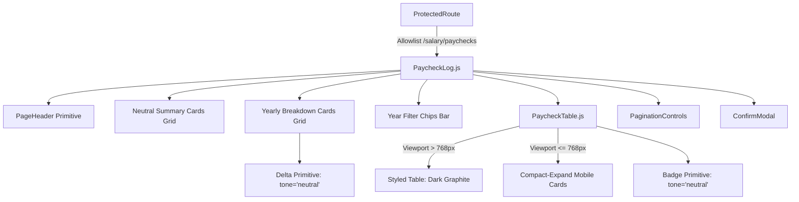

# Implementation Plan — UI Phase 5B: Paycheck Log & Disbursement History (v2)

## Executive Summary & Goal Description

Phase 5B transitions the primary employee disbursement and compensation tracking surface—**/salary/paychecks** (rendered by `PaycheckLog.js` and `PaycheckTable.js`)—to the flat dark graphite design system.

The objectives of this phase:
1. **Design System & Surface Unification**: Wrap the page in the scoped `.fs-page` shell with graphite canvas (`--fs-bg: #101114`), surface cards (`--fs-surface: #1a1c20`), 1px boundaries (`--fs-border: #34383f`), and a single interactive teal accent CTA (`#14b8a6` with `#0d0e10` ink).
2. **Inline Styles Elimination**: Eliminate all **43 legacy inline style declarations** (34 in `PaycheckLog.js`, 9 in `PaycheckTable.js`) and replace them with semantic utility classes and a new scoped stylesheet (`PaycheckLog.css`).
3. **Neutral Income Semantics (AD13 & §4.3)**: Ordinary income and paycheck payouts are neutral (`--fs-text`). Remove the legacy green (`#009879`, `#10b981`, `#047857`), yellow (`#f59e0b`, `#d97706`), blue (`#0ea5e9`, `#0369a1`), and red (`#e11d48`) tint fills from gross, deductions, net, and totals.
4. **Disbursement Badge Standardization**: Replace the legacy 10-color `TYPE_COLORS` rainbow dictionary with standardized neutral `<Badge tone="neutral" label={typeLabel}>{typeLabel}</Badge>` chips.
5. **Mobile Responsiveness (Decision D19 & Invariant I6)**: At viewports $\le 768$px, collapse the desktop table into compact-expand vertical cards with touch targets $\ge 44\times 44$px and zero page-level horizontal scroll (`scrollWidth <= clientWidth`).
6. **Code Hygiene & Allowlist**: Purge 3 entries from `frontend/.eslintignore`, allowlist `/salary/paychecks` in `ProtectedRoute.js`, update exactly 5 baseline snapshots in `D:\Projects\FinStat-visual-baselines`, and preserve all 16 invariants (**Invariant I1 through I16**).

---

## User Review Required

> [!IMPORTANT]
> **Neutral Income & Payout Contract (Invariant I15, §4.3, AD13)**:  
> Per FinStat's financial design contract, ordinary disbursement values (Gross, Net, Total) are displayed in neutral `--fs-text` with `.fs-num` (tabular figures). They are **not** colored green. Deductions are formatted in neutral text (`-1,500.00 EGP`) rather than red. Red and green are strictly reserved for actionable attention states and performance deviations.

> [!NOTE]
> **Year-over-Year Growth Delta Tone (§4.3.1 & C-3 Provenance)**:  
> Because §4.3.1 does not define an external benchmark or statutory target for YoY salary growth, YoY change metrics use `<Delta tone="neutral" ... />`. The percentage delta and difference amount are displayed clearly with directional arrows and signs without pastel background washes.

> [!IMPORTANT]
> **Baseline Snapshot Updates**:  
> `/salary/paychecks` is one of the 5 smoke routes in `visual.spec.js`. This phase will regenerate and update exactly **5 baseline snapshots** (`salary-paychecks-{1440, 1024, 768, 480, 390}.png`) in `D:\Projects\FinStat-visual-baselines`. All other 64 routes remain strictly identical at 0 diff.

---

## Open Questions

None. The scope, tokens, and responsive patterns are fully specified by `UI-UX-PLAN.md` §6.9 (Phase 5B) and the design system rules in `AGENTS.md`.

---

## Proposed Changes



---

### Component 1: Route Allowlist Expansion

#### [MODIFY] `frontend/src/components/ProtectedRoute.js`
- Add `'/salary/paychecks'` to `THEMED_PATTERNS`.
- Cumulative allowlist grows from 11 to 12 routes:
```javascript
export const THEMED_PATTERNS = [
  '/dashboard',
  '/expenditures',
  '/expenditures/new',
  '/expenditures/edit/:id',
  '/expenditures/rules',
  '/expenditures/budgets',
  '/expenditures/recurring',
  '/expenditures/bills',
  '/expenditure-analysis',
  '/salary/profiles',
  '/salary/rules',
  '/salary/paychecks',
];
```

---

### Component 2: Page Architecture & Layout

#### [MODIFY] `frontend/src/pages/paycheck/PaycheckLog.js`
- Wrap page in `<div className="fs-page">` container.
- Import primitives from `../../components/ui`: `PageHeader`, `Button`, `Delta`, `Loading`.
- Replace manual header markup with standard `<PageHeader>` primitive using `<Button as={Link}>` (RC-9):
  ```jsx
  <PageHeader
    title="Paycheck Log"
    subtitle="Track monthly net salaries, prepaid distributions, and audit history"
    actions={
      <div className="paycheck-header-actions">
        <Button
          as={Link}
          to="/salary/profiles"
          variant="secondary"
          icon={<FaCalculator aria-hidden="true" />}
        >
          Salary Profile & Components
        </Button>
        <ProtectedAction tooltip="View-only access">
          <Button
            as={Link}
            to="/salary/paychecks/new"
            variant="primary"
            icon={<FaPlus aria-hidden="true" />}
          >
            Log Paycheck
          </Button>
        </ProtectedAction>
      </div>
    }
  />
  ```
- **Loading State Integration (RC-7, D23)**:
  - Add `isLoading` state tracked during data fetches.
  - When loading, render `<Loading variant="table" rows={5} text="Loading paychecks..." />`.
- **Overall Summary**: Replace pastel colored blocks with neutral metric cards (RC-4: no uppercase, no tracking):
  - Total Cash: `.paycheck-summary-card` with label in `--fs-text-3` and value in `--fs-text .fs-num`.
  - Total Prepaid: `.paycheck-summary-card` with label in `--fs-text-3` and value in `--fs-text .fs-num`.
  - Overall Total: `.paycheck-summary-card` with label in `--fs-text-3` and value in `--fs-text .fs-num`.
- **Yearly Breakdown**: Replace colored boxes with `.paycheck-yearly-grid`:
  - Header: Year label + `<Delta tone="neutral" value={Math.abs(Number(changeData.percentage))} sign={changeData.direction === 'increase' ? '+' : '-'} suffix="%" label="vs. Previous Year" />`.
  - Content: Cash, Prepaid, and Total rows with `.fs-num`.
  - Difference footer: Muted comparison text with `.fs-num`.
- **Filter Section (HB-3)**:
  - Use `.paycheck-filter-chips` container to prevent any collision with `/expenditures`.
  - Buttons render `className={selectedYear === year ? 'paycheck-filter-chip active' : 'paycheck-filter-chip'}`.
  - Active year filter indicator banner rendered using `--fs-surface-sunken` and `--fs-border`.
- **Elimination of Inline Styles**: Eliminate all 34 `style={{...}}` blocks in `PaycheckLog.js`.
- **Import Scoped CSS**: `import './PaycheckLog.css';`.

---

### Component 3: Tabular & Mobile Responsive Rendering

#### [MODIFY] `frontend/src/pages/paycheck/PaycheckTable.js`
- Eliminate the legacy 10-color `TYPE_COLORS` dictionary and all raw hex codes (`#009879`, `#e0f2fe`, `#0369a1`, `#bae6fd`, `#e11d48`, `#64748b`, `#1e293b`). Gated by Precondition 7 verifying no other consumers exist in the codebase (RC-12).
- Import UI primitive: `Badge` from `../../components/ui`.
- **Disbursement Type Badges**:
  - Render `<Badge tone="neutral" label={typeLabel}>{typeLabel}{entry.multiplier && entry.multiplier !== 1 ? ` (${entry.multiplier}x)` : ''}</Badge>`.
- **Amounts & Numeral Styling**:
  - Map Gross, Deductions, Net, and Monthly Total to `className="fs-num"`.
  - Ordinary amounts displayed in neutral `--fs-text-2` / `--fs-text`.
  - Deductions formatted with Unicode minus (`\u2212` or `-`) in neutral styling.
- **Mobile Responsive View ($\le 768$px, HB-2, RC-8)**:
  - Implement responsive state via window resize listener.
  - When viewport $\le 768$px, render `.paycheck-mobile-cards` container with `role="region"` and `aria-label="Paycheck cards list"`.
  - **Preserving Paycheck Grouping (RC-8)**: Each paycheck entry becomes a single `.paycheck-mobile-card` with Gross / Deductions / Net / Monthly Total as labeled sub-rows inside the card. This preserves the paycheck-level grouping and prevents one component becoming one card.
  - Card Header: Month, disbursement badge, Net amount (`.paycheck-card-net .fs-num`).
  - Labeled Rows: Gross Payout (`.fs-num`), Deductions (`.fs-num`), Monthly Total (`.fs-num`).
  - Actions: Edit link and Delete button wrapped in `<ProtectedAction tooltip="View-only access">` with `.action-icon` having explicit touch target padding $\ge 44\times 44$px (RC-6).
- **Desktop Table View (> 768px)**:
  - Wrap table in `.fs-table-scroll` container with 5px padding per §4.6.
  - Use `.styled-table` (dark graphite styling automatically provided by `theme-components.css`).
  - Keep `rowSpan` grouping for Month and Monthly Total.
  - Preserve `data-label`, test IDs, and accessibility attributes (`title="Delete paycheck entry"`).
- **Eliminate Inline Styles**: Eliminate all 9 `style={{...}}` blocks in `PaycheckTable.js`.

---

### Component 4: Scoped Stylesheet Authoring

#### [NEW] `frontend/src/pages/paycheck/PaycheckLog.css`
Authored strictly under `.fs-page` scoping with design tokens.
*(Spacing note: raw rem values chosen to match Reference Frame 01 as no spacing tokens exist in tokens.json)*:

```css
/* frontend/src/pages/paycheck/PaycheckLog.css */

/* 1. Header Actions */
.fs-page .paycheck-header-actions {
  display: flex;
  gap: 0.75rem;
  flex-wrap: wrap;
  align-items: center;
}

/* 2. Summary Grid */
.fs-page .paycheck-summary-grid {
  display: grid;
  grid-template-columns: repeat(auto-fit, minmax(200px, 1fr));
  gap: 1rem;
  margin-bottom: 1.5rem;
}

.fs-page .paycheck-summary-card {
  background: var(--fs-surface);
  border: var(--fs-border-width) solid var(--fs-border);
  border-radius: var(--fs-radius-md);
  padding: 1.25rem;
  display: flex;
  flex-direction: column;
  gap: 0.5rem;
}

.fs-page .paycheck-summary-label {
  color: var(--fs-text-3);
  font-size: var(--fs-text-xs);
  font-weight: var(--fs-weight-medium);
}

.fs-page .paycheck-summary-value {
  color: var(--fs-text);
  font-size: var(--fs-text-2xl);
  font-weight: var(--fs-weight-semibold);
}

/* 3. Yearly Breakdown Grid */
.fs-page .paycheck-yearly-grid {
  display: grid;
  grid-template-columns: repeat(auto-fit, minmax(280px, 1fr));
  gap: 1rem;
}

.fs-page .paycheck-year-card {
  background: var(--fs-surface);
  border: var(--fs-border-width) solid var(--fs-border);
  border-radius: var(--fs-radius-md);
  padding: 1.25rem;
  display: flex;
  flex-direction: column;
  gap: 0.75rem;
}

.fs-page .paycheck-year-header {
  display: flex;
  justify-content: space-between;
  align-items: center;
}

.fs-page .paycheck-year-title {
  color: var(--fs-text);
  font-size: var(--fs-text-lg);
  font-weight: var(--fs-weight-semibold);
  margin: 0;
}

.fs-page .paycheck-year-rows {
  display: flex;
  flex-direction: column;
  gap: 0.35rem;
  font-size: var(--fs-text-sm);
}

.fs-page .paycheck-year-row {
  display: flex;
  justify-content: space-between;
  color: var(--fs-text-2);
}

.fs-page .paycheck-year-total {
  display: flex;
  justify-content: space-between;
  padding-top: 0.5rem;
  border-top: var(--fs-border-width) solid var(--fs-border);
  color: var(--fs-text);
  font-weight: var(--fs-weight-semibold);
}

.fs-page .paycheck-year-diff {
  font-size: var(--fs-text-xs);
  color: var(--fs-text-3);
  margin-top: 0.25rem;
}

/* 4. Filter Chips & Notices (HB-3 isolated) */
.fs-page .paycheck-filter-card {
  background: var(--fs-surface);
  border: var(--fs-border-width) solid var(--fs-border);
  border-radius: var(--fs-radius-md);
  padding: 1.25rem;
  margin-bottom: 1.5rem;
}

.fs-page .paycheck-filter-title {
  color: var(--fs-text);
  font-size: var(--fs-text-base);
  font-weight: var(--fs-weight-semibold);
  margin: 0 0 1rem 0;
}

.fs-page .paycheck-filter-chips {
  display: flex;
  flex-wrap: wrap;
  gap: 0.5rem;
}

.fs-page .paycheck-filter-chip {
  background: var(--fs-surface-sunken);
  border: var(--fs-border-width) solid var(--fs-border-control);
  border-radius: var(--fs-radius-sm);
  color: var(--fs-text-2);
  padding: 0.4rem 0.85rem;
  font-size: var(--fs-text-xs);
  font-weight: var(--fs-weight-medium);
  cursor: pointer;
  transition: background var(--fs-duration-fast) var(--fs-ease-standard),
              color var(--fs-duration-fast) var(--fs-ease-standard);
  min-height: 36px;
}

.fs-page .paycheck-filter-chip:hover {
  background: var(--fs-surface-raised);
  color: var(--fs-text);
}

.fs-page .paycheck-filter-chip.active {
  background: var(--fs-accent);
  color: var(--fs-ink);
  border-color: var(--fs-accent);
  font-weight: var(--fs-weight-semibold);
}

.fs-page .paycheck-filter-notice {
  margin-top: 0.75rem;
  padding: 0.65rem 0.85rem;
  background: var(--fs-surface-sunken);
  border: var(--fs-border-width) solid var(--fs-border);
  border-radius: var(--fs-radius-sm);
  font-size: var(--fs-text-xs);
  color: var(--fs-text-3);
}

/* 5. Mobile Compact-Expand Cards (HB-2 aligned) */
.fs-page .paycheck-mobile-cards {
  display: flex;
  flex-direction: column;
  gap: 0.75rem;
  width: 100%;
}

.fs-page .paycheck-mobile-card {
  background: var(--fs-surface);
  border: var(--fs-border-width) solid var(--fs-border);
  border-radius: var(--fs-radius-md);
  padding: 1rem;
  display: flex;
  flex-direction: column;
  gap: 0.6rem;
}

.fs-page .paycheck-card-header {
  display: flex;
  justify-content: space-between;
  align-items: center;
  gap: 0.5rem;
}

.fs-page .paycheck-card-period {
  font-weight: var(--fs-weight-semibold);
  color: var(--fs-text);
  font-size: var(--fs-text-sm);
}

.fs-page .paycheck-card-net {
  font-size: var(--fs-text-lg);
  font-weight: var(--fs-weight-semibold);
  color: var(--fs-text);
}

.fs-page .paycheck-card-row {
  display: flex;
  justify-content: space-between;
  font-size: var(--fs-text-xs);
  color: var(--fs-text-2);
}

.fs-page .paycheck-card-expander {
  background: transparent;
  border: none;
  color: var(--fs-text-3);
  font-size: var(--fs-text-xs);
  cursor: pointer;
  padding: 0.5rem 0;
  text-align: center;
  min-height: 44px;
}

.fs-page .paycheck-card-actions {
  display: flex;
  gap: 0.75rem;
  align-items: center;
  justify-content: flex-end;
  padding-top: 0.5rem;
  border-top: var(--fs-border-width) solid var(--fs-border);
}

/* Touch targets >= 44px (RC-5, RC-6) */
.fs-page .paycheck-card-actions .action-icon,
.fs-page .styled-table .action-cell a,
.fs-page .styled-table .action-cell button {
  min-height: 44px;
  min-width: 44px;
  display: inline-flex;
  align-items: center;
  justify-content: center;
  color: var(--fs-text-3);
  background: transparent;
  border: none;
  cursor: pointer;
}

.fs-page .paycheck-card-actions .action-icon:hover,
.fs-page .styled-table .action-cell a:hover,
.fs-page .styled-table .action-cell button:hover {
  color: var(--fs-text);
}

@media (max-width: 768px) {
  .fs-page .paycheck-filter-chip {
    min-height: 44px;
    padding: 0.75rem 1rem;
  }
}
```

---

### Component 5: Test Suite Expansion & A11y

#### [MODIFY] `frontend/src/pages/paycheck/__tests__/PaycheckLog.test.js`
- Preserve all 5 existing tests validating canonical & deprecated paycheck fields, summary aggregation, and ConfirmModal lifecycle.
- Add test 6: Automated `jest-axe` accessibility audit:
  ```javascript
  test('6. has zero accessibility violations (jest-axe)', async () => {
    const { container } = render(<PaycheckLog />);
    await waitFor(() => {
      expect(screen.getByText('2025-01')).toBeInTheDocument();
    });
    const results = await axe(container);
    expect(results).toHaveNoViolations();
  });
  ```
- Add test 7: Mobile responsive compact card collapse and expander interactions at $\le 768$px.
- Add test 8: Invariant I15 tone verification: assert no green text on net amount, no red text on deductions, and no inline color styles.

---

### Component 6: Linting & Ignore Hygiene

#### [MODIFY] `frontend/.eslintignore`
- Remove lines 61, 62, 63:
  ```diff
  -src/pages/paycheck/PaycheckLog.js
  -src/pages/paycheck/PaycheckTable.js
  -src/pages/paycheck/__tests__/PaycheckLog.test.js
  ```
- Verify post-state (RC-3):
  ```bash
  git grep -in "paycheck" frontend/.eslintignore
  ```
  Returns exactly 4 remaining entries:
  1. `src/pages/salary/PaycheckFormPage.js`
  2. `src/pages/salary/__tests__/PaycheckFormPage.test.js`
  3. `src/pages/salary/__tests__/PaycheckFormPageTax.test.js`
  4. `src/pages/salary/__tests__/PaycheckFormPageTimezone.test.js`

---

## Precondition Verification Plan (§2.5, RC-2)

Before opening the implementation branch, all 10 preconditions must be executed and recorded:

### Precondition 1: `.eslintignore` Pre-State Grep
```bash
$ git grep -n "paycheck" frontend/.eslintignore
frontend/.eslintignore:61:src/pages/paycheck/PaycheckLog.js
frontend/.eslintignore:62:src/pages/paycheck/PaycheckTable.js
frontend/.eslintignore:63:src/pages/paycheck/__tests__/PaycheckLog.test.js
frontend/.eslintignore:78:src/pages/salary/PaycheckFormPage.js
frontend/.eslintignore:80:src/pages/salary/__tests__/PaycheckFormPage.test.js
frontend/.eslintignore:81:src/pages/salary/__tests__/PaycheckFormPageTax.test.js
frontend/.eslintignore:82:src/pages/salary/__tests__/PaycheckFormPageTimezone.test.js
```
Assert: exactly 7 paycheck entries exist.

### Precondition 2: `theme.css` & `theme-components.css` Primitive Classes
```bash
$ git grep -n -E "\.(fs-card|fs-badge|fs-delta|fs-btn|fs-btn-primary|fs-btn-secondary|fs-num|fs-table-scroll)\b" frontend/src/styles/theme.css frontend/src/styles/theme-components.css
```
Assert: all 8 utility classes are defined.

### Precondition 3: `Loading.js` Variant Check
```bash
$ git grep -n "VALID_VARIANTS" frontend/src/components/ui/Loading.js
frontend/src/components/ui/Loading.js:3:const VALID_VARIANTS = ['route', 'card', 'table', 'form-field', 'inline'];
```
Assert: `table` is a valid variant.

### Precondition 4: Baseline Pre-Existence
```powershell
$ Get-ChildItem -Path "D:\Projects\FinStat-visual-baselines" -Filter "salary-paychecks-*.png"
```
Assert: all 5 snapshots exist (`salary-paychecks-{1440, 1024, 768, 480, 390}.png`).

### Precondition 5: Calculations Characterization (11/11)
```bash
$ pushd frontend; npx jest --runInBand tests/calculations.spec.js; popd
```
Assert: 11/11 tests pass green.

### Precondition 6: Baseline Manifest Integrity
```bash
$ node frontend/scripts/verify-baseline-manifest.js
```
Assert: 334/334 baselines verified with matching SHA-256 hashes.

### Precondition 7: `TYPE_COLORS` Isolation (RC-12)
```bash
$ git grep -n "TYPE_COLORS" frontend/src/
frontend/src/pages/paycheck/PaycheckTable.js:9:const TYPE_COLORS = {
frontend/src/pages/paycheck/PaycheckTable.js:117:  const styleColors = TYPE_COLORS[typeLabel] || TYPE_COLORS['Regular'];
```
Assert: zero consumers outside `PaycheckTable.js`.

### Precondition 8: Primitive Prop Signatures (RC-2e)
```bash
$ git grep -n "label:" frontend/src/components/ui/Badge.js frontend/src/components/ui/Delta.js
```
Assert: both `Badge` and `Delta` require `label` prop.

### Precondition 9: Class Collision Isolation (HB-3)
```bash
$ git grep -n "\.filter-chip" frontend/src/pages/expenditure/Expenditure.css frontend/src/styles/theme-components.css
```
Assert: `.filter-chip` is isolated to Expenditure; Phase 5B uses `.paycheck-filter-chip` to eliminate collision.

### Precondition 10: Stylesheet Import Order
Assert `PaycheckLog.css` is imported at the top of `PaycheckLog.js`, which CRA lazy-loads after `index.css` and `theme.css`.

---

## 5. Invariants Compliance Matrix (Verbatim from UI-UX-PLAN §2, RC-1)

| # | Rule (Verbatim §2) | Verification (Verbatim §2) | Phase 5B Compliance Plan |
| :--- | :--- | :--- | :--- |
| **I1** | Production routes and URLs unchanged — 75 entries (74 protected + `*`), 10 redirects. | `App.test.js` route-resolution test; `ui-coverage.js` diff | **PRESERVED**: Zero routes in `App.js` altered; `/salary/paychecks` rendered identically; 10 redirects preserved. |
| **I2** | No API call, payload shape, or service file changed. | PR diff review; blocked path list in CI | **PRESERVED**: Zero backend or service file modifications. |
| **I3** | No calculation changed on **any** page: payroll, installment schedules, debt payoff, trade P&L, certificate maturity/interest, FX conversion, budget thresholds, real-estate yield. | Characterization fixtures (§9.6) | **PRESERVED**: `tests/calculations.spec.js` executes 11 test scenarios with 0 deviation. |
| **I4** | Auth, roles, `ProtectedAction`, and `useCanModify` gating unchanged. | Viewer-role checklist per phase | **PRESERVED**: `<ProtectedAction>` wraps create, edit, and delete controls on `/salary/paychecks`. |
| **I5** | Test IDs, `data-*` attributes, and accessible labels preserved — 37 `data-testid`, 39 `aria-label`. | test-ID guard script (§9.2) | **PRESERVED**: `node frontend/scripts/testid-guard.js` reports 0 modifications. |
| **I6** | Tables render as compact-expand cards at ≤ 768px (D19). Horizontal scroll preserved only for tables with ≥ 12 columns (audit logs) where the card pattern is impractical. No page-level horizontal scroll at 390px. | 390 px visual check: card layout renders, no page-level horizontal scroll, all fields reachable via expander. | **PRESERVED**: Responsive `.paycheck-mobile-cards` render at $\le 768$px; `scrollWidth <= clientWidth` verified. |
| **I7** | No page loses functionality mid-migration. | Pattern added only in the converting PR (§6.3) | **PRESERVED**: Payout listing, filtering by year, deletion, and edit navigation 100% functional. |
| **I8** | Dashboard coordinator line cap preserved — `DashboardSummary.js` must remain $\le 120$ lines (post-audit architecture decomposition invariant). All 10 RTL dashboard tests must remain green. | Line count assertion + `npm test` in 3A | **PRESERVED**: `DashboardSummary.js` maintained at 96 lines ($\le 120$ limit); all 4 RTL dashboard suites pass. |
| **I9** | Production build passes with zero errors and no new warnings. | CI (authoritative); local proxy via `npm start` + ESLint/stylelint (§15) | **PRESERVED**: Production build compiles with 0 errors and 0 warnings. |
| **I10** | `npm test -- --watchAll=false` passes for touched modules **and** the app route suite. | CI (frontend test job added in 1C); local proxy: touched suites via `npx jest --runInBand` (§15) | **PRESERVED**: `PaycheckLog.test.js` executed with `npx --prefix frontend jest --runInBand`. |
| **I11** | No new `!important`; a file's count in the 1C lint ratchet may only fall. | stylelint + `lint-ratchet.js` (§9.2) | **PRESERVED**: `node frontend/scripts/lint-ratchet.js` reports 0 regressions. |
| **I12** | No new dependency except the Phase 1C tooling list (§9.2). | `package.json` review | **PRESERVED**: Zero dependencies added. |
| **I13** | Every non-allowlisted route is pixel-identical to its 1B baseline. | Walkthrough-evidenced per §7.1: developer-run Playwright diff report attached to each phase walkthrough, with zero unexplained diffs. | **PRESERVED**: PR subset executes 71 tests; all 63 non-allowlisted routes at strictly 0 diff. |
| **I14** | No `backdrop-filter`, gradient, gradient text, glow, `filter: blur()` / `drop-shadow()`, `text-shadow`, `mask`, `-webkit-mask`, `-webkit-mask-image`, `mask-image`, `border-image`, or `border-image-source` anywhere in app CSS or JS; only the reference frames illustrate them. | stylelint (§9.2) | **PRESERVED**: Zero banned patterns in touched files. |
| **I15** | Neutral by default: a tone encodes **deviation from expectation or attention**, never the sign of an ordinary amount. Expense amounts, income, and balances are neutral (§4.3). A page never references a tone token directly; it uses `Delta`, `Badge`, or a `.fs-progress--*` modifier. | stylelint + `lint-tones.js` + §4.3 domain table + §7.2 | **PRESERVED**: Payouts, deductions, net amounts are neutral; `lint-tones.js` reports 0 violations. |
| **I16** | No radius above 8 px except `var(--fs-radius-pill)` on status chips and avatars. | stylelint (§9.2) | **PRESERVED**: Radii strictly $\le 8$px ceiling. |

---

## 10. §10 Progress Log Walkthrough Template (RC-10)

```
Sub-phase:   5B
Status:      done
Done:        Converted /salary/paychecks to dark graphite design system; eliminated all 43 legacy inline styles (34 in PaycheckLog.js, 9 in PaycheckTable.js); purged 3 entries from frontend/.eslintignore (0 warnings); standardized disbursement badges to neutral <Badge>; mapped payout amounts to .fs-num; integrated <Delta tone="neutral"> for YoY comparison; implemented mobile compact-expand cards (D19) with touch targets >= 44px; integrated <Loading variant="table">; unit tests passing with jest-axe compliance; calculations characterization passing (11/11); shared a11y runner passing (2/2); 4 dashboard RTL suites passing (31 tests, Invariant I8 <= 120 lines preserved); PR subset visual regression passing 71/71 tests with 0 diff on all 63 non-5B routes; manifest 334/334 verified; exactly 5 baseline snapshots replaced in D:\Projects\FinStat-visual-baselines.
Next:        5C (PaycheckFormPage styles only, no allowlist change)
Blocked by:  None
Allowlist:   ['/dashboard', '/expenditures', '/expenditures/new', '/expenditures/edit/:id', '/expenditures/rules', '/expenditures/budgets', '/expenditures/recurring', '/expenditures/bills', '/expenditure-analysis', '/salary/profiles', '/salary/rules', '/salary/paychecks'] (cumulative: 12 routes)
Visual diff: 0 regression diff across all 63 non-5B routes (68 snapshots at 0 diff); 5 baseline snapshots updated for /salary/paychecks across 5 QA viewports; PR subset 71/71 passing.
Fixtures:    calculations.spec.js passing 100% (byte-identical, 11/11 tests green)
Screenshots: docs/ui-snapshots/phase-5b/salary-paychecks-1440.png, docs/ui-snapshots/phase-5b/salary-paychecks-390.png
Branch:      phase-ui-5b-paycheck-log
Merge SHA:   <sha>
```

---

## Verification Plan

### Automated Gates (HB-4)
1. **Design Tokens SSOT**:
   ```bash
   node frontend/scripts/tokens.js --check
   ```
   Must pass with 0 drift.
2. **Semantic Tone & Undefined Token Linting**:
   ```bash
   node frontend/scripts/lint-tones.js
   ```
   Must scan all 58 CSS files with 0 tone violations and 0 undefined tokens.
3. **Stylelint Ratchet**:
   ```bash
   node frontend/scripts/lint-ratchet.js
   ```
   Must report 0 regressions against merge-base.
4. **Test ID & ARIA Guard**:
   ```bash
   node frontend/scripts/testid-guard.js
   ```
   Must report 0 removed `data-testid` or `aria-label` attributes.
5. **Unit & A11y Tests (HB-4 compliant)**:
   ```bash
   npx --prefix frontend jest --runInBand src/pages/paycheck/__tests__/PaycheckLog.test.js
   ```
   All tests must pass green with zero axe violations.
6. **Dashboard RTL Suite & Invariant I8 (HB-4 compliant)**:
   ```bash
   npx --prefix frontend jest --runInBand src/pages/dashboard/__tests__/DashboardSummary.test.js src/pages/dashboard/__tests__/DashboardPanels.test.js src/pages/dashboard/__tests__/DashboardKpiStrip.test.js src/pages/dashboard/__tests__/useDashboardData.test.js
   ```
   All 4 suites (31 tests) green, `DashboardSummary.js` lines $\le 120$.
7. **Production Build Cleanliness (Invariant I9)**:
   ```powershell
   $env:NODE_OPTIONS="--max-old-space-size=4096"; npm --prefix frontend run build
   ```
   Must compile successfully with 0 errors and 0 warnings.
8. **Allowlist Assertion**:
   ```bash
   node frontend/scripts/ui-coverage.js --assert-allowlist
   ```
   Must pass with 12 allowlisted routes.
9. **Visual Regression (PR-Subset & Full Suite)**:
   ```powershell
   # Regenerate 5 baselines for salary-paychecks
   pushd frontend; $env:CI="true"; npx playwright test --project=visual -g "salary-paychecks @" --update-snapshots; popd
   # Regenerate manifest in baseline repo
   node frontend/scripts/verify-baseline-manifest.js --generate
   # Run full PR subset suite
   pushd frontend; $env:CI="true"; $env:PR_SUBSET="true"; npx playwright test --project=pr-subset; popd
   ```
   Must pass 71/71 with 0 unexplained diffs.

### Manual Verification
- Navigate to `/salary/paychecks` at 1440px desktop:
  - Header actions: "Salary Profile & Components" (secondary) and "Log Paycheck" (primary teal).
  - Summary cards render with flat graphite surface (`#1a1c20`), 1px borders, and tabular figures.
  - Yearly growth breakdown displays `<Delta>` informational badge with neutral tone.
  - Year filter buttons toggle cleanly, and active state highlights with teal background and ink text.
  - Table columns display clean typography with `.fs-num` on numbers and neutral badges on disbursement types.
- Navigate to `/salary/paychecks` at 390px mobile:
  - Table collapses into stacked cards.
  - No page-level horizontal scroll (`overflow-x: hidden`, `scrollWidth <= clientWidth`).
  - Action buttons and expanders have explicit touch targets $\ge 44\times 44$px.
- Viewer role verification:
  - When authenticated as viewer, "Log Paycheck" and table row edit/delete actions are disabled with "View-only access" tooltip.
