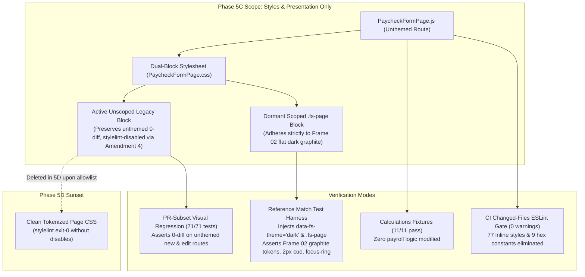

# Implementation Plan — UI Phase 5C: Paycheck Form, Part 1 (Styles Only) (v8)

## 1. Executive Summary & Goal Description

Phase 5C initiates the design system migration of FinStat's central compensation entry screen—**/salary/paychecks/new** and **/salary/paychecks/edit/:id** (`frontend/src/pages/salary/PaycheckFormPage.js` and `PaycheckFormPage.css`)—into the flat dark graphite design system.

In strict adherence to `UI-UX-PLAN.md §6.9` (lines 1680–1694), **Phase 5C is a styles-only phase**:
1. **Zero Route Allowlisting (`§6.9`)**: `/salary/paychecks/new` and `/salary/paychecks/edit/:id` **must not** be added to `THEMED_PATTERNS` in `ProtectedRoute.js`. The routes remain unthemed until Phase 5D. The root container in `PaycheckFormPage.js` remains `<div className="page-container">` (no `fs-page` class added in 5C).
2. **Strict Mixed-File Diff Rule (`§6.4` line 1302 & `§6.9`)**: `PaycheckFormPage.js` holds core statutory payroll calculations and temporal logic. The diff may modify **only** `className`, `style`, JSX presentation structure, and remove presentation-only `color` hex properties from `DISBURSEMENT_TYPES` per Recorded Amendment 6. **Do not touch** `normalizePayDateInput`, calculation hooks, handlers, state machines, or validation logic.
3. **Complete Inline Styles Elimination**: Completely eliminate all **77 legacy inline style declarations** in `PaycheckFormPage.js` and replace them with page-local semantic CSS classes.
4. **Compatibility Contract for Unthemed 0-Diff vs Dormant Graphite Theme**: To preserve 0 visual diff on unthemed snapshots while eliminating all 77 inline styles, `PaycheckFormPage.css` maintains a dual-block architecture:
   - *Active Unscoped Legacy Block*: Retains legacy rules and maps extracted inline style classes to unscoped rules matching the unthemed look. Governed by Recorded Plan Amendment 4 in `UI-UX-PLAN.md §6.9` with scoped `/* stylelint-disable */` comments and a mandatory Phase 5D sunset upon route allowlisting.
   - *Dormant Scoped `.fs-page` Block*: Implements the tokenized graphite theme adhering to Reference Frame 02 (`docs/UI-UX_Plan/reference/02-form.html`). Contains zero raw hex, zero direct tone tokens, zero gradients, zero blurs, and strict 8px radius ceilings. Activates in Phase 5D when allowlisted.
5. **No Global Primitive Classes in Unthemed Mode (B3 Resolution)**: Global primitive classes from `theme.css` (`.fs-btn`, `.fs-btn-primary`, `.fs-btn-secondary`, `.fs-num`) are unscoped and would bleed accent colors or tabular alignments onto the unthemed route. JSX in 5C uses page-local semantic classes (`.paycheck-submit-btn`, `.paycheck-cancel-btn`, `.paycheck-recalc-btn`, `.paycheck-calc-readonly`, `.paycheck-preview-val`).
6. **Numeric Typography Alignment (B9, B13 Resolutions)**: In accordance with `UI-UX-PLAN.md §6.4` line 1297 and Decision D16, numeric inputs, smart preview values, and calculations use proportional typography with tabular figures and right-alignment (`font-family: var(--fs-font-sans); font-variant-numeric: tabular-nums; text-align: right;`). Defined explicitly for both `.paycheck-calc-readonly` and `.paycheck-preview-val`. Monospace is reserved exclusively for identifiers.
7. **`DISBURSEMENT_TYPES` Presentation Color Extraction (B10 Resolution)**: `color: '#...'` properties are removed from `DISBURSEMENT_TYPES` per Recorded Plan Amendment 6 to satisfy ESLint AST rule `Literal[value=/^#(?:[0-9a-fA-F]{3,4}){1,2}$/]`. Colors are governed 100% in CSS classes (`.type-*`), enabling clean de-ignoring of `PaycheckFormPage.js` with 0 ESLint errors and 0 warnings.
8. **Recorded Master Plan Amendments Formally Committed**: All six plan amendments are recorded directly in `UI-UX-PLAN.md §6.9`, `§6.16`, and `§10 Progress Log` (commit `f3232f6` on `main`).

---

## 2. User Review Required

> [!IMPORTANT]
> **No Early Route Allowlisting (`§6.9` Invariant)**:  
> Unlike Phases 4A, 4C, 5A, and 5B, Phase 5C does **not** add `/salary/paychecks/new` or `/salary/paychecks/edit/:id` to `THEMED_PATTERNS`. The page is styled in CSS, but remains unthemed in production routing until Phase 5D validation and walkthrough sign-off.

> [!CAUTION]
> **Zero Payroll Calculation Logic Modification (`§6.4` line 1302)**:  
> `normalizePayDateInput`, `triggerCalculation`, `handleSavePaycheck`, `extractProfileSalaryValues`, `computeLiveEstimate`, and all calculation dependencies must remain 100% byte-for-byte identical. The 11/11 statutory calculation fixtures in `frontend/tests/calculations.spec.js` serve as the cryptographic characterization baseline.

> [!NOTE]
> **Compatibility Contract & Stylelint Ratchet**:  
> Extracted inline style colors and geometry are mapped to an unscoped legacy CSS block in `PaycheckFormPage.css` to guarantee 0 diff on `salary-paychecks-new @ 1440px`. Governed by Recorded Plan Amendment 4, this temporary block is wrapped in scoped `/* stylelint-disable */` comments. Direct `stylelint --max-warnings=0` on this file is deferred to Phase 5D when the legacy block is purged.

---

## 3. Formally Recorded Master Plan Amendments

The following amendments have been formally recorded in `docs/UI-UX_Plan/UI-UX-PLAN.md §6.9`, `§6.16 (Phase 12)`, and `§10 Progress Log` (Owner: Antigravity / Developer approved, Date: 2026-11-20, Commit: `f3232f6`):

### 1. Recorded Plan Amendment 1: Move `.eslintignore` Removal to Phase 5C
- **Amendment**: Move "Remove `PaycheckFormPage.js` from `frontend/.eslintignore`; verify clean ESLint" from Phase 5D (`UI-UX-PLAN.md §6.9` line 1702) to Phase 5C (`§6.9` line 1686).
- **Reason**: CI's changed-files ESLint gate (`.github/workflows/ci.yml:173-185`) executes `npx eslint $CHANGED_FILES --max-warnings=0`. When an edited file is listed in `.eslintignore`, ESLint emits a warning causing exit code 1. De-ignoring `PaycheckFormPage.js` in 5C after resolving all 173 errors and 20 warnings prevents this failure.
- **Scope Limit**: The three test files (`src/pages/salary/__tests__/PaycheckFormPage*.test.js`) remain in `.eslintignore`. Only `PaycheckFormPage.js` is de-ignored.

### 2. Tooling Amendment 2: Extend `playwright.config.js` Reference Project `testMatch`
- **Amendment**: In `frontend/playwright.config.js` line 37, update the `reference` project regex:
  ```javascript
  // Before:
  testMatch: /(reference-frames|dashboard-reference-match|expenditure-reference-match|expenditure-form-reference-match)\.spec\.js/,
  // After:
  testMatch: /(reference-frames|dashboard-reference-match|expenditure-reference-match|expenditure-form-reference-match|paycheck-form-reference-match)\.spec\.js/,
  ```
- **Reason**: Permits discovery and execution of `frontend/tests/visual/paycheck-form-reference-match.spec.js` by Playwright's `reference` project.

### 3. Recorded Plan Amendment 3: Inline Styles Extraction Scope Alignment
- **Amendment**: Pull the complete extraction of all 77 inline style declarations from Phase 5D into Phase 5C.
- **Reason**: `frontend/.eslintrc.json` enforces `no-restricted-syntax` which bans all `style={{ ... }}` declarations. Once `PaycheckFormPage.js` is removed from `.eslintignore` (Amendment 1) and touched in 5C, any surviving inline styles will fail the CI changed-files gate. Complete extraction in 5C ensures 0 errors.

### 4. Recorded Plan Amendment 4: Temporary Dual-Mode Legacy CSS Compatibility Block with Phase 5D Sunset
- **Amendment**: Author a temporary unscoped legacy compatibility block in `PaycheckFormPage.css` protected by scoped `/* stylelint-disable color-no-hex, color-named, function-disallowed-list, declaration-property-value-allowed-list, declaration-property-value-disallowed-list */` comments.
- **Precedent & Invariant Reconciliation**: Follows the Phase 2F precedent (`UI-UX-PLAN.md §6.16` line 1982 and `§10` line 2509) and recorded in `UI-UX-PLAN.md §6.9`. A temporary I14/I16 waiver applies strictly to this unscoped legacy compatibility block to preserve 0-diff on unthemed routes. The new scoped `.fs-page` block strictly obeys I14 and I16.
- **Sunset**: The unscoped compatibility block and its `stylelint-disable` comments will be completely purged in Phase 5D when `/salary/paychecks/new` and `/salary/paychecks/edit/:id` are allowlisted. In Phase 5D, `PaycheckFormPage.css` will pass direct `stylelint --max-warnings=0` cleanly without disables. Recorded in Phase 12 checklist (`UI-UX-PLAN.md §6.16`).

### 5. Recorded Plan Amendment 5: Deferral of Loading Primitive (`<Loading variant="route" />`) to Phase 5D
- **Amendment**: Retain the markup structure and tag hierarchy of the legacy loading state in `PaycheckFormPage.js:654-661` (`RefreshCw` spinner + status text) while extracting inline styles to `.paycheck-loading-*` classes. Adoption of `<Loading variant="route" />` per D23 and §6.4 line 1290 is deferred to Phase 5D.
- **Reason**: Preserves 0-diff on unthemed loading state snapshots during the styles-only Phase 5C. When the route is allowlisted in Phase 5D, the loading state will be switched to the shared `<Loading variant="route" />` component.

### 6. Recorded Plan Amendment 6: `DISBURSEMENT_TYPES` Presentation Color Extraction
- **Amendment**: Authorize removal of presentation-only `color: '#...'` hex properties from the `DISBURSEMENT_TYPES` array literal in `PaycheckFormPage.js`.
- **Reason**: `frontend/.eslintrc.json:14-15` enforces `Literal[value=/^#(?:[0-9a-fA-F]{3,4}){1,2}$/]` which bans raw hex literals across all JS files. The 9 hex colors in `DISBURSEMENT_TYPES` are strictly presentation metadata (used only for button/icon styling, never for payroll calculations or business logic). Removing `color` and managing colors 100% in CSS classes (`.type-*`) allows `PaycheckFormPage.js` to pass ESLint with 0 errors and 0 warnings upon de-ignoring in 5C.
- **Scope Limit**: IDs, labels, icons, and descriptions in `DISBURSEMENT_TYPES` remain untouched.

### 7. Deferred Form Accessibility Scope (Phase 5D)
- In accordance with the strict Phase 5C scope rule (`§6.4` line 1302: presentation and CSS extraction only, no logic or DOM behavior modifications), the following form accessibility features are explicitly deferred to Phase 5D:
  - `aria-required="true"` on statutory required inputs.
  - `aria-describedby` linking inputs to helper texts or field error containers.
  - `aria-invalid="true"` dynamic bindings on invalid inputs.
  - Inline field error rendering and focus management.
- In Phase 5C, we resolve all 20 `jsx-a11y/label-has-associated-control` warnings by pairing existing `<label>` elements with input `id` attributes via `htmlFor`.

---

## 4. Preconditions

Before modifying code or creating branch `phase-ui-5c-paycheck-form-a`, verify (working directory: repository root `D:\Projects\FinStat`, paths targeting `frontend/` as specified):

1. **PC-1: `.eslintignore` Pre-State**:
   ```powershell
   git grep -n "PaycheckFormPage" frontend/.eslintignore
   ```
   *Expect*: Line 74 `src/pages/salary/PaycheckFormPage.js`, lines 76–78 for test files.
2. **PC-2: Shared Theme Primitives Existence**:
   ```powershell
   git grep -n "fs-btn" frontend/src/styles/theme.css
   git grep -n "fs-num" frontend/src/styles/theme.css
   ```
   *Expect*: `.fs-btn`, `.fs-btn-primary`, `.fs-btn-secondary`, `.fs-num` exist in `theme.css`.
3. **PC-3: `Loading.js` Variant Support**:
   ```powershell
   git grep -n "VALID_VARIANTS" frontend/src/components/ui/Loading.js
   ```
   *Expect*: Supports `['route', 'card', 'table', 'form-field', 'inline']`.
4. **PC-4: Baseline Pre-Existence**:
   ```powershell
   cd D:\Projects\FinStat-visual-baselines
   git ls-files 'salary-paychecks-new*' 'salary-paychecks-edit*'
   ```
   *Expect*: Baselines exist for both slugs at 1440, 1024, 768, 480, and 390px.
5. **PC-5: Manifest Integrity Pre-Check**:
   ```powershell
   node frontend/scripts/verify-baseline-manifest.js
   ```
   *Expect*: `334/334 baselines verified successfully.`
6. **PC-6: Characterization Engine Pre-Check**:
   ```powershell
   cd frontend; npx jest --runInBand tests/calculations.spec.js
   ```
   *Expect*: 11/11 tests pass.
7. **PC-7: Hex Code & Style Isolation Pre-Check**:
   ```powershell
   git grep -n "style={{" frontend/src/pages/salary/PaycheckFormPage.js | Measure-Object -Line
   git grep -n -A 12 "const DISBURSEMENT_TYPES = \[" frontend/src/pages/salary/PaycheckFormPage.js | Select-String "color: '#" | Measure-Object -Line
   ```
   *Expect*: Exactly 77 inline styles total, and exactly 9 hardcoded hex colors in the `DISBURSEMENT_TYPES` literal.
8. **PC-8: Clean Git Status**:
   ```powershell
   git status
   ```
   *Expect*: Working tree clean on `main` (`37f6c4a` or later).
9. **PC-9: Allowlist Pre-State**:
   ```powershell
   git grep -n "'/salary/paychecks" frontend/src/components/ProtectedRoute.js
   ```
   *Expect*: Exactly 1 match (`'/salary/paychecks'`). New and edit routes are absent.
10. **PC-10: Loading State Structure Pre-Check**:
    Verify lines 654–661 in `PaycheckFormPage.js` render `<div className="page-container">`, `<RefreshCw className="spinning-icon" ...>`, and `<p>Loading profile & paycheck details...</p>`. Extracted classes (`.paycheck-loading-container`, `.paycheck-loading-icon`, `.paycheck-loading-text`) retain the exact element tag hierarchy and string content.

---

## 5. Proposed Architecture & Component Flow



### Complete 9-Disbursement-Type CSS Mapping Specification (Geometry & Colors)

In `PaycheckFormPage.js`, `color` is removed from `DISBURSEMENT_TYPES` per Amendment 6. Each button renders:
```javascript
className={`paycheck-type-btn type-${dt.id.toLowerCase().replace(/\s+/g, '-')} ${isSelected ? 'selected' : ''}`}
```

#### 1. Unscoped Legacy Geometry & State Mapping (Active in Unthemed Mode):
- **Base Geometry**:
  ```css
  .paycheck-type-btn {
    display: flex;
    align-items: flex-start;
    gap: 0.75rem;
    padding: 0.85rem 1rem;
    border-radius: 10px;
    border: 1px solid #e2e8f0;
    background-color: #ffffff;
    cursor: pointer;
    text-align: left;
    transition: all 0.15s ease;
  }
  .paycheck-type-btn .paycheck-type-icon-wrapper {
    padding: 6px;
    border-radius: 8px;
    flex-shrink: 0;
    margin-top: 2px;
  }
  .paycheck-type-btn .paycheck-type-title {
    font-weight: 700;
    font-size: 0.92rem;
    color: #1e293b;
  }
  .paycheck-type-btn .paycheck-type-desc {
    font-size: 0.75rem;
    color: #64748b;
    margin-top: 2px;
    line-height: 1.25;
  }
  ```
- **Per-Type Legacy Color Mapping (9 Types)**:

| `typeClass` | Hex Color | Unselected State (Button / Icon / Title / Desc) | Selected State (Button / Icon / Title / Desc) |
|---|---|---|---|
| `type-regular` | `#009879` | `border: 1px solid #e2e8f0; bg: #ffffff;`<br/>`icon-bg: #00987915; icon-color: #009879;`<br/>`title: #1e293b; desc: #64748b` | `border: 2px solid #009879; bg: #f8fafc; shadow: 0 0 0 1px #00987920, 0 4px 6px -1px rgba(0,0,0,0.05);`<br/>`icon-bg: #00987915; icon-color: #009879;`<br/>`title: #009879; desc: #64748b` |
| `type-basic-months` | `#6366f1` | `border: 1px solid #e2e8f0; bg: #ffffff;`<br/>`icon-bg: #6366f115; icon-color: #6366f1;`<br/>`title: #1e293b; desc: #64748b` | `border: 2px solid #6366f1; bg: #f8fafc; shadow: 0 0 0 1px #6366f120, 0 4px 6px -1px rgba(0,0,0,0.05);`<br/>`icon-bg: #6366f115; icon-color: #6366f1;`<br/>`title: #6366f1; desc: #64748b` |
| `type-basic-production` | `#8b5cf6` | `border: 1px solid #e2e8f0; bg: #ffffff;`<br/>`icon-bg: #8b5cf615; icon-color: #8b5cf6;`<br/>`title: #1e293b; desc: #64748b` | `border: 2px solid #8b5cf6; bg: #f8fafc; shadow: 0 0 0 1px #8b5cf620, 0 4px 6px -1px rgba(0,0,0,0.05);`<br/>`icon-bg: #8b5cf615; icon-color: #8b5cf6;`<br/>`title: #8b5cf6; desc: #64748b` |
| `type-sector-bonus` | `#0284c7` | `border: 1px solid #e2e8f0; bg: #ffffff;`<br/>`icon-bg: #0284c715; icon-color: #0284c7;`<br/>`title: #1e293b; desc: #64748b` | `border: 2px solid #0284c7; bg: #f8fafc; shadow: 0 0 0 1px #0284c720, 0 4px 6px -1px rgba(0,0,0,0.05);`<br/>`icon-bg: #0284c715; icon-color: #0284c7;`<br/>`title: #0284c7; desc: #64748b` |
| `type-individual-bonus` | `#ec4899` | `border: 1px solid #e2e8f0; bg: #ffffff;`<br/>`icon-bg: #ec489915; icon-color: #ec4899;`<br/>`title: #1e293b; desc: #64748b` | `border: 2px solid #ec4899; bg: #f8fafc; shadow: 0 0 0 1px #ec489920, 0 4px 6px -1px rgba(0,0,0,0.05);`<br/>`icon-bg: #ec489915; icon-color: #ec4899;`<br/>`title: #ec4899; desc: #64748b` |
| `type-surplus` | `#10b981` | `border: 1px solid #e2e8f0; bg: #ffffff;`<br/>`icon-bg: #10b98115; icon-color: #10b981;`<br/>`title: #1e293b; desc: #64748b` | `border: 2px solid #10b981; bg: #f8fafc; shadow: 0 0 0 1px #10b98120, 0 4px 6px -1px rgba(0,0,0,0.05);`<br/>`icon-bg: #10b98115; icon-color: #10b981;`<br/>`title: #10b981; desc: #64748b` |
| `type-bond-distribution` | `#d97706` | `border: 1px solid #e2e8f0; bg: #ffffff;`<br/>`icon-bg: #d9770615; icon-color: #d97706;`<br/>`title: #1e293b; desc: #64748b` | `border: 2px solid #d97706; bg: #f8fafc; shadow: 0 0 0 1px #d9770620, 0 4px 6px -1px rgba(0,0,0,0.05);`<br/>`icon-bg: #d9770615; icon-color: #d97706;`<br/>`title: #d97706; desc: #64748b` |
| `type-end-of-year-bonus` | `#f59e0b` | `border: 1px solid #e2e8f0; bg: #ffffff;`<br/>`icon-bg: #f59e0b15; icon-color: #f59e0b;`<br/>`title: #1e293b; desc: #64748b` | `border: 2px solid #f59e0b; bg: #f8fafc; shadow: 0 0 0 1px #f59e0b20, 0 4px 6px -1px rgba(0,0,0,0.05);`<br/>`icon-bg: #f59e0b15; icon-color: #f59e0b;`<br/>`title: #f59e0b; desc: #64748b` |
| `type-prepaid` | `#64748b` | `border: 1px solid #e2e8f0; bg: #ffffff;`<br/>`icon-bg: #64748b15; icon-color: #64748b;`<br/>`title: #1e293b; desc: #64748b` | `border: 2px solid #64748b; bg: #f8fafc; shadow: 0 0 0 1px #64748b20, 0 4px 6px -1px rgba(0,0,0,0.05);`<br/>`icon-bg: #64748b15; icon-color: #64748b;`<br/>`title: #64748b; desc: #64748b` |

#### 2. Scoped `.fs-page` Geometry & Design Tokens (Frame 02 Flat Dark Graphite):
All nine types follow the unified flat graphite design system tokens (G5):
- **Base (Unselected)**:
  ```css
  .fs-page .paycheck-type-btn {
    display: flex;
    align-items: flex-start;
    gap: 0.75rem;
    padding: 0.75rem 1rem;
    background: var(--fs-surface);
    border: 1px solid var(--fs-border);
    border-radius: var(--fs-radius-lg);
    box-shadow: none;
    cursor: pointer;
    text-align: left;
    min-height: 44px;
    transition: background var(--fs-duration-fast) var(--fs-ease-standard),
                border-color var(--fs-duration-fast) var(--fs-ease-standard);
  }
  .fs-page .paycheck-type-btn:focus-visible {
    outline: var(--fs-focus-ring);
    outline-offset: var(--fs-focus-offset);
  }
  .fs-page .paycheck-type-btn .paycheck-type-icon-wrapper {
    padding: 6px;
    background: var(--fs-surface-raised);
    color: var(--fs-text-2);
    border-radius: var(--fs-radius-md);
    flex-shrink: 0;
    margin-top: 2px;
  }
  .fs-page .paycheck-type-btn .paycheck-type-title {
    font-weight: var(--fs-weight-semibold);
    font-size: var(--fs-text-sm);
    color: var(--fs-text);
  }
  .fs-page .paycheck-type-btn .paycheck-type-desc {
    font-size: var(--fs-text-xs);
    color: var(--fs-text-2);
    margin-top: 2px;
    line-height: 1.25;
  }
  ```
- **Selected**:
  ```css
  .fs-page .paycheck-type-btn.selected {
    background: var(--fs-surface-raised);
    border: 1px solid var(--fs-border-strong);
    border-left: 2px solid var(--fs-text-2);
    box-shadow: none;
  }
  .fs-page .paycheck-type-btn.selected .paycheck-type-icon-wrapper {
    background: var(--fs-surface);
    color: var(--fs-text);
  }
  .fs-page .paycheck-type-btn.selected .paycheck-type-title {
    color: var(--fs-text);
  }
  .fs-page .paycheck-type-btn.selected .paycheck-type-desc {
    color: var(--fs-text-2);
  }
  ```

---

## 6. Detailed Implementation Steps

### Step 1: Tooling Amendment
In `frontend/playwright.config.js` line 37:
```javascript
testMatch: /(reference-frames|dashboard-reference-match|expenditure-reference-match|expenditure-form-reference-match|paycheck-form-reference-match)\.spec\.js/,
```

### Step 2: Scoped Stylesheet Conversion in `frontend/src/pages/salary/PaycheckFormPage.css`
Author `PaycheckFormPage.css` containing:

1. **Temporary Unscoped Legacy Compatibility Block**:
   ```css
   /* ==========================================================================
      TEMPORARY LEGACY COMPATIBILITY BLOCK (Phase 5C only, Sunset: Phase 5D)
      Preserves byte-for-byte unthemed appearance during styles-only phase.
      Governed by Recorded Plan Amendment 4 in UI-UX-PLAN.md §6.9.
      ========================================================================== */
   /* stylelint-disable color-no-hex, color-named, function-disallowed-list, declaration-property-value-allowed-list, declaration-property-value-disallowed-list */
   ...
   /* stylelint-enable color-no-hex, color-named, function-disallowed-list, declaration-property-value-allowed-list, declaration-property-value-disallowed-list */
   ```
   Contains all legacy unscoped rules plus classes extracted from inline styles (`.paycheck-submit-btn`, `.paycheck-cancel-btn`, `.paycheck-type-btn`, `.type-regular`, `.paycheck-preview-val`, etc.) matching original unthemed hex values, gradients, and shadows.

2. **Dormant Scoped `.fs-page` Block (Reference Frame 02)**:
   - All rules strictly scoped under `.fs-page`:
     ```css
     .fs-page .page-container {
       background: var(--fs-bg);
       color: var(--fs-text);
       max-width: 1200px;
       margin: 0 auto;
       padding: 1.5rem 1rem;
     }
     .fs-page .paycheck-card {
       background: var(--fs-surface);
       border: var(--fs-border-width) solid var(--fs-border);
       border-radius: var(--fs-radius-lg);
       padding: 1.5rem;
       margin-bottom: 1.5rem;
     }
     /* Form controls aligned with Reference Frame 02 and theme-components.css */
     .fs-page .form-group input,
     .fs-page .form-group select,
     .fs-page .form-group textarea,
     .fs-page .form-control {
       background: var(--fs-surface);
       color: var(--fs-text);
       border: var(--fs-border-width) solid var(--fs-border-control);
       border-radius: var(--fs-radius-sm);
       font-family: var(--fs-font-sans);
     }
     .fs-page .form-group label {
       color: var(--fs-text-2);
       font-size: var(--fs-text-xs);
       font-weight: var(--fs-weight-medium);
     }
     /* Buttons: page-local classes styled with theme tokens & explicit focus-visible */
     .fs-page .paycheck-submit-btn {
       background: var(--fs-action-bg);
       color: var(--fs-action-text);
       border: 1px solid transparent;
       border-radius: var(--fs-radius-md);
       font-family: var(--fs-font-sans);
       font-size: var(--fs-text-sm);
       font-weight: var(--fs-weight-medium);
       padding: 0.625rem 1.25rem;
       min-height: 44px;
       cursor: pointer;
     }
     .fs-page .paycheck-cancel-btn {
       background: var(--fs-surface-raised);
       color: var(--fs-text);
       border: 1px solid var(--fs-border-control);
       border-radius: var(--fs-radius-md);
       font-family: var(--fs-font-sans);
       font-size: var(--fs-text-sm);
       padding: 0.625rem 1.25rem;
       min-height: 44px;
       cursor: pointer;
     }
     .fs-page .paycheck-submit-btn:focus-visible,
     .fs-page .paycheck-cancel-btn:focus-visible {
       outline: var(--fs-focus-ring);
       outline-offset: var(--fs-focus-offset);
     }
     /* Calculated read-only inputs (D16, B9: proportional font with tabular figures, right-aligned) */
     .fs-page .paycheck-calc-readonly {
       background: var(--fs-surface-raised);
       color: var(--fs-text-2);
       border-color: var(--fs-border);
       font-family: var(--fs-font-sans);
       font-variant-numeric: tabular-nums;
       text-align: right;
     }
     /* Smart preview numbers (B11, B12, B13: proportional tabular figures, right-aligned, semibold) */
     .fs-page .paycheck-preview-val {
       font-family: var(--fs-font-sans);
       font-variant-numeric: tabular-nums;
       text-align: right;
       font-size: var(--fs-text-lg);
       font-weight: var(--fs-weight-semibold);
       color: var(--fs-text);
     }
     .fs-page .paycheck-preview-val.highlight-color {
       font-size: var(--fs-text-xl);
       font-weight: var(--fs-weight-semibold);
       text-align: right;
       color: var(--fs-text);
     }
     ```
   - Zero raw hex, zero banned effects, zero unlisted radii, zero direct tone tokens (`var(--fs-accent)` is never used; semantic action token `var(--fs-action-bg)` is used).

### Step 3: `frontend/src/pages/salary/PaycheckFormPage.js` Presentation Refactor
1. **Preserve Root Container**: Keep `<div className="page-container">` (no `fs-page` in 5C).
2. **Remove All 77 Inline `style={{ ... }}` Declarations**: Replace each with a semantic class name.
3. **Disbursement Types Array Color Extraction (Amendment 6)**:
   - Remove presentation-only `color` properties from items in `DISBURSEMENT_TYPES`.
   - Preserve `id`, `label`, `icon`, and `desc` byte-for-byte.
   - Button renders `className={`paycheck-type-btn type-${dt.id.toLowerCase().replace(/\s+/g, '-')} ${isSelected ? 'selected' : ''}`}`.
4. **Form Labels Association**:
   - Pair all 20 `<label>` elements with input `id` attributes via `htmlFor="field-id"`.
5. **No Global Primitive Classes**:
   - Do NOT add `.fs-btn`, `.fs-btn-primary`, `.fs-btn-secondary`, or `.fs-num` in JSX during 5C. Use `.paycheck-submit-btn`, `.paycheck-cancel-btn`, etc.
6. **Strict Logic Preservation (`§6.4` line 1302)**:
   - Ensure byte-for-byte identical code in `normalizePayDateInput`, `triggerCalculation`, `handleSavePaycheck`, `extractProfileSalaryValues`, `computeLiveEstimate`, and all form state handlers.

### Step 4: `.eslintignore` Update
In `frontend/.eslintignore`, delete line 74:
```text
src/pages/salary/PaycheckFormPage.js
```
Leave the three test files (`src/pages/salary/__tests__/PaycheckFormPage*.test.js`) untouched in `.eslintignore`.

### Step 5: Test Specs Authoring
1. **Reference Frame 02 Match Test**:
   Author `frontend/tests/visual/paycheck-form-reference-match.spec.js`:
   - Navigates to `/salary/paychecks/new`.
   - Injects dark theme and `.fs-page` via `page.evaluate()`:
     ```javascript
     await page.evaluate(() => {
       document.documentElement.dataset.fsTheme = 'dark';
       document.querySelector('main').classList.add('fs-page');
     });
     ```
   - Verifies Frame 02 design token computed properties:
     - Primary Save CTA background matches computed `var(--fs-action-bg)` and text matches `var(--fs-action-text)`.
     - Exactly one primary accent CTA on page.
     - Stacked card container background matches computed `var(--fs-surface)` and border matches `var(--fs-border)`.
     - Form input background matches computed `var(--fs-surface)` and border-radius matches `var(--fs-radius-sm)` (4px), aligning with `theme-components.css`.
     - Selected disbursement button exhibits 2px left indicator (`border-left-width: 2px`).
     - Preview values compute to `font-family: var(--fs-font-sans)`, `font-variant-numeric: tabular-nums`, and `text-align: right`.
     - Focused button exhibits `outline-style: solid` matching `var(--fs-focus-ring)`.
     - Interactive controls have `min-height: 44px` at 390px.
     - Statutory preview warning banner preserves `⚠` glyph, label, and `role="alert"`.
     - Zero horizontal overflow (`scrollWidth <= clientWidth`) at 390px.
2. **Jest-Axe Component Test**:
   Author `frontend/src/pages/salary/__tests__/PaycheckFormPageAxe.test.js`:
   - Renders `PaycheckFormPage` within `MemoryRouter` with a mock store/context.
   - Runs `await axe(container)` and asserts zero serious or critical accessibility violations per §7.1.

---

## 7. Quality Gates Verification Plan (13 Gates)

All commands executed from `frontend/` unless otherwise indicated:

1. **Characterization Engine (I3)**:
   ```powershell
   npx jest --runInBand tests/calculations.spec.js
   ```
   *Expected*: 11/11 tests pass. Snapshot byte-identical to Phase 1C baseline.

2. **PaycheckFormPage Unit Test Suites (I10)**:
   ```powershell
   npm test -- --runInBand --watchAll=false src/pages/salary/__tests__/PaycheckFormPage.test.js src/pages/salary/__tests__/PaycheckFormPageTax.test.js src/pages/salary/__tests__/PaycheckFormPageTimezone.test.js
   ```
   *Expected*: All 16 unit tests across the 3 test suites pass.

3. **CI Changed-Files ESLint Gate Simulation (B10 Verified)**:
   ```powershell
   npx eslint src/pages/salary/PaycheckFormPage.js src/pages/salary/__tests__/PaycheckFormPageAxe.test.js --max-warnings=0
   ```
   *Expected*: 0 errors, 0 warnings, exit code 0.

4. **Stylelint Ratchet & Tone Linters (I11, I14, I15, B12)**:
   ```powershell
   node scripts/tokens.js --check --fonts
   node scripts/lint-tones.js
   node scripts/lint-ratchet.js
   ```
   *Expected*: All exit 0. `tokens.js --check --fonts` passes font budget check. `lint-ratchet.js` verifies `PaycheckFormPage.css` violations $\le 86$ (ratchet preserved). `lint-tones.js` verifies zero direct tone/accent tokens in page CSS and zero undefined tokens (no invalid `--fs-weight-bold`).

5. **Route Allowlist Assertion (I1, I7)**:
   ```powershell
   node scripts/ui-coverage.js --assert-allowlist
   ```
   *Expected*: Exactly 12 allowlisted routes. `/salary/paychecks/new` and `/salary/paychecks/edit/:id` are **not** allowlisted.

6. **Test ID & Accessibility Label Guard (I5)**:
   ```powershell
   node scripts/testid-guard.js
   ```
   *Expected*: Clean diff against merge-base. 0 test IDs or accessible labels deleted or modified.

7. **Jest-Axe Component Test & Real-Browser Playwright Axe (I10)**:
   - Run Jest-Axe component test:
     ```powershell
     npm test -- --runInBand --watchAll=false src/pages/salary/__tests__/PaycheckFormPageAxe.test.js
     ```
     *Expected*: 0 serious or critical axe violations on the rendered form component in jsdom per §7.1.
   - Run Playwright real-browser axe test:
     ```powershell
     npx playwright test --project=a11y -g "salary-paychecks-new|salary-paychecks-edit"
     ```
     *Expected*: 0 serious or critical axe violations in Chromium per §7.1.

8. **Application Route Suite & Dashboard RTL Regression Suites + Line Cap Check (I8, I10)**:
   ```powershell
   npm test -- --runInBand --watchAll=false src/App.test.js src/pages/dashboard/__tests__/DashboardSummary.test.js src/pages/dashboard/__tests__/DashboardKpiStrip.test.js src/pages/dashboard/__tests__/DashboardPanels.test.js src/pages/dashboard/__tests__/useDashboardData.test.js
   node -e "const lines = fs.readFileSync('src/pages/DashboardSummary.js', 'utf8').split('\n').length; console.log('DashboardSummary.js line count:', lines); if (lines > 120) process.exit(1);"
   ```
   *Expected*: 5 test suites pass (App.test.js 9/9, and 31 tests across the 4 Dashboard suites). Direct assertion verifies `DashboardSummary.js` $\le 120$ lines (currently 97 lines).

9. **Canonical Reference Frame 02 Match Spec with Harness Injection (B13)**:
   ```powershell
   npx playwright test --project=reference tests/visual/paycheck-form-reference-match.spec.js
   ```
   *Expected*: All assertions pass against computed design tokens (Save CTA has computed `var(--fs-action-bg)` and `var(--fs-action-text)`, exactly one accent CTA, inputs compute to `var(--fs-surface)` and `var(--fs-radius-sm)` per Frame 02 and `theme-components.css`, selected disbursement button exhibits 2px left indicator cue, preview values compute to `font-family: var(--fs-font-sans)`, `font-variant-numeric: tabular-nums`, and `text-align: right`, focused buttons have outline matching `var(--fs-focus-ring)`).

10. **Production Build Compilation (I9, B8 Pre-Requisite for CI Playwright)**:
    ```powershell
    cmd /c "set NODE_OPTIONS=--max-old-space-size=8192 && npm run build"
    ```
    *Expected*: Clean production build with zero compilation errors. Generates a fresh `build/` artifact required by `serve -s build -l 3000` under `CI=true`.

11. **Visual Regression PR-Subset Gate (71/71) & Four-Part Diff Report (B8)**:
    ```powershell
    $env:CI="true"; $env:PR_SUBSET="true"; npx playwright test --project=pr-subset
    ```
    *Authoritative Scope*: 71 tests (1 auth setup + 65 routes at 1440px + 5 smoke routes at 390px).
    *Required Report Structure*:
    - (a) Total routes tested: 71.
    - (b) Zero-diff routes: 71 (including `salary-paychecks-new` and `salary-paychecks-edit` at 1440px).
    - (c) Accepted diffs: 0.
    - (d) Unexplained diffs: 0.

12. **Baseline Manifest Integrity**:
    ```powershell
    node scripts/verify-baseline-manifest.js
    ```
    *Expected*: All 334 baseline snapshots in `D:\Projects\FinStat-visual-baselines` match manifest SHA-256 hashes.

13. **Full Banned Pattern & Anti-Slop Audit (§7.1, B14 Resolved)**:
    ```powershell
    git grep -n '#14b8a6' -- 'src/**/*.css'
    git grep -rn '#14b8a6' src/pages/salary/ src/components/salary/
    git grep -n "overflow-x" src/pages/salary/
    git grep -nE "<div>Loading|className=\"loading-spinner\"|custom spinner SVG" frontend/src --include="*.js"
    ```
    *Expected*:
    - `#14b8a6` in CSS returns strictly `src/styles/tokens.css:36` (`--fs-accent: #14b8a6;`); zero occurrences across all 56 page CSS files.
    - Zero occurrences of `#14b8a6` in salary page/component JS files.
    - `overflow-x` in salary pages returns strictly the 1 pre-existing occurrence in unmigrated `TaxSimulator.css:277` (`overflow-x: auto;`, deferred to Phase 5E); exactly 0 occurrences in `PaycheckFormPage.css`.
    - Loading check: known 5C exception per Amendment 5 (legacy `RefreshCw` spinner retained with `.paycheck-loading-icon` to maintain 0-diff; `<Loading variant="route" />` adoption deferred to Phase 5D upon allowlisting).

---

## 8. Verbatim Master Plan Invariants Matrix (UI-UX-PLAN.md §2)

These 16 invariants are verified at every sub-phase:

| # | Rule | Verification | Plan Compliance / Evidence |
| :--- | :--- | :--- | :--- |
| **I1** | Production routes and URLs unchanged — 75 entries (74 protected + `*`), 10 redirects. | `App.test.js` route-resolution test; `ui-coverage.js` diff | Verified in gate 8 (`App.test.js` 9/9 passing) and gate 5 (`ui-coverage.js --assert-allowlist`). |
| **I2** | No API call, payload shape, or service file changed. | PR diff review; blocked path list in CI | No service file touched. Handlers and submission payload in `PaycheckFormPage.js` preserved byte-identically. |
| **I3** | No calculation changed on **any** page: payroll, installment schedules, debt payoff, trade P&L, certificate maturity/interest, FX conversion, budget thresholds, real-estate yield. | Characterization fixtures (§9.6) | Verified in gate 1 (`tests/calculations.spec.js` 11/11 tests pass byte-identically). |
| **I4** | Auth, roles, `ProtectedAction`, and `useCanModify` gating unchanged. | Viewer-role checklist per phase | Auth gating unchanged: route is protected by `ProtectedRoute.js`. `PaycheckFormPage.js` contains no auth hooks or role checks; route accessibility is governed by `ProtectedRoute`. |
| **I5** | Test IDs, `data-*` attributes, and accessible labels preserved — 37 `data-testid`, 39 `aria-label`. | test-ID guard script (§9.2) | Verified in gate 6 (`node frontend/scripts/testid-guard.js` clean diff). |
| **I6** | Tables render as compact-expand cards at ≤ 768px (D19). Horizontal scroll preserved only for tables with ≥ 12 columns (audit logs) where the card pattern is impractical. No page-level horizontal scroll at 390px. | 390 px visual check: card layout renders, no page-level horizontal scroll, all fields reachable via expander. | Form grids collapse to single-column at $\le 768\text{px}$; touch targets $\ge 44\text{px}$; zero page-level horizontal overflow (`scrollWidth <= clientWidth`). |
| **I7** | No page loses functionality mid-migration. | Pattern added only in the converting PR (§6.3) | `/salary/paychecks/new` remains unthemed in 5C. Zero functional disruption. |
| **I8** | Dashboard coordinator line cap preserved — `DashboardSummary.js` must remain $\le 120$ lines (post-audit architecture decomposition invariant). All 10 RTL dashboard tests must remain green. | Line count assertion + `npm test` in 3A | Verified in gate 8 (`DashboardSummary.js` line count $\le 120$ check and 31 dashboard RTL tests pass). |
| **I9** | Production build passes with zero errors and no new warnings. | CI (authoritative); local proxy via `npm start` + ESLint/stylelint (§15) | Verified in gate 10 (`NODE_OPTIONS=--max-old-space-size=8192 npm run build`). |
| **I10**| `npm test -- --watchAll=false` passes for touched modules **and** the app route suite. | CI (frontend test job added in 1C); local proxy: touched suites via `npx jest --runInBand` (§15) | Verified in gates 2, 7, and 8 (`PaycheckFormPage` suites, Axe suite, and `App.test.js`). |
| **I11**| No new `!important`; a file's count in the 1C lint ratchet may only fall. | stylelint + `lint-ratchet.js` (§9.2) | Verified in gate 4 (`node scripts/lint-ratchet.js`). Zero new `!important`. |
| **I12**| No new dependency except the Phase 1C tooling list (§9.2). | `package.json` review | `package.json` diff is empty. Zero new dependencies introduced. |
| **I13**| Every non-allowlisted route is pixel-identical to its 1B baseline. | Walkthrough-evidenced per §7.1: developer-run Playwright diff report attached to each phase walkthrough, with zero unexplained diffs. | Verified in gate 11 (`$env:CI="true"; $env:PR_SUBSET="true"; npx playwright test --project=pr-subset`: 71/71 passing with 0 diff on unthemed routes). |
| **I14**| No `backdrop-filter`, gradient, gradient text, glow, `filter: blur()` / `drop-shadow()`, `text-shadow`, `mask`, `-webkit-mask`, `-webkit-mask-image`, `mask-image`, `border-image`, or `border-image-source` anywhere in app CSS or JS; only the reference frames illustrate them. | stylelint (§9.2) | Verified in gate 4 and 13. The scoped `.fs-page` rules contain zero banned effects. Unscoped legacy compatibility block is governed by Recorded Amendment 4 in `UI-UX-PLAN.md §6.9` with scheduled Phase 5D sunset. |
| **I15**| Neutral by default: a tone encodes **deviation from expectation or attention**, never the sign of an ordinary amount. Expense amounts, income, and balances are neutral (§4.3). A page never references a tone token directly; it uses `Delta`, `Badge`, or a `.fs-progress--*` modifier. | stylelint + `lint-tones.js` + §4.3 domain table + §7.2 | Verified in gate 4 (`node scripts/lint-tones.js`). Preview and calculated amounts use neutral styling (`color: var(--fs-text)` or `var(--fs-text-2)`, `font-family: var(--fs-font-sans)`, `font-variant-numeric: tabular-nums`, `text-align: right`) via page-local classes (`.paycheck-calc-readonly`, `.paycheck-preview-val`). Direct tone tokens are zero in page CSS. |
| **I16**| No radius above 8 px except `var(--fs-radius-pill)` on status chips and avatars. | stylelint (§9.2) | Verified in gate 4 (`node scripts/lint-ratchet.js`). The scoped `.fs-page` card radii use `var(--fs-radius-lg)` (8px), inputs/badges use `var(--fs-radius-sm)` (4px) or `var(--fs-radius-md)` (6px). Legacy block governed by Recorded Amendment 4 in `UI-UX-PLAN.md §6.9`. |

---

## 9. Walkthrough Artifact Requirements (§7.1, §7.2)

Upon completion of Phase 5C implementation and quality gates verification, the walkthrough document `docs/ui-plans/phase_5c_walkthrough.md` will record:
1. **Four-Part Visual Regression Diff Report**:
   - Total routes tested: 71
   - Zero-diff routes: 71
   - Accepted diffs: 0
   - Unexplained diffs: 0
2. **Before / After Screenshots**:
   - Unthemed live route at 1440px and 390px (0-diff evidence).
   - Test-harness injected `.fs-page` dark graphite preview at 1440px and 390px.
3. **Master Plan & Progress Log Updates**:
   - Update `docs/UI-UX_Plan/UI-UX-PLAN.md §5 Status Matrix`, `§6.1 Route Migration Master Table`, and `§10 Progress Log`.
   - Update root `CHANGELOG.md` with Phase 5C entry.
4. **`.eslintignore` Post-Conversion Verification**:
   - Output of `git grep -n "PaycheckFormPage" frontend/.eslintignore` confirming removal of `PaycheckFormPage.js` and retention of the three test files per `walkthrough-template.md:121–127`.
5. **Evidence Outputs**:
   - Full command output for all 13 quality gates.
