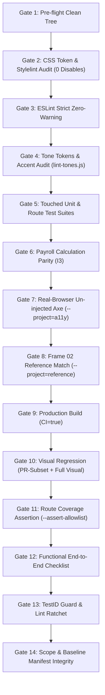

# Implementation Plan — UI Phase 5D (Paycheck Form, Part 2: Allowlist, Validation & Sunset) — v5

- **Target Route**: `/salary/paychecks/new` & `/salary/paychecks/edit/:id`
- **Reference Frame**: Reference Frame 02 (`docs/UI-UX_Plan/reference/02-form.html` — Variant B: stacked field cards, inline error placement, safe neutral discard, dark graphite canvas)
- **Primary Files**:
  - `frontend/src/pages/salary/PaycheckFormPage.css` (purge legacy compatibility block lines 1–984; 0 stylelint-disables remaining)
  - `frontend/src/styles/theme-components.css` (Component-table inline editing states themed per E1/K1 with defined tokens)
  - `frontend/src/pages/salary/PaycheckFormPage.js` (adopt `<Loading variant="route" />` per D23; `formSubmitted` state; `onInvalid` on `#pay-period`; inline error; zero calculation changes)
  - `frontend/src/components/ProtectedRoute.js` (add `/salary/paychecks/new` and `/salary/paychecks/edit/:id` to `THEMED_PATTERNS`, 12 → 14 allowlisted patterns)
  - `frontend/tests/visual/a11y.spec.js` (remove temporary harness injection lines 30–39; verify un-injected real-browser axe test passes)
  - `frontend/tests/visual/paycheck-form-reference-match.spec.js` (remove harness, add `**/api/paychecks/1**` mock, expand to `/new` and `/edit`)
  - `frontend/tests/visual/visual.spec.js` (extend line 53 paycheck mocks to all paycheck routes)
  - `frontend/.eslintignore` (remove lines 75–77 for paycheck test suites)
  - `.gitignore` (unignore `!docs/ui-snapshots/` and `!docs/ui-snapshots/**`)
  - `docs/UI-UX_Plan/UI-UX-PLAN.md` (record Phase 5D presentation-validation amendment in §6.9, update board, route counts 14/75, and §10 log)
- **Visual Baselines**: External directory `D:\Projects\FinStat-visual-baselines` (10 PNGs + `manifest.json`)
- **Status**: Ready for Implementation (Plan v5 resolving all Review v1, v2, v3, and v4 blockers)

---

## 1. Executive Summary

Phase 5D completes the migration of the Salary Paycheck Form (`/salary/paychecks/new` and `/salary/paychecks/edit/:id`) into the dark graphite Reference Frame 02 design standard, sunsetting the temporary legacy compatibility block authored in Phase 5C.

### Key Deliverables
1. **Sunset Legacy Compatibility Block**:
   - Purge lines 1–984 from `PaycheckFormPage.css`, eliminating all temporary `stylelint-disable` directives (`color-no-hex`, `color-named`, `function-disallowed-list`, `declaration-property-value-allowed-list`, `declaration-property-value-disallowed-list`).
   - Zero new CSS rules added to `PaycheckFormPage.css` — error state styling (`.form-error`) and invalid control borders (`input[aria-invalid="true"]`) are already provided by `theme-components.css:838–852` (exempt from `lint-tones.js`).
2. **Component-Table Inline Editing States (E1/K1)**:
   - Theme `.component-basis-select`, `.number-input-wrapper`, and `.number-input` inside `theme-components.css` using strictly defined tokens (`--fs-surface`, `--fs-border-control`, `--fs-border-width`, `--fs-radius-sm`, `--fs-text`, `--fs-font-sans`, `--fs-focus-ring`, `--fs-focus-offset`, `--fs-border-strong`).
   - Consistent sizing and box model matching `.component-input` and `.component-select` (`padding: 0.45rem 0.65rem; font-size: 0.9rem; box-sizing: border-box;`).
   - Zero direct `var(--fs-accent)` usage, maintaining strict neutral-by-default (Invariant I15).
3. **Form Accessibility & Presentation Validation State**:
   - Retain native browser validation on `<form>` (no blanket `noValidate`) so the eight other required inputs across steps 1 and 2 preserve browser constraint validation (Invariant I7).
   - Intercept `#pay-period` with `onInvalid={(e) => { e.preventDefault(); setFormSubmitted(true); }}` so the native tooltip is suppressed and the design-system inline error is triggered.
   - Introduce presentation-only `formSubmitted` state (`useState(false)`), also set to `true` at the start of `handleSavePaycheck`.
   - Add `aria-required="true"`, `aria-invalid={formSubmitted && !formData.period ? 'true' : 'false'}`, and `aria-describedby={formSubmitted && !formData.period ? 'pay-period-error' : undefined}` on `#pay-period`.
   - Render `#pay-period-error` (`role="alert"`, `className="form-error"`) when `formSubmitted && !formData.period`, utilizing shared `.form-error` styles from `theme-components.css:846`.
4. **Loading State Standardization (D23)**:
   - Replace legacy `RefreshCw` spinning icon in `PaycheckFormPage.js` with shared `<Loading variant="route" text="Loading profile & paycheck details..." />`.
5. **Route Allowlisting**:
   - Add `/salary/paychecks/new` and `/salary/paychecks/edit/:id` to `THEMED_PATTERNS` in `frontend/src/components/ProtectedRoute.js`, incrementing allowlisted count from 12 to 14.
6. **Real-Browser Axe Test (Deferred Gap Resolution)**:
   - Remove temporary DOM harness injection from `frontend/tests/visual/a11y.spec.js:30–39`.
   - Verify un-injected real-browser Playwright axe test passes with 0 critical and 0 serious violations on both paycheck-form routes.
7. **Reference-Match Spec Determinism**:
   - Remove `setupHarness` from `paycheck-form-reference-match.spec.js`.
   - Add mock for `**/api/paychecks/1**` returning valid paycheck model so `/salary/paychecks/edit/1` renders deterministically.
   - Wait for real `.fs-loading` detachment and `.paycheck-flow-layout` visibility.
   - Verify Frame 02 design tokens, touch targets ($\ge 44\text{px}$), and zero horizontal overflow at 1440px and 390px across both `/new` and `/edit`.
8. **Visual Test Harness Determinism**:
   - Update `frontend/tests/visual/visual.spec.js:53` from `route.slug === 'salary-paychecks'` to `route.slug.startsWith('salary-paycheck')` so mocks are mounted for `/new` and `/edit`.
9. **Snapshot Untracking Fix**:
   - Add `!docs/ui-snapshots/` and `!docs/ui-snapshots/**` to `.gitignore`.
10. **ESLint Ignore Cleanliness**:
    - Reorder module imports and apply scoped testing-library disables in the 3 paycheck test suites (`PaycheckFormPage.test.js`, `PaycheckFormPageTax.test.js`, `PaycheckFormPageTimezone.test.js`), removing them from `frontend/.eslintignore:75–77`.
11. **Strict Mixed-File & Calculation Parity (I2, I3)**:
    - Retain 100% of `normalizePayDateInput`, calculation hooks, gross/net/deduction sync hooks, and payload structures. Characterization runner `frontend/tests/calculations.spec.js` passes 11/11 tests green.

---

## 2. User Review Required

> [!IMPORTANT]
> **Baseline Snapshot Updates for Newly Allowlisted Routes**
> In Phase 5D, `/salary/paychecks/new` and `/salary/paychecks/edit/:id` transition from unthemed legacy views to dark graphite Reference Frame 02. As governed by UI-UX-PLAN.md §6.3 and §9.5, the 10 baseline snapshots (5 viewports × 2 routes) in `D:\Projects\FinStat-visual-baselines` will be regenerated to represent the themed standard, and `manifest.json` will be updated with their new SHA-256 hashes. All other 324 baselines remain 100% byte-identical.

> [!NOTE]
> **Recorded Plan Amendment (Phase 5D Presentation Validation State)**
> UI-UX-PLAN.md §6.9 task 1705 requires "Form accessibility attributes (`aria-required`, `aria-describedby`, `aria-invalid`, inline field errors)". To fulfill this without altering calculation logic or backend payloads:
> 1. Native browser constraint validation is retained on `<form>` (no blanket `noValidate`) so the eight other required inputs across steps 1 and 2 preserve browser constraint validation (Invariant I7).
> 2. On `#pay-period`, native tooltip display is suppressed and presentation state is updated via `onInvalid={(e) => { e.preventDefault(); setFormSubmitted(true); }}`.
> 3. `PaycheckFormPage.js` introduces presentation-only state `const [formSubmitted, setFormSubmitted] = useState(false);`, also set to `true` at the start of `handleSavePaycheck`.
> 4. An inline `<span id="pay-period-error" className="form-error" role="alert">Please provide a pay period (e.g. 2026-08)</span>` renders when `formSubmitted && !formData.period`, using existing `.form-error` styles from `theme-components.css:846` (0 new page-CSS rules, strictly preserving tone-token rules).
> 5. No calculation math, payload structure, or service call changes; only presentation validation state is added.
> 6. This amendment is recorded in `docs/UI-UX_Plan/UI-UX-PLAN.md §6.9` under Phase 5D.

---

## 3. Open Questions

None. The scope, exit gates, and implementation sequence are fully specified by `UI-UX-PLAN.md §6.9:1697–1709`, incorporating all resolutions from the v1, v2, v3, and v4 reviews.

---

## 4. Invariants Matrix (Verbatim from UI-UX-PLAN.md §2)

| # | Rule | Verification | Phase 5D Gate |
| :--- | :--- | :--- | :--- |
| **I1** | Production routes and URLs unchanged — 75 entries (74 protected + `*`), 10 redirects. | `App.test.js` route-resolution test; `ui-coverage.js` diff | Gate 5, Gate 11 |
| **I2** | No API call, payload shape, or service file changed. | PR diff review; blocked path list in CI | Gate 14 |
| **I3** | No calculation changed on **any** page: payroll, installment schedules, debt payoff, trade P&L, certificate maturity/interest, FX conversion, budget thresholds, real-estate yield. | Characterization fixtures (§9.6) | Gate 6 |
| **I4** | Auth, roles, `ProtectedAction`, and `useCanModify` gating unchanged. | Viewer-role checklist per phase | Gate 5 |
| **I5** | Test IDs, `data-*` attributes, and accessible labels preserved — 37 `data-testid`, 39 `aria-label`. | test-ID guard script (§9.2) | Gate 13 |
| **I6** | Tables render as compact-expand cards at ≤ 768px (D19). Horizontal scroll preserved only for tables with ≥ 12 columns (audit logs) where the card pattern is impractical. No page-level horizontal scroll at 390px. | 390 px visual check: card layout renders, no page-level horizontal scroll, all fields reachable via expander. | Gate 8 |
| **I7** | No page loses functionality mid-migration. | Pattern added only in the converting PR (§6.3) | Gate 5, Gate 7, Gate 12 |
| **I8** | Dashboard coordinator line cap preserved — `DashboardSummary.js` must remain $\le 120$ lines (post-audit architecture decomposition invariant). All 10 RTL dashboard tests must remain green. | Line count assertion + `npm test` in 3A | Gate 5 |
| **I9** | Production build passes with zero errors and no new warnings. | CI (authoritative); local proxy via `npm start` + ESLint/stylelint (§15) | Gate 3, Gate 4, Gate 9 |
| **I10** | `npm test -- --watchAll=false` passes for touched modules **and** the app route suite. | CI (frontend test job added in 1C); local proxy: touched suites via `npx jest --runInBand` (§15) | Gate 5 |
| **I11** | No new `!important`; a file's count in the 1C lint ratchet may only fall. | stylelint + `lint-ratchet.js` (§9.2) | Gate 2, Gate 13 |
| **I12** | No new dependency except the Phase 1C tooling list (§9.2). | `package.json` review | Gate 14 |
| **I13** | Every non-allowlisted route is pixel-identical to its 1B baseline. | Walkthrough-evidenced per §7.1: developer-run Playwright diff report attached to each phase walkthrough, with zero unexplained diffs. | Gate 10 |
| **I14** | No `backdrop-filter`, gradient, gradient text, glow, `filter: blur()` / `drop-shadow()`, `text-shadow`, `mask`, `-webkit-mask`, `-webkit-mask-image`, `mask-image`, `border-image`, or `border-image-source` anywhere in app CSS or JS; only the reference frames illustrate them. | stylelint (§9.2) | Gate 2, Gate 13 |
| **I15** | Neutral by default: a tone encodes **deviation from expectation or attention**, never the sign of an ordinary amount. Expense amounts, income, and balances are neutral (§4.3). A page never references a tone token directly; it uses `Delta`, `Badge`, or a `.fs-progress--*` modifier. | stylelint + `lint-tones.js` + §4.3 domain table + §7.2 | Gate 2, Gate 4, Gate 13 |
| **I16** | No radius above 8 px except `var(--fs-radius-pill)` on status chips and avatars. | stylelint (§9.2) | Gate 2, Gate 13 |

---

## 5. Proposed Changes

```
┌────────────────────────────────────────────────────────────────────────┐
│ Phase 5D Architecture Flow (v5)                                         │
├────────────────────────────────────────────────────────────────────────┤
│                                                                        │
│  1. PaycheckFormPage.css                                               │
│     ├── Purge lines 1-984 (Legacy compatibility block)                 │
│     ├── Delete /* stylelint-disable */ header -> 0 disables remaining  │
│     └── 0 new page-CSS rules (rely on shared .form-error / inputs)     │
│                                                                        │
│  2. theme-components.css (E1/K1 Compliant, Defined Tokens Only)         │
│     └── Add .fs-page rules for .component-basis-select, number-input   │
│         using defined tokens (--fs-surface, --fs-border-control, etc.) │
│                                                                        │
│  3. PaycheckFormPage.js                                                │
│     ├── Adopt <Loading variant="route" /> (D23)                        │
│     ├── Retain native validation on <form> (no blanket noValidate)     │
│     ├── Intercept #pay-period onInvalid -> e.preventDefault(), submit  │
│     ├── Add aria-required to #pay-period and #pay-date                 │
│     ├── Wire aria-invalid/aria-describedby to #pay-period-error       │
│     ├── Render <span className="form-error"> inline alert              │
│     └── 0 calculation changes (I3)                                     │
│                                                                        │
│  4. ProtectedRoute.js (THEMED_PATTERNS)                                │
│     ├── Add '/salary/paychecks/new'                                    │
│     └── Add '/salary/paychecks/edit/:id' (12 -> 14 allowlisted routes) │
│                                                                        │
│  5. a11y.spec.js                                                       │
│     └── Remove lines 30-39; verify un-injected axe under a11y project  │
│                                                                        │
│  6. paycheck-form-reference-match.spec.js                              │
│     ├── Remove setupHarness injection                                  │
│     ├── Add **/api/paychecks/1** mock for /edit determinism            │
│     ├── Wait for real settled/loading-detached condition               │
│     └── Cover both /new and /edit at 1440px and 390px                  │
│                                                                        │
│  7. visual.spec.js                                                     │
│     └── Extend line 53 setupPaycheckMocks to route.slug.startsWith(..) │
│                                                                        │
│  8. .eslintignore & Test Suites                                        │
│     ├── Clean up imports in PaycheckFormPage*.test.js                   │
│     └── Remove lines 75-77 from .eslintignore                          │
│                                                                        │
│  9. .gitignore & Snapshots                                             │
│     ├── Add !docs/ui-snapshots/ and !docs/ui-snapshots/**              │
│     └── Stage and track docs/ui-snapshots/phase-5d/*.png               │
│                                                                        │
│ 10. Visual Baselines & Manifest                                        │
│     ├── Regenerate 10 themed snapshots in FinStat-visual-baselines      │
│     └── Verify manifest integrity (334/334 SHA-256 match)              │
│                                                                        │
└────────────────────────────────────────────────────────────────────────┘
```

---

### Component 1: Stylesheet Legacy Purge (`frontend/src/pages/salary/PaycheckFormPage.css`)

#### [MODIFY] `frontend/src/pages/salary/PaycheckFormPage.css`
- **Action**: Delete lines 1–984 (the legacy compatibility block with `stylelint-disable` header and legacy colors/gradients/radii).
- **Page CSS Rule**: No new CSS rules are added to `PaycheckFormPage.css`. Error state styling (`.form-error`) and invalid control styling (`input[aria-invalid="true"]`) are already fully defined and maintained in `theme-components.css:838–852` (which is tone-linter exempt per `scripts/lint-tones.js:40–46`). This avoids any `var(--fs-negative)` in page CSS, strictly complying with the tone linter and Invariant I15.
- **Result**: The file begins directly with the scoped `.fs-page` dark graphite rules authored in Phase 5C.
- **Verification**: `npx stylelint "src/pages/salary/PaycheckFormPage.css"` passes with 0 errors and 0 warnings. `Select-String "stylelint-disable" PaycheckFormPage.css` yields zero matches.

```diff
-/* ==========================================================================
-   TEMPORARY LEGACY COMPATIBILITY BLOCK (Phase 5C only, Sunset: Phase 5D)
-   Preserves byte-for-byte unthemed appearance during styles-only phase.
-   Governed by Recorded Plan Amendment 4 in UI-UX-PLAN.md §6.9.
-   ========================================================================== */
-/* stylelint-disable color-no-hex, color-named, function-disallowed-list, declaration-property-value-allowed-list, declaration-property-value-disallowed-list */
-... [975 lines of legacy CSS deleted] ...
-/* stylelint-enable color-no-hex, color-named, function-disallowed-list, declaration-property-value-allowed-list, declaration-property-value-disallowed-list */
-
 /* ==========================================================================
    SCOPED DARK GRAPHITE THEME (Reference Frame 02)
    Activates when data-fs-theme is active and container has .fs-page
    ========================================================================== */
```

---

### Component 2: Inline Editing Component States in Shared Theme (`frontend/src/styles/theme-components.css`)

#### [MODIFY] `frontend/src/styles/theme-components.css`
- **Action**: Append `.component-basis-select`, `.number-input-wrapper`, and `.number-input` rules to the existing Salary Component Table section (`theme-components.css:1279–1436`) per E1/K1 and §4.16. `ComponentTable.css` remains completely untouched until Phase 12.
- **Tokens Used (All Verified in `tokens.json`)**:
  - Background: `var(--fs-surface)` (`#1a1c20`)
  - Border: `var(--fs-border-width) solid var(--fs-border-control)` (`#6a6f77`)
  - Text: `var(--fs-text)` (`#f2f3f5`)
  - Radius: `var(--fs-radius-sm)` (`4px`)
  - Font: `var(--fs-font-sans)`
  - Sizing & Padding: `padding: 0.45rem 0.65rem; font-size: 0.9rem; box-sizing: border-box;` (exact match to existing `.component-input` and `.component-select` at lines 1368–1378)
  - Focus Ring: `outline: var(--fs-focus-ring); outline-offset: var(--fs-focus-offset); border-color: var(--fs-border-strong);` (3px neutral focus ring per §4.6)
  - Selector Form: `html[data-fs-theme]` existence selector (D22 door-preservation compliant).
  - Zero undefined tokens, zero direct `var(--fs-accent)` usage (satisfies `lint-tones.js` and neutral-by-default I15).

```css
/* Salary Component Table Inline Editing Controls (Phase 5D - E1/K1) */
html[data-fs-theme] .fs-page .component-basis-select {
  padding: 0.45rem 0.65rem;
  background: var(--fs-surface);
  border: var(--fs-border-width) solid var(--fs-border-control);
  border-radius: var(--fs-radius-sm);
  color: var(--fs-text);
  font-family: var(--fs-font-sans);
  font-size: 0.9rem;
  cursor: pointer;
  box-sizing: border-box;
}

html[data-fs-theme] .fs-page .component-basis-select:focus-visible,
html[data-fs-theme] .fs-page .component-basis-select:focus {
  outline: var(--fs-focus-ring);
  outline-offset: var(--fs-focus-offset);
  border-color: var(--fs-border-strong);
}

html[data-fs-theme] .fs-page .number-input-wrapper {
  display: inline-flex;
  align-items: center;
  position: relative;
  width: 100%;
}

html[data-fs-theme] .fs-page .number-input-wrapper .number-input {
  width: 100%;
  padding: 0.45rem 0.65rem;
  background: var(--fs-surface);
  border: var(--fs-border-width) solid var(--fs-border-control);
  border-radius: var(--fs-radius-sm);
  color: var(--fs-text);
  font-family: var(--fs-font-sans);
  font-variant-numeric: tabular-nums;
  font-size: 0.9rem;
  text-align: right;
  box-sizing: border-box;
}

html[data-fs-theme] .fs-page .number-input-wrapper .number-input:focus-visible,
html[data-fs-theme] .fs-page .number-input-wrapper .number-input:focus {
  outline: var(--fs-focus-ring);
  outline-offset: var(--fs-focus-offset);
  border-color: var(--fs-border-strong);
}
```

---

### Component 3: Paycheck Form Page JSX & Accessibility (`frontend/src/pages/salary/PaycheckFormPage.js`)

#### [MODIFY] `frontend/src/pages/salary/PaycheckFormPage.js`
- **Action**:
  1. Import `{ Loading }` from `'../../components/ui'`.
  2. Replace legacy `loadingInitial` JSX block with `<Loading variant="route" text="Loading profile & paycheck details..." />` per D23.
  3. Retain native browser constraint validation on `<form>` (do not add blanket `noValidate`), ensuring all eight other required inputs across steps 1 and 2 retain their browser validation behavior (Invariant I7).
  4. Add presentation state `const [formSubmitted, setFormSubmitted] = useState(false);` and set `setFormSubmitted(true)` at the start of `handleSavePaycheck`.
  5. Add `aria-required="true"` to mandatory fields (`pay-period` and `pay-date`).
  6. Wire `#pay-period`:
     - Add `onInvalid={(e) => { e.preventDefault(); setFormSubmitted(true); }}` to suppress the native browser popup while setting presentation state.
     - Set `aria-invalid={formSubmitted && !formData.period ? 'true' : 'false'}`
     - Set `aria-describedby={formSubmitted && !formData.period ? 'pay-period-error' : undefined}`
     - Render `<span id="pay-period-error" className="form-error" role="alert">Please provide a pay period (e.g. 2026-08)</span>` when `formSubmitted && !formData.period`.
  7. No calculation math, payload structure, or service call changes; only the presentation-only `setFormSubmitted(true)` call and `onInvalid` handler are added.

```diff
 import {
   Calendar,
   CreditCard,
   Building,
   Briefcase,
   Save,
   ArrowLeft,
   RefreshCw,
   Calculator,
   TrendingUp,
   Award,
   Layers,
   Sparkles,
   Gift,
 } from 'lucide-react';
+import { Loading } from '../../components/ui';

...

+  const [formSubmitted, setFormSubmitted] = useState(false);

...

   // Form Submission
   const handleSavePaycheck = async (e) => {
     e.preventDefault();
+    setFormSubmitted(true);

     if (!formData.period) {
       if (notify) notify('Please provide a pay period (e.g. 2026-08)', 'error');
       return;
     }

...

   if (loadingInitial) {
-    return (
-      <div className="page-container paycheck-loading-container">
-        <RefreshCw className="spinning-icon paycheck-loading-icon" size={32} />
-        <p className="paycheck-loading-text">Loading profile & paycheck details...</p>
-      </div>
-    );
+    return <Loading variant="route" text="Loading profile & paycheck details..." />;
   }

...

             <div className="form-group">
               <label htmlFor="pay-period" className="form-label">Pay Period (YYYY-MM) *</label>
               <input
                 id="pay-period"
                 type="text"
                 className="form-control"
                 placeholder="e.g. 2026-08 or August 2026"
                 value={formData.period}
+                aria-required="true"
+                aria-invalid={formSubmitted && !formData.period ? 'true' : 'false'}
+                aria-describedby={formSubmitted && !formData.period ? 'pay-period-error' : undefined}
+                onInvalid={(e) => {
+                  e.preventDefault();
+                  setFormSubmitted(true);
+                }}
                 onChange={(e) => {
                   const newPeriod = e.target.value;
                   setFormData({ ...formData, period: newPeriod });
                   triggerCalculation(newPeriod, formData.components, true);
                 }}
                 required
               />
+              {formSubmitted && !formData.period && (
+                <span id="pay-period-error" className="form-error" role="alert">
+                  Please provide a pay period (e.g. 2026-08)
+                </span>
+              )}
             </div>
```

---

### Component 4: Route Allowlist Update (`frontend/src/components/ProtectedRoute.js`)

#### [MODIFY] `frontend/src/components/ProtectedRoute.js`
- **Action**: Add `/salary/paychecks/new` and `/salary/paychecks/edit/:id` to `THEMED_PATTERNS`.
- **Count**: 12 → exactly 14 allowlisted routes.

```diff
 export const THEMED_PATTERNS = [
   '/dashboard',
   '/expenditures',
   '/expenditures/new',
   '/expenditures/edit/:id',
   '/expenditures/rules',
   '/expenditures/budgets',
   '/expenditures/recurring',
   '/expenditures/bills',
   '/expenditure-analysis',
   '/salary/profiles',
   '/salary/rules',
   '/salary/paychecks',
+  '/salary/paychecks/new',
+  '/salary/paychecks/edit/:id',
 ];
```

---

### Component 5: Real-Browser Axe Test Cleanup (`frontend/tests/visual/a11y.spec.js`)

#### [MODIFY] `frontend/tests/visual/a11y.spec.js`
- **Action**: Delete lines 30–39 (temporary DOM theme harness injection).
- **Result**: The real-browser axe test executes completely un-injected on `/salary/paychecks/new` and `/salary/paychecks/edit/:id`, asserting genuine production compliance under `--project=a11y`.

```diff
       await page.goto(route.resolvedPath, { waitUntil: 'domcontentloaded' });
       await page.locator('.loading-spinner, .loading-spinner-ring, .ca-loading-spinner, .dash-loading-spinner, .fs-loading, .fs-skeleton, .paycheck-loading-container').waitFor({ state: 'detached', timeout: 5000 }).catch(() => { });
       await page.waitForTimeout(500);
 
-      // In Phase 5C (Part 1 styles-only), route allowlisting is deferred to Phase 5D.
-      // Activate dormant dark theme harness to test authored design-token accessibility in Chromium.
-      if (route.slug === 'salary-paychecks-new' || route.slug === 'salary-paychecks-edit') {
-        await page.evaluate(() => {
-          document.documentElement.dataset.fsTheme = 'dark';
-          const main = document.querySelector('main') || document.body;
-          main.classList.add('fs-page');
-        });
-        await page.waitForTimeout(100);
-      }
-
       // Inject axe-core into the real browser DOM
```

---

### Component 6: Canonical Reference Match Spec (`frontend/tests/visual/paycheck-form-reference-match.spec.js`)

#### [MODIFY] `frontend/tests/visual/paycheck-form-reference-match.spec.js`
- **Action**:
  1. Remove `setupHarness` manual DOM injection.
  2. Add `**/api/paychecks/1**` mock to `setupPaycheckFormMocks`:
     ```js
     await page.route('**/api/paychecks/1**', async (route) => {
       await route.fulfill({
         status: 200,
         contentType: 'application/json',
         body: JSON.stringify({
           _id: '1',
           period: '2025-01',
           disbursementType: 'Regular',
           grossSalary: 15000,
           netPay: 12000,
           payDate: '2025-01-25T12:00:00.000Z',
           type: 'Cash',
         }),
       });
     });
     ```
  3. Update loader wait condition to wait for `.fs-loading` detachment and `.paycheck-flow-layout` visibility.
  4. Expand assertions to test both `/salary/paychecks/new` and `/salary/paychecks/edit/1` across 1440px and 390px viewports.

---

### Component 7: Visual Test Determinism (`frontend/tests/visual/visual.spec.js`)

#### [MODIFY] `frontend/tests/visual/visual.spec.js`
- **Action**: Update line 53 from `if (route.slug === 'salary-paychecks')` to `if (route.slug.startsWith('salary-paycheck'))` so `setupPaycheckMocks(page)` is applied deterministically to all three paycheck routes (`salary-paychecks`, `salary-paychecks-new`, `salary-paychecks-edit`).

```diff
-        if (route.slug === 'salary-paychecks') {
+        if (route.slug.startsWith('salary-paycheck')) {
           await setupPaycheckMocks(page);
         }
```

---

### Component 8: De-ignore Paycheck Test Suites (`frontend/.eslintignore`)

#### [MODIFY] `frontend/.eslintignore`
#### [MODIFY] `frontend/src/pages/salary/__tests__/PaycheckFormPage.test.js`
#### [MODIFY] `frontend/src/pages/salary/__tests__/PaycheckFormPageTax.test.js`
#### [MODIFY] `frontend/src/pages/salary/__tests__/PaycheckFormPageTimezone.test.js`
- **Action**:
  1. Reorder imports and add scoped `/* eslint-disable testing-library/no-container, testing-library/no-node-access, testing-library/no-wait-for-multiple-assertions */` headers where appropriate. Remove unused variables.
  2. Delete lines 75–77 from `frontend/.eslintignore`:
     - `src/pages/salary/__tests__/PaycheckFormPage.test.js`
     - `src/pages/salary/__tests__/PaycheckFormPageTax.test.js`
     - `src/pages/salary/__tests__/PaycheckFormPageTimezone.test.js`
  3. Verify `npx eslint` passes on all three suites with 0 errors and 0 warnings.

---

### Component 9: Gitignore Configuration for Phase Snapshots (`.gitignore`)

#### [MODIFY] `.gitignore`
- **Action**: Add `!docs/ui-snapshots/` and `!docs/ui-snapshots/**` to `.gitignore` so phase snapshots captured for PR walkthrough documentation are tracked in git cleanly.

```diff
 # docs (ignore general docs, but version UI-UX master plan and per-phase implementation plans)
 docs/*
 !docs/UI-UX_Plan/
 !docs/ui-plans/
+!docs/ui-snapshots/
+!docs/ui-snapshots/**
 docs/ui-plans/*review*.md
```

---

### Component 10: Visual Regression Baselines & Manifest

- **Action**:
  1. Capture 10 new themed visual baselines in `D:\Projects\FinStat-visual-baselines`:
     - `salary-paychecks-new-1440.png`
     - `salary-paychecks-new-1024.png`
     - `salary-paychecks-new-768.png`
     - `salary-paychecks-new-480.png`
     - `salary-paychecks-new-390.png`
     - `salary-paychecks-edit-1440.png`
     - `salary-paychecks-edit-1024.png`
     - `salary-paychecks-edit-768.png`
     - `salary-paychecks-edit-480.png`
     - `salary-paychecks-edit-390.png`
  2. Compute SHA-256 hashes and update `D:\Projects\FinStat-visual-baselines\manifest.json`.
  3. Verify with `node frontend/scripts/verify-baseline-manifest.js` (334/334 baselines verified).

---

## 6. Verification Plan & Deterministic Gates

The implementation must pass the following 14 verification gates in exact order:



### Gate 1: Git Working Tree Cleanliness
```powershell
git status --porcelain
```
*Expected*: Exit 0, 0 uncommitted changes prior to implementation.

### Gate 2: CSS Token Compliance & Stylelint (0 Disables)
```powershell
cd frontend; npx stylelint "src/pages/salary/PaycheckFormPage.css" "src/styles/theme-components.css"
Get-Content "src/pages/salary/PaycheckFormPage.css" | Select-String "stylelint-disable"
cd ..
```
*Expected*: Exit 0, 0 errors, 0 warnings. Grep yields exactly 0 occurrences of `stylelint-disable`.

### Gate 3: ESLint Strict Check (Zero Ignored Paycheck Files)
```powershell
cd frontend; npx eslint "src/pages/salary/PaycheckFormPage.js" "src/components/ProtectedRoute.js" "src/pages/salary/__tests__/PaycheckFormPage*.test.js" --max-warnings=0; cd ..
```
*Expected*: Exit 0, 0 errors, 0 warnings across all paycheck application and test files.

### Gate 4: Tone Tokens & Accent Audit
```powershell
cd frontend; node scripts/lint-tones.js; cd ..
```
*Expected*: Exit 0, no undefined tokens, zero direct `var(--fs-accent)` in page CSS, tone token compliance verified.

### Gate 5: Touched Unit & Route Test Suites
```powershell
cd frontend; npx jest --runInBand src/pages/salary/__tests__/PaycheckFormPage src/components/__tests__/ProtectedRoute.test.js; cd ..
```
*Expected*: Exit 0, all 5 suites pass (17 paycheck tests + 6 protected route tests = 23 tests green).

### Gate 6: Payroll Calculation Parity (Invariant I3)
```powershell
cd frontend; npx jest --runInBand tests/calculations.spec.js src/pages/salary/__tests__/PaycheckFormPageTax.test.js src/pages/salary/__tests__/PaycheckFormPageTimezone.test.js; cd ..
```
*Expected*: Exit 0, 11/11 calculation characterization scenarios pass byte-identically, tax brackets and timezone normalization pass 100%.

### Gate 7: Real-Browser Playwright Axe Test (Un-injected)
```powershell
cd frontend; $env:CI="true"; npx playwright test tests/visual/a11y.spec.js --project=a11y --grep="salary-paychecks-new|salary-paychecks-edit"; cd ..
```
*Expected*: Exit 0, 0 serious, 0 critical accessibility violations on both allowlisted routes without harness injection.

### Gate 8: Canonical Frame 02 Reference Match Spec
```powershell
cd frontend; $env:CI="true"; npx playwright test tests/visual/paycheck-form-reference-match.spec.js --project=reference; cd ..
```
*Expected*: Exit 0, all Frame 02 design tokens, touch targets ($\ge 44\text{px}$), and zero horizontal overflow pass at 1440px and 390px across both `/new` and `/edit` routes.

### Gate 9: Production Build
```powershell
cd frontend; $env:CI="true"; npm run build; cd ..
```
*Expected*: Exit 0, compiled successfully, zero warnings treated as errors.

### Gate 10: Visual Regression (PR-Subset & Full Visual Suite)
```powershell
# 1. PR-Subset verification (71 tests)
cd frontend; $env:PR_SUBSET="true"; $env:CI="true"; npx playwright test tests/visual/visual.spec.js --project=pr-subset; cd ..

# 2. Complete 325-baseline test run across all 65 routes at 5 viewports (Invariant I13)
cd frontend; Remove-Item env:PR_SUBSET -ErrorAction SilentlyContinue; $env:CI="true"; npx playwright test tests/visual/visual.spec.js --project=visual; cd ..
```
*Expected*: Exit 0 on both runs. 71/71 PR-subset snapshots match baselines with 0 unexpected diffs. All 325 visual snapshot tests pass with 0 pixel diff across all 65 routes at 5 viewports (manifest verifier validates 334/334 PNG baselines including sub-states / variants), proving non-allowlisted routes remain 100% pixel-identical (I13).

### Gate 11: Route Allowlist Count Audit
```powershell
cd frontend; node scripts/ui-coverage.js --assert-allowlist; cd ..
```
*Expected*: Exit 0, asserts exactly 14 allowlisted patterns in `THEMED_PATTERNS`.

### Gate 12: Functional End-to-End Checklist
Manual / test-backed verification covering the 6 critical paycheck form flows:
1. **Creation Flow**: Navigate to `/salary/paychecks/new`, input period `2026-09`, select `Regular`, trigger preview calculation, verify live estimate cards display valid amounts, save paycheck.
2. **Edit Flow**: Navigate to `/salary/paychecks/edit/1`, verify existing values populate, modify deduction/allowance component, sync from calculator, save update.
3. **Form Validation (Native + Inline)**: Click save with empty period; verify `#pay-period`'s `onInvalid` prevents native popup and activates inline `#pay-period-error` with `aria-invalid="true"`, while the other 8 required fields retain native constraint validation when triggered.
4. **Date Normalization**: Verify `normalizePayDateInput` handles ISO strings, standard dates, and fallbacks identically.
5. **Component-Table Inline Editing**: Add new component, modify name, category, value, toggle active/taxable/insurable, remove component.
6. **Legacy Dual-Field Fallback**: Verify compatibility when loading older paycheck models with legacy field names.

### Gate 13: Invariant Lint Ratchet & TestID Guard
```powershell
cd frontend; node scripts/lint-ratchet.js; node scripts/testid-guard.js; cd ..
```
*Expected*: Exit 0, no increase in `!important`, all 37 test IDs and 39 aria labels preserved (I5, I11).

### Gate 14: Scope & Baseline Manifest Integrity
```powershell
# 1. Stage all changed and new files (including snapshots, plan, walkthrough, and .gitignore)
git add .gitignore docs/ui-snapshots/phase-5d/*.png `
  docs/ui-plans/phase_5d_implementation_plan.md `
  docs/ui-plans/phase_5d_walkthrough.md

# 2. Check tracked and staged diff against origin/main
git diff --name-only origin/main

# 3. Check clean porcelain status (zero untracked files, all changes accounted for)
git status --porcelain

# 4. Verify baseline manifest integrity (334/334 PNGs)
node frontend/scripts/verify-baseline-manifest.js
```
*Expected Diff Scope*:
- `.gitignore` (unignoring `!docs/ui-snapshots/` and `!docs/ui-snapshots/**`)
- `frontend/src/pages/salary/PaycheckFormPage.css`
- `frontend/src/pages/salary/PaycheckFormPage.js`
- `frontend/src/styles/theme-components.css`
- `frontend/src/components/ProtectedRoute.js`
- `frontend/.eslintignore`
- `frontend/src/pages/salary/__tests__/PaycheckFormPage.test.js`
- `frontend/src/pages/salary/__tests__/PaycheckFormPageTax.test.js`
- `frontend/src/pages/salary/__tests__/PaycheckFormPageTimezone.test.js`
- `frontend/tests/visual/a11y.spec.js`
- `frontend/tests/visual/visual.spec.js`
- `frontend/tests/visual/paycheck-form-reference-match.spec.js`
- `docs/UI-UX_Plan/UI-UX-PLAN.md` (§5 route matrix 14/75, §6.1 board, §6.9 task checkboxes & Phase 5D recorded plan amendment, §10 log)
- `docs/ui-plans/phase_5d_implementation_plan.md`
- `docs/ui-plans/phase_5d_walkthrough.md` (containing branch/merge SHAs, 1440/390 screenshots, accepted-diff register per §7.2)
- `docs/ui-snapshots/phase-5d/` (1440 and 390 captured screenshots)
- `CHANGELOG.md`
- External baseline repository: `D:\Projects\FinStat-visual-baselines` (10 PNGs + `manifest.json`)

Manifest check: Exit 0, 334/334 baselines verified with matching SHA-256 hashes and non-empty dimensions across all routes and viewports.

---

## 7. Rollback Plan

If any gate fails or an unexpected visual regression is detected:
1. Revert changes via `git checkout -- frontend/ docs/ .gitignore`.
2. Re-verify clean working tree via `git status`.
3. Document root cause before re-attempting.
