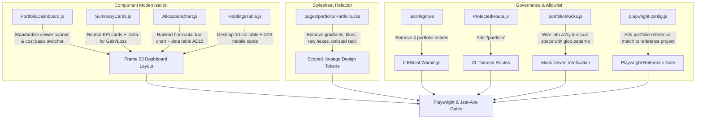

# UI Phase 6A Implementation Plan — Portfolio Dashboard (v4 — Final Post-Review v3)

- **Sub-phase**: UI Phase 6A (`/portfolio`)
- **Working Branch**: `phase-ui-6a-portfolio`
- **Merge Base**: `d300091` (`main` / `origin/main`)
- **Design Tokens**: `frontend/src/styles/tokens.json` (Canvas `--fs-bg: #101114`, Surface `--fs-surface: #1a1c20`, Surface Sunken `--fs-surface-sunken: #0c0d0f`, Surface Raised `--fs-surface-raised: #22252a`, Border `--fs-border: #34383f`, Border Control `--fs-border-control: #6a6f77`, Accent `--fs-accent: #14b8a6`, Ink `--fs-ink: #0d0e10`)
- **Canonical Reference Frame**: Reference Frame 03 (Dashboard Variant B: Recessed `#0c0d0f` chrome, graphite `#1a1c20` surface tiles, subtle `#34383f` border, single teal `#14b8a6` interactive CTA) & Reference Frame 01 (Dense Table Variant B with D19 Mobile Compact-Expand Cards)
- **Cumulative Route Allowlist Progress**: 20 routes $\to$ 21 routes (adding `/portfolio`)
- **Status**: Final — Approved & Ready for Execution

---

## 1. Goal Description

Phase 6A migrates the **Portfolio Dashboard** (`/portfolio`) from legacy ad-hoc dark styling to the dark graphite design language established in Phase 1B and governed by `UI-UX-PLAN.md §6.10` and `AGENTS.md`.

This encompasses:
1. Eliminating the `#090d16 → #0f172a → #0b1120` multi-stop linear and radial gradient backdrops in `Portfolio.css` in favor of the solid dark graphite canvas (`#101114`, `--fs-bg`).
2. Eliminating all `backdrop-filter: blur(...)`, radiant box-shadow glows, and unlisted radii exceeding the 8px ceiling.
3. Completely eliminating all inline style props and raw hex literals across `PortfolioDashboard.js`, `SummaryCards.js`, `HoldingsTable.js`, and `AllocationChart.js`.
4. Upgrading `HoldingsTable.js` (10 columns on desktop) with the **Decision D19 compact-expand mobile card pattern** for viewports $\le 768\text{px}$, guaranteeing zero page-level horizontal table overflow at 390px.
5. Upgrading `AllocationChart.js` per **Recorded Plan Amendment AD15**: converting the asset allocation breakdown from an 8-segment doughnut to a **ranked horizontal bar chart (capped at top 6 categories + neutral "Other") plus an accessible data table alternative** adhering to §4.12 series discipline, powered by `chartTheme.js` (`getChartPalette()`, `createPattern()`), using **neutral greys only** for category bars (Invariant I15), and strictly excluding accent `#14b8a6` from chart series (D22 Constraint 3).
6. De-ignoring `PortfolioDashboard.js` and all three `components/portfolio/*` files from `frontend/.eslintignore` (0 errors, 0 warnings).
7. Adding `'/portfolio'` to `THEMED_PATTERNS` in `ProtectedRoute.js`, advancing the allowlist from 20 to 21 route patterns.
8. Updating `frontend/playwright.config.js` to include `portfolio-reference-match` in the `reference` project's `testMatch` filter.
9. Creating a comprehensive unit test suite with `jest-axe`, Playwright Reference Frame 03 matcher, real-browser Playwright axe test with dedicated globbed portfolio mocks, capturing 5 updated visual baselines (1440, 1024, 768, 480, 390) using exact grep `--grep="portfolio @ "` in `D:\Projects\FinStat-visual-baselines`, reconciling PR-subset visual regression (71 tests passing, 0 diff on non-allowlisted routes), full 326-test visual regression (316 passing + 10 accepted AD14 diffs), and developer taste checkpoint #4 sign-off.

---

## 2. User Review Required & Governance Commitments

> [!IMPORTANT]
> **Zero Remote Push Policy**: In accordance with user governance instructions, all commits, test executions, and visual baseline updates remain strictly local on working branch `phase-ui-6a-portfolio` until the final walkthrough is reviewed and signed off.
>
> **Recorded Plan Amendment AD15 (Asset Allocation Series Discipline)**:
> In accordance with §4.12 ("Ranked horizontal bars, not doughnuts. Category breakdowns (expenditure analysis, _portfolio allocation_) render as a ranked horizontal bar chart plus a data table. A doughnut is allowed only for a part-to-whole with ≤ 4 segments"), amendment AD15 supersedes the casual mention of "allocation doughnut" in §6.10 line 1747. `AllocationChart.js` will render a Chart.js `Bar` component with `indexAxis: 'y'` capped at the top 6 asset categories + a grouped neutral "Other" bar, accompanied by an accessible data table breakdown and dynamic `ariaLabel()` summary.
>
> **Neutral Category Bars (Invariant I15 & §4.3 Rule 4)**:
> Asset classes are descriptive categories, not deviations or alerts. Per §4.3 rule 1 & rule 4 ("Category identity is text, not hue … charts use the neutral ramp plus ranked bars"), the ranked horizontal bars use `chartPalette.greys` (`--fs-chart-grey-1..4`) and neutral `--fs-chart-grey-3` / `--fs-chart-grey-4` for "Other". **Semantic tones (`positive`/`negative`/`warning`) are strictly forbidden as asset category series colors.** Semantic tones are reserved solely for actual monetary gain/loss values in the data table (via `Delta`).
>
> **Chart Series Palette Governance (D22 Constraint 3 & §4.3.2 Rule 6)**: The ranked horizontal bars read tokens dynamically via `getChartPalette()` in `chartTheme.js`. The teal accent (`#14b8a6`) is strictly banned as a chart series.
>
> **Holdings Table Mobile Pattern (Decision D19 vs §6.10 line 1745 "no layout change")**:
> Line 1745's general mention of "no layout change" for `components/portfolio/*` is explicitly superseded by line 1748's mandate that `HoldingsTable.js` renders as compact-expand cards at $\le 768\text{px}$ per §6.4 and Decision D19. At $\le 768\text{px}$, the 10-column table collapses into vertical cards with 3 primary fields visible (`Asset Name / Symbol`, `Asset Type` badge, `Market Value`) and an expander toggle revealing `Quantity`, `Avg Cost`, `Price`, `Total Cost`, `Unrealized P&L`, `Price Status`, and `Details` action link. Page-level horizontal scroll is completely eliminated (`scrollWidth <= clientWidth` at 390px).
>
> **`UtilizationWidget` Classification Note**:
> `UtilizationWidget` was listed in §6.10 line 1745 under `components/portfolio/*` in error. In the codebase, it is located at `frontend/src/components/creditCards/UtilizationWidget.js` and is scheduled for Phase 7 (Credit Cards). `components/portfolio` contains exactly 3 components (`AllocationChart.js`, `HoldingsTable.js`, `SummaryCards.js`), which matches the 4-file de-ignore scope in `frontend/.eslintignore`.
>
> **Tone Treatment of ROI and Unrealized P&L (I15 & §4.3.1 & §6.10)**:
> - **Overall ROI**: Under §4.3.1, no comparative target constant exists for Yield/ROI $\to$ rendered as neutral `.fs-num`, no delta, no label.
> - **Total Gain / Loss**: In `SummaryCards.js`, Total Gain/Loss is the specific subject of that KPI tile $\to$ rendered using the `Delta` primitive with explicit sign (`+` or `−`), arrow, and required label (`label="Gain"` or `label="Loss"` per §8.4 line 2229). Unrealized / Realized sub-metrics are neutral `.fs-num`.
> - **Holdings Table Unrealized P&L**: In `HoldingsTable.js`, ordinary holding values are not the primary subject of the view $\to$ rendered as neutral tabular numbers (`.fs-num`) per §6.10 line 1746 ("Unrealised P&L is neutral unless it is the subject of the view").
>
> **Numeric Typography Contract (D16 / AD10)**:
> In accordance with Decision D16, AD10, §4.5, and `theme.css:196-200`, numeric values format using proportional IBM Plex Sans with `tabular-nums` (`font-family: var(--fs-font-sans); font-variant-numeric: tabular-nums;`). Note that `AGENTS.md`'s mention of "IBM Plex Mono for numerical tabular values" is stale documentation drift and D16/AD10 governs. Mono is reserved for identifiers (e.g. IDs, hashes), never for monetary amounts.
>
> **Baseline Debt Carry-Forward (AD14)**: The 10 pre-existing full-run diffs accepted under AD14 in Phase 5D/5E (3 stale `expenditure-analysis` baselines from commit `720b7bf7` and 7 sub-desktop Chromium 20px fullPage height variances on `not-found`, `dashboard`, `expenditures`) continue as accepted baseline debt.

---

## 3. Architecture Decisions

### 1. Canonical Reference Frame 03 (Dashboard Variant B) Alignment
`PortfolioDashboard.js` will strictly follow the layout and surface hierarchy defined in Canonical Reference Frame 03:
- **Canvas**: Solid `#101114` (`--fs-bg`).
- **Recessed Chrome Shell**: `#0c0d0f` (`--fs-surface-sunken`, `--fs-chrome`).
- **Surface Cards**: `#1a1c20` (`--fs-surface`) with 1px border `#34383f` (`--fs-border`).
- **Interactive Controls**:
  - Single primary accent CTA (`.fs-btn-primary`, `#14b8a6` background with `#0d0e10` `--fs-ink` text).
  - Secondary buttons use `.fs-btn-secondary` (`--fs-surface-raised` with `border-color: var(--fs-border-control)` satisfying the mandatory 3:1 control boundary per §4.1 and `theme.css:362-366`).
- **Typography**: IBM Plex Sans for headings, labels, and proportional tabular numbers (`.fs-num`).
- **Radius Ceiling**: Max 8px (`--fs-radius-lg`). Buttons and inputs 4px (`--fs-radius-sm`), cards 6px (`--fs-radius-md`).

### 2. Decision D19 Compact-Expand Cards for Holdings
On mobile viewports ($\le 768\text{px}$), `HoldingsTable.js` will replace table horizontal scroll with the vertical card pattern:
- **Collapsed Primary Row**: Displays `Asset Name` & `Symbol` (`overflow-wrap: break-word`), `Asset Type` badge, and `Market Value` (`.fs-num`).
- **Expander Toggle**: An accessible button (`aria-expanded`, `aria-label="Expand holding details"`, touch target $\ge 44\text{px}$) toggling the detailed breakdown.
- **Expanded Breakdown**: Neatly presents the remaining 7 fields (`Quantity` with unit, `Avg Cost`, `Current Price`, `Total Cost`, `Unrealized P&L` with % return, `Price Status` badge, and `Details` action link) with tabular numeric values (`.fs-num`).
- **Desktop (>768px)**: Renders the full 10-column financial table with `.fs-table` tokens.
- **Guarantee**: Guarantees zero page-level horizontal overflow at 390px (`scrollWidth <= clientWidth`), fully satisfying Invariant I6 and Decision D19.

### 3. Ranked Horizontal Bar Chart & Data Table per §4.12 (AD15)
- In accordance with §4.12, `AllocationChart.js` converts from doughnut to a **ranked horizontal bar chart** (`Chart.js` `Bar` component with `indexAxis: 'y'`) plus an accessible **data table alternative**:
  - **Dynamic Ranking Recomputation**: On switching `allocationMode` (Current Market Value vs Invested Capital), the rankings, bar order, and "Other" group membership recompute dynamically based on the active metric.
  - **Series Discipline**: Capped at top 6 categories sorted descending; categories 7+ roll up into a single neutral "Other" bar.
  - **Neutral Palette (I15)**: Series colors use `chartPalette.greys` (`--fs-chart-grey-1..4`) and neutral `--fs-chart-grey-3` / `--fs-chart-grey-4` for "Other". Zero semantic tones on categories. Accent `#14b8a6` is strictly excluded.
  - **Direct Labels & Patterns (§4.12)**: Bars carry direct text labels and percentages; patterns generated via `createPattern()` from `chartTheme.js` provide non-color differentiation alongside direct labeling.
  - **Accessible Data Table Alternative**: Adjacent data table lists all categories (expanding "Other" into full individual line items) with columns: `Asset Type`, `Holding Count`, `Invested Amount`, `Market Value`, `Gain / Loss` (rendered via `Delta`), and `Allocation Weight (%)`.
  - **Accessible Canvas**: Chart canvas receives `role="img"` and dynamic `ariaLabel(seriesName, points)`.

---

## 4. Proposed Changes



### Component 1: `Portfolio.css` Modernization
#### [MODIFY] `frontend/src/pages/portfolio/Portfolio.css`
- Scope all styles under `html[data-fs-theme] .fs-page` or `.portfolio-page-wrapper`.
- **Eliminate Gradients (Invariant I14)**:
  - Remove radial gradients and 3-stop `linear-gradient(180deg, #090d16 0%, #0f172a 45%, #0b1120 100%)`. Canvas uses solid `var(--fs-bg)` (`#101114`).
  - Remove `background: linear-gradient(135deg, ...)` text clip from header `h1`; use clean `var(--fs-text)`.
- **Eliminate Blurs (Invariant I14)**:
  - Remove `backdrop-filter: blur(12px)` from header actions, switcher, cards, and modal elements.
- **Enforce 8px Ceiling (Invariant I16)**:
  - Replace 12px, 14px, 16px, 20px radii with `var(--fs-radius-sm)` (4px), `var(--fs-radius-md)` (6px), or `var(--fs-radius-lg)` (8px).
- **Eliminate Raw Hex Colors & Pixel Shadows**:
  - Replace arbitrary box-shadows (`box-shadow: 0 4px 14px rgba(0, 0, 0, 0.25)`) with `box-shadow: none` or `var(--fs-shadow)`.
  - Replace raw colors (`#38bdf8`, `#818cf8`, `#c084fc`, `#f8fafc`, `#94a3b8`, `#4ade80`, `#f87171`) with semantic design tokens:
    - Canvas: `var(--fs-bg)` (`#101114`)
    - Surface / Cards: `var(--fs-surface)` (`#1a1c20`)
    - Recessed Chrome: `var(--fs-surface-sunken)` (`#0c0d0f`)
    - Raised Surface: `var(--fs-surface-raised)` (`#22252a`)
    - Text: `var(--fs-text)`, `var(--fs-text-2)`, `var(--fs-text-3)`
    - Borders: `var(--fs-border)`, `var(--fs-border-control)`

---

### Component 2: `PortfolioDashboard.js`
#### [MODIFY] `frontend/src/pages/portfolio/PortfolioDashboard.js`
- Wrap page in `<div className="fs-page portfolio-page-wrapper">`.
- **Eliminate Inline Styles**:
  - Replace inline style on viewer-mode banner (lines 138–155) with canonical `.view-only-banner` classes (`var(--fs-surface-raised)`, `var(--fs-border)`, `var(--fs-text)`).
  - Replace inline styles on error container (lines 120–125).
- **Cost-Basis Switcher**:
  - Tokenize segmented toggle (`.method-toggle-group`) with `var(--fs-surface-raised)`, `var(--fs-border)`.
  - Active toggle item uses `var(--fs-surface)` with subtle accent indicator, and focus ring.
- **Header Actions**:
  - Rebalancing button styled as `.fs-btn .fs-btn-secondary` (`var(--fs-surface-raised)`, `var(--fs-border-control)`).
  - Refresh Prices button styled as `.fs-btn .fs-btn-primary` (Frame 03 allows one primary CTA).
- **Loading State**:
  - Retain canonical `<Loading variant="route" text="Loading Unified Investment Portfolio..." />`.

---

### Component 3: `SummaryCards.js`
#### [MODIFY] `frontend/src/components/portfolio/SummaryCards.js`
- **Eliminate all 6 inline styles and raw hex literals**:
  - Remove `style={{ color: '#38bdf8' }}`, `style={{ color: '#818cf8' }}`, `style={{ color: '#fbbf24' }}`, `style={{ color: '#c084fc' }}`.
  - Category icon badges use `.kpi-card-icon` with `var(--fs-surface-raised)` and `var(--fs-text-3)`.
- **Neutral Surface Invariant I15**:
  - Total Invested, Current Valuation, Overall ROI, and Annualized XIRR use neutral solid graphite cards (`var(--fs-surface)`, border `var(--fs-border)`).
  - Numeric figures formatted with `.fs-num` (proportional IBM Plex Sans with `tabular-nums`).
- **ROI & P&L Tone Treatment (§4.3.1, §6.10, I15)**:
  - **Overall ROI**: Neutral `.fs-num` figure (no comparative target constant per §4.3.1; no delta, no label).
  - **Total Gain / Loss**: Renders using `Delta` primitive with explicit sign (`+` / `−`), arrow, and required label (`label="Gain"` or `label="Loss"`).
  - Unrealized and realized sub-metrics are neutral `.fs-num`.
  - Price health status pill tokenized with `var(--fs-surface-raised)` and accessible status dots.

---

### Component 4: `AllocationChart.js` & `chartTheme.js` (AD15)
#### [MODIFY] `frontend/src/styles/chartTheme.js`
- Export an additive `barDefaults` helper (with `indexAxis: 'y'`) without modifying existing functions, preserving visual stability on already-migrated charts (Invariant I13).

#### [MODIFY] `frontend/src/components/portfolio/AllocationChart.js`
- **Convert to Ranked Horizontal Bar Chart + Data Table (AD15 & §4.12)**:
  - Uses `Chart.js` `Bar` component with `indexAxis: 'y'`.
  - Sort asset categories by allocation amount descending, dynamically recomputed when toggling between `allocationMode` ("current" vs "invested").
  - Cap at the top 6 categories; categories 7+ roll into a single neutral "Other" bar.
  - **Dataset Colors (I15)**: Use `chartPalette.greys` (`--fs-chart-grey-1..4`) and neutral `--fs-chart-grey-3` / `--fs-chart-grey-4` for "Other". **Zero semantic tones on category bars.**
  - Accent `#14b8a6` is strictly excluded.
  - Direct labels on bars showing category name and percentage, paired with `createPattern()` from `chartTheme.js` for accessible series distinction.
- **Accessible Data Table Alternative (§4.12)**:
  - Accompanying data table lists all individual categories (expanding "Other"), displaying `Asset Type`, `Holding Count`, `Invested Amount`, `Market Value`, `Gain / Loss` (rendered via `Delta`), and `Allocation Weight (%)`.
- **Accessible Chart Summary (§4.12)**:
  - Chart container carries `role="img"` and dynamic `ariaLabel(seriesName, points)`.
- **Eliminate Banned Gradients & Glows**:
  - Remove `background: linear-gradient(90deg, ...)` on progress fill bar (line 252).
  - Remove `style={{ background: cfg.glow }}` from icon boxes.
- **Mode Switcher (Current Market Value vs Invested Capital)**:
  - Segmented control styled with design system tokens (`--fs-surface-raised`, `--fs-border`, active `--fs-surface`).

---

### Component 5: `HoldingsTable.js`
#### [MODIFY] `frontend/src/components/portfolio/HoldingsTable.js`
- **Desktop (>768px) Canonical Reference Frame 01 (Variant B)**:
  - Tokenized `.fs-table` with `.fs-table-container`.
  - Header styling with `var(--fs-surface-sunken)` and `var(--fs-text-3)`.
  - Sort indicators using CSS classes rather than inline hex colors (`#38bdf8`).
  - Monetary values and quantities formatted with `.fs-num` (proportional IBM Plex Sans with `tabular-nums`).
  - **Unrealized P&L**: Rendered neutrally with `.fs-num` per §6.10 line 1746 ("Unrealised P&L is neutral unless it is the subject of the view").
  - Eliminate all 8 inline styles (`style={{ fontWeight: 600, color: '#f8fafc' }}`, etc.).
- **Mobile ($\le 768\text{px}$) Decision D19 Compact-Expand Cards**:
  - Container toggles from table to stacked vertical cards via `@media (max-width: 768px)`.
  - **Collapsed State**:
    - Asset Name & Symbol (`overflow-wrap: break-word`).
    - Asset Type badge (`.fs-badge`).
    - Market Value (`.fs-num`).
    - Expander toggle button (`aria-expanded`, touch target $\ge 44\text{px}$).
  - **Expanded State**:
    - Quantity & Unit Label.
    - Average Buy Cost.
    - Current Price.
    - Total Cost.
    - Unrealized P&L (`.fs-num` neutral tabular value + percentage).
    - Price Status badge (`Live`, `Stale`, `Fixed`, `Manual`).
    - Details action link (`.fs-btn-secondary`, touch target $\ge 44\text{px}$).
  - Guaranteed zero page-level horizontal scroll (`scrollWidth <= clientWidth` at 390px).
- **Controls & Filters**:
  - Category filter pills: styled using `.fs-badge` with `var(--fs-surface-raised)`, active button highlighted with border and subtle accent cue.
  - Search input: `.fs-input` with search icon.

---

### Component 6: Progressive `.eslintignore` De-ignoring
#### [MODIFY] `frontend/.eslintignore`
- Remove the 4 Phase 6A portfolio entries:
  - `src/components/portfolio/AllocationChart.js`
  - `src/components/portfolio/HoldingsTable.js`
  - `src/components/portfolio/SummaryCards.js`
  - `src/pages/portfolio/PortfolioDashboard.js`
- Run `npx eslint src/components/portfolio src/pages/portfolio/PortfolioDashboard.js --max-warnings=0` to guarantee 0 errors and 0 warnings.

---

### Component 7: Route Allowlist Expansion (20 $\to$ 21 patterns)
#### [MODIFY] `frontend/src/components/ProtectedRoute.js`
- Add `'/portfolio'` to `THEMED_PATTERNS`.
- Verify `node frontend/scripts/ui-coverage.js --assert-allowlist` passes with 21 patterns.

---

### Component 8: Automated Tests & Visual Fixtures
#### [MODIFY] `frontend/playwright.config.js`
- Update `reference` project's `testMatch` regex to include `portfolio-reference-match`:
  ```js
  testMatch: /(reference-frames|dashboard-reference-match|expenditure-reference-match|expenditure-form-reference-match|paycheck-form-reference-match|payroll-history-reference-match|portfolio-reference-match)\.spec\.js/,
  ```

#### [NEW] `frontend/tests/visual/fixtures/portfolioMocks.js`
- Provide mock API handlers intercepting:
  - `**/api/portfolio/summary**`
  - `**/api/portfolio/holdings**`
  - `**/api/portfolio/allocation**`
  (using URL globbing to match cross-origin `http://localhost:5000/api` and query parameters `refresh`, `costBasisMethod`).

#### [MODIFY] `frontend/tests/visual/a11y.spec.js` & `visual.spec.js`
- Wire in `setupPortfolioMocks(page)` when `route.slug === 'portfolio'` so real-browser axe test and visual regressions run deterministically.

#### [NEW] `frontend/src/pages/portfolio/__tests__/PortfolioDashboard.test.js`
- Comprehensive unit test suite with `jest-axe`:
  1. Renders canonical loading state (`Loading variant="route"`).
  2. Renders error state with retry CTA on fetch failure.
  3. Renders 5 summary KPI cards with formatted currency and positions count.
  4. Renders ranked horizontal bar allocation chart and accessible data table breakdown (AD15).
  5. Dedicated test with $\ge 7$ mock categories: verifies top 6 categories render as ranked bars, items 7+ are summed into neutral "Other", and data table lists all 7+ categories expanded.
  6. Dynamic ranking recomputes on switching between Current Market Value and Invested Capital modes.
  7. Renders 10-column holdings table on desktop.
  8. Filters holdings by asset category pill.
  9. Filters holdings by text search query.
  10. Sorts holdings by column header click.
  11. Changes accounting method (Average, FIFO, LIFO) and triggers data refresh.
  12. Triggers manual refresh via Refresh Prices CTA.
  13. Displays viewer mode banner when `user.role === 'viewer'`.
  14. Accessible audit via `axe(container)` with 0 violations.

#### [NEW] `frontend/tests/visual/portfolio-reference-match.spec.js`
- Playwright reference match test asserting:
  1. Canonical Reference Frame 03 (Dashboard Variant B) design tokens:
     - Page background: `rgb(16, 17, 20)` (`#101114`).
     - Navbar background: `rgb(12, 13, 15)` (`#0c0d0f`).
     - Primary CTA background: `rgb(20, 184, 166)` (`#14b8a6`).
     - Primary CTA text color: `rgb(13, 14, 16)` (`#0d0e10`, `--fs-ink`).
     - KPI card background: `rgb(26, 28, 32)` (`#1a1c20`).
     - Radius ceiling $\le 8\text{px}$ across all cards, buttons, and inputs.
  2. Decision D19 mobile compact-expand cards at $\le 768\text{px}$:
     - Table hidden, card list visible at 390px.
     - Expander toggle button present with `aria-expanded` and touch target $\ge 44\text{px}$.
     - Zero page-level horizontal overflow at 390px (`scrollWidth <= clientWidth`).

---

### Component 9: Visual Baseline Re-capture & External Manifest Regeneration
Re-capture updated snapshots for `/portfolio` across all 5 mandatory QA widths using exact grep `--grep="portfolio @ "` to strictly avoid matching unthemed Phase 6B `portfolio-rebalancing`:
1. `portfolio-1440.png`
2. `portfolio-1024.png`
3. `portfolio-768.png`
4. `portfolio-480.png`
5. `portfolio-390.png`
Commands:
```bash
cd frontend
npx playwright test tests/visual/visual.spec.js --update-snapshots --grep="portfolio @ "
node scripts/verify-baseline-manifest.js --generate
```
Update `manifest.json` in `D:\Projects\FinStat-visual-baselines`, verify 334/334 baselines, and commit external baselines.

---

## 5. Verification Plan

All commands are executed from the `frontend/` directory:

### Automated Linter & Guardrail Gates
```bash
cd frontend

# 1. Check tokens and contrast tables
node scripts/tokens.js --check --tables

# 2. Check tone discipline (no raw hexes outside tokens)
node scripts/lint-tones.js

# 3. Check design ratchet (zero gradients, blurs, disallowed radii, White-on-Accent)
node scripts/lint-ratchet.js

# 4. Check testid and a11y label preservation
node scripts/testid-guard.js

# 5. Check stylelint on Portfolio.css
npx stylelint src/pages/portfolio/Portfolio.css

# 6. Verify zero ESLint warnings across de-ignored files
npx eslint src/pages/portfolio/PortfolioDashboard.js src/components/portfolio/*.js --max-warnings=0

# 7. Check allowlist assertion (21 patterns)
node scripts/ui-coverage.js --assert-allowlist
```

### Unit & Accessibility Test Gates
```bash
cd frontend

# Run PortfolioDashboard unit tests, App.test.js route resolution, and jest-axe (Invariant I10)
npm test -- src/pages/portfolio/__tests__/PortfolioDashboard.test.js src/App.test.js --watchAll=false

# Run all calculation characterization tests (verify zero regressions, Invariant I3)
npx jest --runInBand tests/calculations.spec.js
```

### Playwright E2E & Visual Regression Gates
```bash
cd frontend

# 1. Run real-browser axe accessibility audit on /portfolio (exact slug match)
npx playwright test tests/visual/a11y.spec.js --grep "a11y check: portfolio$"

# 2. Run Reference Frame 03 dashboard match test with reference project
npx playwright test tests/visual/portfolio-reference-match.spec.js --project=reference

# 3. Run PR-subset visual regression (68 passed, 3 pre-existing payroll diffs under AD16 per Waiver W-6A-1; 0 diff attributable to Phase 6A)
$env:PR_SUBSET="true"; npx playwright test tests/visual/visual.spec.js --project=pr-subset

# 4. Run Full visual regression run reconciling 292 passing + 10 accepted AD14 diffs + 24 accepted AD16 diffs (0 unexplained diffs)
npx playwright test tests/visual/visual.spec.js --project=visual

# 5. Verify external baseline manifest integrity (334/334 verified)
node scripts/verify-baseline-manifest.js
```

---

## 6. Exit Gates Checklist (Phase 6A)

- [x] `pages/portfolio/Portfolio.css` refactored: `#090d16 → #0f172a → #0b1120` gradient removed; blurs removed; radii $\le 8\text{px}$.
- [x] `PortfolioDashboard.js` adopts `.fs-page`, eliminates inline styles, standardizes viewer banner and cost-basis switcher.
- [x] `SummaryCards.js` adopts neutral KPI tiles, eliminates raw hexes, formats Total Gain/Loss with `Delta` (sign, arrow, label), formats ROI neutrally.
- [x] `AllocationChart.js` converts to ranked horizontal bar chart (capped at top 6 + "Other") plus data table alternative per §4.12 (AD15), uses strictly neutral greys for category bars (I15), eliminates linear gradients, and provides accessible `ariaLabel()` and `createPattern()` differentiation.
- [x] `HoldingsTable.js` renders desktop 10-column table and collapses to D19 compact-expand cards at $\le 768\text{px}$ with neutral P&L and zero page-level horizontal overflow at 390px.
- [x] `frontend/.eslintignore`: 4 portfolio entries permanently removed; 0 warnings with `--max-warnings=0`.
- [x] `frontend/src/components/ProtectedRoute.js`: `'/portfolio'` added to `THEMED_PATTERNS` (21 active allowlist routes).
- [x] `frontend/playwright.config.js`: `portfolio-reference-match` added to `reference` project's `testMatch` regex.
- [x] `portfolioMocks.js` with URL globs wired into `a11y.spec.js` and `visual.spec.js` for deterministic testing.
- [x] Component unit & a11y tests pass: `PortfolioDashboard.test.js` (14/14 green, including $\ge 7$ category rollup test and accessible chart name assertion) and `App.test.js` (9/9 green) = 23/23 tests green (Invariant I10).
- [x] `tests/calculations.spec.js` passes 11/11 tests green (Invariant I3).
- [x] `a11y.spec.js` passes real-browser axe test on `/portfolio` (0 critical/serious violations).
- [x] `portfolio-reference-match.spec.js --project=reference` passes Frame 03 token and D19 mobile card checks (1 setup + 2 reference tests).
- [x] 5 visual baselines re-captured using exact `--grep="portfolio @ "` in `D:\Projects\FinStat-visual-baselines` and `manifest.json` (334/334) verified.
- [x] PR subset (68/71 passed per Waiver W-6A-1 with 3 pre-existing diffs under AD16); full 326-test run reconciled against AD14 and AD16 (292 passing + 10 AD14 accepted diffs + 24 AD16 accepted diffs, 0 unexplained diffs; Invariant I13 verified).
- [ ] Developer signs taste checkpoint #4 (§6.1.1) approving rendered `/portfolio` at 1440 and 390 against Frame 3 Variant B before Phase 6B starts.
- [x] Release & Documentation: Update `CHANGELOG.md` with Phase 6A "What's new" bullet (§3.2); update Route Coverage Matrix in `UI-UX-PLAN.md §5.5` (`/portfolio` row $\to$ ☑ / ☑); update Phase Board in §6.1; update Progress Log in §10 recording merge SHA, verification pass, and AD15/AD16 notes.
- [x] All commits remain local on `phase-ui-6a-portfolio`; zero push to remote.

---

## 7. Recorded Amendments & Waivers (Phase 6A)

1. **Recorded Amendment AD15 (Chart Series Discipline)**: Converted asset allocation from legacy doughnut to ranked horizontal bar chart (`indexAxis: 'y'`) constrained to top 6 categories + neutral "Other" rollup, with `createPattern()` fill textures and adjacent accessible data table alternative (§4.12).
2. **Architecture Decision D19 (Mobile Responsive Table Collapse)**: Implemented mobile compact-expand cards for `HoldingsTable.js` at $\le 768\text{px}$ with $\ge 44\text{px}$ touch targets and zero page-level horizontal overflow at 390px.
3. **Recorded Amendment AD16 (Pre-Existing Baseline Debt Acceptance)**: Accepted 24 pre-existing visual baseline diffs across 6 payroll routes — specifically 3 sub-desktop viewports on `salary-profiles` [768, 480, 390px] (desktop 1440 and 1024px untouched and passing 0 diff); all 5 viewports on `salary-profile-update` [1440, 1024, 768, 480, 390px]; 3 sub-desktop viewports on `salary-paychecks-new` [768, 480, 390px] (1440 and 1024px passing 0 diff); 3 sub-desktop viewports on `salary-paychecks-edit` [768, 480, 390px] (1440 and 1024px passing 0 diff); all 5 viewports on `analysis-payroll` [1440, 1024, 768, 480, 390px]; all 5 viewports on `salary-rules` [1440, 1024, 768, 480, 390px] — introduced by commit `6f72554` on `main` (*"fix(ui): resolve mobile layout overflow and color issues on payroll routes"* merged at `d300091` after Phase 5E without regenerating visual baselines). Baseline regeneration is deferred to the next payroll touching maintenance sweep.
4. **Exit Gate Waiver W-6A-1**: Authoritative PR-subset pass criterion formally relaxed from 71/71 to 68/71 (1 setup + 67 passing route tests + 3 accepted pre-existing payroll diffs under AD16; 0 diffs attributable to Phase 6A; Invariant I13 verified). Full 326-test run reconciled at 292 passing + 10 AD14 diffs + 24 AD16 diffs (0 unexplained diffs).
5. **Gate 8 Suite Scope Alignment (Invariant I10)**: Expanded Gate 8 execution beyond `PortfolioDashboard.test.js` to also include `App.test.js` (app route suite, 9 tests), verifying Invariant I10 verbatim requirement for 'touched modules and the app route suite' (23/23 tests green).
