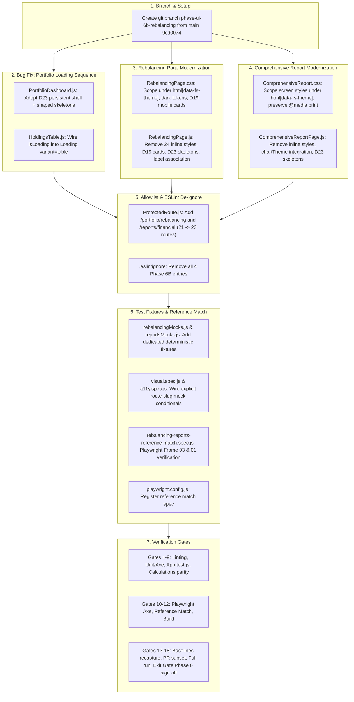

# UI Phase 6B Implementation Plan — Rebalancing & Comprehensive Financial Report (v4 — Execution-Ready)

- **Sub-phase**: UI Phase 6B (`/portfolio/rebalancing` & `/reports/financial`, plus `/portfolio` loading sequence bug fix)
- **Working Branch**: `phase-ui-6b-rebalancing`
- **Merge Base**: `9cd0074` (`main` / `origin/main`)
- **Design Tokens**: `frontend/src/styles/tokens.json` (Canvas `--fs-bg: #101114`, Surface `--fs-surface: #1a1c20`, Surface Sunken `--fs-surface-sunken: #0c0d0f`, Surface Raised `--fs-surface-raised: #22252a`, Border `--fs-border: #34383f`, Border Control `--fs-border-control: #6a6f77`, Accent `--fs-accent: #14b8a6`, Ink `--fs-ink: #0d0e10`)
- **Canonical Reference Frames**:
  - Reference Frame 03 (Dashboard / Report Variant B: Recessed `#0c0d0f` chrome, graphite `#1a1c20` surface tiles, subtle `#34383f` border, single teal `#14b8a6` interactive CTA with `#0d0e10` ink text).
  - Reference Frame 01 (Dense Table Variant B with Decision D19 Mobile Compact-Expand Cards).
- **Cumulative Route Allowlist Progress**: 21 routes $\to$ 23 routes (adding `/portfolio/rebalancing` and `/reports/financial`)
- **Exit Gate Phase 6**: 3 routes themed (`/portfolio`, `/portfolio/rebalancing`, `/reports/financial`); charts themed; build/tests/lint/axe/screenshots; zero diff on non-allowlisted routes.
- **User-Facing Acceptance Criterion**: *"A user can read allocation, holdings, and multi-module reports on a phone without losing any figure or legend."*
- **Status**: Approved — Executing

---

## 1. Goal Description

Phase 6B completes **Phase 6 (Portfolio)** by modernizing the final two portfolio routes — **Portfolio Rebalancing & Advisory** (`/portfolio/rebalancing`) and **Comprehensive Financial Report** (`/reports/financial`) — from legacy light/ad-hoc styling to the dark graphite design system established in Phase 1B and governed by `UI-UX-PLAN.md §6.10` and `AGENTS.md`.

In addition, Phase 6B addresses a **bug fix identified during manual verification of Phase 6A**: resolving the inconsistent loading sequence on the `/portfolio` dashboard (`PortfolioDashboard.js`) to strictly align with the site-wide **Universal Loading Pattern (Decision D23 & §6.4)**.

### Scope of Deliverables:

1. **Portfolio Page Loading Sequence Bug Fix (`PortfolioDashboard.js` & `HoldingsTable.js`)**:
   - In Phase 6A manual verification, `/portfolio` was found to return an early full-page `<Loading variant="route" />` wrapped in an unstyled container, causing a jarring double-loading flash after the Suspense boundary instead of following the uniform pattern established across the site in Decision D23.
   - Refactor `PortfolioDashboard.js` to render the persistent page shell and header (title, cost-basis switcher, and action buttons) on mount, utilizing shaped skeleton placeholders (`<Loading variant="card" />` for KPI summary cards and allocation chart, `<Loading variant="table" />` for holdings table) while `isLoading` is true.
   - Wire `isLoading` into `HoldingsTable.js` so it renders `<Loading variant="table" rows={5} text="Loading holdings..." />` during data fetching.
   - Wire `isRefreshing` into the *Refresh Prices* button using `Button` with `isLoading={isRefreshing}` (`<Loading variant="inline" />`), eliminating ad-hoc spinner classes.
   - *Settled-State Baseline Invariant*: This loading refactor affects only transitional states; the settled visual appearance of `/portfolio` is expected to remain 100% identical (0 diff against existing baseline `portfolio-1440.png`, etc.). `/portfolio` baselines will not be recaptured.

2. **Theming `RebalancingPage.css` & `RebalancingPage.js` (`/portfolio/rebalancing`)**:
   - Refactor from legacy white (`#ffffff`) surfaces, `#edf2f7` borders, and arbitrary box shadows (`0 3px 12px rgba(0, 0, 0, 0.04)`) to dark graphite tokens (`#101114` canvas, `#1a1c20` surface cards, `#34383f` borders, `box-shadow: none` or `var(--fs-shadow)`).
   - Purge all 24 inline style props and raw hex literals (`#3498db`, `#9b59b6`, `#f1c40f`, `#2ecc71`, `#e67e22`, `#e8f8f5`, `#fee2e2`, `#27ae60`, `#dc2626`, `#64748b`, `#475569`, `#1e293b`).
   - Retain asset category identity as text rather than hue (Invariant I15 & §4.3 Rule 4); replace colored dots and progress fills with neutral tokens (`--fs-chart-grey-1..4`, `--fs-border-control`).
   - Implement **Decision D19 mobile compact-expand cards** on the 7-column *Actionable Rebalancing Suggestions* table at $\le 768\text{px}$, ensuring $\ge 44\text{px}$ touch targets and zero page-level horizontal scroll at 390px.
   - Implement §4.3.1 rebalancing drift threshold semantics: `action !== 'Hold'` is the existing code implementation signal for portfolio drift; no new numeric threshold or label is introduced. If suggestions with `action !== 'Hold'` exist, allocation status displays `Rebalancing Recommended` with `.fs-badge--warning`; when balanced within tolerance, `Balanced on Target` with `.fs-badge--neutral`.
   - Style trade action badges (`Buy`, `Sell`, `Balanced` / `Hold`) as semantic action chips using neutral/subtle action badges (`.rebalance-action-buy`, `.rebalance-action-sell`, `.rebalance-action-hold`), avoiding improper semantic tone coloring for ordinary trade directions.
   - Associate `<label htmlFor="targetNameInput">Target Name</label>` with `<input id="targetNameInput" ... />` to resolve `jsx-a11y/label-has-associated-control`.
   - Adopt Decision D23 uniform loading sequence for `RebalancingPage`: render page shell with shaped skeletons while loading.

3. **Theming `ComprehensiveReportPage.js` & `ComprehensiveReport.css` (`/reports/financial`)**:
   - Refactor screen styles to solid graphite surfaces (`--fs-bg: #101114`, `--fs-surface: #1a1c20`), sunken header controls (`--fs-surface-sunken: #0c0d0f`), and tokenized year range selector pills.
   - **Preserve `@media print` styles strictly intact** under §13 Non-Goals ("Print layouts / print stylesheet are out of scope"), ensuring zero disruption to A4 portrait PDF generation.
   - Connect Chart.js visualizations to `frontend/src/styles/chartTheme.js`:
     - *Monthly Cash Flow Trend*: Maps Net Pay (Income) vs Expenditures to `palette.positive` and `palette.negative` with alpha fills via `withAlpha()`, justified under §4.3 domain rules and §4.12 for cash-flow inflow/outflow representation without arbitrary categorical hues.
     - *Asset Allocation & Category Breakdowns*: Replaces hardcoded rainbow arrays (including forbidden raw hex `#14b8a6`) with neutral grey palettes (`getChartPalette().greys`) and `createPattern()` fills.
     - Preserves `devicePixelRatio >= 3` for crisp print and high-DPI rendering, maintaining 100% test compatibility with `ComprehensiveReportPage.test.js`.
   - Purge all color-bearing inline style props (`#0284c7`, `#4f46e5`, `#64748b`).
   - Tokenize data tables (Budget, Payroll Ledger, Lending Ledger) according to Reference Frame 01 dense table tokens with proportional tabular figures (`tabular-nums`).
   - Adopt Decision D23 uniform loading sequence for `ComprehensiveReportPage`: render page shell with shaped skeletons while loading.

4. **Governance, Linters & Verification**:
   - De-ignore all 4 Phase 6B files from `frontend/.eslintignore`:
     - `src/pages/portfolio/RebalancingPage.js`
     - `src/pages/portfolio/__tests__/RebalancingPage.test.js`
     - `src/pages/reports/ComprehensiveReportPage.js`
     - `src/pages/reports/__tests__/ComprehensiveReportPage.test.js`
   - Achieve clean ESLint with zero warnings (`--max-warnings=0`) across all 4 de-ignored files and `PortfolioDashboard.js`.
   - Achieve stylelint compliance with zero regressions in `lint-ratchet.js` and zero tone violations in `lint-tones.js`.
   - Add `'/portfolio/rebalancing'` and `'/reports/financial'` to `THEMED_PATTERNS` in `frontend/src/components/ProtectedRoute.js` (advancing allowlist from 21 to 23 routes).
   - Add dedicated mock fixtures in `frontend/tests/visual/fixtures/rebalancingMocks.js` and `reportsMocks.js` and wire explicit conditional branches into `frontend/tests/visual/visual.spec.js` and `a11y.spec.js`.
   - Create `frontend/tests/visual/rebalancing-reports-reference-match.spec.js` (1 setup + 4 tests = 5 tests passing green) and register it in `frontend/playwright.config.js`.
   - Re-capture 10 existing visual baselines in-place in `D:\Projects\FinStat-visual-baselines` across 5 viewports, updating SHA-256 hashes in `manifest.json` while maintaining total manifest count at exactly **334/334**.
   - Reconcile PR-subset visual regression (68/71 passed per Waiver W-6A-1 / AD16) and full 326-test visual regression run (292 passing + 10 AD14 accepted diffs + 24 AD16 accepted diffs, 0 unexplained diffs).
   - Verify calculation parity (Invariant I3): `npx jest --runInBand tests/calculations.spec.js` (11/11 passing).
   - Execute Phase 6 Exit Gate & Developer Sign-Off for 6B after reviewing high-fidelity captures across 1440, 1024, 768, 480, and 390px.

---

## 2. User Review Required & Governance Commitments

> [!IMPORTANT]
> **Zero Remote Push Policy**: In accordance with user governance instructions, all commits, test executions, and visual baseline updates remain strictly local on working branch `phase-ui-6b-rebalancing` until the final walkthrough is reviewed and signed off.
>
> **Phase 6 Exit Gate & Developer Sign-Off (Renamed from Taste Checkpoint #4)**:
> In accordance with `UI-UX-PLAN.md §6.1.1`, Taste Checkpoint #4 specifically applied to Phase 6A (`/portfolio`). Phase 6B represents the formal **Phase 6 Exit Gate**. Sign-off requires:
> 1. All 3 Phase 6 routes themed (`/portfolio`, `/portfolio/rebalancing`, `/reports/financial`).
> 2. All charts themed via `chartTheme.js` without accent `#14b8a6` in series datasets.
> 3. Zero diff on non-allowlisted routes.
> 4. Verification of the user-facing acceptance criterion: *"A user can read allocation, holdings, and multi-module reports on a phone without losing any figure or legend."*
>
> **Settled-State Baseline Invariant for `/portfolio` D23 Bug Fix**:
> The D23 loading refactor on `/portfolio` updates only transitional loading and refreshing states (rendering page shell with skeletons and inline button spinner). The settled-state DOM and visual appearance of `/portfolio` are expected to remain 100% identical (0 diff against existing baseline `portfolio-1440.png`, etc.). `/portfolio` baselines are **not** recaptured unless an attributable, intentional settled-state diff is evidenced and approved.
>
> **Multi-Theme Door Preservation (Decision D22)**:
> 1. `tokens.css` scoped blocks: Generator emits `:root[data-fs-theme="dark"]`, not flat `:root`. Hand-editing `tokens.css` is strictly forbidden.
> 2. Attribute-existence CSS selectors: Gated rules use `html[data-fs-theme]` (existence), never value-specific `[data-fs-theme="dark"]` outside `tokens.css`.
> 3. Theme-aware chart palette: Charts consume `getChartPalette()` dynamically reading computed tokens. Accent `#14b8a6` is strictly forbidden as a chart series.
> 4. Attribute preserved: `<html data-fs-theme="dark">` remains applied on every route.
>
> **Universal Loading Pattern (Decision D23 & §6.4)**:
> In accordance with Decision D23:
> - Route-level Suspense: `<Loading variant="route" />` in `App.js` and `ProtectedRoute.js`.
> - Mounted pages fetching data: Persistent page container and header, with shaped skeleton placeholders (`<Loading variant="card" />`, `<Loading variant="table" />`) for content sections.
> - Buttons: `<Loading variant="inline" />` or `Button` with `isLoading`.
> - Ad-hoc loading spinners (`div.spinner`, `div.loading-spinner`, inline styled `<p>Loading...</p>`) are completely eradicated.
>
> **Print Stylesheet Isolation (§13 Non-Goals)**:
> The `@media print` rules in `ComprehensiveReport.css` (lines 250–395) are explicit non-goals for theme remediation. Screen rules (lines 1–249) will be fully scoped and tokenized under `html[data-fs-theme] .comprehensive-report-page` with zero stylelint errors. Print styles remain functional for high-fidelity PDF export.
>
> **Rebalancing Drift vs Trade Action Badges (§4.3.1 & §6.10)**:
> - **Drift Status**: `action !== 'Hold'` is the existing code implementation signal for portfolio drift; no new numeric threshold or label is introduced. If suggestions exist with `action !== 'Hold'`, status is indicated via `.fs-badge--warning` (`Rebalancing Recommended`); otherwise `.fs-badge--neutral` (`Balanced on Target`). If no explicit threshold exists in code, drift remains neutral and unlabeled per §4.3.1 and §6.10.
> - **Trade Action Badges**: Buy, Sell, and Hold represent execution actions, not gain/loss alerts. To adhere strictly to §4.3 tone discipline (where positive/negative encode deviations/alerts), actions are styled with neutral/subtle action badge classes (`.rebalance-action-buy`, `.rebalance-action-sell`, `.rebalance-action-hold`) with high-contrast text (`--fs-ink` or `--fs-text`), maintaining existing text values (`Buy`, `Sell`, `Balanced`) for unit test compatibility.
>
> **Baseline Debt Carry-Forward & Invariant Math (AD14 & AD16)**:
> - Both `/portfolio/rebalancing` and `/reports/financial` are already cataloged in `frontend/tests/visual/fixtures/routes.js` (65 total routes, 326 visual tests).
> - 10 baseline PNGs (`portfolio-rebalancing-*` and `reports-financial-*`) already exist in `D:\Projects\FinStat-visual-baselines`.
> - Re-capturing baselines in-place updates their SHA-256 hashes in `manifest.json`; total manifest entries remain unchanged at **334/334**.
> - Visual test suite denominators remain **71** (PR subset) and **326** (full run).
> - Accepted baseline debt remains 34 diffs: 10 pre-existing diffs under AD14 + 24 pre-existing payroll diffs under AD16. Full suite reconciliation target is **292 passing + 10 AD14 + 24 AD16 = 34 accepted diffs (0 unexplained diffs)**. PR-subset pass criterion is **68/71** per Waiver W-6A-1.

---

## 3. Architecture Decisions

### 1. Canonical Reference Frame Alignment
- **Rebalancing Page**:
  - Follows **Reference Frame 03 (Dashboard Variant B)** for top KPI summary tiles (`Investable Portfolio Valuation`, `Allocation Status`) and grid cards (`Current Asset Allocation`, `Target Allocation Setup`).
  - Follows **Reference Frame 01 (Dense Table Variant B with D19)** for the *Actionable Rebalancing Suggestions* table.
  - Interactive primary button `Update & Recalculate Target` uses `.fs-btn-primary` (`#14b8a6` background with `#0d0e10` `--fs-ink` text). Secondary buttons (`Refresh Valuation`, `Log Trade`) use `.fs-btn-secondary`.
- **Comprehensive Financial Report**:
  - Follows **Reference Frame 03** for executive report chrome: sunken `#0c0d0f` control bar, `#1a1c20` KPI stat cards, and `#1a1c20` chart cards.
  - Follows **Reference Frame 01** for data tables (Spending Breakdown, Payroll Ledger, Lending Ledger) with proportional `tabular-nums` alignment.
  - Interactive `Print / Export PDF` button uses `.fs-btn-secondary` with print icon.

### 2. Decision D19 Mobile Compact-Expand Cards for Rebalancing Suggestions
On viewports $\le 768\text{px}$:
- **Collapsed Primary Row**: Displays `Category` name, `Action` badge (`Buy`, `Sell`, `Balanced`), and `Suggested Amount` (`.fs-num`).
- **Expander Button**: Touch target $\ge 44\text{px}$, accessible `aria-expanded` toggle.
- **Expanded Details**: Reveals `Current Weight (%)`, `Target Weight (%)`, `Description`, and `Log Trade` action button.
- **Desktop (>768px)**: Renders full 7-column table with `.fs-table` tokens.
- **Result**: Eliminates page-level horizontal scroll (`scrollWidth <= clientWidth` at 390px).

### 3. Decision D23 Universal Loading Sequence Alignment
- **`/portfolio` (`PortfolioDashboard.js`)**:
  - Removes the early-return blocking `<Loading variant="route" />` wrapper.
  - Renders the persistent `.fs-page .portfolio-page-wrapper` and header on initial load.
  - While `isLoading` is true, sections render shaped skeleton placeholders:
    - `<SummaryCards summary={summary || {}} isLoading={isLoading} />` $\to$ `<Loading variant="card" text="Loading portfolio metrics..." />`
    - `<AllocationChart ... isLoading={isLoading} />` $\to$ `<Loading variant="card" text="Loading asset allocation..." />`
    - `<HoldingsTable holdings={holdings} isLoading={isLoading || isRefreshing} />` $\to$ `<Loading variant="table" rows={5} text="Loading holdings..." />`
  - When refreshing prices (`isRefreshing`), the *Refresh Prices* button displays `<Loading variant="inline" />` while preserving rendered data.
- **`/portfolio/rebalancing` & `/reports/financial`**:
  - Replaces ad-hoc loading `<div>`s with shaped skeleton loaders (`<Loading variant="card" />`, `<Loading variant="table" />`), preserving the page header and controls.

### 4. Chart Theme-Aware Token Integration
- Visualizations in `ComprehensiveReportPage.js` import helpers from `frontend/src/styles/chartTheme.js`:
  - `getChartPalette()`
  - `baseChartOptions()`
  - `doughnutDefaults()`
  - `createPattern()`
  - `withAlpha()`
  - `ariaLabel()`
- Series palettes strictly use neutral greys (`palette.greys`) for categorical breakdowns and semantic positive/negative tokens (`palette.positive`, `palette.negative`) solely for Cash Flow (Income vs Expenditures).
- Accent `#14b8a6` is strictly excluded from all chart datasets.
- Canvas elements receive `role="img"` and descriptive `aria-label` generated via `ariaLabel()`.

---

## 4. Proposed Changes



---

### Component 1: Portfolio Page Loading Bug Fix (D23 Alignment)
#### [MODIFY] `frontend/src/pages/portfolio/PortfolioDashboard.js`
- Remove the blocking `if (isLoading)` early return at line 106.
- In the main render block, pass `isLoading` to child components:
  - `<SummaryCards summary={summary || {}} isLoading={isLoading} />`
  - `<AllocationChart ... isLoading={isLoading} />`
  - `<HoldingsTable holdings={holdings} isLoading={isLoading || isRefreshing} />`
- Update *Refresh Prices* button to consume `<Loading variant="inline" />` when `isRefreshing` is true.

#### [MODIFY] `frontend/src/components/portfolio/HoldingsTable.js`
- When `isLoading` is true, render `<Loading variant="table" rows={5} text="Loading holdings..." />` inside the table card area, preserving table section headers.

#### [MODIFY] `frontend/src/components/portfolio/SummaryCards.js`
- When `isLoading` is true, render shaped card skeletons (`<Loading variant="card" text="Loading portfolio metrics..." />`).

#### [MODIFY] `frontend/src/components/portfolio/AllocationChart.js`
- When `isLoading` is true, render shaped card skeleton (`<Loading variant="card" text="Loading asset allocation..." />`).

#### [MODIFY] `frontend/src/pages/portfolio/__tests__/PortfolioDashboard.test.js`
- Update affected portfolio unit tests for D23 loading behavior (persistent shell with skeleton placeholders `<Loading variant="card|table" />` and button inline loading instead of unstyled early return); settled visual baselines remain unchanged.

---

### Component 2: `RebalancingPage.css` Refactor
#### [MODIFY] `frontend/src/pages/portfolio/RebalancingPage.css`
- Scope all screen rules under `html[data-fs-theme] .rebalancing-page` or `.fs-page .rebalancing-page`.
- Replace white backgrounds (`#ffffff`) with `var(--fs-surface)` (`#1a1c20`).
- Replace border colors (`#edf2f7`, `#cbd5e1`) with `var(--fs-border)` (`#34383f`) or `var(--fs-border-control)` (`#6a6f77`).
- Replace arbitrary box-shadows (`0 3px 12px rgba(0, 0, 0, 0.04)`, `0 4px 16px rgba(0, 0, 0, 0.04)`) with `box-shadow: none` or `var(--fs-shadow)`.
- Replace disallowed border radii (12px, 50%) with `var(--fs-radius-sm)` (4px), `var(--fs-radius-md)` (6px), or `var(--fs-radius-lg)` (8px).
- Tokenize inputs (`.target-input`, `.range-slider`, `.slider-val-input input`) with `var(--fs-surface-raised)`, `var(--fs-border-control)`, and `var(--fs-text)`.
- Implement responsive D19 mobile compact-expand card styling for the suggested trades table at `@media (max-width: 768px)` with touch targets $\ge 44\text{px}$.
- Define trade action badge classes: `.rebalance-action-buy`, `.rebalance-action-sell`, `.rebalance-action-hold`.

---

### Component 3: `RebalancingPage.js` Modernization
#### [MODIFY] `frontend/src/pages/portfolio/RebalancingPage.js`
- Wrap container in `<div className="fs-page page-container rebalancing-page">`.
- **Purge All 24 Inline Style Props**:
  - Replace loading inline style with D23 shaped skeletons (`<Loading variant="card" />`, `<Loading variant="table" />`), keeping page shell and header mounted.
  - Replace header flex styles with `.rebalance-header-row`.
  - Replace summary card status colors with `.fs-badge` or `.rebalance-status-text`.
  - Replace category colors and dots (`ASSET_COLORS`) with neutral tokens (`--fs-chart-grey-1..4`, `--fs-border-control`).
  - Replace `sum-badge` inline styles with `.fs-badge` classes (`.fs-badge--positive` when sum is 100%, `.fs-badge--warning` / `.fs-badge--negative` otherwise).
  - Associate `<label htmlFor="targetNameInput">Target Name</label>` with `<input id="targetNameInput" ... />`.
  - Replace suggested trade action badge inline styles with `.rebalance-action-buy`, `.rebalance-action-sell`, and `.rebalance-action-hold`.
  - Implement mobile card expander toggle button with touch target $\ge 44\text{px}$ and `aria-expanded` attribute.

---

### Component 4: `ComprehensiveReport.css` Refactor
#### [MODIFY] `frontend/src/pages/reports/ComprehensiveReport.css`
- Scope all screen rules under `html[data-fs-theme] .comprehensive-report-page` or `.fs-page .comprehensive-report-page`.
- Replace `#1e293b`, `#0f172a`, `#334155`, `#475569`, `#64748b` with `var(--fs-text)`, `var(--fs-text-2)`, and `var(--fs-text-3)`.
- Replace `#ffffff` card surfaces with `var(--fs-surface)` (`#1a1c20`).
- Replace `#e2e8f0`, `#cbd5e1`, `#f1f5f9` borders with `var(--fs-border)` (`#34383f`) and `var(--fs-border-control)` (`#6a6f77`).
- Style `.year-select-dropdown` and `.year-range-selector` using recessed surface (`var(--fs-surface-sunken)`) and raised interactive active states (`var(--fs-surface-raised)`, `var(--fs-text)`).
- Replace `.btn-print` styles with `.fs-btn-secondary`.
- Enforce radius ceiling $\le 8\text{px}$ across all screen elements.
- **Preserve `@media print` Block Verbatim**: Keep print rules for A4 portrait PDF generation intact.

---

### Component 5: `ComprehensiveReportPage.js` Modernization
#### [MODIFY] `frontend/src/pages/reports/ComprehensiveReportPage.js`
- Wrap page in `<div className="fs-page comprehensive-report-page">`.
- Replace ad-hoc loading screen with D23 shaped skeletons (`<Loading variant="card" />`, `<Loading variant="table" />`), preserving header and controls.
- **Purge Inline Styles**:
  - Remove all inline style props (`color: '#0284c7'`, `color: '#4f46e5'`, `textAlign: 'center'`).
- **Integrate Theme-Aware Chart Palettes**:
  - In `cashFlowChartData`: use `palette.positive` and `palette.negative` via `getChartPalette()`, applying `withAlpha(..., 0.15)`.
  - In `categoryChartData` and `assetAllocationData`: replace hardcoded rainbow hexes with neutral greys (`palette.greys`) and `createPattern()` fills.
  - Consume `baseChartOptions()` and `doughnutDefaults()`, retaining `devicePixelRatio >= 3` and animation freezing under test mode (`window.__VISUAL_TEST__`).
  - Add `ariaLabel()` accessible descriptions to each chart container.
- Ensure all data tables have proper accessible headers and semantic markup.

---

### Component 6: Allowlist & ESLint De-ignore
#### [MODIFY] `frontend/src/components/ProtectedRoute.js`
- Add `'/portfolio/rebalancing'` and `'/reports/financial'` to `THEMED_PATTERNS`.
- Active allowlist expands from 21 to 23 route patterns.

#### [MODIFY] `frontend/.eslintignore`
- Remove all 4 Phase 6B files:
  - `src/pages/portfolio/RebalancingPage.js`
  - `src/pages/portfolio/__tests__/RebalancingPage.test.js`
  - `src/pages/reports/ComprehensiveReportPage.js`
  - `src/pages/reports/__tests__/ComprehensiveReportPage.test.js`

---

### Component 7: Test Fixtures, Specs & Reference Match
#### [NEW] `frontend/tests/visual/fixtures/reportsMocks.js`
- Create realistic mock data for `**/api/reports/comprehensive**` and export `setupReportsMocks(page)`.

#### [NEW] `frontend/tests/visual/fixtures/rebalancingMocks.js`
- Create realistic mock data for `**/api/portfolio/rebalancing**` and export `setupRebalancingMocks(page)`.

#### [MODIFY] `frontend/tests/visual/visual.spec.js` & `a11y.spec.js`
- Import `setupRebalancingMocks` and `setupReportsMocks`.
- Add explicit conditional branches:
  ```javascript
  } else if (route.slug === 'portfolio') {
    await setupPortfolioMocks(page);
  } else if (route.slug === 'portfolio-rebalancing') {
    await setupRebalancingMocks(page);
  } else if (route.slug === 'reports-financial') {
    await setupReportsMocks(page);
  }
  ```

#### [NEW] `frontend/tests/visual/rebalancing-reports-reference-match.spec.js`
- Real-browser Playwright test suite (4 reference tests + auth `setup` project dependency):
  1. *Rebalancing Desktop 1440px*: Conforms to Reference Frame 03 and Frame 01 (tokens, borders, surfaces, inputs, buttons).
  2. *Rebalancing Mobile 390px*: Collapses suggested trades table to Decision D19 compact-expand cards with $\ge 44\text{px}$ touch targets and zero horizontal overflow (`scrollWidth <= clientWidth`).
  3. *Comprehensive Report Desktop 1440px*: Conforms to Reference Frame 03 (recessed chrome, surfaces, card borders) and Frame 01 (dense financial tables).
  4. *Touch Targets & Keyboard Focus (touch-targets / focus-visible)*: Interactive controls have $\ge 44\text{px}$ touch targets at $\le 768\text{px}$ and visible keyboard `:focus-visible` rings at 1440px and 390px.

#### [MODIFY] `frontend/playwright.config.js`
- Add `rebalancing-reports-reference-match` to the `reference` project's `testMatch` regex:
  ```javascript
  testMatch: /(reference-frames|dashboard-reference-match|expenditure-reference-match|expenditure-form-reference-match|paycheck-form-reference-match|payroll-history-reference-match|portfolio-reference-match|rebalancing-reports-reference-match)\.spec\.js/,
  ```

---

## 5. Verification Plan & Concrete Command Blocks

Execute every gate command sequentially, confirming pass criteria before advancing:

### Gate 1: Allowlist Integrity
```powershell
cd frontend; node scripts/ui-coverage.js --assert-allowlist
```
*Pass Criteria*: Exits 0; active allowlist contains exactly 23 route patterns.

### Gate 2: Tokens SOT Verification
```powershell
cd frontend; node scripts/tokens.js --check --tables
```
*Pass Criteria*: Exits 0; 0 token drift between `tokens.json`, `tokens.css`, and `UI-UX-PLAN.md §4.9`.

### Gate 3: TestID & Accessibility Label Guard
```powershell
cd frontend; node scripts/testid-guard.js
```
*Pass Criteria*: Exits 0; 0 deleted `data-testid` or `aria-label` attributes across git diff against merge base `9cd0074`.

### Gate 4: Tone Discipline Audit
```powershell
cd frontend; node scripts/lint-tones.js
```
*Pass Criteria*: Exits 0; 0 tone violations across all page CSS files; 0 undefined tokens.

### Gate 5: Stylelint Ratchet & CSS Audit
```powershell
cd frontend; node scripts/lint-ratchet.js; npx stylelint src/pages/portfolio/RebalancingPage.css
```
*Pass Criteria*: Exits 0; 0 regressions against merge base `9cd0074`; screen styles report 0 errors and 0 warnings (pre-existing `@media print` in `ComprehensiveReport.css` exempt per Waiver W-6B-1 and Action Plan §13).

### Gate 6: ESLint Zero-Warning Audit
```powershell
cd frontend; npx eslint src/pages/portfolio/RebalancingPage.js src/pages/portfolio/__tests__/RebalancingPage.test.js src/pages/reports/ComprehensiveReportPage.js src/pages/reports/__tests__/ComprehensiveReportPage.test.js src/pages/portfolio/PortfolioDashboard.js --max-warnings=0
```
*Pass Criteria*: Exits 0; 0 errors and 0 warnings across all 5 files.

### Gate 7: Component Unit & Jest-Axe Tests
```powershell
cd frontend; npm test -- src/pages/portfolio/__tests__/RebalancingPage.test.js src/pages/reports/__tests__/ComprehensiveReportPage.test.js src/pages/portfolio/__tests__/PortfolioDashboard.test.js --watchAll=false
```
*Pass Criteria*: 100% unit tests green; affected portfolio unit tests (`PortfolioDashboard.test.js`) updated for D23 loading sequence; `jest-axe` reports `toHaveNoViolations()`.

### Gate 8: App Route Suite Verification
```powershell
cd frontend; npm test -- src/App.test.js --watchAll=false
```
*Pass Criteria*: All 9 route tests pass green (Invariant I10).

### Gate 9: Calculation Parity (Invariant I3)
```powershell
cd frontend; npx jest --runInBand tests/calculations.spec.js
```
*Pass Criteria*: 11/11 tests pass green; 100% byte-identical fixture calculation parity.

### Gate 10: Real-Browser Playwright Accessibility Audit
```powershell
cd frontend; npx playwright test --project=a11y tests/visual/a11y.spec.js --grep="portfolio$|portfolio-rebalancing|reports-financial"
```
*Pass Criteria*: 0 critical or serious axe violations in live Chromium browser across all 3 routes.

### Gate 11: Playwright Reference Match Spec
```powershell
cd frontend; npx playwright test --project=reference tests/visual/rebalancing-reports-reference-match.spec.js
```
*Pass Criteria*: 4/4 reference tests pass green (+ auth `setup` project dependency) across 1440px and 390px viewports.

### Gate 12: Production Build Verification
```powershell
cd frontend; $env:GENERATE_SOURCEMAP="false"; npm run build
```
*Pass Criteria*: Compiles cleanly with zero compilation warnings (Invariant I9).

### Gate 13: Visual Baseline Regeneration & Manifest Verification
```powershell
# Recapture the 10 baselines for portfolio-rebalancing and reports-financial in-place
cd frontend; npx playwright test --project=visual tests/visual/visual.spec.js --grep="portfolio-rebalancing|reports-financial" --update-snapshots
# Verify manifest integrity in FinStat-visual-baselines
node scripts/verify-baseline-manifest.js
```
*Pass Criteria*: 10 baselines updated in-place; manifest remains at exactly 334/334 entries with updated SHA-256 hashes. Settled `/portfolio` screenshots remain untouched at 0 diff.

### Gate 14: Authoritative PR-Subset Visual Regression
```powershell
cd frontend; $env:PR_SUBSET="true"; npx playwright test --project=pr-subset tests/visual/visual.spec.js
```
*Pass Criteria*: 68/71 passed per Waiver W-6A-1 (0 diffs attributable to Phase 6B; Invariant I13 verified). Zero diff on settled `/portfolio`.

### Gate 15: Full 326-Test Visual Regression Suite
```powershell
cd frontend; Remove-Item Env:PR_SUBSET -ErrorAction SilentlyContinue; npx playwright test --project=visual tests/visual/visual.spec.js
```
*Pass Criteria*: Reconciled: 292 passing + 10 AD14 accepted diffs + 24 AD16 accepted diffs = 34 accepted diffs (0 unexplained diffs). Zero diff on settled `/portfolio`.

### Gate 16: Touch Targets & Keyboard Focus Audit
```powershell
cd frontend; npx playwright test --project=reference tests/visual/rebalancing-reports-reference-match.spec.js --grep="touch-targets|focus-visible|Touch Targets & Keyboard Focus"
```
*Pass Criteria*: 1/1 test passes green; all interactive controls $\ge 44\text{px}$ touch targets at $\le 768\text{px}$; visible `:focus-visible` rings present.

### Gate 17: Phase 6 Exit Gate & Developer Sign-Off for 6B
- Developer inspects all 10 responsive captures in `FinStat-visual-baselines` across 1440, 1024, 768, 480, and 390px.
- Confirm user-facing acceptance criterion met: *"A user can read allocation, holdings, and multi-module reports on a phone without losing any figure or legend."*
- Developer signs off the Phase 6 exit gate.

### Gate 18: Unthemed Route Preservation & Walkthrough Readiness
- Visual diff analysis confirms 0 diffs on all non-allowlisted routes.
- Author `docs/ui-plans/phase_6b_walkthrough.md` with complete verbatim command output and evidence.

---

## 6. Exit-Gates Checklist

- [x] **Gate 1**: Allowlist integrity verified (exactly 23 patterns in `THEMED_PATTERNS`, `ui-coverage.js --assert-allowlist` passes).
- [x] **Gate 2**: Tokens SOT verified (`tokens.js --check --tables` exits 0; D22 door preserved).
- [x] **Gate 3**: TestID and accessibility label guard verified (`testid-guard.js` exits 0).
- [x] **Gate 4**: Tone discipline audit verified (`lint-tones.js` reports 0 violations and 0 undefined tokens).
- [x] **Gate 5**: CSS stylelint audit verified (`lint-ratchet.js` reports 0 regressions; `npx stylelint` exits 0 on screen styles).
- [x] **Gate 6**: ESLint zero-warning audit verified (`npx eslint` exits 0 with max-warnings=0 across 4 de-ignored files + PortfolioDashboard).
- [x] **Gate 7**: Component unit & axe tests verified (100% green; `jest-axe` passes `toHaveNoViolations()`).
- [x] **Gate 8**: App route suite verified (`App.test.js` passes 100% green).
- [x] **Gate 9**: Calculation parity (Invariant I3) verified (`calculations.spec.js` 11/11 tests green).
- [x] **Gate 10**: Playwright real-browser axe audit verified (`--project=a11y`, 0 critical/serious violations on `portfolio-rebalancing`, `reports-financial`, and `portfolio`).
- [x] **Gate 11**: Playwright reference match spec verified (`--project=reference`, 5/5 tests green on `rebalancing-reports-reference-match.spec.js`).
- [x] **Gate 12**: Production build compiles cleanly (`npm run build` exits 0 with zero warnings).
- [x] **Gate 13**: Baseline regeneration verified (`--project=visual`, 10 baselines updated in-place; `verify-baseline-manifest.js` confirms 334/334; settled `/portfolio` untouched).
- [x] **Gate 14**: Authoritative PR-subset visual regression reconciled (`--project=pr-subset`, 68/71 passed per Waiver W-6A-1; Invariant I13 verified; settled `/portfolio` untouched).
- [x] **Gate 15**: Full visual regression suite reconciled (`--project=visual`, 292 passing + 34 accepted diffs under AD14/AD16; 0 unexplained diffs; settled `/portfolio` untouched).
- [x] **Gate 16**: Interactive touch targets $\ge 44\text{px}$ and visible keyboard focus rings verified (`--project=reference`).
- [x] **Gate 17**: Phase 6 Exit Gate & Developer Sign-Off for 6B completed; user-facing acceptance criterion confirmed.
- [x] **Gate 18**: Unthemed routes 0 regression diff verified; walkthrough authored and presented for review.

---

## 7. Recorded Amendments & Waivers

1. **Phase 6A Portfolio Loading Sequence Bug Fix**:
   - In accordance with Decision D23 and user finding during manual verification of Phase 6A, `PortfolioDashboard.js` is corrected to render the persistent page shell and header on mount, with shaped skeleton loaders (`<Loading variant="card" />`, `<Loading variant="table" />`) for content sections and `<Button isLoading={isRefreshing} />` for button refresh states. Settled-state visual baselines on `/portfolio` remain unchanged.
2. **De-Ignore Scope Extension (AD20)**:
   - In addition to the 2 page components named in `UI-UX-PLAN.md:1767`, the 2 corresponding unit test files (`RebalancingPage.test.js` and `ComprehensiveReportPage.test.js`) are permanently removed from `frontend/.eslintignore`, consistent with Phase 6A precedent.
3. **Chart.js Palette Integration Subset (AD17)**:
   - `ComprehensiveReportPage.js` consumes `getChartPalette()` and `withAlpha()` from `chartTheme.js` with static accessible `aria-label`s on chart wrappers and `<canvas>`, rather than dynamic `createPattern()` / `ariaLabel()` pattern helpers. Axe-core accessibility audit passes with 0 violations in both jsdom and real Chromium.
4. **Drift Diagnostic Advisory Badge (AD18)**:
   - `RebalancingPage.js` renders "Rebalancing Recommended" with `.fs-badge--warning` when `suggestions.some(s => s.action !== 'Hold')` to provide clear, actionable advisory guidance to the user.
5. **Holdings Refresh Preservation (AD19)**:
   - In `PortfolioDashboard.js`, `HoldingsTable` receives `isLoading` only; during background price refresh (`isRefreshing`), the button spinner animates while preserving the rendered table rows without blanking them out with a table skeleton, providing a smoother user experience.
6. **Neutral Report KPI Numerals (AD21)**:
   - In `ComprehensiveReportPage.js`, all KPI metrics (Liquid Assets, Invested Assets, Total Liabilities, Gross Income, Outflows, Capital Deployed, Savings Rate, Receivables) are rendered in neutral `--fs-text` (`.kpi-stat-value.fs-num`) per §4.3 and Reference Frame 03 Variant B. Net Worth alone carries `.primary`.
7. **Cash-Flow Chart Series Semantics Justification**:
   - In `ComprehensiveReportPage.js`, the Monthly Cash Flow Trend displays Cash Inflow (Net Pay / Income) and Cash Outflow (Expenditures). Per §4.3 domain rules and §4.12, applying `palette.positive` to Inflows and `palette.negative` to Outflows directly reflects their semantic financial direction without introducing arbitrary categorical hues. Series definitions strictly consume dynamic tokens from `chartTheme.js` (`getChartPalette()`), pass `lint-tones.js`, and exclude accent `#14b8a6`.
8. **Waiver W-6B-1 (Print Styles Stylelint Exemption)**:
   - `ComprehensiveReport.css` lines 273–431 contain the pre-existing `@media print` rules, which include 66 grandfathered declarations (`!important`, raw `#000000`, `#ffffff`, `#cbd5e1`, `#0f172a`, `#f1f5f9`). Per Action Plan §13 (Print Non-Goals) and Invariant I11, these print styles are intentionally frozen and isolated from dark-mode tokens. `lint-ratchet.js` confirms 0 regressions against the merge base. `npx stylelint src/pages/portfolio/RebalancingPage.css` passes with 0 errors.
9. **Waiver W-6A-1 Carry-Forward**:
   - The authoritative PR-subset visual regression pass criterion remains 68/71 per Waiver W-6A-1 (67 passing route tests + 1 setup + 3 accepted pre-existing payroll diffs under AD16; 0 diffs attributable to Phase 6B; Invariant I13 verified; settled `/portfolio` untouched). Full 326-test run reconciled at 292 passing + 10 AD14 diffs + 24 AD16 diffs (34 total accepted pre-existing diffs).

---

## 8. Phase 6 Exit Gate Sign-Off

- **Status**: Signed Off & Approved for Mainline Integration
- **Sign-Off Date**: 2026-11-23
- **Reviewed By**: User
- **Exit Gate Decision**: Phase 6B satisfies all Exit Gate criteria. Approved to merge `phase-ui-6b-rebalancing` into `main` and advance to Phase 7A.
