# UI Phase 7A Implementation Plan — Trade Log & Trade Entry Conversion (v3)

- **Sub-phase**: UI Phase 7A (`/trades`, `/trades/add`, `/trades/edit/:id`, `/trade-summary`)
- **Taste Checkpoint**: **Taste Checkpoint #5** (7A `/trades` compared against Reference Frame 01 Variant B — Dense Table)
- **Target Routes**:
  - `/trades` (`TradeLogPage.js`)
  - `/trades/add` (`AddTradePage.js` + `TradeForm.js`)
  - `/trades/edit/:id` (`EditTradePage.js` + `TradeForm.js`)
  - `/trade-summary` (`TradeSummaryPage.js`)
- **Target Stylesheets**:
  - `frontend/src/pages/trades/Trades.css` (neutral tokens only)
  - `frontend/src/styles/theme-components.css` (scoped semantic tone rules)
- **Working Branch**: `phase-ui-7a-trades` (branched from `main` at merge commit `46f2108` / documentation commit `5c57915`)
- **Baselines Directory**: `D:\Projects\FinStat-visual-baselines` (commit `c2dadf6`, 334/334 manifest verified)
- **Merge Base**: `5c57915a3c65f4fe8e5047e59d968c3d6a1eaa7a` (`main`)
- **Date**: 2026-11-23

---

## 1. Goal Description & Scope

UI Phase 7A modernizes the **Stock Trading & Performance Subsystem** of FinStat, converting the core trading ledger, trade creation/edit forms, and multi-broker position performance summaries to the dark graphite design system.

### Core Objectives:
1. **Allowlist Expansion**: Promote 4 trade routes (`/trades`, `/trades/add`, `/trades/edit/:id`, `/trade-summary`) to the active allowlist in `ProtectedRoute.js`, expanding active coverage from 23 to 27 patterns.
2. **Canonical Reference Frame Conformance**:
   - **Reference Frame 01 (Dense Table Variant B)**: Applied to `TradeLogPage.js` and the two position ledgers on `TradeSummaryPage.js`. Compact cell padding (`0.55rem 0.75rem`), neutral category chips, tabular numerals (`.fs-num`), sortable column headers with active sort indicators highlighted via `--fs-accent`.
   - **Reference Frame 02 (Form Variant B)**: Applied to `TradeForm.js` (rendered by `AddTradePage.js` and `EditTradePage.js`). Stacked field cards, dark graphite surface `--fs-surface` (`#1a1c20`), border `--fs-border` (`#34383f`), tokenized inputs (`.fs-input`, `.fs-select`), explicit label association (`htmlFor`), inline feedback, safe neutral cancel / primary submit (`.fs-btn-primary`).
   - **Reference Frame 03 (Dashboard Variant B)**: Applied to `TradeSummaryPage.js`. Recessed chrome shell, graphite KPI summary tiles for broker metrics and overall totals (`.kpi-card`, scoped in `Trades.css`), neutral tabular numerals.
3. **P&L Tone Discipline & `<Delta>` Primitive**:
   - Replace 54 color-bearing inline styles in `TradeSummaryPage.js`.
   - Enforce UI-UX-PLAN §4.3 and §6.11: all gains, losses, and returns are rendered through the `<Delta>` primitive with explicit semantic sign (`+` / `−`), arrow, and accessible label; zero amounts rendered strictly neutral. Page CSS never names a tone token.
4. **Decision D19 Mobile Compact-Expand Pattern**:
   - At viewports $\le 768\text{px}$, tables on `/trades` and `/trade-summary` collapse into stacked vertical cards with $\ge 44\text{px} \times 44\text{px}$ touch targets, showing essential fields in compact mode and full transaction details in expanded mode. Page-level horizontal scroll eliminated (`scrollWidth <= clientWidth` at 390px).
5. **Architectural Guard: Unthemed Route Preservation for Shared `Trades.css` (Waiver W-7A-1)**:
   - `Trades.css` is currently imported by 7 unthemed pages (`CertificateLogPage`, `CreditCardPage`, `CurrencyLogPage`, `GoldLogPage`, `GoldSummaryPage`, `MutualFundLogPage`, `MutualFundSummaryPage`) and `CorporateActionsList`.
   - To strictly preserve Invariant I13 (zero diff on non-allowlisted routes), legacy rules (lines 1–326) remain unscoped and evaluate verbatim for unthemed routes. On allowlisted trade routes, modern styles scoped under `html[data-fs-theme]` (`.trade-log-page`, `.trade-form-page`, `.trade-summary-page`) apply with higher specificity. Because `ProtectedRoute.js` sets `data-fs-theme` only on allowlisted routes, unthemed pages never match the themed rules and maintain their exact 1B baseline cascade without single-pixel visual diffs.
   - Permanently remove the 8 `!important` declarations from lines 182, 195, 201, 202, 207, 216, 225, 233 in `Trades.css` per §6.11.
   - Pre-record **Waiver W-7A-1**: The pre-existing unscoped legacy rules (lines 1–326) in `Trades.css` are grandfathered and exempt from stylelint errors during Phase 7A. Ratchet rule: `lint-ratchet.js` must show 0 regressions against merge base `5c57915` (the removal of 8 `!important` declarations strictly drops the count), while all screen styles in the new scoped theme block strictly adhere to design tokens with 0 errors.
6. **Tone Scoping Discipline (`lint-tones.js` & `AGENTS.md`)**:
   - `Trades.css` is restricted strictly to neutral design tokens (`--fs-surface*`, `--fs-border*`, `--fs-text*`, `--fs-ink`, `--fs-radius*`).
   - Zero direct references to `var(--fs-accent*)`, `var(--fs-positive)`, `var(--fs-negative)`, or `var(--fs-warning)` in `Trades.css`.
   - All scoped tone and accent rules (active filter pill background, sort column active indicator, inline validation error text, stock info warning text) are hosted in `frontend/src/styles/theme-components.css` under `/* Phase 7A: Stock Trades Semantic Themes */`, which is an exempt file under `lint-tones.js`.
7. **ESLint De-Ignore Scope**:
   - Permanently remove lines 64–66 (`TradeForm.js`, `TradeLogPage.js`, `TradeSummaryPage.js`) from `frontend/.eslintignore`. Confirm `AddTradePage.js` and `EditTradePage.js` are not ignored.
   - Author 3 comprehensive CRA unit test suites with `jest-axe` (exactly 30 tests: 10 tests each in `TradeLogPage.test.js`, `TradeForm.test.js`, `TradeSummaryPage.test.js`).
   - Achieve 0 errors and 0 warnings with `eslint --max-warnings=0`.
8. **Playwright Mock & Reference Match Registration**:
   - Create `frontend/tests/visual/fixtures/tradesMocks.js` intercepting `**/api/trades**`.
   - Wire `setupTradesMocks` into **both** `visual.spec.js` and `a11y.spec.js` for deterministic snapshots and axe scans.
   - Register `trades-reference-match` in `frontend/playwright.config.js` `reference` project `testMatch` regex.
9. **Taste Checkpoint #5 Compliance**:
   - Compare rendered `/trades` at 1440px and 390px with Reference Frame 01 (Variant B — Dense Table) for Taste Checkpoint #5 sign-off before Phase 7B corporate actions begins.
10. **Visual Baselines**:
   - Capture 20 baseline snapshots (4 routes × 5 viewports) in `D:\Projects\FinStat-visual-baselines`.
   - Maintain 334/334 manifest integrity in `manifest.json`.
   - Reconcile PR-subset visual regression suite (68/71 passing per Waiver W-6A-1 carry-forward: 68 passed + 3 accepted pre-existing payroll failures under AD16; 0 diffs attributable to Phase 7A; 0 diff on allowlisted routes; 0 diff on any of the 8 unthemed consumers of `Trades.css`).
   - Full 326-test run reconciled at 292 passing + 10 AD14 diffs + 24 AD16 diffs (34 total accepted pre-existing diffs).

---

## 2. User Review Required & Design Decisions

> [!IMPORTANT]
> **Waiver W-7A-1: Legacy Shared Stylesheet Stylelint Exemption**:
> `Trades.css` is shared by 7 unthemed pages and `CorporateActionsList`. To strictly satisfy Invariant I13 (zero diff on non-allowlisted routes), legacy unscoped rules (lines 1–326) are preserved to evaluate verbatim for unthemed routes. These legacy rules contain 78 pre-existing stylelint errors (`color-no-hex`, disallowed functions, unlisted radii). Under Waiver W-7A-1, these grandfathered rules are exempt from strict stylelint; `lint-ratchet.js` evaluates against merge base `5c57915` (confirming 0 regressions and the permanent removal of 8 `!important`), while the new scoped theme block strictly passes token checks with 0 errors.

> [!IMPORTANT]
> **Tone Scoping Architecture (`lint-tones.js` / `AGENTS.md`)**:
> `Trades.css` is a page CSS file and therefore subject to the strict tone ban in `lint-tones.js` (line 46). It will contain **zero** references to `var(--fs-accent*)`, `var(--fs-positive)`, `var(--fs-negative)`, or `var(--fs-warning)`. All component-specific tone and accent overrides will be hosted in `frontend/src/styles/theme-components.css` under the Phase 7A block, and JSX will consume standard utility classes (`.fs-btn-primary`, `.fs-btn-secondary`, `.fs-input`, `.fs-select`, `.fs-num`, `.fs-delta`).

> [!IMPORTANT]
> **Taste Checkpoint #5 Requirement**:
> Per UI-UX-PLAN §6.1.1, Phase 7A serves as **Taste Checkpoint #5** (evaluating `/trades` against Reference Frame 01 Variant B — Dense Table). Developer visual sign-off of the rendered screen at 1440px and 390px is required before Phase 7B can commence.

---

## 3. Proposed Changes

```
frontend/
├── playwright.config.js                             # [MODIFY] Add trades-reference-match to reference testMatch regex
├── .eslintignore                                    # [MODIFY] Remove lines 64-66 (TradeLogPage, TradeForm, TradeSummaryPage)
├── src/
│   ├── components/
│   │   └── ProtectedRoute.js                        # [MODIFY] Add 4 routes to THEMED_PATTERNS (23 -> 27)
│   ├── styles/
│   │   └── theme-components.css                     # [MODIFY] Add Phase 7A scoped tone & accent rules (exempt file)
│   ├── pages/
│   │   └── trades/
│   │       ├── Trades.css                           # [MODIFY] Scope modern neutral tokens under html[data-fs-theme], remove 8 !important (Waiver W-7A-1)
│   │       ├── TradeLogPage.js                      # [MODIFY] Scoped .trade-log-page, sortable headers, D19 mobile cards, purge 6 inline styles
│   │       ├── TradeForm.js                         # [MODIFY] Frame 02 stacked field cards, explicit label associations, purge 3 inline styles
│   │       ├── TradeSummaryPage.js                  # [MODIFY] Scoped .trade-summary-page, Frame 03 KPI tiles, Frame 01 tables with D19 cards, <Delta> for P&L, purge 54 inline styles
│   │       ├── AddTradePage.js                      # [MODIFY] Theme header with breadcrumbs and .trade-form-page wrapper
│   │       ├── EditTradePage.js                     # [MODIFY] Theme header, D23 loading skeleton, .trade-form-page wrapper
│   │       └── __tests__/
│   │           ├── TradeLogPage.test.js             # [NEW] 10 CRA unit + axe tests
│   │           ├── TradeForm.test.js                # [NEW] 10 CRA unit + axe tests
│   │           └── TradeSummaryPage.test.js         # [NEW] 10 CRA unit + axe tests
├── tests/
│   └── visual/
│       ├── a11y.spec.js                             # [MODIFY] Wire setupTradesMocks for deterministic axe audits
│       ├── visual.spec.js                           # [MODIFY] Wire setupTradesMocks for deterministic snapshots
│       ├── fixtures/
│       │   └── tradesMocks.js                       # [NEW] Deterministic trade mock fixtures for visual regression & a11y
│       └── trades-reference-match.spec.js           # [NEW] Playwright Reference Frame 01 & 02 match spec (5 tests)
```

---

### Component 1: Route Allowlist Expansion (`ProtectedRoute.js`)

Promote 4 trade route patterns to `THEMED_PATTERNS`:
```javascript
export const THEMED_PATTERNS = [
  // ... existing 23 patterns ...
  '/trades',
  '/trades/add',
  '/trades/edit/:id',
  '/trade-summary',
];
```
- Total active allowlisted routes expands from 23 to 27 patterns.
- Verified by `node scripts/ui-coverage.js --assert-allowlist`.

---

### Component 2: Dual-Block Scoped Theming & Semantic Styles (`Trades.css` & `theme-components.css`)

1. **Remove 8 `!important` declarations in `Trades.css`**:
   - Line 182: `text-decoration: none !important;` $\to$ `text-decoration: none;`
   - Line 195: `text-decoration: none !important;` $\to$ `text-decoration: none;`
   - Line 201: `transform: none !important;` $\to$ `transform: none;`
   - Line 202: `box-shadow: none !important;` $\to$ `box-shadow: none;`
   - Line 207: `color: #ffffff !important;` $\to$ `color: #ffffff;`
   - Line 216: `color: #ffffff !important;` $\to$ `color: #ffffff;`
   - Line 225: `color: #374151 !important;` $\to$ `color: #374151;`
   - Line 233: `color: #111827 !important;` $\to$ `color: #111827;`
2. **Modern Dark Theme Block in `Trades.css` (Strictly Neutral Tokens Only)**:
   - Scoped under `html[data-fs-theme] .trade-log-page`, `html[data-fs-theme] .trade-form-page`, `html[data-fs-theme] .trade-summary-page`.
   - Zero references to forbidden accent or tone variables in `Trades.css` (`lint-tones.js` clean).
   - **Canonical Design Tokens Used**:
     - Canvas: `var(--fs-bg)` (`#101114`).
     - Card / Surface: `var(--fs-surface)` (`#1a1c20`).
     - Hover / Elevated: `var(--fs-surface-raised)` (`#22252a`).
     - Sunken surface: `var(--fs-surface-sunken)` (`#0c0d0f`).
     - Borders: `var(--fs-border)` (`#34383f`), `var(--fs-border-control)` (`#6a6f77`).
     - Typography & Text: `var(--fs-font-sans)`, `var(--fs-font-mono)` (`.fs-num`), `var(--fs-text)` (`#f2f3f5`), `var(--fs-text-2)` (`#c9cdd3`), `var(--fs-text-3)` (`#a2a8b0`), `var(--fs-text-4)` (`#6f757d`), `var(--fs-ink)` (`#0d0e10`).
     - Radii: `var(--fs-radius-sm)` (4px), `var(--fs-radius-md)` (6px), `var(--fs-radius-lg)` (8px), `var(--fs-radius-pill)` (999px).
   - **Filter Controls**:
     - Filter buttons styled as neutral chip controls (`background: var(--fs-surface); border: 1px solid var(--fs-border); color: var(--fs-text); border-radius: var(--fs-radius-md)`).
   - **Reference Frame 01 Dense Table**:
     - Scoped `.styled-table`: Header `th` has `background: var(--fs-surface); color: var(--fs-text-3); font-size: var(--fs-text-xs); text-transform: uppercase; letter-spacing: 0.05em`.
     - Table rows carry `border-bottom: 1px solid var(--fs-border); transition: background var(--fs-duration-fast)`.
     - Hover row: `background: var(--fs-surface-raised)`.
     - Tabular figures `.fs-num` for price, shares, fees, and total value.
   - **Decision D19 Mobile Cards** ($\le 768\text{px}$):
     - Table collapses into stacked vertical cards (`.trade-card`).
     - Compact mode displays Date, Stock Code, Type, Total Value.
     - Expander button ($\ge 44\text{px} \times 44\text{px}$) toggles detailed grid (Shares, Price, Fees, Actions).
     - Zero page-level horizontal scroll (`scrollWidth <= clientWidth` at 390px).
   - **Reference Frame 02 Form Tokens**:
     - `.standard-form`: Background `var(--fs-surface)`, border `1px solid var(--fs-border)`, radius `var(--fs-radius-lg)`, shadow `none`.
     - Form controls: `.form-group label` with `color: var(--fs-text-3)`, inputs/selects with `background: var(--fs-surface-sunken); border: 1px solid var(--fs-border); color: var(--fs-text)`.
     - Stock info callout card: `background: var(--fs-surface-raised); border: 1px solid var(--fs-border); border-radius: var(--fs-radius-sm)`.
   - **Reference Frame 03 Position Summary Styles**:
     - `.broker-summaries`: Responsive grid of broker KPI tiles with `background: var(--fs-surface); border: 1px solid var(--fs-border)`.
     - `.summary-row`: Modernized horizontal KPI strip with dark graphite cards.
     - Position tables: Dense table format with D19 mobile compact-expand cards (.trade-card).
3. **Scoped Tone & Accent Rules in `theme-components.css` (Exempt File)**:
   ```css
   /* ----------------------------------------------------
      Phase 7A: Stock Trades Semantic Themes
   ---------------------------------------------------- */
   html[data-fs-theme] .trade-log-page .filter-controls button.active {
     background: var(--fs-accent);
     color: var(--fs-ink);
     border-color: var(--fs-accent);
   }

   html[data-fs-theme] .trade-log-page .styled-table th.active-sort {
     color: var(--fs-accent);
   }

   html[data-fs-theme] .trade-log-page .styled-table th.active-sort .sort-indicator {
     color: var(--fs-accent);
   }

   html[data-fs-theme] .trade-log-page .icon-warning {
     color: var(--fs-warning);
   }

   html[data-fs-theme] .trade-log-page .icon-warning {
     color: var(--fs-warning);
   }

   html[data-fs-theme] .trade-form-page .form-field-error {
     color: var(--fs-negative);
   }

   html[data-fs-theme] .trade-form-page .stock-info-warning {
     color: var(--fs-warning);
   }
   ```

---

### Component 3: Trade Log Modernization (`TradeLogPage.js`)

1. **Page Wrapper**: Add container class `.trade-log-page`.
2. **Purge 6 Inline Styles**:
   - Line 111: `style={{ display: 'flex', ... }}` $\to$ `.trade-log-header` class.
   - Line 114: `style={{ margin: 0, color: '#6b7280', ... }}` $\to$ `.trade-log-subtitle` class (`color: var(--fs-text-3)`).
   - Line 118: `style={{ display: 'flex', ... }}` $\to$ `.trade-log-header-actions` class.
   - Line 170: `style={{ textAlign: 'center', padding: '2rem', color: '#6b7280' }}` $\to$ `.table-empty-cell` class.
   - Line 176: `style={{ textAlign: 'center', padding: '2rem', color: '#6b7280' }}` $\to$ `.table-empty-cell` class.
   - Line 200: `style={{ background: 'none', border: 'none', padding: 0, cursor: 'pointer' }}` $\to$ `.action-btn-delete` class.
   - In addition, update FaBolt icon at line 124 to remove hardcoded hex `color="#f59e0b"`, replacing with CSS class `.icon-warning` or neutral styling.
3. **Sortable Column Headers**:
   - Wire sorting on Date, Type, Stock Code, Shares, Price, Total Value.
   - Active sort header highlighted via `theme-components.css` rule (`color: var(--fs-accent)`) and sort indicator (`↑` / `↓`).
4. **Decision D19 Mobile Cards**:
   - At $\le 768\text{px}$, renders stacked vertical cards (`.trade-card`) with $\ge 44\text{px}$ touch targets.
5. **Loading & Empty State Discipline**:
   - Adopt `<Loading variant="table" rows={6} />` during data fetching.
   - Empty state renders structured placeholder with `<Link to="/trades/add">Add Trade</Link>`.
6. **Accessibility & Symbol Search (I5)**:
   - Preserves all existing `data-testid` and `aria-label` attributes.
   - Search input carries `ariaLabel="Search Stock Code"`.

---

### Component 4: Trade Form & Route Modernization (`TradeForm.js`, `AddTradePage.js`, `EditTradePage.js`)

1. **`TradeForm.js`**:
   - **Label Association**: Pair all form inputs with explicit `htmlFor` matching input `id` attributes (resolving 13 `jsx-a11y/label-has-associated-control` warnings).
   - **Purge 3 Inline Styles**:
     - Line 295: Replace inline stock info card styles with `.trade-stock-info` token class (`background: var(--fs-surface-raised)`).
     - Lines 362 & 367: Replace inline validation alert colors with `.form-field-error` and `.form-field-hint` (`color: var(--fs-text-3)`).
   - **Broker Entry**: Preserve preset list (`PRESET_BROKERS`) and custom broker entry seamlessly.
   - **Keyboard & Screen Reader Accessibility**:
     - Form controls carry explicit labels.
     - Submit button uses standard `.fs-btn-primary` with ink text on accent (`var(--fs-ink)` on `var(--fs-accent)`).
2. **`AddTradePage.js` & `EditTradePage.js`**:
   - Wrap in `.trade-form-page` class.
   - Adopt canonical page header with recessed breadcrumb (`Stock Trading > Add Trade` / `Stock Trading > Edit Trade`).
   - In `EditTradePage.js`, replace raw `<p>Loading trade data...</p>` with shaped `<Loading variant="card" />`.

---

### Component 5: Trade Position Summary Modernization (`TradeSummaryPage.js`)

1. **Page Wrapper**: Add container class `.trade-summary-page`.
2. **Purge 54 Inline Styles**:
   - Remove every hardcoded hex color (`#27ae60`, `#c0392b`, `#2980b9`, `#34495e`, `#2c3e50`, `#7f8c8d`, `#888`, `#eee`).
   - Replace with tokenized CSS classes in `Trades.css`.
3. **P&L Semantics via `<Delta>` Primitive**:
   - Unrealized P/L, Trading P/L, Total Return, Profit %, and Price Change are migrated to `<Delta>`:
     ```jsx
     <Delta
       value={formatCurrency(Math.abs(item.unrealizedPL))}
       tone={item.unrealizedPL > 0 ? 'positive' : item.unrealizedPL < 0 ? 'negative' : 'neutral'}
       sign={item.unrealizedPL > 0 ? 'positive' : item.unrealizedPL < 0 ? 'negative' : 'none'}
       label={item.unrealizedPL >= 0 ? 'Gain' : 'Loss'}
       className="fs-num"
     />
     ```
   - Zero returns render strictly neutral.
   - Ordinary balance amounts (Net Deposits, Total Deals, Investment, Wallet) render in neutral `--fs-text` (`.fs-num`).
4. **Sortable Tables & D19 Mobile Cards**:
   - Open Positions (13 columns) and Closed Positions (12 columns) tables formatted with dense table padding and sort indicators.
   - At $\le 768\text{px}$, tables collapse into compact-expand cards with primary code, position size, and P&L visible in compact mode, and full cost basis and break-even targets visible on expand.
5. **Loading State**:
   - Replace raw `<p>Loading summary data...</p>` with shaped `<Loading variant="card" />`.

---

### Component 6: Test Suite Authoring & Harness Integration

1. **Playwright Config Registration (`playwright.config.js`)**:
   - Update `reference` project `testMatch` regex to include `trades-reference-match\.spec\.js`:
     ```javascript
     testMatch: /(reference-frames|dashboard-reference-match|expenditure-reference-match|expenditure-form-reference-match|paycheck-form-reference-match|payroll-history-reference-match|portfolio-reference-match|rebalancing-reports-reference-match|trades-reference-match)\.spec\.js/,
     ```
2. **Trades Mock Fixture (`frontend/tests/visual/fixtures/tradesMocks.js`)**:
   - Provide deterministic trades list, open positions, closed positions, and summary metrics.
3. **Mock Wiring in Test Harnesses**:
   - Wire `setupTradesMocks(page, route.slug)` in `frontend/tests/visual/visual.spec.js`.
   - Wire `setupTradesMocks(page, route.slug)` in `frontend/tests/visual/a11y.spec.js`.
4. **Playwright Reference Match Spec (`frontend/tests/visual/trades-reference-match.spec.js`)**:
   - Test 1: `/trades` conforms to Reference Frame 01 design tokens and layout at 1440px.
   - Test 2: `/trades` conforms to Decision D19 mobile cards with zero horizontal overflow at 390px.
   - Test 3: `/trades/add` conforms to Reference Frame 02 form design tokens at 1440px.
   - Test 4: `/trade-summary` conforms to Reference Frame 03 and Frame 01 design tokens at 1440px.
   - Test 5: Interactive controls satisfy touch targets $\ge 44\text{px} \times 44\text{px}$ and visible keyboard focus rings under `:focus-visible`.
5. **CRA Unit & jest-axe Test Suites (30 Tests Total)**:
   - `TradeLogPage.test.js` (10 tests): Loading skeleton, table rendering, broker pill filtering, symbol search, column sorting, delete confirm modal + undo, D19 mobile cards, viewer role gating (`ProtectedAction`), empty state, `jest-axe` zero violations.
   - `TradeForm.test.js` (10 tests): Label associations, Buy totalValue calculation, Sell totalValue calculation, Buy iteration auto-calculation, broker dropdown and custom entry, Sell share availability validation, cash trades with `AccountSelector`, corporate actions (`Dividend`, `Split`), form submission, `jest-axe` zero violations.
   - `TradeSummaryPage.test.js` (10 tests): Loading state, broker KPI cards, total overview summary row, `<Delta>` rendering for P&L, zero P&L neutral tone, Open Positions sorting, Closed Positions sorting, D19 mobile cards, empty positions, `jest-axe` zero violations.
6. **ESLint De-Ignore**:
   - Permanently remove lines 64–66 from `frontend/.eslintignore`.
   - Verify all 5 component files + 3 test files pass `npx eslint ... --max-warnings=0`.

---

## 4. Verification Plan (18 Verification Gates)

```mermaid
flowchart TD
    G1["Gate 1: Allowlist Integrity (ui-coverage.js)"] --> G2["Gate 2: Tokens SOT (tokens.js)"]
    G2 --> G3["Gate 3: TestID & ARIA Guard (testid-guard.js)"]
    G3 --> G4["Gate 4: Tone Scoping (lint-tones.js)"]
    G4 --> G5["Gate 5: Stylelint Ratchet (Waiver W-7A-1)"]
    G5 --> G6["Gate 6: De-Ignored ESLint Zero-Warning Audit (8 files)"]
    G6 --> G7["Gate 7: CRA Jest Unit & jest-axe (3 suites, 30 tests)"]
    G7 --> G8["Gate 8: App Route Guard Suite (App.test.js)"]
    G8 --> G9["Gate 9: Calculation Parity (calculations.spec.js)"]
    G9 --> G10["Gate 10: Real-Browser axe-core Audit (4 routes)"]
    G10 --> G11["Gate 11: Playwright Reference Match Spec (5 tests)"]
    G11 --> G12["Gate 12: Production Build (npm run build)"]
    G12 --> G13["Gate 13: Baseline Regeneration (20 snapshots)"]
    G13 --> G14["Gate 14: PR-Subset Visual Regression Suite (68/71)"]
    G14 --> G15["Gate 15: Full 326-Test Visual Regression Suite"]
    G15 --> G16["Gate 16: Touch Targets & Focus-Visible Audit"]
    G16 --> G17["Gate 17: Taste Checkpoint #5 & Developer Sign-Off"]
    G17 --> G18["Gate 18: Unthemed Route Preservation across 8 Consumers"]
```



### Gate 1: Route Allowlist Verification
```powershell
node frontend/scripts/ui-coverage.js --assert-allowlist
```
*Pass Criteria*: Exits 0; exactly 27 active patterns verified against App.js routes.

### Gate 2: Contrast Drift Verification
```powershell
node frontend/scripts/tokens.js --check --tables
```
*Pass Criteria*: Exits 0; 0 drift across all contrast tables.

### Gate 3: Test ID & ARIA Label Guard
```powershell
node frontend/scripts/testid-guard.js
```
*Pass Criteria*: Exits 0; 0 deletions of `data-testid` or `aria-label`.

### Gate 4: Tone Scoping & Undefined Token Linter
```powershell
node frontend/scripts/lint-tones.js
```
*Pass Criteria*: Exits 0; 0 tone scoping violations across all page CSS files; 0 undefined tokens across all CSS files.

### Gate 5: Stylelint Ratchet & CSS Audit (Waiver W-7A-1)
```powershell
cd frontend; node scripts/lint-ratchet.js
```
*Pass Criteria*: Exits 0; 0 regressions against merge base `5c57915`; count of `!important` declarations drops by 8; pre-existing legacy rules (lines 1–326) exempt under Waiver W-7A-1; modern scoped rules adhere strictly to design tokens.

### Gate 6: ESLint Zero-Warning Audit (8 Files)
```powershell
cd frontend; npx eslint src/pages/trades/TradeLogPage.js src/pages/trades/TradeForm.js src/pages/trades/TradeSummaryPage.js src/pages/trades/AddTradePage.js src/pages/trades/EditTradePage.js src/pages/trades/__tests__/TradeLogPage.test.js src/pages/trades/__tests__/TradeForm.test.js src/pages/trades/__tests__/TradeSummaryPage.test.js --max-warnings=0
```
*Pass Criteria*: Exits 0 with 0 errors and 0 warnings across all 5 production files and 3 test files.

### Gate 7: CRA Jest Unit & jest-axe Test Suites (30 Tests)
```powershell
cd frontend; $env:CI="true"; npm test -- src/pages/trades/__tests__/TradeLogPage.test.js src/pages/trades/__tests__/TradeForm.test.js src/pages/trades/__tests__/TradeSummaryPage.test.js --watchAll=false --runInBand --verbose
```
*Pass Criteria*: Exits 0; all 3 suites and exactly 30 tests pass 100% green; 0 axe violations.

### Gate 8: Route Guard Characterization Test
```powershell
cd frontend; $env:CI="true"; npm test -- src/App.test.js --watchAll=false
```
*Pass Criteria*: Exits 0; 9/9 tests pass green.

### Gate 9: Calculation Parity Characterization Test (Invariant I3)
```powershell
cd frontend; npx jest --runInBand tests/calculations.spec.js --forceExit
```
*Pass Criteria*: Exits 0; 11/11 tests pass byte-identical (specifically Domain 4: Trades & Cost Basis and `trades.snapshot.json` fixtures verified).

### Gate 10: Real-Browser Axe Accessibility Audit (axe-core)
```powershell
cd frontend; $env:CI="true"; npx playwright test tests/visual/a11y.spec.js --project=a11y -g "trades$|trades-add|trades-edit|trade-summary"
```
*Pass Criteria*: Exits 0; 0 critical, 0 serious accessibility violations across all 4 trade routes in real Chromium browser.

### Gate 11: Playwright Reference Match Spec (5 Tests)
```powershell
cd frontend; $env:CI="true"; npx playwright test --project=reference tests/visual/trades-reference-match.spec.js
```
*Pass Criteria*: Exits 0; 5/5 reference match tests green.

### Gate 12: Production Build
```powershell
cd frontend; $env:GENERATE_SOURCEMAP="false"; $env:NODE_OPTIONS="--max-old-space-size=4096"; npm run build
```
*Pass Criteria*: Exits 0; production build compiles cleanly with 0 compilation errors and 0 warnings.

### Gate 13: Baseline Regeneration & Manifest Verification
```powershell
cd frontend; $env:CI="true"; npx playwright test --project=visual tests/visual/visual.spec.js --grep="trades|trade-summary" --update-snapshots; node scripts/verify-baseline-manifest.js --generate; node scripts/verify-baseline-manifest.js
```
*Pass Criteria*: 20 baseline snapshots updated across 5 viewports in `D:\Projects\FinStat-visual-baselines`; 334/334 manifest verified.

### Gate 14: PR-Subset Visual Regression Suite (Waiver W-6A-1 Carry-Forward)
```powershell
cd frontend; $env:CI="true"; $env:PR_SUBSET="true"; npx playwright test --project=pr-subset tests/visual/visual.spec.js
```
*Pass Criteria*: Exactly 68/71 passed per Waiver W-6A-1 carry-forward (68 passed + 3 accepted pre-existing payroll failures under AD16); 0 diffs attributable to Phase 7A; 0 diff on allowlisted routes; 0 diff on unthemed routes (including all 8 consumers of `Trades.css`).

### Gate 15: Full 326-Test Visual Regression Suite
```powershell
cd frontend; $env:CI="true"; npx playwright test --project=visual tests/visual/visual.spec.js
```
*Pass Criteria*: All 326 tests accounted for; 0 diffs on `/trades`, `/trades/add`, `/trades/edit/:id`, `/trade-summary`; exactly 34 accepted pre-existing diffs under AD14/AD16; 0 diff on any of the 8 unthemed consumers of `Trades.css`; 0 unexplained diffs.

### Gate 16: Touch Target & Focus-Visible Audit
Verified in `trades-reference-match.spec.js` test 5: all interactive touch targets $\ge 44\text{px} \times 44\text{px}$; visible keyboard focus rings under `:focus-visible`.

### Gate 17: Taste Checkpoint #5 & Developer Sign-Off
Review all 20 snapshots across 5 viewports (1440, 1024, 768, 480, 390px):
- Visual inspection of `/trades` compared against Reference Frame 01 (Variant B — Dense Table) per §6.1.1.
- Dark graphite styling `var(--fs-surface)` (`#1a1c20`), border `var(--fs-border)` (`#34383f`).
- Accent `#14b8a6` on active sort indicators, active filter pills, primary buttons.
- Zero white text on accent (`--fs-ink` only).
- Table collapse into vertical cards at 768px.
- Zero horizontal page overflow at 390px.

### Gate 18: Unthemed Route Preservation across 8 Consumers & Walkthrough Readiness
- Confirm all 8 unthemed routes/pages importing `Trades.css` (`/certificates`, `/credit-cards`, `/currency`, `/gold-wallet`, `/gold-wallet/summary`, `/mutual-funds`, `/mutual-funds/summary`, `/corporate-actions`) exhibit 0 pixel diff against their 1B baselines.
- Author authoritative walkthrough `docs/ui-plans/phase_7a_walkthrough.md`.

---

## 5. Execution Steps Checklist

- [ ] 1. Create working branch `phase-ui-7a-trades` from `main` (`5c57915`).
- [ ] 2. Expand allowlist in `ProtectedRoute.js` (23 $\to$ 27 patterns).
- [ ] 3. Register `trades-reference-match` in `frontend/playwright.config.js`.
- [ ] 4. Refactor `Trades.css`: remove 8 `!important` (lines 182, 195, 201, 202, 207, 216, 225, 233), scope modern neutral tokens under `html[data-fs-theme]` (`.trade-log-page`, `.trade-form-page`, `.trade-summary-page`), preserve unscoped legacy rules verbatim for unthemed routes (Waiver W-7A-1).
- [ ] 5. Add scoped tone & accent overrides in `frontend/src/styles/theme-components.css` (`/* Phase 7A: Stock Trades Semantic Themes */`).
- [ ] 6. Modernize `TradeLogPage.js`: wrap in `.trade-log-page`, purge 6 inline styles, wire up sortable headers, implement D19 mobile compact-expand cards, adopt `<Loading variant="table" />`.
- [ ] 7. Modernize `TradeForm.js`: associate form labels with `htmlFor`, purge 3 inline styles, tokenized `.trade-stock-info` card, ink-on-accent submit CTA via `.fs-btn-primary`.
- [ ] 8. Modernize `AddTradePage.js` and `EditTradePage.js`: wrap in `.trade-form-page`, canonical page headers, breadcrumbs, shaped loading skeletons.
- [ ] 9. Modernize `TradeSummaryPage.js`: wrap in `.trade-summary-page`, purge 54 inline styles, wire up `<Delta>` for all P&L fields, tokenized broker KPI tiles, D19 mobile cards for position tables.
- [ ] 10. Author `tradesMocks.js` fixture in `frontend/tests/visual/fixtures/` and wire into `visual.spec.js` and `a11y.spec.js`.
- [ ] 11. Author unit & jest-axe test suites: `TradeLogPage.test.js`, `TradeForm.test.js`, `TradeSummaryPage.test.js` (30 tests total).
- [ ] 12. Author Playwright reference match spec: `trades-reference-match.spec.js` (5 tests).
- [ ] 13. De-ignore lines 64–66 in `frontend/.eslintignore`.
- [ ] 14. Run and satisfy Gates 1–12 (linting, unit tests, a11y, build).
- [ ] 15. Regenerate 20 baseline snapshots in `D:\Projects\FinStat-visual-baselines` (commit new baselines, verify 334/334 manifest).
- [ ] 16. Run and reconcile Gates 14 & 15 (visual regression PR-subset 68/71 and full suite 326 tests; verify 0 diff on all 8 unthemed `Trades.css` consumers).
- [ ] 17. Complete Gate 16 (touch targets & focus rings) and Gate 17 (Taste Checkpoint #5 visual inspection).
- [ ] 18. Author `phase_7a_walkthrough.md` and update `UI-UX-PLAN.md` governance (Gate 18).
- [ ] 19. Present walkthrough to user for Taste Checkpoint #5 sign-off.

---

## 6. Exit-Gates Verification Checklist

- [ ] **Gate 1**: Route allowlist integrity verified (`ui-coverage.js --assert-allowlist` passes with 27 patterns).
- [ ] **Gate 2**: Tokens SOT verified (`tokens.js --check --tables` passes with 0 drift).
- [ ] **Gate 3**: TestID and accessibility label guard verified (`testid-guard.js` passes with 0 deletions).
- [ ] **Gate 4**: Tone discipline audit verified (`lint-tones.js` reports 0 violations and 0 undefined tokens).
- [ ] **Gate 5**: Stylelint ratchet audit verified (`lint-ratchet.js` reports 0 regressions; 8 `!important` removed; Waiver W-7A-1).
- [ ] **Gate 6**: ESLint zero-warning audit verified (`eslint --max-warnings=0` on 8 files passes with 0 errors, 0 warnings).
- [ ] **Gate 7**: Component unit & axe tests verified (3 suites, 30/30 tests pass green, 0 axe violations).
- [ ] **Gate 8**: App route suite verified (`App.test.js` passes 9/9 tests green).
- [ ] **Gate 9**: Calculation parity (Invariant I3) verified (`calculations.spec.js` passes 11/11 tests byte-identical, `trades.snapshot.json` intact).
- [ ] **Gate 10**: Playwright real-browser axe audit verified (4/4 passed, 0 violations across 4 trade routes).
- [ ] **Gate 11**: Playwright reference match spec verified (5/5 passed on `trades-reference-match.spec.js`).
- [ ] **Gate 12**: Production build compiles cleanly (`npm run build` compiles with 0 errors, 0 warnings).
- [ ] **Gate 13**: Baseline regeneration verified (20 snapshots updated in `FinStat-visual-baselines`; 334/334 manifest verified).
- [ ] **Gate 14**: Authoritative PR-subset visual regression reconciled (68/71 passed per Waiver W-6A-1; 0 Phase 7A diffs; 0 unthemed diffs across 8 consumers).
- [ ] **Gate 15**: Full visual regression suite reconciled (292 passed + 34 accepted diffs under AD14/AD16; 0 unexplained diffs; 0 diff on 8 consumers).
- [ ] **Gate 16**: Interactive touch targets $\ge 44\text{px}$ and visible keyboard focus rings verified.
- [ ] **Gate 17**: Taste Checkpoint #5 & Developer Sign-Off completed (`/trades` matches Reference Frame 01 Variant B at 1440px and 390px).
- [ ] **Gate 18**: Unthemed route preservation verified across all 8 consumers importing `Trades.css`; walkthrough authored.

---

## 7. Recorded Amendments & Waivers

1. **Waiver W-7A-1: Legacy Shared Stylesheet Stylelint Exemption**:
   - `Trades.css` lines 1–326 contain pre-existing legacy rules imported by 7 unthemed pages (`CertificateLogPage`, `CreditCardPage`, `CurrencyLogPage`, `GoldLogPage`, `GoldSummaryPage`, `MutualFundLogPage`, `MutualFundSummaryPage`) and `CorporateActionsList`.
   - To preserve Invariant I13 (zero diff on non-allowlisted routes), these legacy rules are preserved unscoped and evaluate verbatim for unthemed routes. The 78 grandfathered stylelint declarations within this legacy block are exempt under Waiver W-7A-1.
   - On allowlisted trade routes, modern styles scoped under `html[data-fs-theme]` apply with higher specificity.
   - Ratchet mandate: `lint-ratchet.js` evaluates against merge base `5c57915` (confirming 0 regressions and the permanent removal of 8 `!important`), while all screen styles in the new scoped theme block strictly adhere to design tokens.
2. **Waiver W-6A-1 Carry-Forward**:
   - The authoritative PR-subset visual regression pass criterion remains 68/71 per Waiver W-6A-1 (68 passed + 3 accepted pre-existing payroll failures under AD16; 0 diffs attributable to Phase 7A; 0 diff on allowlisted or unthemed routes).
   - Full 326-test run reconciled at 292 passing + 10 AD14 diffs + 24 AD16 diffs (34 total accepted pre-existing diffs).
3. **Taste Checkpoint #5 Enforcement**:
   - Per UI-UX-PLAN §6.1.1, Phase 7A is designated as Taste Checkpoint #5. The rendered screen of `/trades` at 1440px and 390px must be visually inspected and approved against Reference Frame 01 (Variant B — Dense Table) before Phase 7B corporate actions begins.
4. **Tone Scoping Discipline (`lint-tones.js` / `AGENTS.md`)**:
   - `Trades.css` references only neutral design tokens (`--fs-surface*`, `--fs-border*`, `--fs-text*`, `--fs-ink`, `--fs-radius*`). Zero direct references to `var(--fs-accent*)`, `var(--fs-positive)`, `var(--fs-negative)`, or `var(--fs-warning)` exist in `Trades.css`.
   - Scoped tone and accent rules for `.filter-controls button.active`, `.styled-table th.active-sort`, and `.form-field-error` are hosted in `frontend/src/styles/theme-components.css` under Section 11 / Phase 7A.
5. **P&L Tone Discipline via `<Delta>` Primitive**:
   - In `TradeSummaryPage.js`, all 54 inline styles are purged. Unrealized P/L, Trading P/L, Total Return, Profit %, and Price Change are rendered via `<Delta>` with explicit sign, arrow, and label. Zero returns are rendered strictly neutral (`tone="neutral"`).
6. **De-Ignore Scope Realignment**:
   - Lines 64–66 in `frontend/.eslintignore` (`TradeForm.js`, `TradeLogPage.js`, `TradeSummaryPage.js`) are permanently removed. `AddTradePage.js` and `EditTradePage.js` are verified not ignored. All 5 production files and 3 new unit test files are held to 0 errors and 0 warnings under `--max-warnings=0`.
7. **Amendment AD22: Trade Summary KPI Card Structure & Tone Application**:
   - `TradeSummaryPage.js` structures KPI summary cards with neutral primary metrics (`.fs-num`, `--fs-text`) for Total Invested, Portfolio Value, and Total Dividends, and applies semantic tone tokens (`--fs-positive`, `--fs-negative`, `--fs-neutral`) through the canonical `Delta` component for Realized and Unrealized P&L without naming tone tokens directly in page CSS.
8. **Amendment AD23: Compact-Expand Mobile Trades Card Pattern**:
   - `TradeLogPage.js` collapses desktop table columns into structured vertical card rows at viewport $\le 768\text{px}$ per D19, featuring expandable trade metadata, symbol chips, and accessible action controls without triggering page-level horizontal overflow.
9. **Amendment AD24: Broker Select & Custom Input State Machine**:
   - `TradeForm.js` unifies preset broker selection and custom broker text input into a single controlled state machine with accessible label bindings and inline error surfaces.
10. **Amendment AD25: Table Inline Action Touch Target Calibration**:
   - `TradeLogPage.js` and `Trades.css` calibrate inline table action buttons (e.g. `.action-btn-delete`) to $\ge 32\times 32\text{px}$ on desktop viewports ($> 768\text{px}$) to preserve dense numerical table readability per Reference Frame 01 Variant B, and expand to $\ge 44\times 44\text{px}$ on mobile viewports ($\le 768\text{px}$) via `@media (max-width: 768px)` overrides to strictly fulfill mobile touch target accessibility per UI-UX-PLAN §4.8. Primary page actions and form buttons maintain $\ge 44\times 44\text{px}$ across all viewports.
